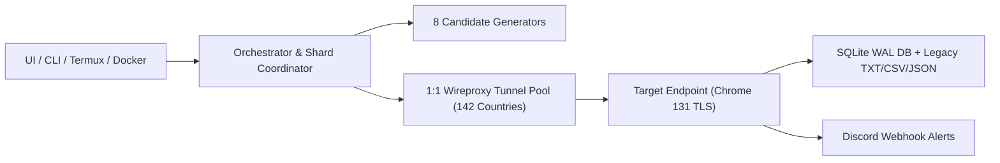

<div align="center">

<p align="center">
  <strong>🇺🇸 English</strong> · <a href="./docs/locales/ko.md">🇰🇷 한국어</a> · <a href="./docs/locales/ja.md">🇯🇵 日本語</a> · <a href="./docs/locales/zh-CN.md">🇨🇳 中文</a> · <a href="./docs/locales/es.md">🇪🇸 Español</a> · <a href="./docs/locales/de.md">🇩🇪 Deutsch</a><br />
  <a href="./docs/locales/fr.md">🇫🇷 Français</a> · <a href="./docs/locales/pt-BR.md">🇧🇷 Português</a> · <a href="./docs/locales/ru.md">🇷🇺 Русский</a> · <a href="./docs/locales/hi.md">🇮🇳 हिन्दी</a> · <a href="./docs/locales/ar.md">🇸🇦 العربية</a> · <a href="./docs/locales/id.md">🇮🇩 Bahasa Indonesia</a>
</p>

# ⚡ D4UC (`discord-checker`)

> **High-Performance Discord Rare Username Availability Engine — Chrome 131 TLS Impersonation, 1:1 Isolated Multi-Tunnel Pool & SQLite WAL Sharding.**

[](https://github.com/KRCUPRO/discord-checker/releases/tag/v12.0.0)
[](LICENSE)
[](https://www.python.org/)
[](docs/GUIDE.md)
[](docs/specs/01_NETWORK_CORE_ENGINE.md)

<sub>Copyright (c) 2026 KRCUPRO · Licensed under Proprietary & Confidential (All Rights Reserved)</sub>

</div>

---

<details open>
<summary><b>🌟 Overview & Key Capabilities</b></summary>

Traditional username checkers fail against modern edge defenses due to three recurring bottlenecks:
1. **TLS Fingerprint Blocking**: Standard HTTP libraries trigger Cloudflare/WAF challenges immediately via synthetic JA3/JA4 signatures.
2. **Host-Wide VPN Disruptions**: Running a desktop VPN client hijacks your entire machine's network interface and DNS.
3. **429 Cascade Stalls & Multi-Process Collisions**: Hitting rate limits stalls all concurrent workers, while launching multiple instances corrupts shared result files.

**D4UC (`discord-checker`)** solves all three cleanly inside an isolated, cross-platform architecture:
- **Chrome 131 TLS JA3/JA4 Stealth**: Powered by `curl_cffi` (BoringSSL) with synchronized HTTP headers matching real Chrome 131 browser handshakes.
- **1:1 User-Space WireGuard Tunnels (`wireproxy`)**: Maps 142 global endpoints onto isolated local ports (`127.0.0.1:1081+`) per worker — zero OS network adapter changes, zero traffic impact on your main system.
- **0.3s Atomic 429 Hot-Swap**: Only the rate-limited worker rotates cleanly to a fresh country node while sibling workers keep running uninterrupted.
- **Mathematical Sharding & SQLite WAL Sync**: Split exhaustive scans across 2, 3, or 4 disjoint slices (`2_1`, `2_2`, `4_1`–`4_4`) writing concurrently to `data/d4uc_results.db` with zero duplicate checks.

</details>

---

<details open>
<summary><b>🥊 Comparison Matrix: Legacy Scripts vs D4UC v12</b></summary>

| Capability | Legacy Username Scripts | ⚡ D4UC v12 (`discord-checker`) |
| :--- | :---: | :---: |
| **TLS Handshake Stealth** | ❌ `requests` / `aiohttp` fingerprint flagged | **✅ BoringSSL Chrome 131 JA3/JA4 Impersonation** |
| **Host Network Isolation** | ❌ Full-system VPN required | **✅ User-Space `wireproxy` HTTP/SOCKS5 Pool (1:1 per worker)** |
| **429 Rate-Limit Recovery** | ❌ Global pause or worker crash | **✅ 0.3s Per-Worker Atomic Hot-Swap + Cooldown Queue** |
| **Multi-Instance Sharding** | ❌ Duplicate checks & file race conditions | **✅ Disjoint Math Shards + SQLite WAL Concurrent Sync** |
| **Platforms & UI** | ⚠️ CLI script only | **✅ Desktop GUI (KO/EN), Rich CLI, Android Termux & Multi-Arch Docker** |
| **Secret & Clean-Repo Hygiene** | ⚠️ Risk of hardcoded keys | **✅ Strict `.gitignore`, `.env` injection & Dummy Templates** |

</details>

---

<details open>
<summary><b>🧬 8 Candidate Generation Modes & Sharding</b></summary>

| Mode Key | Strategy | Best Use Case |
| :--- | :--- | :--- |
| `hybrid` | Dictionary stems + symmetry/numeric mutations | Fast general discovery of clean usernames |
| `permutation` | Exhaustive ordered space (`a–z`, `0–9`, `_`) | Complete coverage using 2/3/4-way sharding (`2_1`, `2_2`) |
| `dictionary` | 3–6 letter words, syllables, pronounceable pairs | High-value readable handles |
| `pattern` | Symmetry/repeating structures (`aaaa`, `abba`, `abab`) | Visually distinctive rare patterns |
| `numeric` | Sequential & repeating digits (`0000`–`9999`) | Short numeric targets |
| `custom_mask` | Prefix, suffix, middle-dot rules (`??.vip`, `kr??`) | Targeted initials, brands, and dot placement |
| `combinatorial` | Structured phonetic CVCV / VCCV syllables | Unique pronounceable brandable handles |
| `recheck` | Re-evaluates previously `TAKEN` records | Detecting newly freed handles |

</details>

---

<details open>
<summary><b>🏛️ System Architecture & Repository Layout</b></summary>



```text
discord-checker/
├── config/                  # .env.example & config.example.yaml templates
├── data/                    # 142-cluster public endpoint DB & credentials template
├── deploy/                  # Dockerfile, docker-compose.yml, Termux & PyInstaller scripts
├── docs/                    # Master guides, 11 locale translations, architecture & specs
├── src/                     # GUI (KO/EN), Headless CLI & modular core engine
├── tests/                   # Automated regression & concurrency test suite (68 checks)
├── CHANGELOG.md             # Version history
├── LICENSE                  # Proprietary & Confidential License (KRCUPRO)
├── NOTICE                   # Third-party open-source component notices
├── README.md                # Project entry documentation
├── requirements.txt         # Python dependencies
└── SECURITY.md              # Secret handling & safety guidelines
```

</details>

---

<details open>
<summary><b>🚀 Quick Start Across 4 Platforms</b></summary>

#### 1. Desktop GUI (Windows / Desktop)
```bash
git clone https://github.com/KRCUPRO/discord-checker.git
cd discord-checker
python -m venv .venv
.\.venv\Scripts\activate
pip install -r requirements.txt

# Launch Korean or English GUI
python src/gui_ko.py
python src/gui_en.py
```

#### 2. Headless CLI & Mathematical Sharding
```bash
# Default Hybrid scan with 5 isolated workers
python src/run.py

# Exhaustive 4-char permutation split (Shard 1 of 2: a–m)
python src/run.py --mode permutation --length 4 --shard 2_1 --workers 5

# Streaming stdout logs for background daemons
python src/run.py --no-dashboard
```

#### 3. Docker & Multi-Container Sharding
```bash
# Copy templates and set your private key
cp config/.env.example .env

# Launch single background container
docker compose -f deploy/docker-compose.yml up -d

# Launch 2-shard parallel containers (2x throughput)
docker compose -f deploy/docker-compose.yml --profile 2shard up -d
```
> Full manual: [Docker Guide](docs/guides/DOCKER_GUIDE.md)

#### 4. Android Termux (`proot-distro debian`)
```bash
chmod +x deploy/install_debian.sh deploy/run.sh
./deploy/install_debian.sh

termux-wake-lock
nohup ./deploy/run.sh --no-dashboard > output.log 2>&1 &
```
> Full manual: [Termux Debian Guide](docs/guides/TERMUX_DEBIAN_GUIDE.md)

</details>

---

<details>
<summary><b>⚙️ Configuration & Environment Variables</b></summary>

Copy [config/.env.example](config/.env.example) to `.env` (or [config/config.example.yaml](config/config.example.yaml) to `config/config.yaml`):

```ini
SURFSHARK_PRIVATE_KEYS=YOUR_SURFSHARK_WIREGUARD_PRIVATE_KEY_HERE
D4UC_MODE=hybrid
D4UC_LENGTH=4
D4UC_WORKERS=5
D4UC_PROXY=surfshark
D4UC_WEBHOOK=
```

See [Security Policy](SECURITY.md) and [Master Guide](docs/GUIDE.md) for credential safety rules.

</details>

---

<details open>
<summary><b>📄 License & Attribution</b></summary>

Copyright (c) 2026 **KRCUPRO**. All Rights Reserved.  
Licensed under the [PROPRIETARY & CONFIDENTIAL SOFTWARE LICENSE](LICENSE).  
Third-party open-source dependencies and notices are documented in [NOTICE](NOTICE).

</details>
