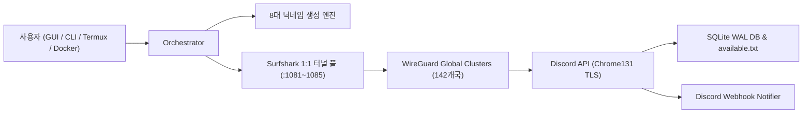

# 🚀 D4UC — Discord Username Checker

<div align="center">


**초고속 비동기 TLS 스텔스 위장 + Surfshark 1:1 다중 국가 터널 풀 + SQLite WAL 멀티 인스턴스 무충돌 동기화 디스코드 닉네임 전수조사 엔진**

[English Guide](#-english-overview) | [한국어 가이드](#-한국어-개요) | [GUIDE.md](GUIDE.md) | [Architecture Map](docs/ARCHITECTURE_MAP.md)

</div>

---

## 🌟 핵심 특징 (Key Highlights)

1. **Chrome 131 TLS JA3/JA4 스텔스 위장**:
   - `curl_cffi` 기반으로 실제 구글 크롬 브라우저와 100% 동일한 암호화 스위트 및 핸드셰이크를 전송하여 Cloudflare/WAF 오탐을 회피합니다.
2. **Surfshark 1:1 독립 국가 터널 풀 (`wireproxy`)**:
   - OS 네트워크 카드를 건드리지 않고 유저스페이스(User-space)에서 전세계 142개국 엔드포인트를 로컬 루프백(`127.0.0.1:1081~1085`)으로 1:1 매핑하여 각 워커에 독립 해외 IP를 배정합니다.
3. **429 레이트리밋 원자적 핫스왑 (Atomic Hot-Swap)**:
   - 특정 워커가 디스코드로부터 429를 맞으면, 해당 워커의 터널만 0.3초 만에 새 국가로 교체하고 타 워커는 중단 없이 100% 풀스피드를 유지합니다.
4. **다중 창 / 다중 컨테이너 분할 샤딩 (2배~4배 가속)**:
   - `a~m`, `n~_` 등 알파벳 범위를 수학적으로 분할하여 다중 창이나 도커 컨테이너를 띄워 2배, 3배, 4배 속도로 전수검사를 가속합니다.
5. **SQLite WAL 멀티 프로세스 동기화**:
   - 프로그램을 여러 개 띄워도 `d4uc_results.db`를 안전하게 공유하여 중복 검사 0% 및 실시간 발견 닉네임 크로스 팝업을 보증합니다.
6. **4대 크로스 플랫폼 지원**:
   - Windows Desktop GUI (한글/영문 CustomTkinter)
   - Headless CLI (`run.py` - TUI 대시보드 & 스트리밍 로그)
   - Android Mobile Termux (`proot-distro debian` 24시간 백그라운드)
   - Docker & Docker Compose (Multi-Arch ARM64 & AMD64)

---

## 🚀 빠른 시작 (Quick Start)

### 1. 데스크톱 GUI (Windows)
```bash
# 가상환경 생성 및 의존성 설치
python -m venv .venv
.\.venv\Scripts\activate
pip install -r requirements.txt

# 한국어 GUI 실행
python gui_ko.py

# 영어 GUI 실행
python gui_en.py
```

### 2. 헤드리스 CLI (CLI & Server)
```bash
# 기본 실행 (하이브리드 모드, 4자리, 5워커)
python run.py

# 순열 2분할 1번 창 (a~m 범위) 실행
python run.py --mode permutation --length 4 --shard 2_1 --workers 5

# 대시보드 없는 스트리밍 로그 모드 (백그라운드/서버 권장)
python run.py --no-dashboard
```

### 3. 안드로이드 모바일 Termux (24시간 무중단)
```bash
# Termux 내 Debian 진입 후 원클릭 설치
chmod +x install_debian.sh run.sh
./install_debian.sh

# 24시간 백그라운드 실행 (화면 꺼짐 방지)
termux-wake-lock
nohup ./run.sh --no-dashboard > output.log 2>&1 &
```
> 상세 매뉴얼: [docs/TERMUX_DEBIAN_GUIDE.md](docs/TERMUX_DEBIAN_GUIDE.md)

### 4. 도커 컨테이너 (Docker & Compose)
```bash
# 단일 컨테이너 백그라운드 기동
docker compose up -d

# 2배속 병렬 분할 (a~m / n~_) 컨테이너 2개 동시 기동
docker compose --profile 2shard up -d

# 실시간 로그 스트리밍
docker compose logs -f
```
> 상세 매뉴얼: [docs/DOCKER_GUIDE.md](docs/DOCKER_GUIDE.md)

---

## ⚙️ 설정 및 환경 변수 (.env)

`config.example.yaml` 및 `.env.example`을 복사하여 나만의 설정을 적용할 수 있습니다:

```bash
cp .env.example .env
```

```ini
# Surfshark WireGuard 개인키 (쉼표로 여러 개 지정 가능)
SURFSHARK_PRIVATE_KEYS=YOUR_SURFSHARK_WIREGUARD_PRIVATE_KEY_HERE

# 실행 옵션
D4UC_MODE=hybrid
D4UC_LENGTH=4
D4UC_WORKERS=5
D4UC_PROXY=surfshark

# 디스코드 웹훅 알림 (선택 사항)
D4UC_WEBHOOK=https://discord.com/api/webhooks/...
```

---

## 🧩 아키텍처 개요 (Architecture Overview)



자세한 내부 구조 및 시퀀스 다이어그램은 [docs/ARCHITECTURE_MAP.md](docs/ARCHITECTURE_MAP.md)에서 확인하실 수 있습니다.

---

## 🛡️ 보안 및 기여 (Security & License)

- 본 저장소는 민감한 인증 정보나 결과 파일이 원천 차단된 템플릿 형태로 제공됩니다.
- 자세한 보안 가이드는 [SECURITY.md](SECURITY.md)를 참고해 주시기 바랍니다.
- 라이선스: MIT License
