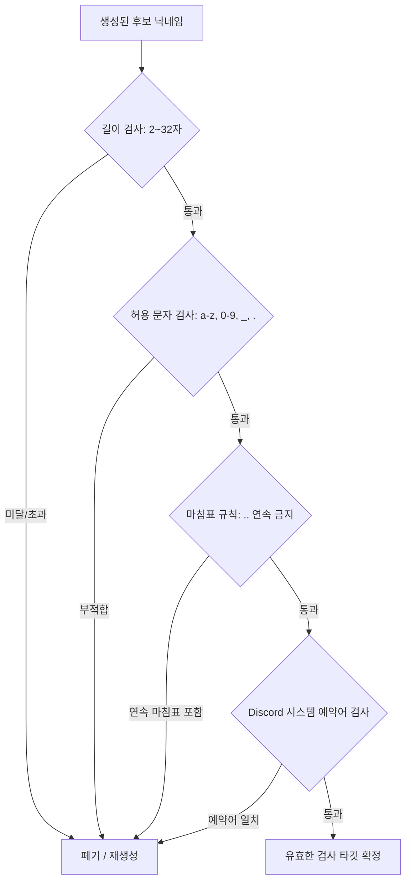
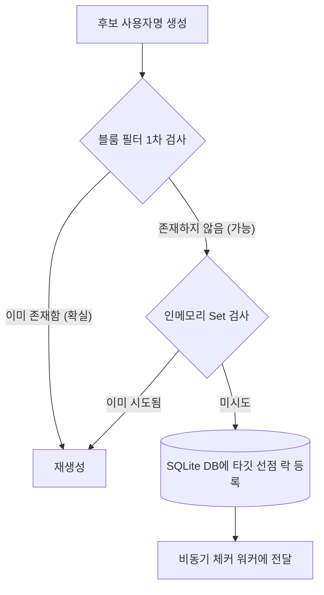

# 03. 닉네임 탐색 알고리즘 & 타깃 생성기 명세서
## (Nickname Target Generation Algorithms & Pattern Engine Specification)

> **문서 버전**: 1.0.0  
> **프로젝트**: Discord Username Checker V2  
> **지원 모드**: 사전(단어장)/음절, 정규식/패턴 매칭, 순차 순열, 가변 글자수 (3~32자)

---

## 1. 개요 및 배경 (Problem Statement)

기존 레거시 `main.py`의 생성 방식은 단순한 4글자 무작위 추출에 국한되어 있었습니다:
```python
# [레거시 단순 무작위 생성]
ALLOWED_CHARS = string.ascii_lowercase + string.digits + "_."

def generate_username(length=4):
    while True:
        username = ''.join(random.choice(ALLOWED_CHARS) for _ in range(length))
        if ".." in username:
            continue
        with tried_lock:
            if username in tried_usernames:
                continue
            tried_usernames.add(username)
        return username
```

이 방식의 한계점:
1. **타깃 가치 저하**: 무의미한 난수 조합(`q7_z`, `8.k2` 등)이 대다수 생성되어, 실제 가치가 높은 의미 있는 4글자 닉네임(사전 단어, 대칭형 패턴, 발음 가능 단어) 발굴 확률이 극히 낮음.
2. **글자수 고정**: 3자리(레거시 및 특수 대상), 5자리 등 다른 자릿수 탐색 불가.
3. **메모리 선형 증가 및 중복 탐색 비효율**: `set`에 문자열을 계속 누적하고 텍스트 파일 전체를 매번 순차 파싱하여 대량 검사 시 메모리/CPU 낭비 발생.

---

## 2. Discord 공식 사용자명 규칙 및 정규화 규격

Discord 고유 사용자명(Unique Username) 시스템의 공식 제약 조건은 다음과 같습니다:



- **길이 규칙**: 최소 2자 ~ 최대 32자 (기본 설정: 4자리, 사용자 지정 가능: 3자~6자 등).
- **허용 문자**: 영문 소문자(`a-z`), 숫자(`0-9`), 밑줄(`_`), 마침표(`.`).
- **마침표 규칙**: 연속된 두 개의 마침표(`..`)는 시스템적으로 금지됨.
- **예약어(Reserved Words)**: `discord`, `everyone`, `here`, `clyde`, `system`, `nitro` 등은 시스템 내부 예약어로 API 호출 전 사전 필터링하여 불필요한 400 Bad Request 요청을 방지.

---

## 3. 4대 타깃 생성 엔진 상세 설계

### 3.1 모드 1: 사전(Dictionary) & 음절(Phonetic) 생성기
가장 가치가 높은 4글자 유의미 닉네임을 집중 발굴합니다:

1. **내장 영단어 코퍼스 (Curated 4-Letter Wordlist)**:
   - 4글자 표준 영단어 (약 4,000+ 개): `star`, `moon`, `wolf`, `fire`, `echo`, `neon`, `gold`, `king`, `epic` 등
2. **발음 가능 음절 결합기 (Phonetic Syllable Synthesizer)**:
   - **CVCV 구조 (자음+모음+자음+모음)**: `luna`, `kaze`, `miku`, `zeno`, `sora`, `tako` (인간이 쉽게 발음하고 기억할 수 있는 레어 닉네임)
   - **VCCV 구조 (모음+자음+자음+모음)**: `alfa`, `echo`, `into`, `alto`

```python
CONSONANTS = "bcdfghjklmnprstvwz"
VOWELS = "aeiou"

def generate_phonetic_cvcv() -> str:
    return f"{random.choice(CONSONANTS)}{random.choice(VOWELS)}{random.choice(CONSONANTS)}{random.choice(VOWELS)}"
```

### 3.2 모드 2: 정규식 & 특수 패턴 생성기 (Pattern Engine)
심미적·수집 가치가 높은 대칭 및 연속 문자열을 생성합니다:

| 패턴 유형 | 예시 | 정규식 / 생성 알고리즘 |
| :--- | :--- | :--- |
| **AAAA (단일 문자 4연속)** | `aaaa`, `7777`, `zzzz` | `r"^([a-z0-9])\1{3}$"` |
| **ABAB (교차 2문자 반복)** | `xoxo`, `1212`, `kaka` | `r"^([a-z0-9]{2})\1$"` |
| **AABB (연속 2쌍 문자)** | `aabb`, `1122`, `zz99` | `r"^([a-z0-9])\1([a-z0-9])\2$"` |
| **ABBA (회문/팰린드롬)** | `abba`, `noon`, `1221` | `r"^([a-z0-9])([a-z0-9])\2\1$"` |
| **언더스코어 래핑** | `_abc_`, `a__z`, `_777_` | 앞뒤 밑줄 또는 언더스코어 대칭 |
| **커스텀 정규식** | 사용자 직접 입력 (예: `^[a-z][0-9]{2}[a-z]$`) | 역정규식 생성기(rstr) 또는 패턴 템플릿 |

### 3.3 모드 3: 순차 순열 전수 조사 (Permutation Exhaustive Scanner)
- 문자셋 크기: 영문(26) + 숫자(10) + 특수(2) = 38문자
- 4글자 전체 공간: $38^4 = 2,085,136$ 개
- **장점**: 무작위 추출 시 발생하는 중복 시도(Birthday Paradox)가 0%이며, 100% 누락 없이 전수 조사가 가능.
- **체크포인트 지속성(State Persistence)**: 현재 탐색 인덱스를 SQLite 또는 상태 파일에 실시간 기록하여, 프로그램 재시작 시 중단된 지점부터 즉시 재개.

### 3.4 모드 4: 가변 길이 지정 (Variable Length: 3~32자)
- CLI 파라미터 또는 설정 파일에서 `target_length: int`로 3자리(특수 대상), 4자리, 5자리 등 자유롭게 전환 가능.

---

## 4. 고속 중복 검증 & 상태 관리 엔진 (Dedup & Persistence)



1. **Bloom Filter (메모리 절약)**:
   - 200만 개 이상의 문자열을 단 수 메가바이트의 메모리로 초고속 사전 필터링.
2. **SQLite3 인덱스**:
   - `CREATE TABLE IF NOT EXISTS checked_users (username TEXT PRIMARY KEY, status TEXT, checked_at TIMESTAMP, response_ms REAL)`
   - 동시성 쓰기 경합 없는 WAL(Write-Ahead Logging) 모드 적용.
