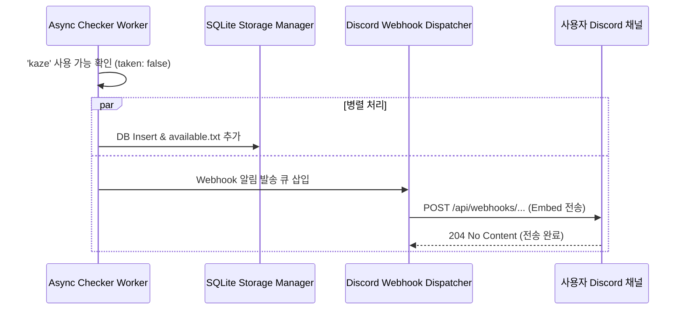
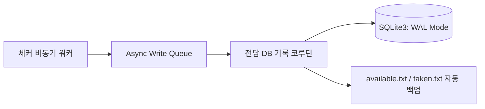

# 04. 모니터링, Discord Webhook & 저장소 무결성 명세서
## (Real-time Rich Dashboard, Discord Webhook Alert & SQLite Storage Specification)

> **문서 버전**: 1.0.0  
> **프로젝트**: Discord Username Checker V2  
> **기능 구성**: Rich 실시간 대시보드, Discord Webhook 즉시 알림, SQLite WAL + TXT 호환 저장소

---

## 1. 개요 및 배경 (Problem Statement)

기존 레거시 `main.py`는 다음과 같은 원시적인 모니터링 및 저장 방식을 취하고 있었습니다:
1. **콘솔 로그 오버플로우**: 각 스레드가 무분별하게 `print()`를 호출하여 터미널이 스크롤되어 지나가며, 시스템 전체 상태(RPS, 프록시 가용성)를 한눈에 파악하기 어렵습니다.
2. **원격 실시간 통보 부재**: 가치 있는 4글자 사용 가능 닉네임이 발견되어도 즉각 알림을 받지 못해, 타인에 의해 선점당할 위험이 큽니다.
3. **파일 쓰기 락 경합 및 데이터 손상 위험**: 동시 다발적인 `with open(..., "a")` 호출로 인해 파일 잠금 충돌 또는 비정상 종료 시 데이터 유실 위험이 존재합니다.

---

## 2. Rich 터미널 실시간 대시보드 (Rich Live TUI)

`rich.live.Live`와 `rich.layout.Layout`을 사용하여 터미널 화면이 깜빡이지 않는 깔끔한 단일 화면 대시보드를 제공합니다:

```text
┌───────────────────────── Discord Username Checker V2 ─────────────────────────┐
│ 모드: 사전(Dictionary) + 패턴(Pattern)    | 글자수: 4자리     | 엔진: curl_cffi │
├───────────────────────────────────────────────────────────────────────────────┤
│ [통계 지표]                                                                    │
│  총 검사수: 12,840 건      | 검사 속도: 84.2 RPS   | 가용 닉네임: 14 건        │
│  사용중(Taken): 12,710 건  | RateLimit: 112 회     | 네트워크 오류: 4 회       │
├───────────────────────────────────────────────────────────────────────────────┤
│ [프록시 풀 현황]                                                               │
│  활성(Alive): 48 / 50 개    | 쿨다운(429): 2 개     | 폐기(Dead): 0 개          │
│  [===================================================>] 96.0% 가용성         │
├───────────────────────────────────────────────────────────────────────────────┤
│ [최근 발견된 사용 가능 닉네임 (LIVE)]                                          │
│  • [09:21:05] 'kaze' (CVCV 음절 패턴) - 응답: 112ms                           │
│  • [09:20:44] 'xoxo' (ABAB 대칭 패턴) - 응답: 98ms                            │
│  • [09:19:12] 'miku' (사전/발음 단어) - 응답: 104ms                           │
└───────────────────────────────────────────────────────────────────────────────┘
```

---

## 3. Discord Webhook 즉각 알림 시스템

가치 있는 닉네임이 `AVAILABLE`로 판정되는 즉시 비동기로 지정된 Discord 채널에 리치 임베드(Rich Embed) 메시지를 발송합니다.



### 3.1 발송 임베드 스펙 (Embed Payload Structure)
- **제목**: `🎉 희귀 4자리 사용자명 발견!`
- **필드 구성**:
  - `사용자명`: **`kaze`**
  - `패턴 분류`: CVCV 발음 가능 음절 (Rare Tier)
  - `발견 시각`: `2026-11-16 09:21:05`
  - `응답 지연`: `112 ms`
  - `등록 바로가기`: `https://discord.com/register`
- **색상**: `0x00FF7F` (Spring Green)
- **핑 옵션**: `@here` 또는 사용자 커스텀 Role 멘션 지원

---

## 4. 데이터 저장소 및 무결성 아키텍처



### 4.1 SQLite 스키마 (`d4uc_results.db`)
```sql
PRAGMA journal_mode=WAL;
PRAGMA synchronous=NORMAL;

CREATE TABLE IF NOT EXISTS checked_usernames (
    username TEXT PRIMARY KEY,
    status TEXT NOT NULL,          -- 'available', 'taken', 'reserved', 'invalid'
    pattern_type TEXT,             -- 'dictionary', 'pattern', 'random', 'phonetic'
    length INTEGER NOT NULL,
    latency_ms REAL,
    proxy_used TEXT,
    checked_at TIMESTAMP DEFAULT CURRENT_TIMESTAMP
);

CREATE INDEX IF NOT EXISTS idx_status ON checked_usernames(status);
```

### 4.2 레거시 텍스트 파일 호환성
- 기존 유저들의 워크플로우를 보장하기 위해 `available.txt` 및 `taken.txt` 포맷을 그대로 유지하며, DB 전담 비동기 워커를 통해 락 충돌 없이 안전하게 순차 버퍼링 플러시(Flush)를 수행합니다.
