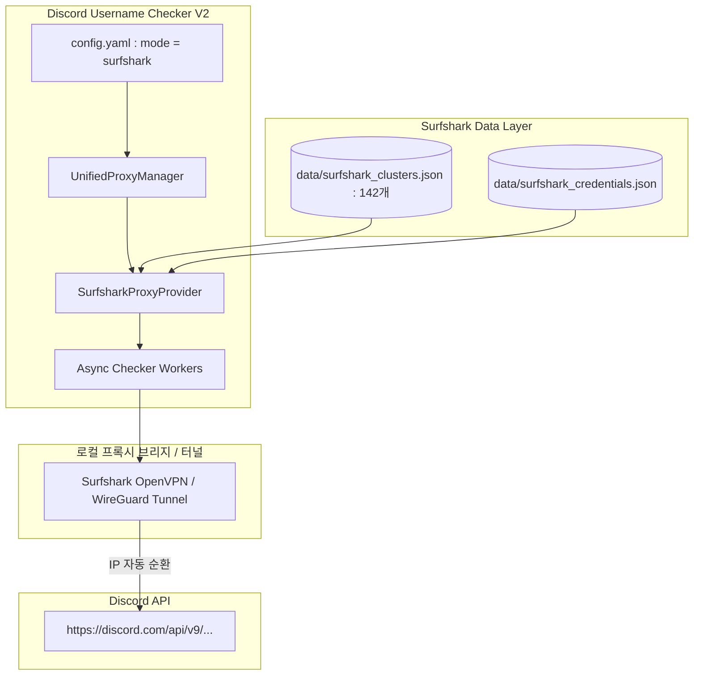

# 05. Surfshark VPN 글로벌 클러스터 연동 및 프록시 브리지 명세서
## (Surfshark VPN 142 Global Clusters Integration & Proxy Bridge Specification)

> **문서 버전**: 1.0.0  
> **프로젝트**: Discord Username Checker V2  
> **연동 소스**: Surfshark Dashboard (`https://my.surfshark.com/`)  
> **보유 클러스터**: 142개 글로벌 서버 (한국, 일본, 미국, 싱가포르, 유럽 등 100+ 개국)  
> **자격 증명 경로**: `data/surfshark_credentials.json` (OpenVPN 수동 자격 증명)  
> **클러스터 목록**: `data/surfshark_clusters.json`

---

## 1. 개요 및 배경 (Problem Statement)

Discord 고유 사용자명 확인 API는 동일한 공인 IP로부터 단시간 내 다수의 요청이 인입될 경우 강력한 Cloudflare WAF 차단 또는 HTTP 429(Too Many Requests) 레이트리밋을 부과합니다.

기존 상용 프록시(ThorData 등)는 비용이 지속적으로 발생하며 단일 벤더 포맷에 종속되는 문제가 있습니다. 사용자의 Surfshark VPN 구독(Starter 플랜, 2027년까지 유효)을 활용하여, **추가 비용 없이 전 세계 142개 고속 VPN 서버를 Discord 체커의 IP 순환 풀(Rotation Pool)로 활용**할 수 있도록 아키텍처를 확장했습니다.

---

## 2. Surfshark 계정 자격 증명 및 클러스터 데이터

Surfshark Dashboard(`https://my.surfshark.com/vpn/manual-setup/main/openvpn` 또는 WireGuard 탭)에서 발급받은 자격 증명을 `.env` 또는 `data/surfshark_credentials.json`(`data/surfshark_credentials.example.json` 참고)에 입력합니다:

### 2.1 자격 증명 설정 예시 (더미 템플릿)
- **계정**: `your_email@example.com` (Surfshark Starter/One 등)
- **OpenVPN 서비스 사용자명**: `${SURFSHARK_OPENVPN_USER}`
- **OpenVPN 서비스 비밀번호**: `${SURFSHARK_OPENVPN_PASS}`
- **WireGuard 개인키**: `${SURFSHARK_PRIVATE_KEYS}` (다중 키 쉼표 구분 지원)

### 2.2 주요 초고속 클러스터 (Low Load Priority)
| 국가 | 위치 | 서버 호스트명 | 기본 프로토콜/포트 |
| :--- | :--- | :--- | :--- |
| **대한민국** | 서울 | `kr-seo.prod.surfshark.com` | TCP 1443 / UDP 1194 / WireGuard 51820 |
| **일본** | 도쿄 | `jp-tok.prod.surfshark.com` | TCP 1443 / UDP 1194 / WireGuard 51820 |
| **싱가포르** | 싱가포르 | `sg-sng.prod.surfshark.com` | TCP 1443 / UDP 1194 / WireGuard 51820 |
| **대만** | 타이베이 | `tw-tai.prod.surfshark.com` | TCP 1443 / UDP 1194 / WireGuard 51820 |
| **미국** | 시애틀/LA/뉴욕 | `us-sea.prod.surfshark.com` | TCP 1443 / UDP 1194 / WireGuard 51820 |
| **독일** | 프랑크푸르트 | `de-fra.prod.surfshark.com` | TCP 1443 / UDP 1194 / WireGuard 51820 |

전체 142개 클러스터의 WireGuard Public Key, 실시간 부하율(Load), 국가 코드는 `data/surfshark_clusters.json`에 구조화되어 영구 보존됩니다.

---

## 3. 연동 아키텍처 (Integration Architecture)



---

## 4. `SurfsharkProxyProvider` 모듈 구현 (`src/proxy/surfshark.py`)

1. **자동 최적 서버 선별**: 부하율(`load`)이 낮은 서버를 우선 정렬하여 빠른 응답 속도 보장.
2. **국가 필터링 (`preferred_countries`)**: 한국(`KR`), 일본(`JP`), 미국(`US`) 등 선호 국가 목록을 지정하여 지연 시간 최소화.
3. **OpenVPN / WireGuard 설정 자동 생성기 내장**:
   - `export_openvpn_config(cluster, proto='tcp', port=1443)`
   - `export_wireguard_config(cluster, private_key)`

---

## 5. 사용 방법

### `config.yaml` 설정:
```yaml
proxy:
  mode: "surfshark"
  
  surfshark:
    enabled: true
    username: "${SURFSHARK_OPENVPN_USER}"
    password: "${SURFSHARK_OPENVPN_PASS}"
    preferred_countries: ["KR", "JP", "US", "SG"]
    local_bridge_port: 1080
```

프로그램 실행:
```bash
python run.py
```
