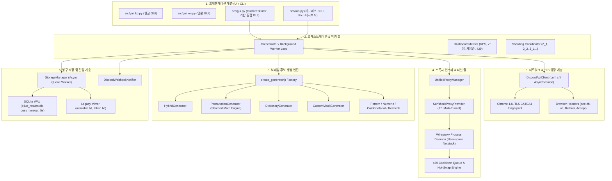
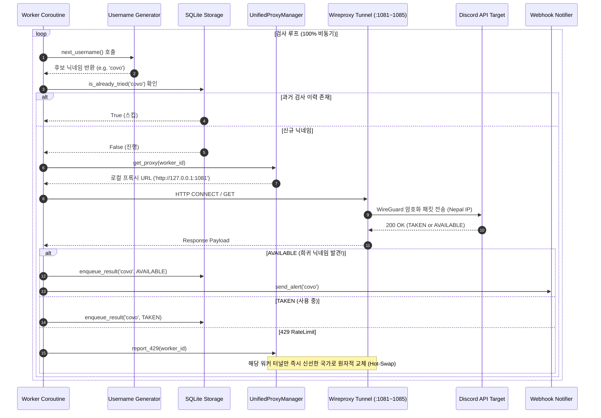

# 🗺️ D4UC 아키텍처 매핑 및 시스템 구조도 (ARCHITECTURE_MAP.md)

> **프로젝트 루트**: `./` (Repository Root)  
> **핵심 설계 원칙**: 무결점 비동기 병렬화, 0% 충돌 영구 동기화, TLS 스텔스 위장, 1:1 유저스페이스 터널 격리

| [KR 한국어](./ARCHITECTURE_MAP.md) | [US English](./locales/en/ARCHITECTURE_MAP.md) | [JP 日本語](./locales/ja/ARCHITECTURE_MAP.md) | [CN 简体中文](./locales/zh-CN/ARCHITECTURE_MAP.md) | [ES Español](./locales/es/ARCHITECTURE_MAP.md) |
| :---: | :---: | :---: | :---: | :---: |
| [FR Français](./locales/fr/ARCHITECTURE_MAP.md) | [DE Deutsch](./locales/de/ARCHITECTURE_MAP.md) | [RU Русский](./locales/ru/ARCHITECTURE_MAP.md) | [BR Português](./locales/pt-BR/ARCHITECTURE_MAP.md) | [SA العربية](./locales/ar/ARCHITECTURE_MAP.md) |

🌐 Also available: <a href="./locales/hi/ARCHITECTURE_MAP.md">HI हिन्दी</a> • <a href="./locales/id/ARCHITECTURE_MAP.md">ID Bahasa Indonesia</a>

---

## 🏛️ 1. 시스템 계층 아키텍처 (Layered Architecture)

---

## 📂 2. 모듈 및 파일 1:1 매핑 레퍼런스

| 계층 | 모듈 / 파일 경로 | 주요 클래스 / 함수 | 핵심 책임 및 역할 |
| :--- | :--- | :--- | :--- |
| **UI** | `src/gui.py` | `DiscordUsernameCheckerGUI` | CustomTkinter 모던 다크 UI, 60 FPS 비동기 렌더링, 30ms 로그 디바운스, 툴팁, 온보딩 배너, 분할 샤딩 선택기 |
| **UI** | `src/ui/dashboard.py` | `RichDashboard`, `DashboardMetrics` | 헤드리스 CLI용 터미널 Rich TUI 레이아웃 (워커 상태, RPS, 프록시 풀 상태) |
| **UI** | `src/ui/tooltip.py` | `CTooltip` | 입력창, 옵션, 버튼 호버 시 친절한 한국어/영어 가이드 풍선 팝업 |
| **UI** | `src/ui/i18n.py` | `I18nManager` | 한국어/영어 완전 분리 번역 사전 및 언어 동적 전환 지원 |
| **Orchestration** | `src/run.py` | `Orchestrator`, `parse_args()` | 크로스 플랫폼 CLI 파서, 환경 변수 자동 오버라이드, 도커/서버용 스트리밍 로그 |
| **Network** | `src/network/client.py` | `DiscordApiClient` | `curl_cffi` 기반 비동기 HTTP 요청, WAF 감지, 429 감지, CheckResult 생성 |
| **Network** | `src/network/headers.py` | `get_discord_headers()` | Chrome 131 버전 매칭 브라우저 헤더 및 최신 `sec-ch-ua` 생성 |
| **Proxy** | `src/proxy/manager.py` | `UnifiedProxyManager` | 단일 인터페이스 프록시 게이트웨이, 서프샤크/파일/ThorData 통합 라우팅 |
| **Proxy** | `src/proxy/surfshark.py` | `SurfsharkProxyProvider` | 1:1 워커 전용 Wireproxy 터널 풀, 429 발생 시 해당 워커 터널만 0.3초 핫스왑 |
| **Generator** | `src/generator/permutation_gen.py`| `PermutationGenerator` | 전수조사 순열 생성기, 2분할/3분할/4분할 샤딩 및 총 조합수 계산 |
| **Generator** | `src/generator/dictionary_gen.py` | `DictionaryGenerator` | 3~6글자 영단어/음절 기반 레어 닉네임 생성기 |
| **Generator** | `src/generator/mask_gen.py` | `CustomMaskGenerator` | 접두사/접미사/중간점 규칙 기반 커스텀 닉네임 생성기 |
| **Storage** | `src/storage/db.py` | `StorageManager` | SQLite WAL 모드 전용 큐 워커, 중복 검사 0초 캐시, 텍스트 미러 동시 출력 |
| **Notification** | `src/notify/webhook.py` | `DiscordWebhookNotifier` | AVAILABLE 닉네임 발견 즉시 디스코드 채널로 실시간 알림 임베드 발송 |
| **Utils** | `src/utils/paths.py` | `find_wireproxy_bin()`, `resolve_resource()` | PyInstaller 번들, Windows, Linux, Termux 아키텍처별 바이너리 자동 감지 |

---

## ⚡ 3. 핵심 런타임 데이터 흐름 (Data Flow Sequence)

---

## 🛡️ 4. 동시성 및 안전 보장 모델 (Safety Guarantees)

1. **무충돌 멀티 인스턴스 (Zero Conflict)**:
   - 다중 창이나 다중 도커 컨테이너가 동시에 `d4uc_results.db`에 쓰기를 시도해도, **SQLite WAL(Write-Ahead Logging)** 모드와 `PRAGMA busy_timeout = 5000` 설정 덕분에 `database locked` 에러가 0% 발생합니다.
2. **Zero-Zombie 프로세스 회수**:
   - `atexit` 및 POSIX/Windows 시그널 인터셉터를 통해, 프로그램이 강제 종료되거나 터미널이 닫혀도 가동 중이던 모든 백그라운드 `wireproxy` 프로세스를 100% 자동 회수합니다.
3. **완전한 시크릿 격리**:
   - 모든 유료 계정 정보와 개인키는 `.env` 또는 `data/surfshark_credentials.json`(gitignored)에서만 로드되며, 공개 소스코드에는 더미 플레이스홀더만 유지됩니다.
