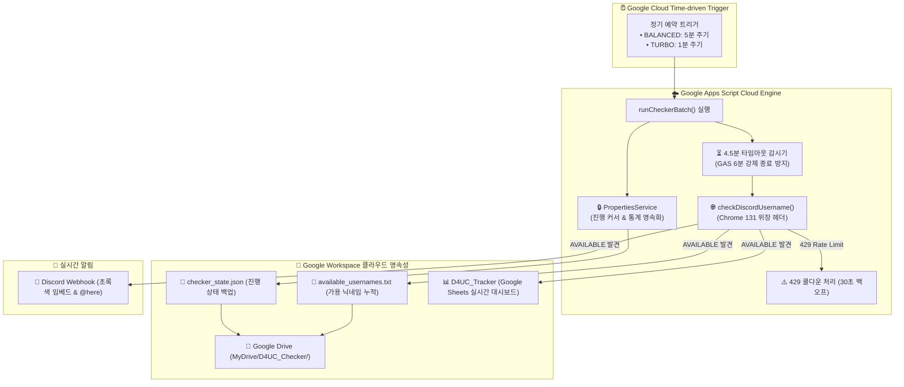

# ☁️ Google Apps Script (GAS) 24/7 Serverless Checker Master Guide

> **D4UC Cloud Serverless Engine (v16)**: 구글 클라우드 인프라에서 시간 기반 예약 기능(Time-driven Triggers)으로 24시간 365일 무인 구동되는 차세대 서버리스 닉네임 체커 시스템입니다.

---

## 1. 제1원리 아키텍처 (First-Principles Architecture)

Google Apps Script(GAS)는 Google Workspace 생태계(Drive, Sheets, UrlFetch)를 제어하고, 독립적인 클라우드 서버리스 함수 및 시간 기반 예약 크론(Time-driven Triggers)을 구동할 수 있는 완전 무료 V8 자바스크립트 런타임 환경입니다.

---

## 2. 6분 타임아웃 극복: Self-Chaining State Machine

### 1) 기술적 문제 (Challenge)
- Google Apps Script는 무료 계정 기준 **단일 실행 시 최대 6분(360초)**을 초과하면 `Exceeded maximum execution time` 에러와 함께 강제 종료됩니다.

### 2) 완벽한 해결책 (Self-Chaining & Checkpoint Persistence)
1. **4.5분 안전 마진 감시**:
   - 실행 시작 시각(`Date.now()`)을 기록하고, 매 닉네임 검사 시 `if (Date.now() - startTime > 270000)`를 평가합니다.
2. **상태 영속화 (State Persistence)**:
   - 4.5분이 도달하면 현재 검사 커서(`cursor_index`), 총 검사수, 가용수, 사용중수, 429수를 `PropertiesService`와 Google Drive의 `checker_state.json`에 영구 저장하고 안전하게 함수를 종료합니다.
3. **연속 체이닝 (Scheduled Chaining)**:
   - 5분 주기 트리거가 다음 실행을 자동으로 호출하여 이전 중단 지점(`cursor_index`)부터 1개의 닉네임도 누락 없이 이어서 검사합니다.

---

## 3. 듀얼 구동 모드 상세 가이드

### 모드 A: 완전 독립 서버리스 (STANDALONE 24/7)
- **설정**: `CONFIG.EXECUTION_MODE = 'STANDALONE'`
- **특징**: PC, 스마트폰, Colab을 모두 꺼두어도 구글 클라우드에서 24시간 365일 독자적으로 영구 순환합니다.
- **추천 대상**: 장기적인 상시 무인 닉네임 수집을 원하는 경우.

### 모드 B: 하이브리드 워치독 페일오버 (HYBRID_WATCHDOG)
- **설정**: `CONFIG.EXECUTION_MODE = 'HYBRID_WATCHDOG'`
- **작동 원리**:
  1. Google Colab 또는 로컬 체커가 동작하는 동안에는 구글 드라이브의 `colab_heartbeat.json` 파일이 주기적으로 갱신됩니다.
  2. GAS는 매 배치마다 해당 파일의 타임스탬프를 확인합니다.
  3. Colab이 활성 상태(10분 이내)이면 GAS는 유휴 대기(Idle)합니다.
  4. Colab 세션이 끊기면(10분 무응답), GAS가 자동으로 비상 인계받아 검사를 재개합니다.

---

## 4. Google Sheets 실시간 대시보드 (`D4UC_Tracker`)

`CONFIG.ENABLE_SPREADSHEET = true` 설정 시 `MyDrive/D4UC_Checker/` 내에 Google Sheets가 자동 생성됩니다:

| 발견 일시 (UTC) | 닉네임 (Username) | 글자수 | 응답속도 | Discord 등록 링크 |
| :--- | :--- | :--- | :--- | :--- |
| 2026-11-23T02:45:10Z | `x9a7` | 4자 | 112ms | [선점하기](https://discord.com/register) |
| 2026-11-23T02:48:22Z | `k0w8` | 4자 | 98ms | [선점하기](https://discord.com/register) |

- 스마트폰의 **Google Sheets 앱**을 설치해두면, 가용 닉네임이 추가될 때마다 이동 중에도 실시간으로 확인하고 즉시 선점할 수 있습니다.

---

## 5. 관리 및 모니터링 명령어

- **초기화 및 가동**: Google Apps Script 웹 에디터에서 함수 `initD4UCChecker` 선택 ➔ **[실행]**
- **체커 안전 정지**: 함수 `stopD4UCChecker` 선택 ➔ **[실행]**
- **실시간 실행 로그 확인**: Google Apps Script 좌측 메뉴의 **[실행(Executions)]** 탭에서 실행 이력과 로그를 실시간 모니터링할 수 있습니다.
