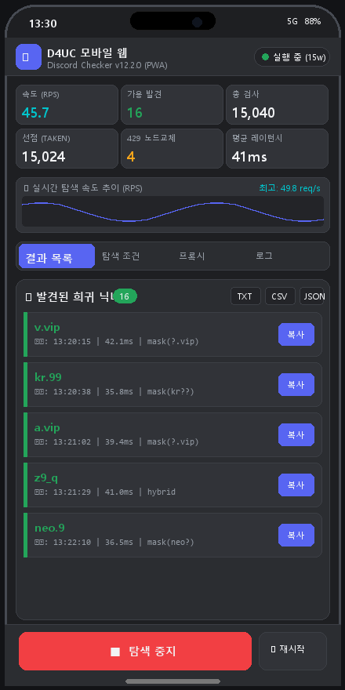

# 🍎 Apple macOS Deployment & Optimization Guide (MACOS_GUIDE.md)

> **프로젝트**: D4UC (`discord-checker`) v12.3.0 / v12.4.0  
> **대상 플랫폼**: Apple macOS Monterey (12+), Ventura (13+), Sonoma (14+), Sequoia (15+)  
> **아키텍처**: Apple Silicon (M1 / M2 / M3 / M4 / Pro / Max / Ultra) & Intel x86_64  
> **최종 개정일**: 2026년 11월 19일  

---

<a id="목차"></a><a id="-목차"></a>
## 📑 목차
1. [macOS 아키텍처 지원 및 시스템 사양](#-macos-아키텍처-지원-및-시스템-사양)
2. [Homebrew 및 필수 런타임 의존성 설치](#-homebrew-및-필수-런타임-의존성-설치)
3. [Python 3.12 가상환경 구축 & BoringSSL curl_cffi 빌드](#-python-312-가상환경-구축--boringssl-curl_cffi-빌드)
4. [모바일 반응형 Web GUI & PWA 서버 구동 (포트 5000)](#-모바일-반응형-web-gui--pwa-서버-구동-포트-5000)
5. [iTerm2 / Terminal 환경 CLI 대시보드 및 tmux 운용](#-iterm2--terminal-환경-cli-대시보드-및-tmux-운용)
6. [macOS 게이트키퍼(Gatekeeper) 및 보안 권한 해제](#-macos-게이트키퍼gatekeeper-및-보안-권한-해제)
7. [launchd 데몬을 통한 24/7 백그라운드 무인 구동](#-launchd-데몬을-통한-247-백그라운드-무인-구동)
8. [macOS 전용 문제 해결 (Troubleshooting)](#-macos-전용-문제-해결-troubleshooting)
9. [각주 및 기술 참고문헌](#-각주-및-기술-참고문헌)

---

<a id="macos-아키텍처-지원-및-시스템-사양"></a><a id="-macos-아키텍처-지원-및-시스템-사양"></a>
## 🍏 macOS 아키텍처 지원 및 시스템 사양

D4UC는 Apple Silicon ARM64(`arm64`) 및 레거시 Intel 64-bit(`x86_64`) 아키텍처를 네이티브 수준으로 완전 지원합니다.

| 구분 | Apple Silicon (M1~M4) | Intel Mac (x86_64) |
| :--- | :--- | :--- |
| **권장 OS 버전** | macOS 14 Sonoma / macOS 15 Sequoia | macOS 12 Monterey 이상 |
| **아키텍처 바이너리** | ARM64 Native Execution | x86_64 Native Execution |
| **TLS 위장 엔진** | `curl_cffi` BoringSSL Native ARM64 | `curl_cffi` BoringSSL x86_64 |
| **와이어프록시** | `brew install wireproxy` (ARM64 네이티브) | `brew install wireproxy` (x86_64 네이티브) |
| **메모리 점유** | 유휴 상태 약 80MB / 50워커 가동 시 약 280MB | 유휴 상태 약 95MB / 50워커 가동 시 약 310MB |

[⬆️ 목차 맨 위로 이동](#-목차)

---

<a id="homebrew-및-필수-런타임-의존성-설치"></a><a id="-homebrew-및-필수-런타임-의존성-설치"></a>
## 🍺 Homebrew 및 필수 런타임 의존성 설치

macOS 환경에서는 공식 패키지 관리자인 Homebrew를 통해 필요한 의존성을 설치합니다.

```bash
# 1. Homebrew 설치 (미설치 시)
/bin/bash -c "$(curl -fsSL https://raw.githubusercontent.com/Homebrew/install/HEAD/install.sh)"

# 2. Apple Silicon 환경 환경 변수 설정 (zsh)
echo 'eval "$(/opt/homebrew/bin/brew shellenv)"' >> ~/.zprofile
eval "$(/opt/homebrew/bin/brew shellenv)"

# 3. Python 3.12, wireproxy, tmux 설치
brew update
brew install python@3.12 wireproxy tmux git
```

[⬆️ 목차 맨 위로 이동](#-목차)

---

<a id="python-312-가상환경-구축--boringssl-curl_cffi-빌드"></a><a id="-python-312-가상환경-구축--boringssl-curl_cffi-빌드"></a>
## 🐍 Python 3.12 가상환경 구축 & BoringSSL curl_cffi 빌드

```bash
# 1. 저장소 클론 및 이동
git clone https://github.com/KRCUPRO/discord-checker.git
cd discord-checker

# 2. Python 3.12 전용 격리 가상환경 생성
python3.12 -m venv .venv
source .venv/bin/activate

# 3. 최신 pip 및 빌드 도구 갱신
pip install --upgrade pip setuptools wheel

# 4. 의존성 패키지 설치
pip install -r requirements.txt
```

> **참고**: Apple Silicon 환경에서 `curl_cffi` 설치 시 사전 컴파일된 ARM64 휠(Wheel)이 자동 적용되어 컴파일 시간 없이 3초 만에 설치됩니다.

[⬆️ 목차 맨 위로 이동](#-목차)

---

<a id="모바일-반응형-web-gui--pwa-서버-구동-포트-5000"></a><a id="-모바일-반응형-web-gui--pwa-서버-구동-포트-5000"></a>
## 🌐 모바일 반응형 Web GUI & PWA 서버 구동 (포트 5000)

Mac을 D4UC 호스트 서버로 구동하고 동일 네트워크 상의 iPhone, iPad, 또는 Mac Safari로 웹 대시보드를 제어합니다.

```bash
# 모바일 웹 GUI 서버 기동
python src/web_gui.py --port 5000
```

[](MACOS_GUIDE.md)

### Mac Safari에서 "Dock에 추가" (macOS Web App)
1. Safari를 열고 `http://localhost:5000`에 접속합니다.
2. Safari 상단 메뉴 바 ➔ **[파일]** ➔ **[Dock에 추가...]** 클릭.
3. 이제 Mac Dock에서 일반 macOS 네이티브 앱처럼 단독 창으로 실행됩니다.

[⬆️ 목차 맨 위로 이동](#-목차)

---

<a id="iterm2--terminal-환경-cli-대시보드-및-tmux-운용"></a><a id="-iterm2--terminal-환경-cli-대시보드-및-tmux-운용"></a>
## 💻 iTerm2 / Terminal 환경 CLI 대시보드 및 tmux 운용

터미널 세션이 닫혀도 검사가 중단되지 않도록 `tmux` 멀티플렉서를 사용하는 것을 권장합니다:

```bash
# 1. 새로운 tmux 세션 생성
tmux new -s d4uc

# 2. 가상환경 활성화 및 CLI 대시보드 기동
source .venv/bin/activate
python src/run.py --mode hybrid --length 4 --workers 10

# 3. 세션 백그라운드 전환 (Detach)
# 키보드 입력: Ctrl + B 누른 후 D 누름

# 4. 언제든 다시 세션 복귀 (Attach)
tmux attach -t d4uc
```

[⬆️ 목차 맨 위로 이동](#-목차)

---

<a id="macos-게이트키퍼gatekeeper-및-보안-권한-해제"></a><a id="-macos-게이트키퍼gatekeeper-및-보안-권한-해제"></a>
## 🔒 macOS 게이트키퍼(Gatekeeper) 및 보안 권한 해제

외부에서 다운로드한 바이너리나 스크립트에 대해 macOS가 차단할 경우:

```bash
# wireproxy 바이너리 격리 속성(com.apple.quarantine) 일괄 해제
xattr -cr bin/wireproxy*
xattr -cr $(which wireproxy)
```

[⬆️ 목차 맨 위로 이동](#-목차)

---

<a id="launchd-데몬을-통한-247-백그라운드-무인-구동"></a><a id="-launchd-데몬을-통한-247-백그라운드-무인-구동"></a>
## ⚙️ launchd 데몬을 통한 24/7 백그라운드 무인 구동

Mac이 켜질 때마다 D4UC 백그라운드 엔진이 자동 시작되도록 launchd 서비스를 구성합니다:

`~/Library/LaunchAgents/com.krcupro.d4uc.plist` 파일 생성:
```xml
<?xml version="1.0" encoding="UTF-8"?>
<!DOCTYPE plist PUBLIC "-//Apple//DTD PLIST 1.0//EN" "http://www.apple.com/DTDs/PropertyList-1.0.dtd">
<plist version="1.0">
<dict>
    <key>Label</key>
    <string>com.krcupro.d4uc</string>
    <key>ProgramArguments</key>
    <array>
        <string>/Users/YOUR_USER/discord-checker/.venv/bin/python</string>
        <string>/Users/YOUR_USER/discord-checker/src/web_gui.py</string>
        <string>--port</string>
        <string>5000</string>
    </array>
    <key>RunAtLoad</key>
    <true/>
    <key>KeepAlive</key>
    <true/>
    <key>StandardOutPath</key>
    <string>/Users/YOUR_USER/discord-checker/data/d4uc.log</string>
    <key>StandardErrorPath</key>
    <string>/Users/YOUR_USER/discord-checker/data/d4uc_err.log</string>
</dict>
</plist>
```

```bash
# 데몬 로드 및 활성화
launchctl load ~/Library/LaunchAgents/com.krcupro.d4uc.plist
```

[⬆️ 목차 맨 위로 이동](#-목차)

---

<a id="macos-전용-문제-해결-troubleshooting"></a><a id="-macos-전용-문제-해결-troubleshooting"></a>
## 🔧 macOS 전용 문제 해결 (Troubleshooting)

| 현상 | 원인 | 조치 사항 |
| :--- | :--- | :--- |
| **`Permission denied: wireproxy`** | 실행 권한 미부여 | `chmod +x bin/wireproxy` 또는 `brew install wireproxy` 실행 |
| **`Address already in use: 5000`** | macOS AirPlay 수신 모드가 5000 포트를 점유 | **[시스템 설정]** ➔ **[일반]** ➔ **[AirDrop 및 Handoff]** ➔ **[AirPlay 수신 모드]** 끄기 또는 `--port 5001` 옵션 사용 |
| **Wi-Fi 절전 모드로 인한 중단** | 화면이 꺼지면서 Mac이 수면 상태로 전환 | 터미널에서 `caffeinate -disu python src/run.py`로 수면 방지 실행 |

[⬆️ 목차 맨 위로 이동](#-목차)

---

<a id="각주-및-기술-참고문헌"></a><a id="-각주-및-기술-참고문헌"></a>
## 📚 각주 및 기술 참고문헌

[^1]: macOS 환경에서의 유저스페이스 와이어프록시는 로컬 루프백(`127.0.0.1`) SOCKS5 인터페이스를 생성하여 루트(sudo) 권한 없이 동작합니다. [↩](#-목차)

[⬆️ 목차 맨 위로 이동](#-목차)
