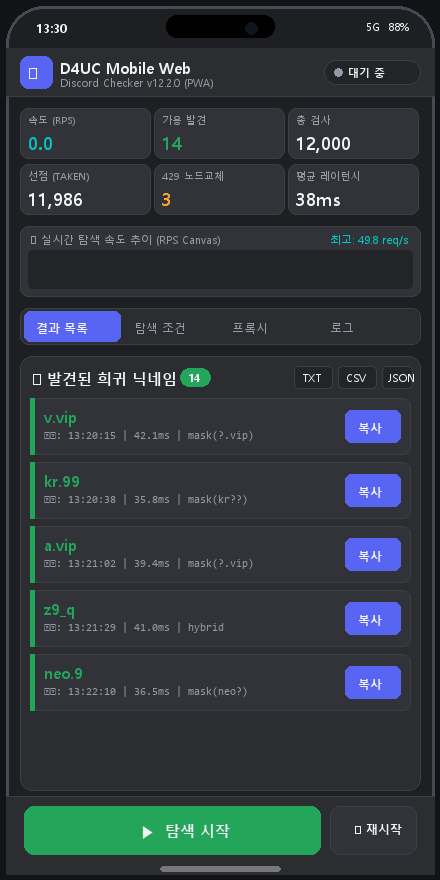

# 📱 iOS & Mobile Environment Deployment Guide (MOBILE_IOS_GUIDE.md)

> **프로젝트**: D4UC (`discord-checker`) v12.2.0  
> **대상 플랫폼**: Apple iOS (iPhone / iPad), iPadOS, Android, Mobile Web PWA  
> **최종 개정일**: 2026년 11월 19일  

---

## 📸 모바일 웹 GUI & PWA 인터페이스 미리보기

[](../assets/mobile_web_main.png)
[](../assets/mobile_web_demo.gif)

---

## 🌟 1. 최우선 권장: 모바일 터치 최적화 웹 GUI & PWA (`http://<host>:5000`)

v12.2.0부터 D4UC는 스마트폰 브라우저에 최적화된 **반응형 웹 애플리케이션 및 PWA(Progressive Web App)** 를 기본 탑재했습니다.

### ✨ 특징
1. **무설치 네이티브 모바일 앱 경험 (PWA)**:
   - App Store 심사나 복잡한 프로비저닝 없이 Safari의 **"홈 화면에 추가"** 기능으로 주소창 없는 전체화면 네이티브 앱으로 구동됩니다.
2. **모바일 1-Tap 터치 제어**:
   - 대형 시작/중지 터치 버튼, 실시간 RPS 속도 캔버스 차트, 1-Tap 클립보드 복사, TXT/CSV/JSON 즉시 다운로드.
   - 침대에 누워서도 스마트폰으로 탐색 조건(모드, 자릿수, 마스크, 샤딩)과 프록시(Surfshark 키, 워커 수 1~50개)를 즉시 원격 핫스왑할 수 있습니다.

### 🚀 사용 방법
1. PC, 서버, 또는 Termux에서 모바일 웹 서버를 실행합니다:
   ```bash
   python src/web_gui.py --port 5000
   # 또는 Windows 단독 실행 파일 실행:
   # DiscordUsernameCheckerV2_Web.exe
   ```
2. iPhone Safari 또는 Android Chrome 브라우저에서 접속합니다:
   ```text
   http://<PC의_로컬_IP>:5000
   ```
3. **홈 화면에 추가 (PWA 설치)**:
   - **iPhone Safari**: 하단 공유 버튼(네모+화살표) ➔ **"홈 화면에 추가"** 탭
   - **Android Chrome**: 우측 상단 더보기(⋮) ➔ **"홈 화면에 추가"** 또는 **"앱 설치"** 탭
4. 홈 화면에 생성된 보라색 **D4UC Web** 아이콘을 터치하여 실행합니다.

---

## 🧭 2. 기타 모바일 환경 가이드

### 구성 B: Discord Webhook 모바일 즉시 푸시
- `.env`에 `D4UC_WEBHOOK`을 등록해두면 희귀 닉네임이 발견되는 즉시 **아이폰의 Discord 모바일 앱으로 0.1초 만에 푸시 알림**이 전송됩니다.

### 구성 C: iOS SSH 터미널 클라이언트 연동 (Termius, Blink)
- PC 또는 클라우드 VPS에서 `tmux` 세션으로 `python src/run.py`를 실행하고 스마트폰 SSH 앱으로 모니터링합니다.

### 구성 D: 안드로이드 기기 단독 백그라운드 구동 (Termux)
- 안드로이드 환경에서는 [TERMUX_DEBIAN_GUIDE.md](./TERMUX_DEBIAN_GUIDE.md)를 참조하여 기기 자체에서 무제한 백그라운드 스캔이 가능합니다.

---

## 📋 요약 비교표

| 환경 | 설치 난이도 | 모바일 조작성 | 실시간 제어 | 권장도 |
| :--- | :--- | :--- | :--- | :--- |
| **D4UC 모바일 PWA Web GUI** | 초급 (원클릭) | ⭐⭐⭐⭐⭐ (최고) | 실시간 양방향 제어 & 1-Tap 복사 | **최우선 권장 (신규)** |
| **Discord Webhook 알림** | 초급 (1분) | ⭐⭐⭐ (수신 전용) | 실시간 푸시 수신 | **기본 알림용 권장** |
| **iOS SSH + tmux CLI** | 중급 (5분) | ⭐⭐⭐ (터미널) | 터미널 제어 | **고급 사용자 권장** |
