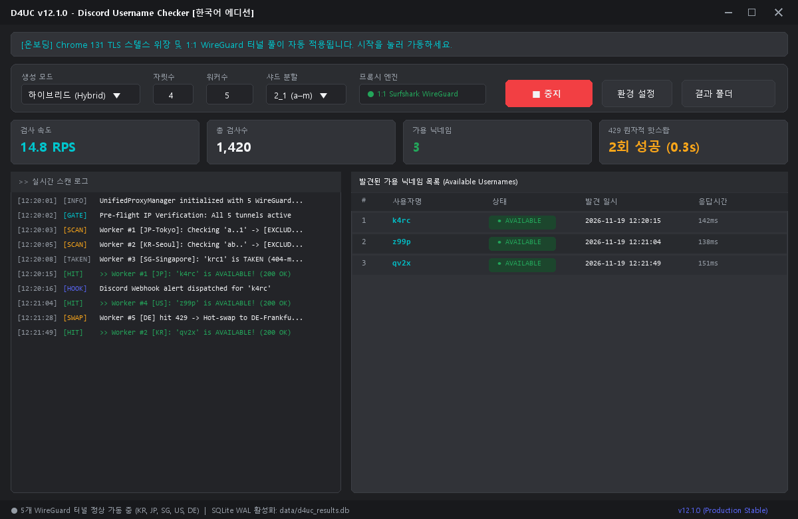
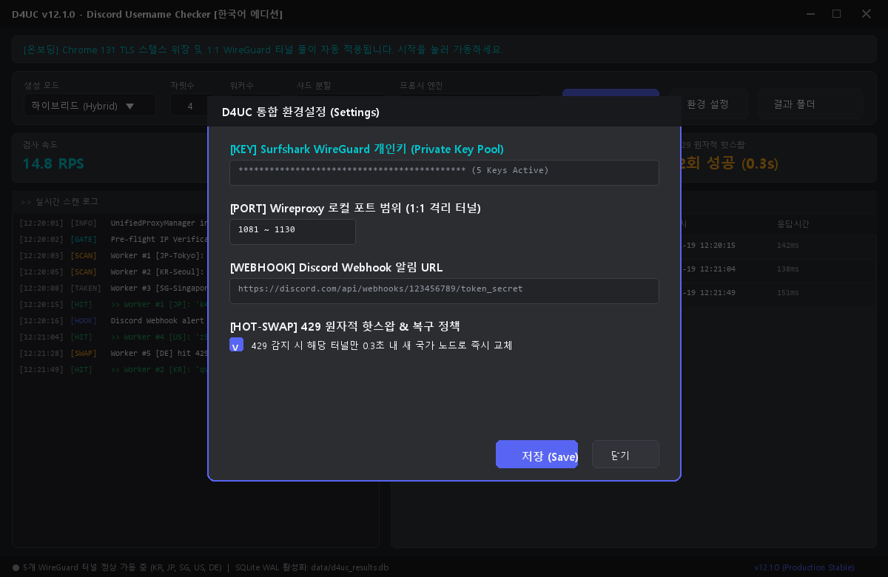

# 💻 PC Platform Deployment Guide (PC_GUIDE.md)

> **프로젝트**: D4UC (`discord-checker`)  
> **대상 플랫폼**: Windows 10/11 (64-bit) & Apple macOS (Apple Silicon M1-M4 / Intel x86_64)  
> **최종 개정일**: 2026년 11월 19일  

---

## 🪟 Part 1. Windows 10 / 11 환경 가이드

### 1. 인터페이스 미리보기
[](PC_GUIDE.md)

[](PC_GUIDE.md)

### 2. 무설치 단독 실행 파일 (`.exe`) 사용
GitHub Releases에서 제공하는 Standalone 바이너리는 Python 3.12 런타임, `customtkinter`, `curl_cffi` BoringSSL 엔진, `wireproxy.exe`를 단일 실행 파일에 완전히 내장하고 있습니다.
- `DiscordUsernameCheckerV2_KO.exe`: 한국어 GUI
- `DiscordUsernameCheckerV2_EN.exe`: 영어 GUI
- `DiscordUsernameCheckerV2_CLI.exe`: 헤드리스 콘솔 CLI 대시보드

### 3. 소스코드 가상환경 실행 (개발자 및 커스텀 빌드용)
```powershell
# 1. 저장소 클론 및 이동
git clone https://github.com/KRCUPRO/discord-checker.git
cd discord-checker

# 2. Python 3.12 가상환경 생성
python -m venv .venv
.\.venv\Scripts\Activate.ps1

# 3. 의존성 패키지 설치
pip install -r requirements.txt

# 4. 방화벽 허용 규칙 등록 (팝업 차단)
# PowerShell을 관리자 권한으로 실행 후 입력:
New-NetFirewallRule -DisplayName "D4UC Wireproxy Local Tunnel" -Direction Inbound -Program "$((Get-Location).Path)\bin\wireproxy.exe" -Action Allow
New-NetFirewallRule -DisplayName "D4UC Python Core" -Direction Inbound -Program "$((Get-Location).Path)\.venv\Scripts\python.exe" -Action Allow

# 5. 실행
python src/gui_ko.py
```

---

## 🍎 Part 2. Apple macOS 환경 가이드

macOS 환경에서는 Homebrew 패키지 매니저를 통해 필요한 유저스페이스 도구와 Python 3.12를 구성하여 실행합니다.

### 1. 사전 요구사항 설치
```bash
# Homebrew 미설치 시 설치
/bin/bash -c "$(curl -fsSL https://raw.githubusercontent.com/Homebrew/install/HEAD/install.sh)"

# Python 3.12 및 wireproxy 설치
brew install python@3.12 wireproxy
```

### 2. 가상환경 구성 및 실행
```bash
git clone https://github.com/KRCUPRO/discord-checker.git
cd discord-checker

python3.12 -m venv .venv
source .venv/bin/activate
pip install -r requirements.txt

# CLI 대시보드 실행
python3 src/run.py --mode hybrid --length 4 --workers 5
```
