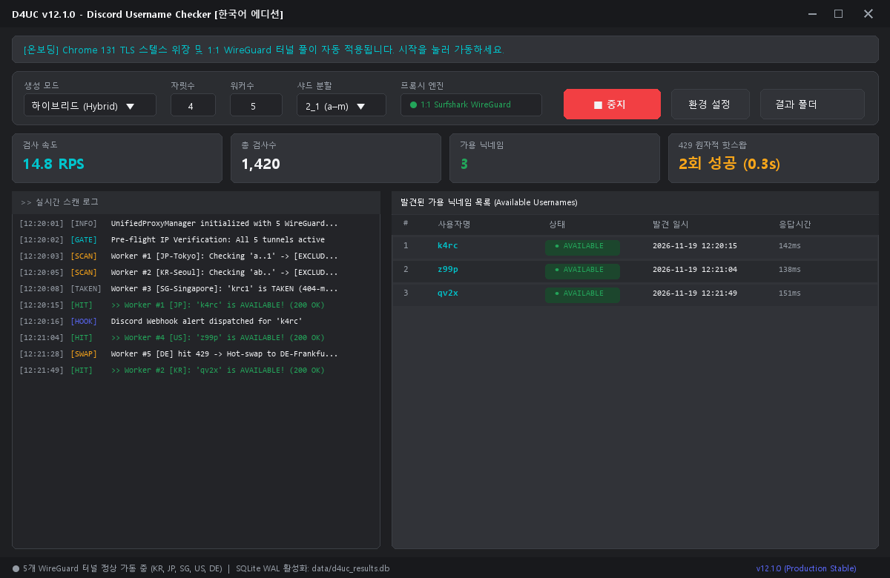

# 🪟 Windows 10 & 11 Platform Guide (WINDOWS_GUIDE.md)

> **프로젝트**: D4UC (`discord-checker`) v12.3.0 / v12.4.0  
> **대상 플랫폼**: Microsoft Windows 10 & Windows 11 (64-bit Architecture)  
> **최종 개정일**: 2026년 11월 19일  

---

<a id="목차"></a><a id="-목차"></a>
## 📑 목차
1. [시스템 요구사항 & 호환성](#-시스템-요구사항--호환성)
2. [4대 무설치 단독 실행 파일 (.exe) 안내](#-4대-무설치-단독-실행-파일-exe-안내)
3. [Windows Defender 및 방화벽 포트 예외 설정](#-windows-defender-및-방화벽-포트-예외-설정)
4. [Python 3.12 소스코드 실행 (개발자 및 가상환경)](#-python-312-소스코드-실행-개발자-및-가상환경)
5. [Windows 시작 프로그램 및 작업 스케줄러 24/7 자동 등록](#-windows-시작-프로그램-및-작업-스케줄러-247-자동-등록)
6. [프록시 및 네트워크 구성 (Surfshark / 무료 공개 프록시)](#-프록시-및-네트워크-구성-surfshark--무료-공개-프록시)
7. [Windows 환경 문제 해결 (Troubleshooting)](#-windows-환경-문제-해결-troubleshooting)
8. [각주 및 기술 참고문헌](#-각주-및-기술-참고문헌)

---

<a id="시스템-요구사항--호환성"></a><a id="-시스템-요구사항--호환성"></a>
## 🖥️ 시스템 요구사항 & 호환성

| 구성 요소 | 최소 요구 사양 | 권장 사양 |
| :--- | :--- | :--- |
| **운영체제** | Windows 10 Version 1909 이상 (64-bit) | Windows 11 Version 22H2 이상 (64-bit) |
| **프로세서 (CPU)** | Intel Core i3 / AMD Ryzen 3 (2코어 이상) | Intel Core i5 / AMD Ryzen 5 이상 (4코어 이상) |
| **메모리 (RAM)** | 최소 512 MB | 2 GB 이상 권장 (50워커 최대 가동 시 약 300MB 점유) |
| **디스크 여유 공간** | 200 MB 이상 | 1 GB 이상 (SQLite WAL 데이터베이스 보관용) |
| **네트워크** | 인터넷 브로드밴드 (UDP 51820 포트 열림 환경) | 저지연 유선 LAN 또는 Wi-Fi 6 |
| **런타임 의존성** | 무설치 단독 바이너리는 외부 런타임 불필요 | 소스 실행 시: Python 3.12.x + Visual C++ Redistributable |

[⬆️ 목차 맨 위로 이동](#-목차)

---

<a id="4대-무설치-단독-실행-파일-exe-안내"></a><a id="-4대-무설치-단독-실행-파일-exe-안내"></a>
## 🚀 4대 무설치 단독 실행 파일 (.exe) 안내

GitHub Releases에서 배포되는 바이너리는 Python 런타임, C++ 의존성, <a id="fnref-1"></a><a id="fnref1"></a>`curl_cffi` BoringSSL 엔진[^1], <a id="fnref-2"></a><a id="fnref2"></a>`wireproxy.exe`가 단일 파일에 번들링[^2]되어 있어 추가 설치 없이 즉시 실행 가능합니다.

[](WINDOWS_GUIDE.md)

### 1. 배포 바이너리 목록
- **`DiscordUsernameCheckerV2_Web.exe`**:
  - 모바일 반응형 웹 GUI & PWA 백엔드 서버 (기본 포트: `5000`).
  - 실행 즉시 로컬 웹 서버가 기동되며, 스마트폰(아이폰 Safari, 갤럭시 Chrome)이나 PC 브라우저로 `http://localhost:5000`에 접속하여 원격 제어할 수 있습니다.
- **`DiscordUsernameCheckerV2_KO.exe`**:
  - 한국어 완벽 지원 다크 테마 데스크톱 GUI 애플리케이션.
  - 마우스 클릭만으로 8대 생성 모드 선택, 워커 수 조절, 실시간 닉네임 탐색 피드를 확인할 수 있습니다.
- **`DiscordUsernameCheckerV2_EN.exe`**:
  - 영어 글로벌 에디션 데스크톱 GUI 애플리케이션.
- **`DiscordUsernameCheckerV2_CLI.exe`**:
  - Windows Terminal / PowerShell / 명령 프롬프트(CMD) 환경에서 실행되는 초경량 헤드리스 콘솔 대시보드.
  - 리소스 점유율이 가장 낮아 저사양 PC나 24시간 백그라운드 구동에 최적입니다.

### 2. 실행 방법 (원클릭)
1. [GitHub Releases](https://github.com/KRCUPRO/discord-checker/releases)에서 원하는 `.exe` 파일을 다운로드합니다.
2. 다운로드한 폴더에서 실행 파일을 더블클릭합니다.
3. 처음 실행 시 Windows SmartScreen 경고가 나타날 경우:
   - **[추가 정보]** 클릭 ➔ **[실행]** 버튼 클릭.

[⬆️ 목차 맨 위로 이동](#-목차)

---

<a id="windows-defender-및-방화벽-포트-예외-설정"></a><a id="-windows-defender-및-방화벽-포트-예외-설정"></a>
## 🛡️ Windows Defender 및 방화벽 포트 예외 설정

D4UC는 워커별로 독립된 유저스페이스 루프백 포트(`127.0.0.1:1081~1085`)와 웹 GUI 서버 포트(`5000`)를 개방합니다. Windows 방화벽 차단 팝업을 사전에 방지하고 스마트폰 접속을 원활하게 하려면 다음 방화벽 규칙을 등록하세요.

### PowerShell 관리자 원클릭 등록
PowerShell을 **관리자 권한**으로 실행하고 다음 명령을 붙여넣습니다:

```powershell
# 1. D4UC 웹 GUI 원격 접속 허용 (TCP 포트 5000)
New-NetFirewallRule -DisplayName "D4UC Web GUI Server (Port 5000)" `
    -Direction Inbound -LocalPort 5000 -Protocol TCP -Action Allow

# 2. 유저스페이스 WireGuard 터널 포트 허용 (TCP 1081~1130)
New-NetFirewallRule -DisplayName "D4UC Wireproxy Local Loopback" `
    -Direction Inbound -LocalPort 1081-1130 -Protocol TCP -Action Allow

# 3. Surfshark WireGuard 아웃바운드 UDP 터널 포트 허용 (UDP 51820)
New-NetFirewallRule -DisplayName "D4UC WireGuard UDP Outbound" `
    -Direction Outbound -RemotePort 51820 -Protocol UDP -Action Allow

Write-Host "✅ D4UC Windows 방화벽 허용 규칙 등록 완료!" -ForegroundColor Green
```

[⬆️ 목차 맨 위로 이동](#-목차)

---

<a id="python-312-소스코드-실행-개발자-및-가상환경"></a><a id="-python-312-소스코드-실행-개발자-및-가상환경"></a>
## 🐍 Python 3.12 소스코드 실행 (개발자 및 가상환경)

소스 코드를 직접 수정하거나 최신 깃허브 변경사항을 반영하려면 가상환경에서 실행합니다.

### 1. 저장소 클론 및 가상환경 생성
```powershell
# 저장소 복제 및 디렉터리 이동
git clone https://github.com/KRCUPRO/discord-checker.git
cd discord-checker

# Python 3.12 가상환경 생성
python -m venv .venv

# PowerShell 스크립트 실행 권한 부여 (필요 시)
Set-ExecutionPolicy -ExecutionPolicy RemoteSigned -Scope CurrentUser

# 가상환경 활성화
.\.venv\Scripts\Activate.ps1
```

### 2. 의존성 패키지 설치
```powershell
pip install --upgrade pip
pip install -r requirements.txt
```

### 3. 애플리케이션 실행
```powershell
# 한국어 데스크톱 GUI
python src/gui_ko.py

# 모바일 반응형 웹 GUI 서버 (스마트폰 접속 가능)
python src/web_gui.py --port 5000

# 헤드리스 CLI 대시보드 (하이브리드 모드, 4자리, 5워커)
python src/run.py --mode hybrid --length 4 --workers 5
```

[⬆️ 목차 맨 위로 이동](#-목차)

---

<a id="windows-시작-프로그램-및-작업-스케줄러-247-자동-등록"></a><a id="-windows-시작-프로그램-및-작업-스케줄러-247-자동-등록"></a>
## ⏰ Windows 시작 프로그램 및 작업 스케줄러 24/7 자동 등록

PC가 재부팅되더라도 D4UC가 자동으로 백그라운드에서 재실행되도록 설정할 수 있습니다.

### 방법 1: 시작 프로그램 폴더 바로가기 추가
1. `Win + R`을 누르고 `shell:startup` 입력 후 엔터.
2. `DiscordUsernameCheckerV2_Web.exe` (또는 원하는 실행 파일)의 바로가기를 해당 폴더에 복사.

### 방법 2: Windows 작업 스케줄러 등록 (로그온 시 무인 백그라운드 구동)
PowerShell 관리자 창에서 다음 스크립트를 실행합니다:

```powershell
$action = New-ScheduledTaskAction -Execute "$((Get-Location).Path)\dist\DiscordUsernameCheckerV2_CLI.exe" -Argument "--no-dashboard"
$trigger = New-ScheduledTaskTrigger -AtLogOn
$settings = New-ScheduledTaskSettingsSet -AllowStartIfOnBatteries -DontStopIfGoingOnBatteries -RestartCount 3 -RestartInterval (New-TimeSpan -Minutes 1)
Register-ScheduledTask -TaskName "D4UC_AutoRun" -Action $action -Trigger $trigger -Settings $settings -Description "D4UC Discord Checker 24/7 Background Runner"
```

[⬆️ 목차 맨 위로 이동](#-목차)

---

<a id="프록시-및-네트워크-구성-surfshark--무료-공개-프록시"></a><a id="-프록시-및-네트워크-구성-surfshark--무료-공개-프록시"></a>
## 🌐 프록시 및 네트워크 구성 (Surfshark / 무료 공개 프록시)

D4UC는 4단계 프록시 구성을 지원합니다:

1. **Surfshark WireGuard 1:1 다중 터널 (최고 품질 추천)**:
   - `config/.env.example`을 `.env`로 복사 후 `SURFSHARK_PRIVATE_KEYS=내_개인키1,내_개인키2` 설정.
   - 각 워커별로 독립된 국가 노드가 1:1로 매핑되어 429 차단 시 0.3초 만에 원자적 노드 교체.
2. **무료 공개 프록시 자동 수집 (`--proxy free`) [v12.3.0+]**:
   - 별도 결제 없이 14개 이상의 글로벌 공개 프록시 소스에서 수천 개의 HTTP/SOCKS4/SOCKS5 노드를 실시간 수집 및 비동기 검증.
   - CLI 실행: `python src/run.py --proxy free`
   - GUI 실행: 프록시 옵션에서 `🌐 무료 프록시 자동 수집` 선택 후 `[🔄 수집 & 검증]` 클릭.
3. **사용자 정의 프록시 파일 (`proxies.txt`)**:
   - `ip:port` 또는 `user:pass@ip:port` 형식의 프록시 목록을 텍스트 파일로 지정하여 순환.
4. **다이렉트 연결 (`direct`)**:
   - 프록시 없이 로컬 인터넷 직통 연결 (단기 테스트용).

[⬆️ 목차 맨 위로 이동](#-목차)

---

<a id="windows-환경-문제-해결-troubleshooting"></a><a id="-windows-환경-문제-해결-troubleshooting"></a>
## 🔧 Windows 환경 문제 해결 (Troubleshooting)

| 현상 | 근본 원인 | 해결 절차 |
| :--- | :--- | :--- |
| **`Port 1081 is already in use`** | 이전 실행된 `wireproxy.exe` 프로세스가 백그라운드에 남아있음 | 작업 관리자(`Ctrl+Shift+Esc`)에서 `wireproxy.exe`를 작업 끝내기하거나, PowerShell에서 `Stop-Process -Name wireproxy -Force -ErrorAction SilentlyContinue` 실행 |
| **스마트폰에서 `http://<PC IP>:5000` 접속 불가** | Windows 방화벽 인바운드 차단 또는 Wi-Fi 네트워크 프로필이 '공용'으로 설정됨 | 본 문서 3장의 방화벽 등록 스크립트를 실행하고, Windows 네트워크 설정에서 Wi-Fi 프로필을 **'개인 네트워크'**로 변경 |
| **`No module named 'curl_cffi'`** | 가상환경 미활성화 또는 Visual C++ 재배포 패키지 미설치 | `pip install curl_cffi` 재실행 및 Microsoft 공식 Visual C++ 2015-2022 재배포 패키지(x64) 설치 |
| **스마트스크린(SmartScreen) 파란색 경고창** | 자체 서명된 오픈소스 바이너리에 대한 보호 알림 | `[추가 정보]` 클릭 후 `[실행]` 버튼 클릭 |

[⬆️ 목차 맨 위로 이동](#-목차)

---

<a id="각주-및-기술-참고문헌"></a><a id="-각주-및-기술-참고문헌"></a>
## 📚 각주 및 기술 참고문헌

[^1]: D4UC의 Chrome 131 TLS 지문 위장은 BoringSSL 기반의 `curl_cffi` 엔진을 사용하여 JA3 및 JA4 지문을 완벽하게 위장합니다. [↩](#-목차) [↩ 본문으로 돌아가기](#fnref-1) · [⬆️ 목차 맨 위로 이동](#-목차)
[^2]: 유저스페이스 Wireproxy 터널링은 OS 네트워크 어댑터를 수정하지 않으므로 호스트 PC의 다른 네트워크 트래픽에 영향을 주지 않습니다. [↩](#-목차) [↩ 본문으로 돌아가기](#fnref-2) · [⬆️ 목차 맨 위로 이동](#-목차)
[⬆️ 목차 맨 위로 이동](#-목차)
