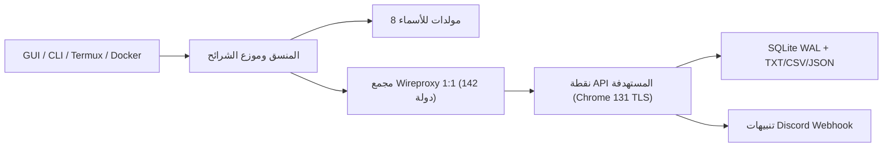

<div align="center">

<p align="center">
  <a href="../../README.md">🇺🇸 English</a> · <a href="./ko.md">🇰🇷 한국어</a> · <a href="./ja.md">🇯🇵 日本語</a> · <a href="./zh-CN.md">🇨🇳 中文</a> · <a href="./es.md">🇪🇸 Español</a> · <a href="./de.md">🇩🇪 Deutsch</a><br />
  <a href="./fr.md">🇫🇷 Français</a> · <a href="./pt-BR.md">🇧🇷 Português</a> · <a href="./ru.md">🇷🇺 Русский</a> · <a href="./hi.md">🇮🇳 हिन्दी</a> · <strong>🇸🇦 العربية</strong> · <a href="./id.md">🇮🇩 Bahasa Indonesia</a>
</p>

# ⚡ D4UC (`discord-checker`)

> **محرك عالي الأداء لفحص توافر أسماء مستخدمي Discord النادرة — انتحال TLS Chrome 131، مجمع أنفاق معزول 1:1 وتقسيم SQLite WAL.**

[](https://github.com/KRCUPRO/discord-checker/releases/tag/v12.0.0)
[](../../LICENSE)
[](https://www.python.org/)
[](../GUIDE.md)
[](../specs/01_NETWORK_CORE_ENGINE.md)

<sub>Copyright (c) 2026 KRCUPRO · رخصة برمجيات مملوكة وسرية (جميع الحقوق محفوظة)</sub>

</div>

---

<details open>
<summary><b>🌟 نظرة عامة والمزايا الأساسية</b></summary>

تفشل أدوات فحص أسماء المستخدمين التقليدية أمام أنظمة الحماية الحديثة بسبب ثلاث عقبات رئيسية:
1. **الحظر عبر بصمة TLS**: تُكتشف مكتبات HTTP العادية فورًا بواسطة Cloudflare/WAF عبر بصمات JA3/JA4.
2. **تداخل VPN على مستوى النظام**: تشغيل VPN تقليدي يفرض تغيير شبكة الجهاز والـ DNS بالكامل.
3. **توقفات 429 وتضارب الملفات**: حدود المعدل توقف جميع العمال، وتشغيل أكثر من نافذة يفسد النتائج.

يحل **D4UC (`discord-checker`)** هذه المشكلات الثلاث ضمن بنية معزولة ومتعددة المنصات:
- **تخفي TLS Chrome 131 JA3/JA4**: مبني على `curl_cffi` (BoringSSL) لإرسال مصافحات TLS ورؤوس مطابقة لمتصفح Chrome 131 الحقيقي.
- **أنفاق WireGuard في مساحة المستخدم 1:1 (`wireproxy`)**: يربط 142 نقطة نهاية عالمية بمنافذ محلية معزولة (`127.0.0.1:1081+`) لكل عامل دون المساس بإعدادات شبكة النظام.
- **تبديل ذري خلال 0.3 ثانية عند خطأ 429**: يتبدل العامل المقيّد فقط إلى دولة جديدة فورًا بينما تستمر بقية العمال بلا انقطاع.
- **التقسيم الرياضي ومزامنة SQLite WAL**: تقسيم الفحص الشامل إلى 2 أو 3 أو 4 أجزاء منفصلة (`2_1`, `2_2`, `4_1`–`4_4`) دون أي تكرار.

</details>

---

<details open>
<summary><b>🥊 مصفوفة المقارنة: الأدوات التقليدية مقابل D4UC v12</b></summary>

| الميزة | الأدوات التقليدية | ⚡ D4UC v12 (`discord-checker`) |
| :--- | :---: | :---: |
| **التخفي عبر TLS** | ❌ كشف فوري في `requests` / `aiohttp` | **✅ محاكاة BoringSSL Chrome 131 JA3/JA4** |
| **عزل شبكة المضيف** | ❌ يتطلب VPN شامل للنظام | **✅ مجمع `wireproxy` في مساحة المستخدم (1:1)** |
| **التعافي من 429** | ❌ توقف كامل أو تعطل | **✅ تبديل ذري 0.3 ثانية لكل عامل** |
| **التقسيم المتعدد (Sharding)** | ❌ فحص مكرر وتضارب ملفات | **✅ شرائح منفصلة + مزامنة SQLite WAL** |
| **المنصات والواجهة** | ⚠️ سطر أوامر بسيط فقط | **✅ واجهة رسومية، Rich CLI، Termux وDocker** |
| **أمان الأسرار** | ⚠️ خطر كشف المفاتيح | **✅ `.gitignore` صارم وحقن `.env` وقوالب آمنة** |

</details>

---

<details open>
<summary><b>🧬 8 أوضاع لتوليد الأسماء</b></summary>

| الوضع | الاستراتيجية | الاستخدام الأمثل |
| :--- | :--- | :--- |
| `hybrid` | جذور القاموس + تناسق وأرقام | اكتشاف سريع لأسماء نظيفة |
| `permutation` | التبديل الشامل (`a–z`, `0–9`, `_`) | تغطية كاملة مع التقسيم (`2_1`, `2_2`) |
| `dictionary` | كلمات ومقاطع من 3–6 أحرف | أسماء نادرة ذات معنى |
| `pattern` | أنماط متناظرة (`aaaa`, `abba`, `abab`) | تراكيب بصرية مميزة |
| `numeric` | أرقام متسلسلة ومكررة (`0000`–`9999`) | معرفات رقمية قصيرة |
| `custom_mask` | بادئة ولاحقة ونقطة (`??.vip`, `kr??`) | علامات وأحرف أولى محددة |
| `combinatorial` | مقاطع صوتية CVCV / VCCV | أسماء مبتكرة سهلة النطق |
| `recheck` | إعادة فحص السجلات `TAKEN` السابقة | اقتناص الأسماء التي تحررت حديثًا |

</details>

---

<details open>
<summary><b>🏛️ البنية المعمارية وهيكل المستودع</b></summary>



```text
discord-checker/
├── config/                  # قوالب .env.example و config.example.yaml
├── data/                    # قاعدة 142 خادمًا وقالب بيانات الاعتماد
├── deploy/                  # Dockerfile و docker-compose.yml و Termux و PyInstaller
├── docs/                    # الأدلة و 11 ترجمة والهيكلة والمواصفات
├── src/                     # واجهة رسومية (KO/EN) و CLI والمحرك الأساسي
├── tests/                   # اختبارات تلقائية (68 اختبارًا)
├── CHANGELOG.md             # سجل الإصدارات
├── LICENSE                  # ترخيص مملوك حصري (KRCUPRO)
├── NOTICE                   # إشعارات الطرف الثالث
├── README.md                # الوثائق الرئيسية بالإنجليزية
├── requirements.txt         # متطلبات بايثون
└── SECURITY.md              # سياسة الأمان
```

</details>

---

<details open>
<summary><b>🚀 البدء السريع على 4 منصات</b></summary>

#### 1. الواجهة الرسومية (Windows / Desktop)
```bash
git clone https://github.com/KRCUPRO/discord-checker.git
cd discord-checker
python -m venv .venv
.\.venv\Scripts\activate
pip install -r requirements.txt

python src/gui_ko.py
python src/gui_en.py
```

#### 2. سطر الأوامر والتقسيم الرياضي
```bash
python src/run.py
python src/run.py --mode permutation --length 4 --shard 2_1 --workers 5
python src/run.py --no-dashboard
```

#### 3. Docker والحاويات المتوازية
```bash
cp config/.env.example .env
docker compose -f deploy/docker-compose.yml up -d
docker compose -f deploy/docker-compose.yml --profile 2shard up -d
```

#### 4. Android Termux (`proot-distro debian`)
```bash
chmod +x deploy/install_debian.sh deploy/run.sh
./deploy/install_debian.sh
termux-wake-lock
nohup ./deploy/run.sh --no-dashboard > output.log 2>&1 &
```

</details>

---

<details>
<summary><b>⚙️ الإعدادات ومتغيرات البيئة</b></summary>

انسخ [config/.env.example](../../config/.env.example) إلى `.env`:

```ini
SURFSHARK_PRIVATE_KEYS=YOUR_SURFSHARK_WIREGUARD_PRIVATE_KEY_HERE
D4UC_MODE=hybrid
D4UC_LENGTH=4
D4UC_WORKERS=5
D4UC_PROXY=surfshark
D4UC_WEBHOOK=
```

راجع [SECURITY.md](../../SECURITY.md) لتفاصيل الحماية.

</details>

---

<details open>
<summary><b>📄 الترخيص وحقوق الملكية</b></summary>

Copyright (c) 2026 **KRCUPRO**. جميع الحقوق محفوظة.  
مرخص بموجب [PROPRIETARY & CONFIDENTIAL SOFTWARE LICENSE](../../LICENSE).  
تُحفظ إشعارات المكونات مفتوحة المصدر في [NOTICE](../../NOTICE).

</details>
