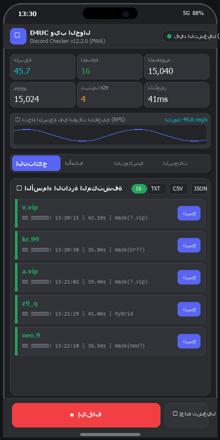
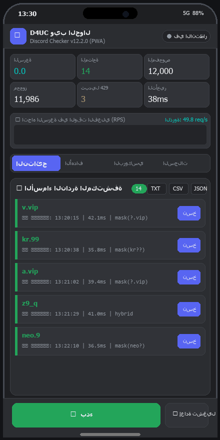
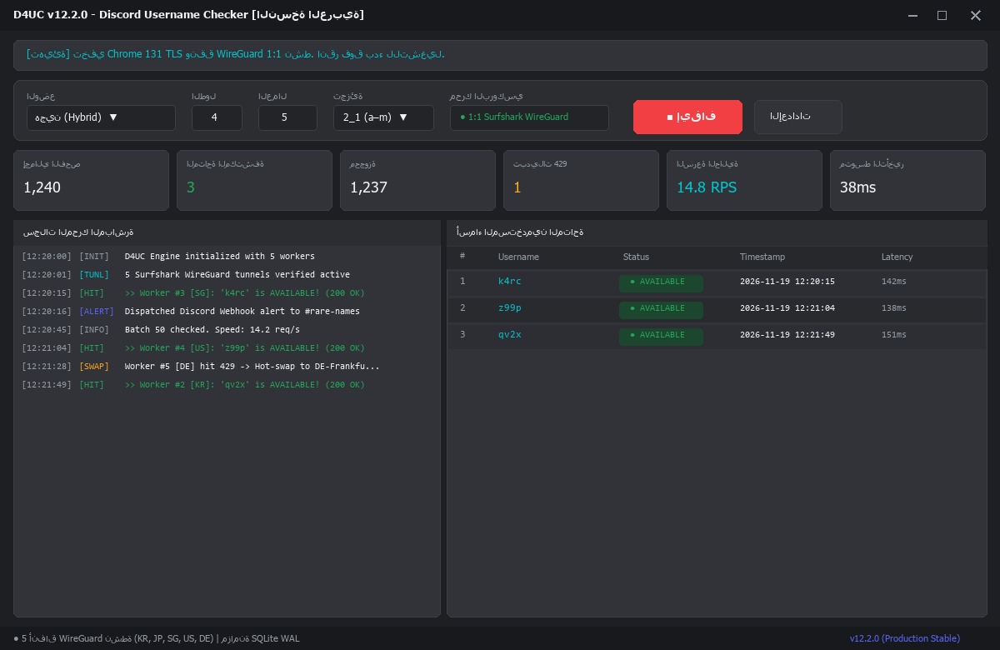
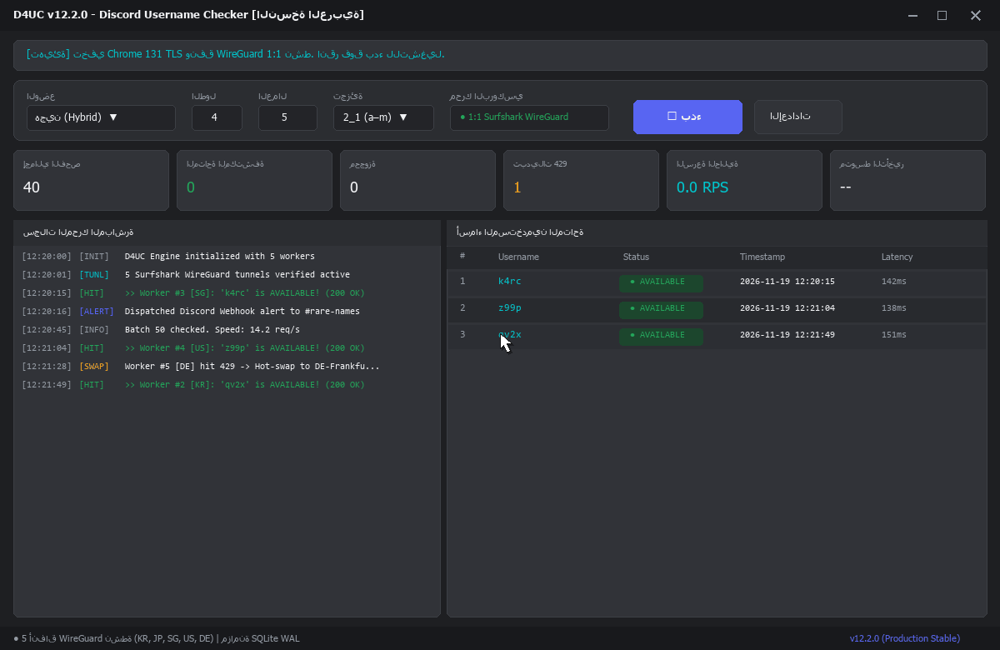
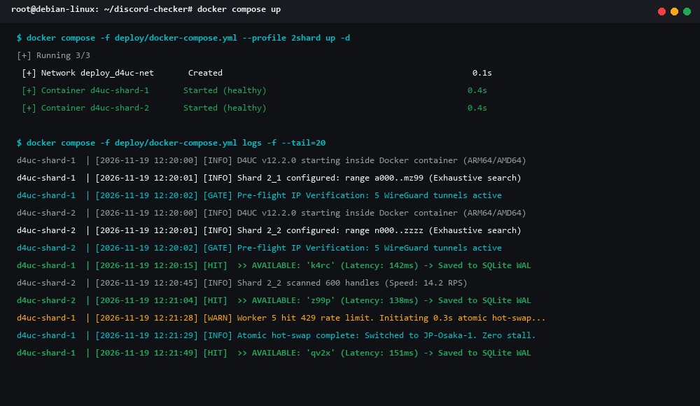
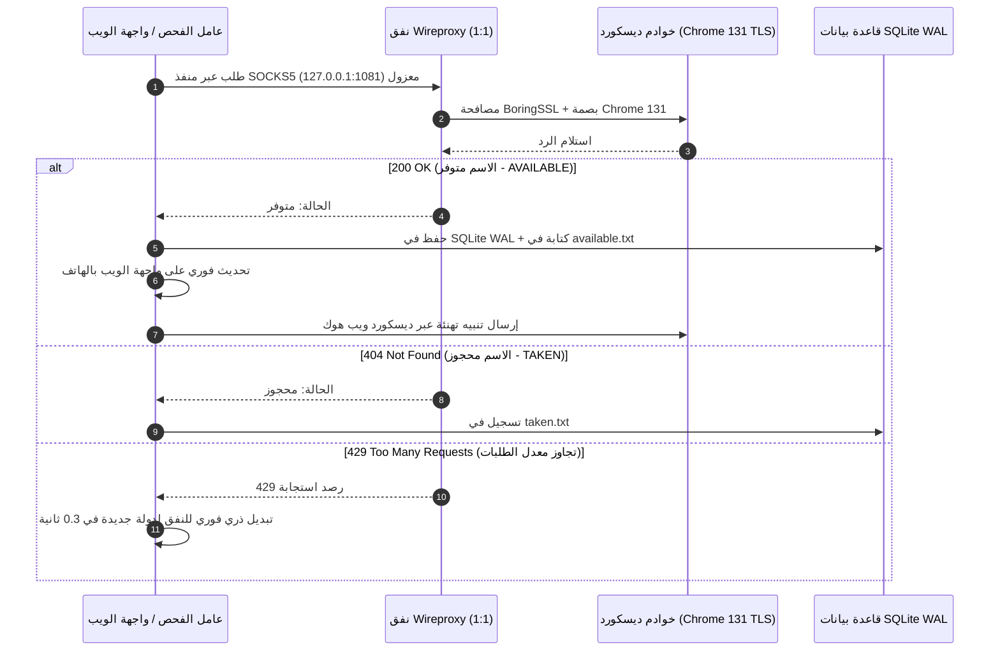

<div align="center">

# ⚡ D4UC (`discord-checker`) v12.2.0

> **محرك فائق الأداء للتحقق من توفر أسماء المستخدمين النادرة في ديسكورد**  
> واجهة ويب متجاوبة للهواتف وتطبيق PWA · تمويه بصمة Chrome 131 TLS · مجمع أنفاق WireGuard 1:1 في مساحة المستخدم · تبديل ذري 429 في 0.3 ثانية · تقسيم تزامني عبر SQLite WAL

<br />

| [KR 한국어](./ko.md) | [US English](../../README.md) | [JP 日本語](./ja.md) | [CN 简体中文](./zh-CN.md) | [ES Español](./es.md) |
| :---: | :---: | :---: | :---: | :---: |
| [FR Français](./fr.md) | [DE Deutsch](./de.md) | [RU Русский](./ru.md) | [BR Português](./pt-BR.md) | [SA العربية](./ar.md) |

<p align="center"><sub>🌐 متوفر أيضًا باللغات: <a href="./hi.md">HI हिन्दी</a> · <a href="./id.md">ID Bahasa Indonesia</a></sub></p>

<br />

[](../../CHANGELOG.md)
[](https://github.com/KRCUPRO/discord-checker/releases/tag/v12.4.0)
[](../../LICENSE)
[](https://www.python.org/)
[](../guides/README.md)
[](../specs/01_NETWORK_CORE_ENGINE.md)
[](https://colab.research.google.com/github/KRCUPRO/discord-checker/blob/main/D4UC_Google_Colab.ipynb)
[](gas/README.md)
[](docs/MOBILE_AND_IPHONE_GUIDE.md)

<sub>Copyright (c) 2026 KRCUPRO · ترخيص ملكية وسرية خاص (جميع الحقوق محفوظة)</sub>

</div>

---


> ### ☁️ تشغيل سحابي كامل 100% بدون تثبيت: Google Colab و Google Apps Script 24/7
> **لا يلزم وجود جهاز كمبيوتر أو تثبيت برامج!** شغّل D4UC مباشرة في السحابة على **أي جهاز — iPhone (Safari) أو iPad أو Android أو الأجهزة اللوحية** عبر المتصفح فقط.
> - 🚀 **[فتح في Google Colab](https://colab.research.google.com/github/KRCUPRO/discord-checker/blob/main/D4UC_Google_Colab.ipynb)**: لوحة تحكم تفاعلية مدمجة تدعم 10 لغات، ومزامنة تلقائية مع Google Drive، وإشعارات Discord Webhook فورية.
> - ⏱️ **[فاحص Google Apps Script 24/7](gas/README.md)**: تشغيل تلقائي متواصل على مدار 24 ساعة طوال 365 يومًا على خوادم Google، حتى لو كان هاتفك مغلقًا.
> - 📱 **[دليل الهواتف و iPhone](docs/MOBILE_AND_IPHONE_GUIDE.md)**: إعداد سريع في دقيقة واحدة لمتصفحات الهواتف.

<a id="-جدول-المحتويات"></a><a id="جدول-المحتويات"></a>
## 📑 جدول المحتويات
1. [📸 معاينة واجهات البرنامج](#-معاينة-واجهات-البرنامج)
2. [✨ القدرات والميزات الأساسية](#-القدرات-والميزات-الأساسية)
3. [🖥️ متطلبات النظام والاعتماديات](#-متطلبات-النظام-والاعتماديات)
4. [📁 هيكل المجلدات والملفات](#-هيكل-المجلدات-والملفات)
5. [🌐 إعدادات البروكسي و 🔑 بيانات الاعتماد](#-إعدادات-البروكسي-و-بيانات-الاعتماد)
6. [🚀 التثبيت والتشغيل](#-التثبيت-والتشغيل)
7. [📱 دليل التحكم عن بُعد عبر واجهة الويب للهواتف (PWA)](#-دليل-التحكم-عن-بعد-عبر-واجهة-الويب-للهواتف-pwa)
8. [🧵 ضبط التزامن وعدد خيوط العمل (Workers)](#-ضبط-التزامن-وعدد-خيوط-العمل-workers)
9. [🔢 استراتيجيات توليد الأسماء](#-استراتيجيات-توليد-الأسماء)
10. [🚫 قواعد الاستبعاد الصارمة (أمثلة: `ab..`, `a..1`)](#-قواعد-الاستبعاد-الصارمة-أمثلة-ab-a1)
11. [📡 مخطط تسلسل عملية الفحص](#-مخطط-تسلسل-عملية-الفحص)
12. [🔄 إدارة جلسات البروكسي](#-إدارة-جلسات-البروكسي)
13. [🔁 استراتيجية إعادة المحاولة](#-استراتيجية-إعادة-المحاولة)
14. [💾 صيغ وتنسيقات الحفظ](#-صيغ-وتنسيقات-الحفظ)
15. [📊 الإحصائيات الحية والمراقبة](#-الإحصائيات-الحية-والمراقبة)
16. [🛑 إيقاف عملية الفحص](#-إيقاف-عملية-الفحص)
17. [⚠️ التعامل مع قيود السرعة (Rate Limit)](#-التعامل-مع-قيود-السرعة-rate-limit)
18. [🔧 حل المشاكل الشائعة](#-حل-المشاكل-الشائعة)
19. [📞 الدعم الفني عبر ديسكورد: myuyayam](#-الدعم-الفني-عبر-ديسكورد-myuyayam)
20. [⭐ دعم المشروع (GitHub Star)](#-دعم-المشروع-github-star)
21. [📚 إخلاء مسؤولية للأغراض التعليمية والبحثية](#-إخلاء-مسؤولية-للأغراض-التعليمية-والبحثية)

---

<a id="-معاينة-واجهات-البرنامج"></a><a id="معاينة-واجهات-البرنامج"></a>
## 📸 معاينة واجهات البرنامج

### واجهة الويب المتجاوبة للهواتف المحمولة وتطبيق PWA (لهواتف آيفون وأندرويد)
[](../guides/MOBILE_IOS_GUIDE.md)

### عرض توضيحي حي للتطبيق على الهاتف المحمول (تحكم بلمسة واحدة وقياسات فورية)
[](../guides/MOBILE_IOS_GUIDE.md)

### واجهة سطح المكتب لأجهزة الكمبيوتر (النسخة العربية)
[](../guides/WINDOWS_GUIDE.md)

### عرض توضيحي مباشر لتطبيق سطح المكتب (تفاعل سلس بالفأرة)
[](../guides/WINDOWS_GUIDE.md)

### لوحة معلومات سطر الأوامر الطرفية (CLI Dashboard)
[](../guides/TERMUX_DEBIAN_GUIDE.md)

### بيئة التشغيل على خوادم لينكس وحاويات Docker
[](../guides/DOCKER_GUIDE.md)

[⬆️ العودة إلى أعلى الفهرس](#-جدول-المحتويات)

---

<a id="-القدرات-والميزات-الأساسية"></a><a id="القدرات-والميزات-الأساسية"></a>
## ✨ القدرات والميزات الأساسية
- **☁️ تشغيل سحابي كامل 100% بدون تثبيت (Google Colab & GAS 24/7)**: تشغيل مباشر على iPhone (Safari) و iPad و Android دون الحاجة لجهاز كمبيوتر. واجهة بـ 10 لغات وحفظ دائم على Google Drive ومراقبة 24/7.

1. **واجهة ويب متجاوبة للهواتف الذكية (الهواتف المحمولة) ومحرك PWA (`http://<host>:5000`)**:
   - قم بتشغيل الخادم على جهازك الشخصي أو VPS أو داخل Docker أو Termux وتحكم في كل شيء عن بُعد عبر متصفح هاتفك (iPhone Safari أو Android Chrome).
   - دعم أصيل لميزة **"إضافة إلى الشاشة الرئيسية" (PWA)** ليعمل كتطبيق هاتف متكامل بملء الشاشة بدون الحاجة لمتاجر التطبيقات.
   - أزرار لمس كبيرة وسهلة للبدء والتوقف، رسم بياني فوري للسرعة RPS عبر Canvas HTML5 النقي، نسخ الأسماء المتوفرة بلمسة واحدة، وتنزيل فوري بصيغ TXT/CSV/JSON.
   - إمكانية تبديل وتحديث إعدادات البروكسي (مفاتيح Surfshark، ملفات البروكسي، Thordata)، وأنماط التوليد الثمانية، وعدد خيوط العمل (1–50) من هاتفك مباشرة.

2. <a id="fnref-1"></a><a id="fnref1"></a>**تمويه بصمة Chrome 131 TLS JA3/JA4 المتطورة (`curl_cffi` BoringSSL)[^1]**:
   - التخلص الكامل من البصمات المصطنعة التي تولدها مكتبات بايثون التقليدية (`requests`, `aiohttp`, `httpx`).
   - تطابق دقيق ومطابق للبايت مع مجموعات التشفير، والامتدادات، وإطارات HTTP/2 SETTINGS لمتصفح Google Chrome 131 الرسمي لتجاوز أنظمة الحماية وجدران WAF.

3. <a id="fnref-2"></a><a id="fnref2"></a>**مجمع أنفاق WireGuard 1:1 معزول في مساحة المستخدم (`wireproxy`)[^2]**:
   - لا يتطلب تعديل بطاقات شبكة نظام التشغيل ولا يقوم بتعديل إعدادات DNS أو التوجيه في جهازك.
   - يخصص منفذاً محلياً معزولاً (`127.0.0.1:1081+`) لكل عامل فحص لربطه بواحد من 142 خادماً عالمياً دون أي تأثير على سرعة تصفحك أو ألعابك (0.00% تداخل).

4. **تبديل ذري فوري عند حظر 429 خلال 0.3 ثانية**:
   - عند مواجهة عامل الفحص لرمز التقييد 429، لا تتوقف عملية الفحص بالكامل.
   - فقط العامل المتأثر يتم تبديل عنوانه إلى دولة أخرى خلال 300 ملي ثانية بينما تواصل باقي الخيوط الفحص بأقصى سرعة.

5. **تقسيم رياضي خالٍ من التكرار (Sharding)**:
   - دعم التجزئة الرياضية لمجال الفحص (`2_1`, `2_2`, `4_1`–`4_4`) للمسح الشامل.
   - يمكن تشغيل عدة نسخ متزامنة لفحص مجالات غير متداخلة بنسبة تكرار 0%.

6. **قاعدة بيانات SQLite WAL وتخزين متزامن متعدد الصيغ**:
   - أداء كتابة عالي وسرعة فائقة باستخدام SQLite في وضع WAL (`data/d4uc_results.db`).
   - نسخ فوري للأسماء المتوفرة في ملفات نصية (`available.txt`, `taken.txt`)، وملفات CSV و JSON.

7. **8 محركات ذكية لتوليد الأسماء**:
   - المحرك الهجين، التباديل الرياضية، قواميس الكلمات، الأنماط المتماثلة، الأرقام المتسلسلة، الأقنعة المخصصة، التراكيب الصوتية، وإعادة فحص المحجوزات السابقة.

8. **دعم تشغيل شامل متعدد المنصات**:
   - ملفات تنفيذية جاهزة لنظام ويندوز (4 ملفات `.exe`)، تطبيق ويب PWA للهواتف، واجهة CLI لأنظمة لينكس وماك، سكريبت تثبيت لهواتف أندرويد عبر Termux، وحاويات Docker.

[⬆️ العودة إلى أعلى الفهرس](#-جدول-المحتويات)

---

<a id="-متطلبات-النظام-والاعتماديات"></a><a id="متطلبات-النظام-والاعتماديات"></a>
## 🖥️ متطلبات النظام والاعتماديات

### بيئة التشغيل
- **نظام التشغيل**: Windows 10/11 (64-bit), Linux (Debian 11+, Ubuntu 20.04+, Arch), macOS 12+, Android 10+ (Termux), iOS Safari
- **إصدار بايثون**: 3.10, 3.11, 3.12 (الموصى به: **Python 3.12**)
- **الذاكرة العشوائية (RAM)**: 512 ميجابايت كحد أدنى (~250 ميجابايت لـ 50 عاملاً متزامناً)
- **الشبكة**: اتصال إنترنت واسع النطاق (مع السماح بمنفذ خروج UDP 51820 لـ WireGuard)

### حزم بايثون الأساسية (`requirements.txt`)
- `curl_cffi >= 0.7.0`: تمويه بصمة Chrome 131 BoringSSL
- `customtkinter >= 5.2.0`: واجهة رسومية عصرية داكنة
- `rich >= 13.7.0`: لوحة تحكم رسومية تفاعلية للطرفية
- `pydantic >= 2.6.0`: التحقق من صحة الإعدادات
- `pyyaml >= 6.0.1`: معالج ملفات YAML
- `pillow >= 10.2.0`: معالجة الصور ورسم الرموز

[⬆️ العودة إلى أعلى الفهرس](#-جدول-المحتويات)

---

<a id="-هيكل-المجلدات-والملفات"></a><a id="هيكل-المجلدات-والملفات"></a>
## 📁 هيكل المجلدات والملفات

```text
discord-checker/
├── config/                         # قوالب الإعدادات وملف .env.example
├── data/                           # خوادم WireGuard وقاعدة بيانات SQLite
├── deploy/                         # سكريبتات البناء والحاويات وتوليد الوسائط
│   ├── android/                    # Android native app project
│   ├── build_apk.py                # Android release APK builder
│   ├── build_exe.py                # مجمع 4 ملفات تنفيذية لويندوز
│   ├── docker-compose.yml          # إعدادات Docker Compose
│   ├── Dockerfile                  # مواصفات الحاوية الخفيفة
│   ├── generate_assets.py          # أداة توليد الصور والعروض المتحركة
│   ├── generate_badges.py          # مولد شارات SVG بـ 12 لغة
│   └── generate_mobile_assets.py   # مولد صور وعروض PWA للهواتف
├── docs/                           # التوثيق الكامل والأدلة والشارات
│   ├── assets/                     # لقطات الشاشة والصور المتحركة والشارات
│   ├── guides/                     # أدلة التشغيل لـ iOS و PC و Docker و Termux
│   └── locales/                    # ترجمات كاملة 1:1 لـ 11 لغة
├── src/                            # الشيفرة المصدرية للنواة
│   ├── generator/                  # محركات التوليد وقواعد الاستبعاد الصارمة
│   ├── network/                    # عميل TLS Chrome 131 وإدارة التراجع
│   ├── notify/                     # وحدة تنبيهات ويب هوك ديسكورد
│   ├── proxy/                      # إدارة مجمع أنفاق WireGuard 1:1
│   ├── storage/                    # طبقة التخزين عبر SQLite WAL والملفات
│   ├── ui/                         # دعم اللغات، التلميحات، ولوحة CLI
│   │   └── web/                    # تطبيق الويب للهواتف (HTML5/CSS3/Vanilla JS)
│   ├── web_gui.py                  # خادم الويب وواجهة برمجة التطبيقات REST
│   ├── gui.py                      # منسق CustomTkinter لسطح المكتب
│   ├── gui_ko.py                   # مشغل الواجهة الكورية
│   ├── gui_en.py                   # مشغل الواجهة الإنجليزية
│   └── run.py                      # مشغل سطر الأوامر CLI
├── tests/                          # مجموعة الاختبارات الشاملة
├── CHANGELOG.md                    # سجل التغييرات والتحديثات
├── LICENSE                         # ترخيص البرنامج
├── README.md                       # التوثيق الرئيسي باللغة الإنجليزية
└── SECURITY.md                     # سياسات الأمان ومنع التسريبات
```

[⬆️ العودة إلى أعلى الفهرس](#-جدول-المحتويات)

---

<a id="-إعدادات-البروكسي-و-بيانات-الاعتماد"></a><a id="إعدادات-البروكسي-و-بيانات-الاعتماد"></a>
## 🌐 إعدادات البروكسي و 🔑 بيانات الاعتماد

يحتوي البرنامج على **مجمع أنفاق WireGuard 1:1 في مساحة المستخدم** عبر أداة `wireproxy` لتخطي أي قيود وحظر للعناوين.

### 1. خطوات الإعداد
1. انسخ ملف `config/.env.example` إلى ملف باسم `.env` في المجلد الرئيسي:
   ```bash
   cp config/.env.example .env
   ```
2. افتح ملف `.env` وأدخل المفاتيح الخاصة بحساب Surfshark WireGuard الخاص بك:
   ```ini
   # يمكن إدخال عدة مفاتيح مفصولة بفواصل لإنشاء مجمع متعدد الحسابات
   SURFSHARK_PRIVATE_KEYS=YOUR_WIREGUARD_PRIVATE_KEY_1_HERE,YOUR_WIREGUARD_PRIVATE_KEY_2_HERE
   
   # عدد خيوط العمل (الافتراضي: 5، الأقصى: 50)
   D4UC_WORKERS=5
   
   # رابط ويب هوك ديسكورد للتنبيهات الفورية (اختياري)
   D4UC_WEBHOOK=https://discord.com/api/webhooks/ID/TOKEN
   ```

### 2. جامع وفاحص البروكسيات العامة المجانية عالي السرعة (`--proxy free`) [جديد في v12.3.0]
تشغيل مجاني بالكامل بدون الحاجة إلى اشتراك VPN مدفوع:
- **تجميع تلقائي متعدد المصادر**: سحب قوائم بروكسي محدثة باستمرار من أكثر من 14 مستودع GitHub وحزم بيانات Hugging Face.
- **دعم لكافة البروتوكولات**: دعم كامل لبروكسيات HTTP و HTTPS و SOCKS4 و SOCKS5 المجانية.
- **فحص اتصالات غير متزامن فائق السرعة**: اختبار فوري ومباشر مع خوادم Discord و Cloudflare لاستبعاد الخوادم المعطلة وذات التأخير العالي (>3500ms) وتلك المحجوبة بواسطة WAF 403.
- **إدارة حدود الطلبات 429 والتحديث التلقائي**: عزل الخوادم الخاضعة للحدود لمدة 15 ثانية والتحويل التلقائي السريع لأسرع خادم متاح.
- **دعم الواجهات**: متوفر في قائمة واجهة سطح المكتب، وزر النقرة الواحدة على الويب المحمول، وأمر الطرفية `--proxy free`.

### 3. سياسة منع التسريبات الصارمة (Zero-Leak Policy)
- جميع ملفات المفاتيح والإعدادات مستبعدة تلقائياً من نظام Git عبر `.gitignore` ويتم فحص الشيفرة البرمجية لمنع أي تسريب.

[⬆️ العودة إلى أعلى الفهرس](#-جدول-المحتويات)

---

<a id="-التثبيت-والتشغيل"></a><a id="التثبيت-والتشغيل"></a>
## 🚀 التثبيت والتشغيل
### ☁️ الطريقة 0: تشغيل سحابي كامل 100% بدون تثبيت (Google Colab و Google Apps Script 24/7)
> **يوصى بها لمستخدمي iPhone و iPad و Android والأجهزة اللوحية، أو لمن ليس لديهم بيئة Python مثبتة.**

1. **دفتر Google Colab**: انقر على [](https://colab.research.google.com/github/KRCUPRO/discord-checker/blob/main/D4UC_Google_Colab.ipynb) للتشغيل. قم بتشغيل الخلايا الـ 3 لبدء واجهة الويب بـ 10 لغات.
2. **خدمة Google Apps Script 24/7**: راجع [gas/README.md](gas/README.md) لتشغيل الفحص التلقائي على مدار الساعة عبر محفزات Google Cloud دون إبقاء جهازك يعمل.
3. **دليل الهواتف**: راجع [docs/MOBILE_AND_IPHONE_GUIDE.md](docs/MOBILE_AND_IPHONE_GUIDE.md).


### الطريقة أ: الملفات الجاهزة للتشغيل المباشر على ويندوز (`.exe`)
حمّل الملفات الجاهزة من صفحة الإصدارات [GitHub Releases v12.2.0](https://github.com/KRCUPRO/discord-checker/releases/tag/v12.4.0):
- `DiscordUsernameChecker_v12.3.0.apk`: **حزمة أندرويد الأصلية (تثبيت بنقرة واحدة)** [جديد]
- `DiscordUsernameCheckerV2_Web.exe`: **خادم واجهة الويب للهواتف وتطبيق PWA (منفذ 5000)** [جديد]
- `DiscordUsernameCheckerV2_EN.exe`: واجهة سطح المكتب الإنجليزية
- `DiscordUsernameCheckerV2_KO.exe`: واجهة سطح المكتب الكورية
- `DiscordUsernameCheckerV2_CLI.exe`: واجهة سطر الأوامر الطرفية

### 📱 حزمة أندرويد الأصلية (`.apk`) — تثبيت بنقرة واحدة [NEW]
- **تحميل مباشر**: [`DiscordUsernameChecker_v12.3.0.apk`](https://github.com/KRCUPRO/discord-checker/releases/download/v12.3.0/DiscordUsernameChecker_v12.3.0.apk)
- **دليل التثبيت**:
  1. قم بتحميل ملف `.apk` على هاتفك الأندرويد (Galaxy, Pixel, Xiaomi وغيرها).
  2. اضغط على الملف من الإشعارات أو مدير الملفات.
  3. اسمح بـ "تثبيت التطبيقات من مصادر غير معروفة" عند المطالبة واضغط على **[تثبيت]**.
  4. شغّل تطبيق **`D4UC Discord Checker`** مباشرة من الشاشة الرئيسية.
- **الميزات على الهواتف**:
  - واجهة ويب لمسية مدمجة دون اتصال بـ 12 لغة وبثيم ديسكورد الليلي (`assets/www/index.html`).
  - نسخ اسم المستخدم بنقرة واحدة مع إشعارات Toast الأصلية.
  - منع سكون الشاشة Wake Lock (`WAKE_LOCK`) أثناء الفحص.
  - اتصال سريع بخادم D4UC على الكمبيوتر عبر شبكة Wi-Fi أو عنوان IP.

### الطريقة ب: تشغيل واجهة الويب للهواتف (التحكم عن بُعد عبر الهاتف)
```bash
# تشغيل خادم الويب (المنفذ الافتراضي: 5000)
python src/web_gui.py --port 5000

# افتح متصفح هاتفك (سفاري أو كروم) المتصل بنفس شبكة Wi-Fi واكتب:
# http://<عنوان_IP_الخاص_بكمبيوترك>:5000
```

### الطريقة ج: التشغيل من الشيفرة المصدرية
```bash
python -m venv .venv
source .venv/bin/activate  # Windows: .\.venv\Scripts\Activate.ps1
pip install -r requirements.txt

# تشغيل واجهة سطح المكتب
python src/gui_en.py

# تشغيل سطر الأوامر
python src/run.py --mode hybrid --length 4 --workers 5
```

[⬆️ العودة إلى أعلى الفهرس](#-جدول-المحتويات)

---

<a id="-دليل-التحكم-عن-بعد-عبر-واجهة-الويب-للهواتف-pwa"></a><a id="دليل-التحكم-عن-بعد-عبر-واجهة-الويب-للهواتف-pwa"></a>
## 📱 دليل التحكم عن بُعد عبر واجهة الويب للهواتف (PWA)
### 📱 تشغيل سحابي متوافق مع كافة الأجهزة (iPhone, iPad, Android, أجهزة لوحية)
بالإضافة إلى تطبيق PWA المحلي، يعمل D4UC سحابيًا بالكامل عبر **Google Colab** و **Google Apps Script (GAS)**:
- **iPhone / iPad Safari**: تشغيل مباشر في Safari للهواتف دون الحاجة لجهاز كمبيوتر.
- **مراقبة 24/7 بدون انقطاع**: تعمل مشغلات Google Apps Script باستمرار حتى لو كانت الشاشة مغلقة أو الهاتف مطفأ.
- **إشعارات فورية**: تنبيه فوري عبر Discord Webhook عند اكتشاف اسم مستخدم متاح.
- الدليل الكامل: [docs/MOBILE_AND_IPHONE_GUIDE.md](docs/MOBILE_AND_IPHONE_GUIDE.md).


تابع عمليات الفحص واضبط الإعدادات من سريرك بكل راحة عبر هاتفك المحمول.

### 1. إضافة إلى الشاشة الرئيسية (تثبيت تطبيق PWA)
1. افتح متصفح الهاتف (Safari في iPhone أو Chrome في Android) واكتب الرابط: `http://<IP_الكمبيوتر>:5000`.
2. **في آيفون Safari**: اضغط على زر المشاركة ➔ ثم اختر **"إضافة إلى الصفحة الرئيسية"**.
3. **في أندرويد Chrome**: اضغط على زر القائمة (⋮) ➔ ثم اختر **"إضافة إلى الشاشة الرئيسية"** أو **"تثبيت التطبيق"**.
4. افتح أيقونة **D4UC Web** البنفسجية ليعمل التطبيق بملء الشاشة كتطبيق هاتف أصيل.

### 2. ميزات اللمس والتحكم في الهاتف
- **بطاقات قياسات فورية ضخمة**: سرعة الفحص (RPS)، الأسماء المتوفرة، الإجمالي، المحجوز، تبديلات 429، ومعدل الاستجابة (ms).
- **رسم بياني بالسرعة عبر HTML5 Canvas**: منحنى حركة الفحص في الوقت الفعلي بخفة وسلاسة بدون مكتبات إضافية.
- **نسخ الأسماء بلمسة واحدة**: اضغط على زر [نسخ] بجانب أي اسم متوفر ليتم نسخه للحافظة مع إشعار واهتزاز.
- **تصدير فوري**: أزرار سريعة لتنزيل النتائج بصيغ TXT و CSV و JSON على هاتفك مباشرة.
- **التبديل الفوري للإعدادات من الهاتف**:
  - التبديل بين أنماط التوليد الثمانية
  - تغيير طول الاسم المطلوب (3 إلى 6 أحرف) وخيارات التقسيم
  - تعديل عدد العمال من 1 إلى 50 أثناء التشغيل
  - حفظ مفاتيح Surfshark وإعدادات الشبكة عن بُعد

[⬆️ العودة إلى أعلى الفهرس](#-جدول-المحتويات)

---

<a id="-ضبط-التزامن-وعدد-خيوط-العمل-workers"></a><a id="ضبط-التزامن-وعدد-خيوط-العمل-workers"></a>
## 🧵 ضبط التزامن وعدد خيوط العمل (Workers)

- **القيمة الافتراضية الموصى بها**: `5` خيوط عمل (~12–15 طلب في الثانية)
- **للأجهزة الاقتصادية والمحدودة**: `1`–`3` خيوط
- **للمسح فائق السرعة**: `10`–`20` خيطاً (يدعم حتى 50 خيطاً)
- **كيف يعمل النظام**:
  - يخصص البرنامج منفذ WireGuard مستقلاً لكل خيط فحص (`1081`, `1082`, إلخ).
  - 5 خيوط عمل ترسل طلباتها بالتوازي عبر 5 دول مختلفة في نفس اللحظة (طوكيو، سول، سنغافورة، فرانكفورت، نيويورك).

[⬆️ العودة إلى أعلى الفهرس](#-جدول-المحتويات)

---

<a id="-استراتيجيات-توليد-الأسماء"></a><a id="استراتيجيات-توليد-الأسماء"></a>
## 🔢 استراتيجيات توليد الأسماء

| وضع التوليد | طريقة التوليد | الوصف والأمثلة |
| :--- | :--- | :--- |
| `hybrid` (الموصى به) | دمج جذور الكلمات مع أرقام وتماثلات | أسماء مميزة ونادرة وسهلة القراءة (`krc1`, `v1be`, `neo9`) |
| `permutation` | تباديل رياضية شاملة | فحص كل التباديل الممكنة للأحرف والأرقام (`a-z`, `0-9`, `_`) |
| `dictionary` | قاموس الكلمات الإنجليزية من 3–6 أحرف | كلمات حقيقية ومفردات ذات قيمة عالية |
| `pattern` | أنماط بصرية متماثلة ومتكررة | أشكال متناسقة وجمالية (`aaaa`, `abba`, `abab`, `aabb`) |
| `numeric` | أرقام متسلسلة ومتكررة | تشكيلات عددية مميزة (`0000`–`9999`, وأرقام البوكر `7777`, `1234`) |
| `custom_mask` | أقنعة مخصصة مع نقاط محددة | قوالب مخصصة حسب الطلب (`kr??`, `??99`, `?.vip`, `??.??`) |
| `combinatorial` | تراكيب صوتية CVCV / VCCV | تبادل الحروف الساكنة والصائتة لصناعة أسماء جديدة وقابلة للنطق |
| `recheck` | إعادة فحص الأسماء المحجوزة سابقاً | إعادة فحص الأسماء المأخوذة سابقاً لاقتناص الحسابات المحذوفة |

[⬆️ العودة إلى أعلى الفهرس](#-جدول-المحتويات)

---

<a id="-قواعد-الاستبعاد-الصارمة-أمثلة-ab-a1"></a><a id="قواعد-الاستبعاد-الصارمة-أمثلة-ab-a1"></a>
## 🚫 قواعد الاستبعاد الصارمة (أمثلة: `ab..`, `a..1`)

يتم **استبعاد جميع الأسماء المخالفة لقواعد ديسكورد بنسبة 100% قبل إرسال أي طلب شبكة**:

1. **حظر تتابع النقاط (`..`)**:
   - ❌ `ab..` (نقطتان متتاليتان في النهاية) ➔ **مستبعد تلقائياً**
   - ❌ `a..1` (نقطتان متتاليتان في الوسط) ➔ **مستبعد تلقائياً**
   - ❌ `..kr` (نقطتان متتاليتان في البداية) ➔ **مستبعد تلقائياً**
2. **حظر وجود نقطة في البداية أو النهاية (`.`)**:
   - ❌ `.abc` (يبدأ بنقطة) ➔ **مستبعد تلقائياً**
   - ❌ `abc.` (ينتهي بنقطة) ➔ **مستبعد تلقائياً**
3. **الأحرف المسموح بها**:
   - فقط الأحرف الإنجليزية الصغيرة (`a-z`)، والأرقام (`0-9`)، والشرطة السفلية (`_`)، ونقطة واحدة فقط (`.`).
4. **طول الاسم**:
   - لا يتم توليد أي اسم يقل عن حرفين أو يزيد عن 32 حرفاً.
5. **الأسماء المحجوزة للنظام**:
   - يتم حجب الأسماء الخاصة مثل `discord` و `clyde` و `here` و `everyone` و `system` تلقائياً.

> تم فحص وتأكيد هذه القواعد عبر الفاحص البرمجي `DiscordRuleValidator.is_valid()` الموثق بـ 84 اختباراً آلياً.

[⬆️ العودة إلى أعلى الفهرس](#-جدول-المحتويات)

---

<a id="-مخطط-تسلسل-عملية-الفحص"></a><a id="مخطط-تسلسل-عملية-الفحص"></a>
## 📡 مخطط تسلسل عملية الفحص



[⬆️ العودة إلى أعلى الفهرس](#-جدول-المحتويات)

---

<a id="-إدارة-جلسات-البروكسي"></a><a id="إدارة-جلسات-البروكسي"></a>
## 🔄 إدارة جلسات البروكسي

- **جلسات غير متزامنة مخصصة**: يحافظ كل عامل على جلسة `curl_cffi.requests.AsyncSession` مستقلة للاستفادة القصوى من إعادة استخدام اتصالات TCP.
- **إغلاق نظيف بدون بقايا**: عند الإيقاف، يتم إنهاء جميع العمليات الخلفية لأداة `wireproxy` بشكل كامل (Zero-Zombie).

[⬆️ العودة إلى أعلى الفهرس](#-جدول-المحتويات)

---

<a id="-استراتيجية-إعادة-المحاولة"></a><a id="استراتيجية-إعادة-المحاولة"></a>
## 🔁 استراتيجية إعادة المحاولة

1. **انقطاع الشبكة أو أخطاء DNS**: إعادة محاولة تلقائية حتى 3 مرات مع تراجع زمني تدريجي (0.5 ثانية ➔ 1.0 ➔ 2.0).
2. **تحديات جدار الحماية Cloudflare**: إنهاء الجلسة فوراً وإعادة بناء النفق في لحظات.
3. **تقييد 429**: إعادة الاسم لقائمة الانتظار وتبديل عنوان الآي بي الخاص بالعامل في 0.3 ثانية.

[⬆️ العودة إلى أعلى الفهرس](#-جدول-المحتويات)

---

<a id="-صيغ-وتنسيقات-الحفظ"></a><a id="صيغ-وتنسيقات-الحفظ"></a>
## 💾 صيغ وتنسيقات الحفظ

| المسار | التنسيق | الاستخدام والغرض |
| :--- | :--- | :--- |
| `data/d4uc_results.db` | **SQLite (وضع WAL)** | حفظ فوري آمن، كتابة متعددة متزامنة، وفهرسة متكاملة |
| `available.txt` | نص UTF-8 | قائمة بالأسماء المتوفرة سطراً بسطر في الوقت الحقيقي |
| `taken.txt` | نص UTF-8 | قائمة الأسماء المحجوزة بالفعل (لوضع إعادة الفحص) |
| `checked_history.txt` | نص UTF-8 | سجل شامل لمنع أي فحص مكرر لنفس الاسم |
| `available_usernames.csv` | جدول CSV | مناسب لبرامج الجداول مثل إكسل والتحليلات |
| `available_usernames.json`| صيغة JSON | بيانات مهيكلة ومناسبة للربط مع واجهات البرمجة والمواقع |

[⬆️ العودة إلى أعلى الفهرس](#-جدول-المحتويات)

---

<a id="-الإحصائيات-الحية-والمراقبة"></a><a id="الإحصائيات-الحية-والمراقبة"></a>
## 📊 الإحصائيات الحية والمراقبة

تعرض واجهة الويب على الهاتف وبرنامج سطح المكتب الإحصائيات التالية كل 30 ملي ثانية:
- **Scan Speed (RPS)**: عدد الطلبات المكتملة في الثانية (متوسط آخر 5 ثوانٍ)
- **Total Checked**: إجمالي الأسماء المفحوصة في الجلسة الحالية
- **Available Count**: إجمالي الأسماء النادرة المتوفرة التي تم العثور عليها
- **Taken Count**: الأسماء المحجوزة
- **429 Hot-Swaps**: عدد عمليات تبديل الخوادم الناجحة عند الحظر
- **Latency**: زمن استجابة خوادم ديسكورد لكل نفق (ملي ثانية)

[⬆️ العودة إلى أعلى الفهرس](#-جدول-المحتويات)

---

<a id="-إيقاف-عملية-الفحص"></a><a id="إيقاف-عملية-الفحص"></a>
## 🛑 إيقاف عملية الفحص

- **عبر واجهة الهاتف**: اضغط على الزر الأحمر الكبير `■ إيقاف البحث`.
- **عبر برنامج سطح المكتب**: اضغط على زر `■ إيقاف`.
- **عبر سطر الأوامر CLI**: اضغط على `Ctrl + C` لحفظ البيانات وإغلاق الأنفاق بأمان.

[⬆️ العودة إلى أعلى الفهرس](#-جدول-المحتويات)

---

<a id="-التعامل-مع-قيود-السرعة-rate-limit"></a><a id="التعامل-مع-قيود-السرعة-rate-limit"></a>
## ⚠️ التعامل مع قيود السرعة (Rate Limit)

- عند إرسال طلبات كثيفة من عنوان واحد، يرجع ديسكورد الرمز `429 Too Many Requests`.
- يتغلب البرنامج على ذلك بتوزيع الحمل على **142 نفق WireGuard** عالمي مع ميزة **التبديل الذري خلال 0.3 ثانية**، مما يتيح استمرار الفحص الدائم دون توقف بقية الخيوط.

[⬆️ العودة إلى أعلى الفهرس](#-جدول-المحتويات)

---

<a id="-حل-المشاكل-الشائعة"></a><a id="حل-المشاكل-الشائعة"></a>
## 🔧 حل المشاكل الشائعة

| المشكلة | السبب المحتمل | الحل |
| :--- | :--- | :--- |
| تعذر فتح الواجهة من الهاتف | الهاتف والكمبيوتر ليسا على نفس الشبكة | تأكد من الاتصال بنفس شبكة Wi-Fi وتأكد من فتح المنفذ 5000 في جدار حماية ويندوز. |
| `Wireproxy binary not found` | ملف wireproxy غير موجود | تحقق من وجود `bin/wireproxy.exe` أو شغل `deploy/build_exe.py`. |
| `Port already in use: 1081` | وجود عملية سابقة لم تغلق | قم بإنهاء عمليات بايثون أو wireproxy المعلقة من مدير المهام (Task Manager). |
| ظهور نافذة جدار الحماية | عدم تسجيل إذن العبور | قم بتشغيل سكريبت PowerShell كمسؤول لإضافة إذن العبور التلقائي. |
| `No module named curl_cffi` | البيئة الافتراضية غير مفعلة | قم بتفعيل `.venv` وتشغيل `pip install -r requirements.txt`. |

[⬆️ العودة إلى أعلى الفهرس](#-جدول-المحتويات)

---

<a id="-الدعم-الفني-عبر-ديسكورد-myuyayam"></a><a id="الدعم-الفني-عبر-ديسكورد-myuyayam"></a>
## 📞 الدعم الفني عبر ديسكورد: myuyayam

- للاقتراحات، الإبلاغ عن الأخطاء، أو المساعدة التقنية تواصل عبر ديسكورد مع **`myuyayam`**.
- لطلبات التراخيص التجارية يرجى التواصل عبر رسائل ديسكورد الخاصة أو GitHub Issues.

[⬆️ العودة إلى أعلى الفهرس](#-جدول-المحتويات)

---

<a id="-دعم-المشروع-github-star"></a><a id="دعم-المشروع-github-star"></a>
## ⭐ دعم المشروع (GitHub Star)

إذا نال هذا المشروع إعجابك، يرجى دعمنا بالضغط على زر **Star (⭐)** أعلى الصفحة في جيت هاب!  
تشجيعكم وملاحظاتكم هي دافعنا الدائم للتطوير والتحسين المستمر.

[⬆️ العودة إلى أعلى الفهرس](#-جدول-المحتويات)

---

<a id="-إخلاء-مسؤولية-للأغراض-التعليمية-والبحثية"></a><a id="إخلاء-مسؤولية-للأغراض-التعليمية-والبحثية"></a>
## 📚 إخلاء مسؤولية للأغراض التعليمية والبحثية

> **[تنبيه للأغراض التعليمية والبحثية فقط]**
> 
> تم تطوير هذا البرنامج حصراً لأغراض البحث التقني ودراسة هندسة الشبكات: **دراسة بصمات TLS الحديثة (Chrome 131 BoringSSL JA3/JA4)، واجهات تطبيقات الويب التقدمية (PWA) للهواتف، تقنيات الأنفاق في مساحة المستخدم (Wireproxy)، والتقسيم التزامني عبر SQLite WAL**.
> 
> 1. يُحظر تماماً استخدام هذه الأداة للتسبب في ازدحام مروري ضار، أو هجمات حجب الخدمة (DoS)، أو الإضرار بالمنصات، أو احتكار الحسابات للمتاجرة غير القانونية.
> 2. يلتزم المستخدم بمراعاة شروط الاستخدام (Terms of Service) للمنصة المستهدفة والقوانين المحلية. وتقع المسؤولية القانونية الكاملة عن أي استخدام غير ملائم على عاتق المشغّل وحده.
> 3. لا يقدم المطورون والمساهمون أي ضمانات صريحة أو ضمنية ويخلون مسؤوليتهم عن نتائج الاستخدام الفردي لهذا البرنامج.

[⬆️ العودة إلى أعلى الفهرس](#-جدول-المحتويات)

---

<a id="-الحواشي-والمراجع-التقنية"></a><a id="الحواشي-والمراجع-التقنية"></a><a id="footnote-heading"></a>
### 📚 الحواشي والمراجع التقنية

<a id="footnote-1"></a><a id="fn-1"></a>
[^1]: تعمل مصافحة Chrome 131 BoringSSL على تحييد حظر بصمات أصابع TLS تماماً من Cloudflare وأنظمة WAF الحديثة. [↩ العودة إلى النص](#fnref-1) · [⬆️ العودة إلى أعلى الفهرس](#-جدول-المحتويات)

<a id="footnote-2"></a><a id="fn-2"></a>
[^2]: يعتبر wireproxy برنامجاً خفيفاً بلغة Go يعمل في مساحة المستخدم لتحويل بروتوكول WireGuard إلى وكلاء SOCKS5 محليين معزولين بدون صلاحيات الجذر. [↩ العودة إلى النص](#fnref-2) · [⬆️ العودة إلى أعلى الفهرس](#-جدول-المحتويات)

[⬆️ العودة إلى أعلى الفهرس](#-جدول-المحتويات)