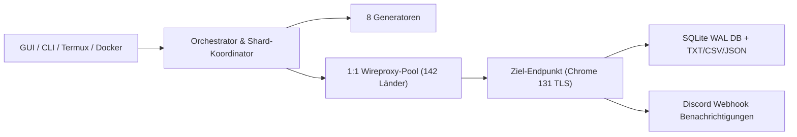

<div align="center">

<br />

| [KR 한국어](./ko.md) | [US English](../../README.md) | [JP 日本語](./ja.md) | [CN 简体中文](./zh-CN.md) | [ES Español](./es.md) |
| :---: | :---: | :---: | :---: | :---: |
| [FR Français](./fr.md) | [DE Deutsch](./de.md) | [RU Русский](./ru.md) | [BR Português](./pt-BR.md) | [SA العربية](./ar.md) |

<p align="center"><sub>🌐 Also available: <a href="./hi.md">HI हिन्दी</a> · <a href="./id.md">ID Bahasa Indonesia</a></sub></p>

<br />

[](../../CHANGELOG.md)

# ⚡ D4UC (`discord-checker`)

> **Hochleistungs-Prüfmaschine für seltene Discord-Benutzernamen — Chrome 131 TLS-Tarnung, isolierter 1:1 Multi-Tunnel-Pool & SQLite WAL-Sharding.**

[](https://github.com/KRCUPRO/discord-checker/releases/tag/v12.1.0)
[](../../LICENSE)
[](https://www.python.org/)
[](../GUIDE.md)
[](../specs/01_NETWORK_CORE_ENGINE.md)

<sub>Copyright (c) 2026 KRCUPRO · Proprietäre und vertrauliche Softwarelizenz (Alle Rechte vorbehalten)</sub>

</div>

---

## 📸 Vorschau der Benutzeroberfläche

[](../guides/PC_GUIDE.md)

[](../guides/PC_GUIDE.md)

[](../guides/TERMUX_DEBIAN_GUIDE.md)

[](../guides/DOCKER_GUIDE.md)

---

<details open>
<summary><b>🌟 Überblick & Kernfunktionen</b></summary>

Herkömmliche Username-Checker scheitern an modernen Edge-Schutzmechanismen durch drei Engpässe:
1. **TLS-Fingerprint-Blockierung**: Standard-HTTP-Bibliotheken werden anhand künstlicher JA3/JA4-Signaturen von Cloudflare/WAF blockiert.
2. **Systemweite VPN-Eingriffe**: Ein Desktop-VPN überschreibt Netzwerkadapter und DNS des gesamten Rechners.
3. **429-Stillstand & Dateikonflikte**: Rate-Limits stoppen alle Worker, und parallele Instanzen beschädigen Ausgabedateien.

**D4UC (`discord-checker`)** löst alle drei Probleme in einer sauberen, plattformübergreifenden Architektur:
- **Chrome 131 TLS JA3/JA4 Stealth**: Basierend auf `curl_cffi` (BoringSSL) mit originalgetreuen Chrome-131-Handshakes und HTTP-Headern.
- **1:1 User-Space WireGuard-Tunnel (`wireproxy`)**: Bindet 142 globale Endpunkte pro Worker auf isolierte lokale Ports (`127.0.0.1:1081+`) ohne Eingriff ins Host-Netzwerk.
- **0,3s Atomarer 429-Hot-Swap**: Nur der betroffene Worker wechselt sofort zu einem frischen Landesknoten; alle anderen laufen unterbrechungsfrei weiter.
- **Mathematisches Sharding & SQLite WAL**: Zerlegt vollständige Scans in 2, 3 oder 4 disjunkte Bereiche (`2_1`, `2_2`, `4_1`–`4_4`) ohne doppelte Prüfungen.

</details>

---

<details open>
<summary><b>🥊 Vergleichsmatrix: Legacy-Skripte vs. D4UC v12</b></summary>

| Merkmal | Legacy-Skripte | ⚡ D4UC v12 (`discord-checker`) |
| :--- | :---: | :---: |
| **TLS-Tarnung** | ❌ `requests` / `aiohttp` sofort erkannt | **✅ BoringSSL Chrome 131 JA3/JA4 Imitation** |
| **Netzwerkisolation** | ❌ Systemweites VPN nötig | **✅ User-Space `wireproxy` Pool (1:1 je Worker)** |
| **429-Wiederherstellung** | ❌ Globaler Stopp oder Absturz | **✅ 0,3s Worker-Hot-Swap + Cooldown-Warteschlange** |
| **Multi-Instanz-Sharding** | ❌ Doppelprüfungen & Sperrfehler | **✅ Disjunkte Shards + SQLite WAL-Synchronisation** |
| **Plattformen & UI** | ⚠️ Nur einfaches CLI | **✅ Desktop-GUI (KO/EN), Rich CLI, Termux & Docker** |
| **Sicherheits-Hygiene** | ⚠️ Gefahr harter Schlüssel | **✅ Striktes `.gitignore`, `.env` & Beispielvorlagen** |

</details>

---

<details open>
<summary><b>🧬 8 Namensgenerierungs-Modi</b></summary>

| Modus | Strategie | Optimaler Einsatz |
| :--- | :--- | :--- |
| `hybrid` | Wörterbuchstämme + Symmetrie/Zahlen | Schnelle allgemeine Entdeckung |
| `permutation` | Vollständiger Suchraum (`a–z`, `0–9`, `_`) | Lückenlose Abdeckung mit Sharding (`2_1`, `2_2`) |
| `dictionary` | 3–6-stellige Wörter & Silben | Wertvolle lesbare Namen |
| `pattern` | Symmetrische Muster (`aaaa`, `abba`, `abab`) | Visuell auffällige Kombinationen |
| `numeric` | Sequentielle & wiederholte Ziffern (`0000`–`9999`) | Kurze Zahlen-IDs |
| `custom_mask` | Präfix/Suffix/Punkt-Regeln (`??.vip`, `kr??`) | Gezielte Initialen & Marken |
| `combinatorial` | Phonetische CVCV / VCCV-Silben | Aussprechbare Kunstnamen |
| `recheck` | Erneute Prüfung früherer `TAKEN`-Einträge | Neu freigegebene Namen abfangen |

</details>

---

<details open>
<summary><b>🏛️ Systemarchitektur & Verzeichnisstruktur</b></summary>



```text
discord-checker/
├── config/                  # .env.example & config.example.yaml Vorlagen
├── data/                    # 142-Cluster-DB & Anmeldedaten-Vorlage
├── deploy/                  # Dockerfile, docker-compose.yml, Termux & PyInstaller
├── docs/                    # Handbücher, 11 Übersetzungen, Architektur & Specs
├── src/                     # GUI (KO/EN), CLI & Kernmodule
├── tests/                   # Automatisierte Test-Suite (68 Tests)
├── CHANGELOG.md             # Versionshistorie
├── LICENSE                  # Proprietäre Lizenz (KRCUPRO)
├── NOTICE                   # Drittanbieter-Hinweise
├── README.md                # Englische Hauptdokumentation
├── requirements.txt         # Python-Abhängigkeiten
└── SECURITY.md              # Sicherheitsrichtlinie
```

</details>

---

<details open>
<summary><b>🚀 Schnellstart auf 4 Plattformen</b></summary>

#### 1. Desktop-GUI (Windows / Desktop)
```bash
git clone https://github.com/KRCUPRO/discord-checker.git
cd discord-checker
python -m venv .venv
.\.venv\Scripts\activate
pip install -r requirements.txt

python src/gui_ko.py
python src/gui_en.py
```

#### 2. Headless-CLI & Sharding
```bash
python src/run.py
python src/run.py --mode permutation --length 4 --shard 2_1 --workers 5
python src/run.py --no-dashboard
```

#### 3. Docker & Multi-Container
```bash
cp config/.env.example .env
docker compose -f deploy/docker-compose.yml up -d
docker compose -f deploy/docker-compose.yml --profile 2shard up -d
```

#### 4. Android Termux (`proot-distro debian`)
```bash
chmod +x deploy/install_debian.sh deploy/run.sh
./deploy/install_debian.sh
termux-wake-lock
nohup ./deploy/run.sh --no-dashboard > output.log 2>&1 &
```

</details>

---

<details>
<summary><b>⚙️ Konfiguration & Umgebungsvariablen</b></summary>

Kopiere [config/.env.example](../../config/.env.example) nach `.env`:

```ini
SURFSHARK_PRIVATE_KEYS=YOUR_SURFSHARK_WIREGUARD_PRIVATE_KEY_HERE
D4UC_MODE=hybrid
D4UC_LENGTH=4
D4UC_WORKERS=5
D4UC_PROXY=surfshark
D4UC_WEBHOOK=
```

Weitere Sicherheitshinweise in [SECURITY.md](../../SECURITY.md).

</details>

---

<details open>
<summary><b>📄 Lizenz & Urheberrecht</b></summary>

Copyright (c) 2026 **KRCUPRO**. Alle Rechte vorbehalten.  
Lizenziert unter der [PROPRIETARY & CONFIDENTIAL SOFTWARE LICENSE](../../LICENSE).  
Hinweise zu Drittanbieter-Komponenten finden Sie in [NOTICE](../../NOTICE).

</details>

---

## 🚫 Ausgeschlossene Benutzernamen (Beispiele: `ab..`, `a..1`)

Gemäß den offiziellen Discord-Richtlinien werden folgende ungültige Muster zu 100% vorab gefiltert:
1. **Aufeinanderfolgende Punkte verboten (`..`)**:
   - `ab..` (Am Ende) ➔ **Ausgeschlossen**
   - `a..1` (In der Mitte) ➔ **Ausgeschlossen**
   - `..kr` (Am Anfang) ➔ **Ausgeschlossen**
2. **Punkt am Anfang oder Ende verboten (`.`)**: `.abc`, `abc.` ➔ **Ausgeschlossen**
3. **Erlaubte Zeichen**: Nur Kleinbuchstaben (`a-z`), Ziffern (`0-9`), Unterstrich (`_`) und Einzelpunkt (`.`).
4. **Reservierte Begriffe**: `discord`, `clyde`, `system`, `everyone` werden automatisch blockiert.

## 📞 Discord Kontakt : myuyayam

Fragen und Support via Discord: **`myuyayam`**.
