<div align="center">

# 🏛️ D4UC Architektur-Mapping & Systemübersicht (ARCHITECTURE_MAP.md)

> **Verlustfreie asynchrone Nebenläufigkeit, konfliktfreie SQLite-Persistenz, TLS-Tarnung & 1:1 isolierte Tunnel**

<br />

| [KR 한국어](../ko/ARCHITECTURE_MAP.md) | [US English](../en/ARCHITECTURE_MAP.md) | [JP 日本語](../ja/ARCHITECTURE_MAP.md) | [CN 简体中文](../zh-CN/ARCHITECTURE_MAP.md) | [ES Español](../es/ARCHITECTURE_MAP.md) |
| :---: | :---: | :---: | :---: | :---: |
| [FR Français](../fr/ARCHITECTURE_MAP.md) | [DE Deutsch](./ARCHITECTURE_MAP.md) | [RU Русский](../ru/ARCHITECTURE_MAP.md) | [BR Português](../pt-BR/ARCHITECTURE_MAP.md) | [SA العربية](../ar/ARCHITECTURE_MAP.md) |

<p align="center"><sub>🌐 Also available: <a href="../hi/ARCHITECTURE_MAP.md">HI हिन्दी</a> • <a href="../id/ARCHITECTURE_MAP.md">ID Bahasa Indonesia</a></sub></p>

<br />

[](./CHANGELOG.md)
[](./ARCHITECTURE_MAP.md)

</div>

---

<a id="-inhaltsverzeichnis"></a>
## 📑 Inhaltsverzeichnis
1. [1. Schichtenarchitektur des Systems](#-1-schichtenarchitektur-des-systems)
2. [2. End-to-End-Ausführungsfluss](#-2-end-to-end-ausführungsfluss)
3. [3. Hochdurchsatz-Parallelität & Deadlock-Prävention](#-3-hochdurchsatz-parallelität--deadlock-prävention)
4. [4. Datenfluss & SQLite WAL-Persistenz](#-4-datenfluss--sqlite-wal-persistenz)
5. [5. Sicherheits- & Netzwerk-Isolationskonzepte](#-5-sicherheits--netzwerk-isolationskonzepte)

---

## 💎 Architektonische Kernprinzipien
- **Verlustfreie asynchrone Nebenläufigkeit**: Bis zu 50 parallele Worker auf der `asyncio`-Ereignisschleife.
- **Konfliktfreie SQLite-Persistenz**: SQLite WAL mit `busy_timeout=5000ms` schließt Deadlocks aus.
- **Chrome 131 TLS-Tarnung**: `curl_cffi` bildet die JA3/JA4-Fingerabdrücke exakt nach.
- **1:1 isolierte Tunnel**: `wireproxy` routet Worker-Traffic im User-Space ohne Eingriff in die Host-Netzwerkkarten.

---

<a id="-1-schichtenarchitektur-des-systems"></a>
## 🏛️ 1. Schichtenarchitektur des Systems

```mermaid
graph TD
    subgraph Layer 1: Presentation ["1. Presentation Layer (UI / CLI)"]
        GUI_KO["src/gui_ko.py (Korean GUI)"]
        GUI_EN["src/gui_en.py (English GUI)"]
        GUI_WEB["src/web_gui.py (Mobile Touch Web GUI / PWA)"]
        CLI["src/run.py (Headless CLI + Rich Dashboard)"]
    end

    subgraph Layer 2: Orchestration ["2. Orchestration & Worker Loop"]
        ORCH["Orchestrator / Async Worker Loop"]
        METRICS["DashboardMetrics (RPS, Available, Taken, 429)"]
        SHARD["Sharding Coordinator (2_1, 2_2, 3_1...)"]
    end

    subgraph Layer 3: Network & Stealth ["3. Network & TLS Stealth"]
        CLIENT["DiscordApiClient (curl_cffi AsyncSession)"]
        TLS["Chrome 131 TLS JA3/JA4 Fingerprint"]
        HEADERS["Browser Headers (sec-ch-ua, Referer, Accept)"]
    end

    subgraph Layer 4: Proxy Infrastructure ["4. Proxy Infrastructure & Multi-Tunnel"]
        UPM["UnifiedProxyManager"]
        SURF["SurfsharkProxyProvider (1:1 Multi-Tunnel)"]
        FREE["FreeProxyProvider (18 Open-Source Pools)"]
        WIRE["Wireproxy Process Daemon (User-Space Netstack)"]
        COOLDOWN["429 Cooldown Queue & 0.3s Atomic Hot-Swap Engine"]
    end

    subgraph Layer 5: Candidate Generator ["5. Candidate Username Generator Engine"]
        GEN_FACT["create_generator() Factory"]
        HYBRID["HybridGenerator"]
        PERM["PermutationGenerator (Sharded Math Engine)"]
        DICT["DictionaryGenerator"]
        MASK["CustomMaskGenerator"]
        OTHER_GEN["Pattern / Numeric / Combinatorial / Recheck"]
    end

    subgraph Layer 6: Storage & Notify ["6. Persistent Storage & Notifications"]
        STORAGE["StorageManager (Async Queue Worker)"]
        SQLITE["SQLite WAL (d4uc_results.db, busy_timeout=5s)"]
        MIRROR["Legacy Mirror (available.txt, taken.txt)"]
        WEBHOOK["DiscordWebhookNotifier (0.1s Dispatch)"]
    end

    GUI_KO & GUI_EN & GUI_WEB & CLI --> ORCH
    ORCH --> GEN_FACT
    GEN_FACT --> HYBRID & PERM & DICT & MASK & OTHER_GEN
    ORCH --> CLIENT
    CLIENT --> TLS & HEADERS
    ORCH --> UPM
    UPM --> SURF & FREE & WIRE & COOLDOWN
    ORCH --> STORAGE
    STORAGE --> SQLITE & MIRROR & WEBHOOK
```



### Schicht 1: Präsentation
`src/gui_ko.py` (Koreanisch), `src/gui_en.py` (Englisch), `src/web_gui.py` (Mobiles Web GUI / PWA), `src/run.py` (Terminal Rich CLI).

### Schicht 2: Orchestrierung
Hintergrund-Worker-Schleife, Live-Telemetrie (RPS, Verfügbar, 429) und Sharding-Koordinator (`2_1`, `2_2`).

### Schicht 3: Netzwerk & TLS-Tarnung
`DiscordApiClient` (`curl_cffi`), Chrome 131 TLS-Signaturen und Header-Emulation.

### Schicht 4: Proxy-Infrastruktur
`UnifiedProxyManager`, `SurfsharkProxyProvider` (1:1), `FreeProxyProvider`, atomarer 429 Hot-Swap in 0,3s.

### Schicht 5: Generierungs-Engines
`create_generator()` Factory: Permutation, Hybrid, Wörterbuch, Maske, Muster, Numerisch, Kombinatorisch, Nachprüfung.

### Schicht 6: Speicherung & Benachrichtigung
`StorageManager`, SQLite WAL (`d4uc_results.db`), TXT-Dateispiegelung und Discord-Webhook-Push.


[⬆️ Zurück zum Inhaltsverzeichnis](#-inhaltsverzeichnis)

---

<a id="-2-end-to-end-ausführungsfluss"></a>
## 🔄 2. End-to-End-Ausführungsfluss

```text
[Candidate Generator] ──(Next Batch)──> [Orchestrator Worker Pool]
                                                    │
                                            (Lease Isolated SOCKS5)
                                                    ▼
                                        [Unified Proxy Manager]
                                                    │
                                          (Chrome 131 TLS Impersonation)
                                                    ▼
                                        [Discord API Endpoint]
                                                    │
                                         (Response Dispatch)
                        ┌───────────────────────────┴───────────────────────────┐
                        ▼                                                       ▼
               HTTP 200 / Taken                                         HTTP 429 Rate Limit
                        │                                                       │
        ┌───────────────┴───────────────┐                             (0.3s Atomic Hot-Swap)
        ▼                               ▼                                       ▼
 [SQLite WAL Storage]       [Discord Webhook Push]                  [Rotate to Fresh Country]
```

[⬆️ Zurück zum Inhaltsverzeichnis](#-inhaltsverzeichnis)

---

<a id="-3-hochdurchsatz-parallelität--deadlock-prävention"></a>
## ⚡ 3. Hochdurchsatz-Parallelität & Deadlock-Prävention

- **Non-blocking Concurrency**: All network I/O operations are scheduled on Python's native `asyncio` event loop.
- **429 Atomic Hot-Swap**: When an isolated worker hits Discord's 429 rate limit, its specific Wireproxy local port is seamlessly reassigned to an available server node in under 0.3s without affecting concurrent workers.
- **Zero Lock Deadlock**: SQLite WAL journal mode coupled with Python-level queueing completely eliminates `database is locked` operational exceptions.

[⬆️ Zurück zum Inhaltsverzeichnis](#-inhaltsverzeichnis)

---

<a id="-4-datenfluss--sqlite-wal-persistenz"></a>
## 💾 4. Datenfluss & SQLite WAL-Persistenz

- **Primary Database**: `data/d4uc_results.db` configured with `PRAGMA journal_mode = WAL` and `PRAGMA synchronous = NORMAL`.
- **Text File Mirroring**: For maximum legacy compatibility, all newly verified rare handles are concurrently appended to `available.txt` and `checked_history.txt`.

[⬆️ Zurück zum Inhaltsverzeichnis](#-inhaltsverzeichnis)

---

<a id="-5-sicherheits--netzwerk-isolationskonzepte"></a>
## 🛡️ 5. Sicherheits- & Netzwerk-Isolationskonzepte

- **Zero-Leak Policy**: All local credentials, WireGuard configuration files, and secrets are strictly excluded from version control.
- **User-Space Network Isolation**: All proxy traffic is terminated in user space (`wireproxy`), preventing interference with system-wide DNS or routing tables.

[⬆️ Zurück zum Inhaltsverzeichnis](#-inhaltsverzeichnis)
