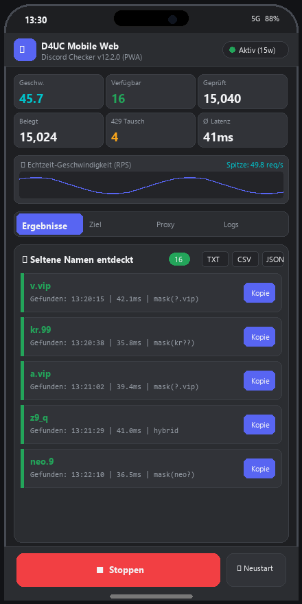
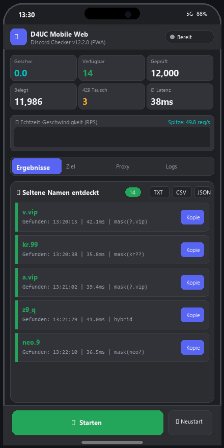
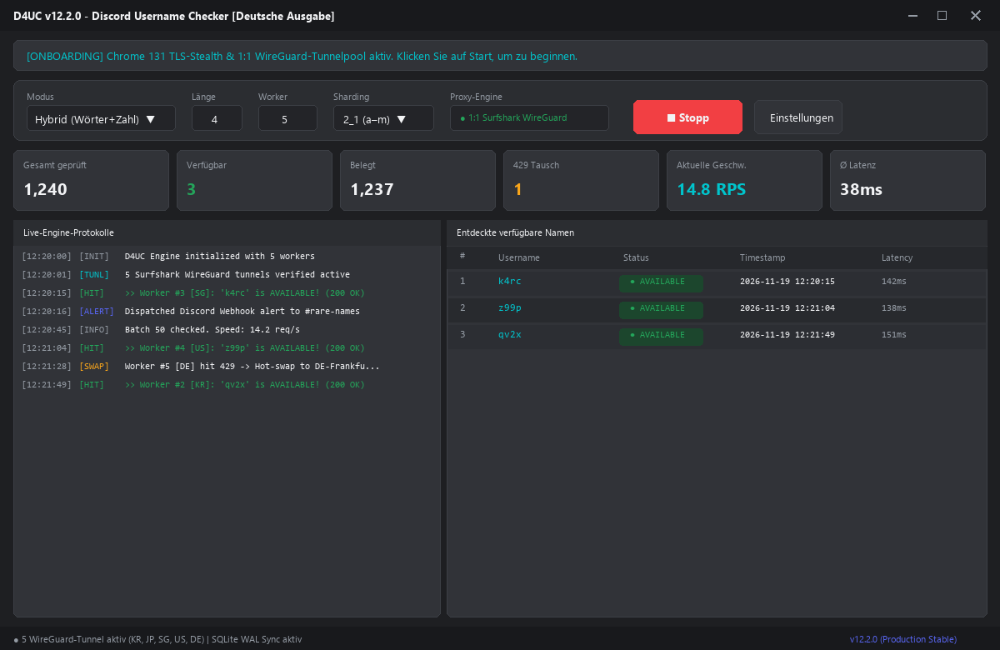
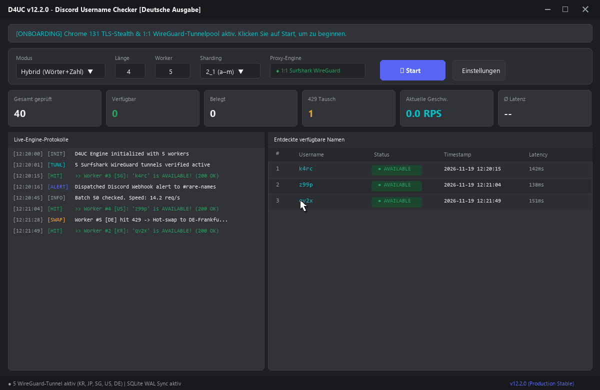
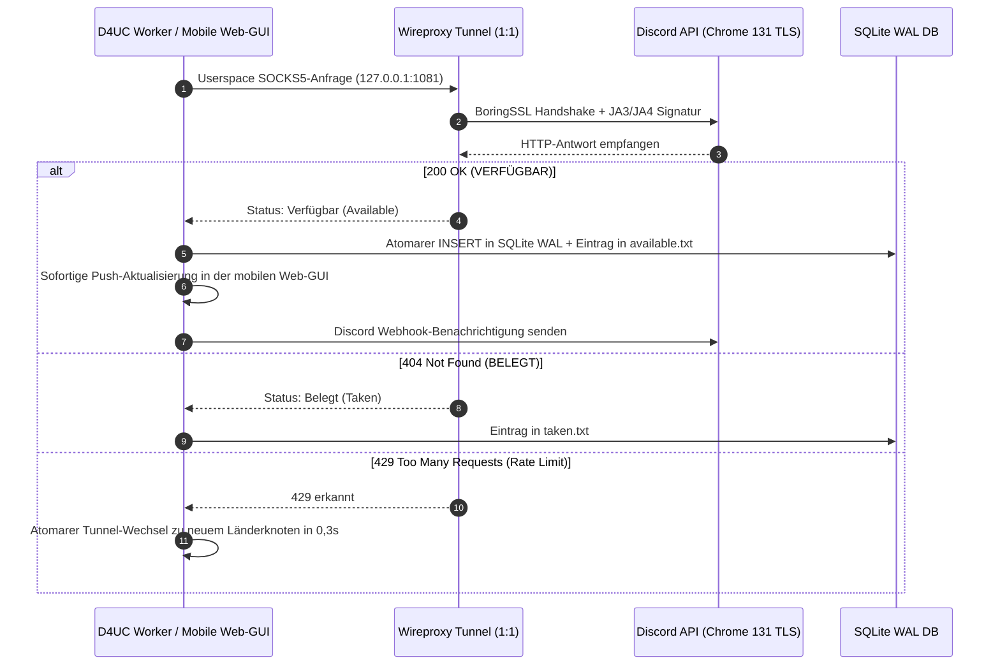

<div align="center">

# ⚡ D4UC (`discord-checker`) v12.2.0

> **Hochleistungs-Engine zur Verfügbarkeitsprüfung seltener Discord-Benutzernamen**  
> Mobile responsive Web-GUI & PWA · Chrome 131 TLS-Tarnung · 1:1 isolierter WireGuard-Tunnelpool im Userspace · Atomarer 0,3s 429-Hot-Swap · SQLite WAL-Sharding

<br />

| [KR 한국어](../ko/README.md) | [US English](../en/README.md) | [JP 日本語](../ja/README.md) | [CN 简体中文](../zh-CN/README.md) | [ES Español](../es/README.md) |
| :---: | :---: | :---: | :---: | :---: |
| [FR Français](../fr/README.md) | [DE Deutsch](./README.md) | [RU Русский](../ru/README.md) | [BR Português](../pt-BR/README.md) | [SA العربية](../ar/README.md) |

<p align="center"><sub>🌐 Also available: <a href="../hi/README.md">HI हिन्दी</a> • <a href="../id/README.md">ID Bahasa Indonesia</a></sub></p>

[](./CHANGELOG.md)
[](https://github.com/KRCUPRO/discord-checker/releases/tag/v12.4.0)
[](./LICENSE.md)
[](https://www.python.org/)
[](../../guides/README.md)
[](../../specs/01_NETWORK_CORE_ENGINE.md)
[](https://colab.research.google.com/github/KRCUPRO/discord-checker/blob/main/D4UC_Google_Colab.ipynb)
[](gas/README.md)
[](docs/MOBILE_AND_IPHONE_GUIDE.md)

<sub>Copyright (c) 2026 KRCUPRO · Proprietäre Lizenz (Alle Rechte vorbehalten)</sub>

</div>

---


> ### ☁️ 100% Cloud Zero-Install: Google Colab & Google Apps Script 24/7
> **Keine lokale Installation oder Hochleistungs-PC erforderlich!** Führen Sie D4UC direkt in der Cloud auf **jedem Gerät aus — iPhone (Safari), iPad, Android oder Tablet**.
> - 🚀 **[In Google Colab öffnen](https://colab.research.google.com/github/KRCUPRO/discord-checker/blob/main/D4UC_Google_Colab.ipynb)**: Interaktives Web-Dashboard in 10 Sprachen, automatische Google Drive-Synchronisierung und Discord Webhooks in Echtzeit.
> - ⏱️ **[Google Apps Script 24/7 Checker](gas/README.md)**: Läuft 24 Stunden an 365 Tagen autonom in der Google Cloud, selbst wenn Ihr Gerät ausgeschaltet ist.
> - 📱 **[Mobile & iPhone Cloud-Leitfaden](docs/MOBILE_AND_IPHONE_GUIDE.md)**: 1-Minuten-Setup für mobile Browser.

<a id="-inhaltsverzeichnis"></a><a id="inhaltsverzeichnis"></a>
## 📑 Inhaltsverzeichnis
1. [📸 Benutzeroberflächen-Vorschau](#-benutzeroberflächen-vorschau)
2. [✨ Hauptfunktionen](#-hauptfunktionen)
3. [🖥️ Systemanforderungen und Abhängigkeiten](#-systemanforderungen-und-abhängigkeiten)
4. [📁 Verzeichnisstruktur](#-verzeichnisstruktur)
5. [🌐 Proxy-Konfiguration & 🔑 Zugangsdaten](#-proxy-konfiguration-zugangsdaten)
6. [🚀 Installation & Ausführung](#-installation-ausführung)
7. [📱 Anleitung zur mobilen Web-GUI & PWA-Fernsteuerung](#-anleitung-zur-mobilen-web-gui-pwa-fernsteuerung)
8. [🧵 Worker- und Thread-Optimierung](#-worker--und-thread-optimierung)
9. [🔢 Methoden der Benutzernamengenerierung](#-methoden-der-benutzernamengenerierung)
10. [🚫 Strikte Ausschlussregeln (z. B. `ab..`, `a..1`)](#-strikte-ausschlussregeln-z-b-ab-a1)
11. [📡 Ablaufdiagramm der Überprüfung](#-ablaufdiagramm-der-überprüfung)
12. [🔄 Proxy-Sitzungsverwaltung](#-proxy-sitzungsverwaltung)
13. [🔁 Fehlerbehandlung und Wiederholungslogik](#-fehlerbehandlung-und-wiederholungslogik)
14. [💾 Speicherformate](#-speicherformate)
15. [📊 Echtzeit-Metriken & Überwachung](#-echtzeit-metriken-überwachung)
16. [🛑 Beenden der Prüfung](#-beenden-der-prüfung)
17. [⚠️ Architektur bei Rate Limits (429)](#-architektur-bei-rate-limits-429)
18. [🔧 Problembehebung](#-problembehebung)
19. [📞 Discord-Support: myuyayam](#-discord-support-myuyayam)
20. [⭐ Projekt unterstützen (GitHub Star)](#-projekt-unterstützen-github-star)
21. [📚 Hinweis zu Studien- und Forschungszwecken](#-hinweis-zu-studien--und-forschungszwecken)

---

<a id="-benutzeroberflächen-vorschau"></a><a id="benutzeroberflächen-vorschau"></a>
## 📸 Benutzeroberflächen-Vorschau

### Für Mobilgeräte optimierte responsive Web-GUI (PWA - iPhone & Android)
[](../../guides/MOBILE_IOS_GUIDE.md)

### Interaktive mobile Echtzeit-Demonstration (1-Tap-Touch-Bedienung & Live-Telemetrie)
[](../../guides/MOBILE_IOS_GUIDE.md)

### Desktop-GUI (Deutsche Ausgabe)
[](../../guides/WINDOWS_GUIDE.md)

### Echtzeit-Desktop-Demo (Flüssige Maussteuerung)
[](../../guides/WINDOWS_GUIDE.md)

### Headless CLI-Dashboard
[](../../guides/TERMUX_DEBIAN_GUIDE.md)

### Docker- & Linux-Server-Bereitstellung
[](../../guides/DOCKER_GUIDE.md)

[⬆️ Nach oben](#-inhaltsverzeichnis)

---

<a id="-hauptfunktionen"></a><a id="hauptfunktionen"></a>
## ✨ Hauptfunktionen
- **☁️ 100% Cloud Zero-Install (Google Colab & GAS 24/7)**: Läuft auf iPhone (Safari), iPad, Android und Tablets ohne PC. 10-Sprachen-UI, Google Drive-Speicherung und 24/7-Trigger.

1. **Mobile responsive Web-GUI & PWA-Engine (`http://<host>:5000`)**:
   - Lokal, auf VPS, Docker oder Termux ausführen und bequem von jedem Smartphone-Browser (iPhone Safari, Android Chrome) aus fernsteuern.
   - Unterstützt nativ **"Zum Home-Bildschirm hinzufügen" (PWA)** als rahmenlose Vollbild-App ohne App-Store-Download.
   - Große touch-optimierte [Start / Stopp]-Schaltflächen, reines HTML5-Canvas-Geschwindigkeitsdiagramm, 1-Tap-Kopieren gefundener Namen und direkter Export als TXT/CSV/JSON.
   - Vollständige Fernkonfiguration und Hot-Swap von Proxys (Surfshark-Schlüsselpool, Dateien, Thordata), 8 Generierungsmodi und Worker-Schieberegler (1–50) direkt vom Smartphone.

2. <a id="fnref-1"></a><a id="fnref1"></a>**Chrome 131 TLS-Tarnung JA3/JA4 (`curl_cffi` BoringSSL)[^1]**:
   - Verhindert künstliche TLS-Signaturen herkömmlicher Python-Bibliotheken (`requests`, `aiohttp`, `httpx`).
   - Bitgenaue Emulation der Cipher Suites, Extensions und HTTP/2 SETTINGS-Frames des echten Google Chrome 131 zur Überwindung von Cloudflare- und WAF-Prüfungen.

3. <a id="fnref-2"></a><a id="fnref2"></a>**1:1 isolierter WireGuard-Tunnelpool im Userspace (`wireproxy`)[^2]**:
   - Verändert weder Netzwerkadapter noch DNS oder System-Routen des Host-PCs.
   - Weist jedem Worker über die Userspace-Binary `wireproxy` einen isolierten lokalen Port (`127.0.0.1:1081+`) zu, der auf 142 weltweite Endpunkte gemappt wird. Normaler Datenverkehr auf dem PC bleibt zu 100 % unbeeinträchtigt.

4. **Atomarer 0,3-Sekunden 429-Hot-Swap**:
   - Tritt bei einem Worker ein HTTP 429 Rate Limit auf, stoppt der Prüfprozess nicht.
   - Ausschließlich der betroffene Worker wechselt in unter 300 ms atomar auf einen neuen Länder-Knotenpunkt, während alle anderen Worker mit voller Geschwindigkeit weiterarbeiten.

5. **Mathematisches duplikatfreies Sharding**:
   - Unterstützt die Aufteilung des Suchraums (`2_1`, `2_2`, `4_1`–`4_4`) für vollständige Permutations- und Lexikondurchläufe.
   - Mehrere parallele Instanzen scannen disjunkte Bereiche mit 0 % redundanten Anfragen.

6. **SQLite WAL-Parallelität & Multi-Format-Dateispeicherung**:
   - Leistungsstarkes Speichern mit Transaktionssicherheit über SQLite im WAL-Modus (`data/d4uc_results.db`).
   - Gefundene Namen werden sofort atomar in Textdateien (`available.txt`, `taken.txt`), CSV und JSON gespiegelt.

7. **8 intelligente Generierungsalgorithmen**:
   - Hybrid, Permutation, Wörterbuch, symmetrische Muster, Zahlenfolgen, benutzerdefinierte Masken, Silbenkombinationen und historische Neuüberprüfung.

8. **Plattformübergreifende Unterstützung**:
   - Windows-Binärdateien (`.exe` in 4 Varianten), mobile PWA, Linux/macOS CLI-Konsole, Android Termux-Skripte und Docker-Container.

[⬆️ Nach oben](#-inhaltsverzeichnis)

---

<a id="-systemanforderungen-und-abhängigkeiten"></a><a id="systemanforderungen-und-abhängigkeiten"></a>
## 🖥️ Systemanforderungen und Abhängigkeiten

### Laufzeitumgebung
- **Betriebssystem**: Windows 10/11 (64-Bit), Linux (Debian 11+, Ubuntu 20.04+, Arch), macOS 12+, Android 10+ (Termux), iOS Safari
- **Python**: 3.10, 3.11, 3.12 (Empfohlen: **Python 3.12**)
- **RAM**: Mindestens 512 MB (~250 MB bei 50 parallelen Workern)
- **Netzwerk**: Breitbandverbindung (ausgehender UDP-Port 51820 für WireGuard)

### Erforderliche Pakete (`requirements.txt`)
- `curl_cffi >= 0.7.0`: Chrome 131 BoringSSL TLS-Emulation
- `customtkinter >= 5.2.0`: Modernes Desktop-GUI-Framework
- `rich >= 13.7.0`: Terminal-Dashboard und Telemetrie
- `pydantic >= 2.6.0`: Konfigurationsvalidierung
- `pyyaml >= 6.0.1`: YAML-Parser
- `pillow >= 10.2.0`: Bildverarbeitung und Icon-Generierung

[⬆️ Nach oben](#-inhaltsverzeichnis)

---

<a id="-verzeichnisstruktur"></a><a id="verzeichnisstruktur"></a>
## 📁 Verzeichnisstruktur

```text
discord-checker/
├── config/                         # Konfigurationsvorlagen und .env.example
├── data/                           # 142 WireGuard-Endpunkte und SQLite-Datenbank
├── deploy/                         # Build-, Docker- und Generierungsskripte
│   ├── android/                    # Android native app project
│   ├── build_apk.py                # Android release APK builder
│   ├── build_exe.py                # 4-in-1 Windows .exe Compiler
│   ├── docker-compose.yml          # Docker Compose Konfiguration
│   ├── Dockerfile                  # Multi-Arch Container-Definition
│   ├── generate_assets.py          # Generator für Vorschaubilder und GIFs
│   ├── generate_badges.py          # SVG-Badges-Generator für 12 Sprachen
│   └── generate_mobile_assets.py   # Mobile PWA Mockups und Demo-GIF
├── docs/                           # Dokumentation, Anleitungen und Assets
│   ├── assets/                     # Screenshots, animierte GIFs und Badges
│   ├── guides/                     # Anleitungen für iOS, PC, Docker und Termux
│   └── locales/                    # Vollständige 1:1 Übersetzungen in 11 Sprachen
├── src/                            # Quellcode der Haupt-Engine
│   ├── generator/                  # 8 Generierungsalgorithmen und Ausschlussfilter
│   ├── network/                    # Chrome 131 TLS-Client und Backoff-Steuerung
│   ├── notify/                     # Discord Webhook-Benachrichtigungen
│   ├── proxy/                      # 1:1 WireGuard Tunnelpool-Verwaltung
│   ├── storage/                    # SQLite WAL und Textdateispeicherung
│   ├── ui/                         # Mehrsprachigkeit (i18n), Tooltips, CLI
│   │   └── web/                    # Mobile PWA Web-App (HTML5/CSS3/Vanilla JS)
│   ├── web_gui.py                  # Responsive Web-GUI & REST API-Server
│   ├── gui.py                      # CustomTkinter Desktop-Orchestrator
│   ├── gui_ko.py                   # Koreanische Desktop-GUI
│   ├── gui_en.py                   # Englische Desktop-GUI
│   └── run.py                      # Headless CLI-Einstiegspunkt
├── tests/                          # Automatisierte Test-Suite
├── CHANGELOG.md                    # Versionshistorie und Release Notes
├── LICENSE                         # Proprietäre Lizenz (KRCUPRO)
├── README.md                       # Englische Hauptdokumentation
└── SECURITY.md                     # Sicherheitsrichtlinien
```

[⬆️ Nach oben](#-inhaltsverzeichnis)

---

<a id="-proxy-konfiguration-zugangsdaten"></a><a id="proxy-konfiguration-zugangsdaten"></a>
## 🌐 Proxy-Konfiguration & 🔑 Zugangsdaten

D4UC enthält einen **1:1 Userspace-WireGuard-Tunnelpool** via `wireproxy`, um IP-Sperren ohne Systemänderungen vollständig zu umgehen.

### 1. Einrichtung
1. Kopieren Sie `config/.env.example` nach `.env`:
   ```bash
   cp config/.env.example .env
   ```
2. Tragen Sie Ihre Surfshark WireGuard-Privatschlüssel in `.env` ein:
   ```ini
   # Mehrere Schlüssel kommagetrennt für hohe Parallelität
   SURFSHARK_PRIVATE_KEYS=IHR_WIREGUARD_PRIVATSCHLUESSEL_1,IHR_WIREGUARD_PRIVATSCHLUESSEL_2
   
   # Worker-Anzahl (Standard: 5, Maximal: 50)
   D4UC_WORKERS=5
   
   # Discord Webhook-URL für Sofortbenachrichtigungen (Optional)
   D4UC_WEBHOOK=https://discord.com/api/webhooks/YOUR_WEBHOOK_ID/YOUR_WEBHOOK_TOKEN
   ```

### 2. Kostenloser Public-Proxy Scraper & Live Multi-Threaded Validator (`--proxy free`) [Neu in v12.3.0]
Vollständig kostenloser Betrieb ohne VPN-Abonnement:
- **Automatisiertes Multi-Source-Scraping**: Sammelt kontinuierlich aktualisierte Proxy-Listen aus über 14 GitHub-Repositories und Hugging Face-Datensätzen (TheSpeedX, monosans, hookzof, roosterkid, ShiftyTR, mertguvencli, Hugging Face).
- **Multi-Protokoll-Unterstützung**: Nahtlose Unterstützung für HTTP-, HTTPS-, SOCKS4- und SOCKS5-Proxies.
- **Asynchrone Echtzeit-Verbindungsprüfung**: Testet Kandidaten direkt gegen Discord- und Cloudflare-Endpunkte, filtert inaktive Server, Latenzen > 3500ms und 403-WAF-Sperren heraus.
- **Schutzschaltung & 429-Rotation**: Automatische 15s-Abkühlung bei Ratenbegrenzung und Hot-Swap auf den schnellsten aktiven Proxy.
- **Oberflächenintegration**: Desktop-GUI-Auswahl, 1-Tap-Button in der mobilen Web-GUI und CLI-Schalter `--proxy free` (oder `-p free`).

### 3. Sicherheitsrichtlinie (Zero-Leak Policy)
- Konfigurationsdateien (`.env`, `config.yaml`) und Schlüssel sind über `.gitignore` vollständig von Git ausgeschlossen.

[⬆️ Nach oben](#-inhaltsverzeichnis)

---

<a id="-installation-ausführung"></a><a id="installation-ausführung"></a>
## 🚀 Installation & Ausführung
### ☁️ Methode 0: 100% Cloud Zero-Install (Google Colab & Google Apps Script 24/7)
> **Empfohlen für iPhone, iPad, Android, Tablets oder Anwender ohne Python-Installation.**

1. **Google Colab Notebook**: Klicken Sie auf [](https://colab.research.google.com/github/KRCUPRO/discord-checker/blob/main/D4UC_Google_Colab.ipynb), um das Dashboard in 10 Sprachen zu starten.
2. **Google Apps Script 24/7 Runner**: Siehe [gas/README.md](gas/README.md) für 24/7-Dauerüberwachung auf Google Cloud-Triggern.
3. **Mobilleitfaden**: Siehe [docs/MOBILE_AND_IPHONE_GUIDE.md](docs/MOBILE_AND_IPHONE_GUIDE.md).


### Methode A: Eigenständige Windows-Programme (`.exe`)
Binärdateien ohne Python-Installation direkt aus [GitHub Releases v12.2.0](https://github.com/KRCUPRO/discord-checker/releases/tag/v12.4.0) herunterladen:
- `DiscordUsernameChecker_v12.3.0.apk`: **Native Android-App (1-Klick Installation)** [NEU]
- `DiscordUsernameCheckerV2_Web.exe`: **Mobile Web-GUI & PWA-Server (Port 5000)** [NEU]
- `DiscordUsernameCheckerV2_EN.exe`: Englische Desktop-GUI
- `DiscordUsernameCheckerV2_KO.exe`: Koreanische Desktop-GUI
- `DiscordUsernameCheckerV2_CLI.exe`: Konsolen-CLI-Dashboard

### 📱 Native Android-App (`.apk`) — 1-Klick-Installation [NEW]
- **Direkt-Download**: [`DiscordUsernameChecker_v12.3.0.apk`](https://github.com/KRCUPRO/discord-checker/releases/download/v12.3.0/DiscordUsernameChecker_v12.3.0.apk)
- **Installationsanleitung**:
  1. Laden Sie die `.apk`-Datei auf Ihr Android-Smartphone herunter (Galaxy, Pixel, Xiaomi etc.).
  2. Öffnen Sie die Datei über die Benachrichtigungen oder den Dateimanager.
  3. Erlauben Sie bei Bedarf die Installation aus unbekannten Quellen und tippen Sie auf **[Installieren]**.
  4. Starten Sie **`D4UC Discord Checker`** direkt von Ihrem Startbildschirm.
- **Mobile Funktionen**:
  - Offline integrierte 12-Sprachen Discord-Dark Touch-Oberfläche (`assets/www/index.html`).
  - 1-Tap Zwischenablage-Kopie mit nativen Android Toast-Benachrichtigungen.
  - Bildschirm-Wachhaltefunktion Wake Lock (`WAKE_LOCK`) während des Betriebs.
  - Nahtlose Fernverbindung zum PC/Server D4UC-Backend über WLAN oder Server-IP.

### Methode B: Mobile Web-GUI starten (Fernsteuerung per Smartphone)
```bash
# Web-GUI Server starten (Standardport: 5000)
python src/web_gui.py --port 5000

# Auf dem Smartphone im selben WLAN öffnen:
# http://<PC_LOKALE_IP>:5000
```

### Methode C: Start aus dem Quellcode
```bash
python -m venv .venv
source .venv/bin/activate  # Windows: .\.venv\Scripts\Activate.ps1
pip install -r requirements.txt

# Desktop-GUI starten
python src/gui_en.py

# CLI starten
python src/run.py --mode hybrid --length 4 --workers 5
```

[⬆️ Nach oben](#-inhaltsverzeichnis)

---

<a id="-anleitung-zur-mobilen-web-gui-pwa-fernsteuerung"></a><a id="anleitung-zur-mobilen-web-gui-pwa-fernsteuerung"></a>
## 📱 Anleitung zur mobilen Web-GUI & PWA-Fernsteuerung
### 📱 Geräteunabhängige Cloud-Ausführung (iPhone, iPad, Android, Tablet)
Neben der lokalen PWA kann D4UC vollständig in der Cloud über **Google Colab** und **Google Apps Script (GAS)** ausgeführt werden:
- **iPhone / iPad Safari**: Direkt in Mobile Safari öffnen ohne PC.
- **24/7 Autonome Überwachung**: Google Apps Script läuft bei gesperrtem Bildschirm oder ausgeschaltetem Gerät weiter.
- **Echtzeit-Meldung**: Sofortige Discord Webhook-Benachrichtigung bei verfügbarem Namen.
- Leitfaden: [docs/MOBILE_AND_IPHONE_GUIDE.md](docs/MOBILE_AND_IPHONE_GUIDE.md).


Überwachen und steuern Sie den Suchfortschritt bequem vom Smartphone aus.

### 1. Zum Home-Bildschirm hinzufügen (PWA-Installation)
1. Öffnen Sie `http://<PC_IP>:5000` auf Ihrem Smartphone (iPhone Safari oder Android Chrome).
2. **iPhone Safari**: Tippen Sie auf das Teilen-Symbol ➔ **"Zum Home-Bildschirm"**.
3. **Android Chrome**: Tippen Sie auf das Drei-Punkte-Menü (⋮) ➔ **"Zum Startbildschirm hinzufügen"** bzw. **"App installieren"**.
4. Starten Sie **D4UC Web** direkt als Vollbild-App ohne Adressleiste.

### 2. Mobile Touch-Funktionen
- **Echtzeit-Telemetrie**: Live-Anzeige von RPS-Geschwindigkeit, Funden, Gesamtzahl, 429-Swaps und Latenz (ms).
- **HTML5-Canvas-Geschwindigkeitskurve**: Flüssiges Diagramm ohne externe Frameworks.
- **1-Tap-Kopieren**: Benutzernamen per Fingertipp sofort mit Benachrichtigung in die Zwischenablage kopieren.
- **Direktexport**: Schnell-Downloads als TXT, CSV oder JSON direkt auf das Telefon.
- **Hot-Swap vom Mobilgerät**:
  - Umschalten zwischen allen 8 Generierungsmodi
  - Anpassung von Länge (3–6) und Sharding-Parametern
  - Dynamisches Skalieren der Worker (1–50) im laufenden Betrieb
  - Aktualisierung von Surfshark-Schlüsseln und Proxys

[⬆️ Nach oben](#-inhaltsverzeichnis)

---

<a id="-worker--und-thread-optimierung"></a><a id="worker--und-thread-optimierung"></a>
## 🧵 Worker- und Thread-Optimierung

- **Empfohlener Standardwert**: `5` Worker (~12–15 RPS)
- **Ressourcenschonend**: `1`–`3` Worker
- **Maximaler Durchsatz**: `10`–`20` Worker (unterstützt bis zu 50 Worker)
- **Funktionsweise**:
  - D4UC weist jedem Worker einen eigenen WireGuard-Port (`1081`, `1082` usw.) zu.
  - 5 Worker senden Anfragen zeitgleich über 5 unterschiedliche Länder-Gateways (Tokio, Seoul, Singapur, Frankfurt, New York).

[⬆️ Nach oben](#-inhaltsverzeichnis)

---

<a id="-methoden-der-benutzernamengenerierung"></a><a id="methoden-der-benutzernamengenerierung"></a>
## 🔢 Methoden der Benutzernamengenerierung

| Modus | Strategie | Beschreibung & Beispiele |
| :--- | :--- | :--- |
| `hybrid` (Empfohlen) | Wortstämme + Zahlen-/Mustervariationen | Praktische und seltene Benutzernamen (`krc1`, `v1be`, `neo9`) |
| `permutation` | Mathematisch vollständige Permutation | Vollständiger Scan über `a-z`, `0-9`, `_` (mit Sharding `2_1`, `2_2`) |
| `dictionary` | Wörterbuch mit 3–6 Zeichen | Reale englische Begriffe und wertvolle kurze Wörter |
| `pattern` | Symmetrische und repetitive Muster | Ästhetische Muster (`aaaa`, `abba`, `abab`, `aabb`) |
| `numeric` | Fortlaufende und strukturierte Ziffern | Zahlenfolgen (`0000`–`9999`, Pokerzahlen `7777`, `1234`) |
| `custom_mask` | Masken mit Präfixen, Suffixen und Punkten | Individuelle Muster (`kr??`, `??99`, `?.vip`, `??.??`) |
| `combinatorial` | Phonotaktische CVCV / VCCV Strukturen | Lautbildende Wortkreationen aus Konsonanten und Vokalen |
| `recheck` | Erneute Prüfung vergebener Namen | Prüft zuvor belegte Namen auf kürzlich freigegebene Konten |

[⬆️ Nach oben](#-inhaltsverzeichnis)

---

<a id="-strikte-ausschlussregeln-z-b-ab-a1"></a><a id="strikte-ausschlussregeln-z-b-ab-a1"></a>
## 🚫 Strikte Ausschlussregeln (z. B. `ab..`, `a..1`)

Namen, die gegen die offiziellen Discord-Vorgaben verstoßen, werden **während der Erzeugung zu 100 % vorab gefiltert**:

1. **Aufeinanderfolgende Punkte verboten (`..`)**:
   - ❌ `ab..` (Punkte am Ende) ➔ **Automatisch ausgeschlossen**
   - ❌ `a..1` (Punkte in der Mitte) ➔ **Automatisch ausgeschlossen**
   - ❌ `..kr` (Punkte am Anfang) ➔ **Automatisch ausgeschlossen**
2. **Punkte am Anfang oder Ende unzulässig (`.`)**:
   - ❌ `.abc` (beginnt mit Punkt) ➔ **Automatisch ausgeschlossen**
   - ❌ `abc.` (endet auf Punkt) ➔ **Automatisch ausgeschlossen**
3. **Erlaubte Zeichen**:
   - Ausschließlich lateinische Kleinbuchstaben (`a-z`), Ziffern (`0-9`), Unterstriche (`_`) und einzelne Punkte (`.`).
4. **Längenbegrenzung**:
   - Namen mit weniger als 2 oder mehr als 32 Zeichen werden nicht generiert.
5. **Reservierte Systemnamen**:
   - Namen wie `discord`, `clyde`, `here`, `everyone` und `system` werden automatisch gefiltert.

> Alle Kriterien werden durch `DiscordRuleValidator.is_valid()` in `src/generator/base.py` durchgesetzt und mit 84 Tests verifiziert.

[⬆️ Nach oben](#-inhaltsverzeichnis)

---

<a id="-ablaufdiagramm-der-überprüfung"></a><a id="ablaufdiagramm-der-überprüfung"></a>
## 📡 Ablaufdiagramm der Überprüfung



[⬆️ Nach oben](#-inhaltsverzeichnis)

---

<a id="-proxy-sitzungsverwaltung"></a><a id="proxy-sitzungsverwaltung"></a>
## 🔄 Proxy-Sitzungsverwaltung

- **Dedizierte asynchrone Sitzungen**: Jeder Worker verwendet eine eigene `curl_cffi.requests.AsyncSession` für maximale TCP Keep-Alive Effizienz.
- **Keine verwaisten Prozesse**: Beim Beenden werden alle Sitzungen und `wireproxy`-Hintergrundprozesse restlos beendet (Zero-Zombie).

[⬆️ Nach oben](#-inhaltsverzeichnis)

---

<a id="-fehlerbehandlung-und-wiederholungslogik"></a><a id="fehlerbehandlung-und-wiederholungslogik"></a>
## 🔁 Fehlerbehandlung und Wiederholungslogik

1. **Netzwerk-Timeouts & DNS-Fehler**: Bis zu 3 automatische Wiederholungsversuche mit exponentiellem Backoff (0,5s ➔ 1,0s ➔ 2,0s).
2. **Cloudflare WAF-Blockaden**: Sofortiges Verwerfen der Sitzung und Tunnel-Neustart.
3. **429 Rate Limits**: Wiederaufnahme des Kandidaten in die Warteschlange und Hot-Swap auf eine neue IP in 0,3s.

[⬆️ Nach oben](#-inhaltsverzeichnis)

---

<a id="-speicherformate"></a><a id="speicherformate"></a>
## 💾 Speicherformate

| Pfad | Format | Verwendungszweck |
| :--- | :--- | :--- |
| `data/d4uc_results.db` | **SQLite (WAL-Modus)** | Transaktionssichere, indexierte Speicherung bei parallelem Zugriff |
| `available.txt` | UTF-8 Text | Liste verfügbarer Namen, zeilenweise in Echtzeit geschrieben |
| `taken.txt` | UTF-8 Text | Bereits vergebene Namen (für Recheck-Modus) |
| `checked_history.txt` | UTF-8 Text | Globale Historie zur Vermeidung von Doppelprüfungen |
| `available_usernames.csv` | CSV-Format | Tabellenformat für Auswertungen in Tabellenkalkulationen |
| `available_usernames.json`| JSON-Format | Strukturierte Daten für APIs und Web-Dashboards |

[⬆️ Nach oben](#-inhaltsverzeichnis)

---

<a id="-echtzeit-metriken-überwachung"></a><a id="echtzeit-metriken-überwachung"></a>
## 📊 Echtzeit-Metriken & Überwachung

In der mobilen Web-GUI, Desktop-App und CLI werden folgende Werte im 30ms-Takt aktualisiert:
- **Scan Speed (RPS)**: Beendete Prüfungen pro Sekunde (gleitender 5-Sekunden-Durchschnitt)
- **Total Checked**: Gesamtzahl der in dieser Sitzung geprüften Namen
- **Available Count**: Gefundene seltene verfügbare Benutzernamen
- **Taken Count**: Belegte Benutzernamen
- **429 Hot-Swaps**: Erfolgreiche IP-Knotenwechsel
- **Latency**: Antwortzeit der Discord-API in Millisekunden (ms)

[⬆️ Nach oben](#-inhaltsverzeichnis)

---

<a id="-beenden-der-prüfung"></a><a id="beenden-der-prüfung"></a>
## 🛑 Beenden der Prüfung

- **Mobile Web-GUI**: Tippen Sie auf die rote Schaltfläche `■ Scan stoppen`.
- **Desktop-GUI**: Klicken Sie auf `■ Stopp`.
- **CLI**: Drücken Sie `Ctrl + C`, um Schreibvorgänge sicher abzuschließen und die Tunnel zu beenden.

[⬆️ Nach oben](#-inhaltsverzeichnis)

---

<a id="-architektur-bei-rate-limits-429"></a><a id="architektur-bei-rate-limits-429"></a>
## ⚠️ Architektur bei Rate Limits (429)

- Bei zu vielen Anfragen pro IP antwortet Discord mit `429 Too Many Requests`.
- D4UC verteilt Anfragen auf **142 globale WireGuard-Tunnel** und führt bei einem 429-Fehler einen **Hot-Swap in 0,3s** durch. So arbeiten alle übrigen Worker ununterbrochen weiter.

[⬆️ Nach oben](#-inhaltsverzeichnis)

---

<a id="-problembehebung"></a><a id="problembehebung"></a>
## 🔧 Problembehebung

| Problem | Ursache | Lösung |
| :--- | :--- | :--- |
| Mobile Web-GUI nicht erreichbar | Smartphone und PC sind in unterschiedlichen Netzwerken | Verbinden Sie beide Geräte mit demselben WLAN und stellen Sie sicher, dass Port 5000 in der Firewall freigegeben ist. |
| `Wireproxy binary not found` | wireproxy-Programmdatei fehlt | Prüfen Sie, ob `bin/wireproxy.exe` vorhanden ist, oder führen Sie `deploy/build_exe.py` aus. |
| `Port already in use: 1081` | Rückstände eines früheren Prozesses | Schließen Sie verbleibende Python- oder wireproxy-Tasks im Task-Manager. |
| Firewall-Warnmeldung | Fehlende Freigaberegel | Führen Sie die PowerShell-Freigabebefehle mit Administratorrechten aus. |
| `No module named curl_cffi` | Virtuelle Umgebung nicht aktiviert | Aktivieren Sie `.venv` und führen Sie `pip install -r requirements.txt` aus. |

[⬆️ Nach oben](#-inhaltsverzeichnis)

---

<a id="-discord-support-myuyayam"></a><a id="discord-support-myuyayam"></a>
## 📞 Discord-Support: myuyayam

- Für Funktionsvorschläge, Fehlerberichte und technischen Support wenden Sie sich auf Discord an **`myuyayam`**.
- Anfragen zu kommerziellen Lizenzen richten Sie bitte über GitHub Issues oder Discord-Direktnachrichten an uns.

[⬆️ Nach oben](#-inhaltsverzeichnis)

---

<a id="-projekt-unterstützen-github-star"></a><a id="projekt-unterstützen-github-star"></a>
## ⭐ Projekt unterstützen (GitHub Star)

Wenn Ihnen dieses Projekt gefällt, unterstützen Sie uns bitte mit einem **Star (⭐)** auf GitHub!  
Ihr Feedback und Ihre Unterstützung sind unsere größte Motivation.

[⬆️ Nach oben](#-inhaltsverzeichnis)

---

<a id="-hinweis-zu-studien--und-forschungszwecken"></a><a id="hinweis-zu-studien--und-forschungszwecken"></a>
## 📚 Hinweis zu Studien- und Forschungszwecken

> **[Ausschließlich für Bildungs- und Forschungszwecke]**
> 
> Diese Software wurde zu Forschungs- und Lernzwecken im Bereich moderner Netzwerktechnologien entwickelt: **TLS-Fingerprinting (Chrome 131 BoringSSL JA3/JA4), mobile PWA-Entwicklung, Userspace-WireGuard-Tunneling (`wireproxy`) und SQLite WAL-Parallelität**.
> 
> 1. Es ist strengstens untersagt, dieses Werkzeug für Denial-of-Service-Angriffe (DoS), übermäßige Serverlast oder unbefugtes Registrieren/Horten von Konten einzusetzen.
> 2. Benutzer sind verpflichtet, die Nutzungsbedingungen (Terms of Service) der Plattform sowie geltende Gesetze einzuhalten. Die Verantwortung für jegliche Nutzung liegt ausschließlich beim Ausführenden.
> 3. Entwickler und Mitwirkende übernehmen keinerlei Haftung oder Gewährleistung für individuelle Resultate.

[⬆️ Nach oben](#-inhaltsverzeichnis)

---

<a id="-fußnoten-und-technische-referenzen"></a><a id="fußnoten-und-technische-referenzen"></a><a id="footnote-heading"></a>
### 📚 Fußnoten und technische Referenzen

<a id="footnote-1"></a><a id="fn-1"></a>
[^1]: Der Chrome 131 BoringSSL-Handshake neutralisiert TLS-Fingerprinting-Sperren von Cloudflare und modernen WAFs vollständig. [↩ Zurück zum Text](#fnref-1) · [⬆️ Nach oben](#-inhaltsverzeichnis)

<a id="footnote-2"></a><a id="fn-2"></a>
[^2]: wireproxy ist eine leichtgewichtige Go-Binärdatei im Userspace, die das WireGuard-Protokoll ohne Root-Rechte in isolierte lokale SOCKS5-Proxys übersetzt. [↩ Zurück zum Text](#fnref-2) · [⬆️ Nach oben](#-inhaltsverzeichnis)

[⬆️ Nach oben](#-inhaltsverzeichnis)