<div align="center">

# 🏛️ D4UC Architecture Mapping & System Blueprints (ARCHITECTURE_MAP.md)

> **Lossless Async Concurrency, 0% Conflict Persistence, TLS Stealth Impersonation, and 1:1 User-Space Tunnel Isolation**

<br />

| [KR 한국어](../ko/ARCHITECTURE_MAP.md) | [US English](./ARCHITECTURE_MAP.md) | [JP 日本語](../ja/ARCHITECTURE_MAP.md) | [CN 简体中文](../zh-CN/ARCHITECTURE_MAP.md) | [ES Español](../es/ARCHITECTURE_MAP.md) |
| :---: | :---: | :---: | :---: | :---: |
| [FR Français](../fr/ARCHITECTURE_MAP.md) | [DE Deutsch](../de/ARCHITECTURE_MAP.md) | [RU Русский](../ru/ARCHITECTURE_MAP.md) | [BR Português](../pt-BR/ARCHITECTURE_MAP.md) | [SA العربية](../ar/ARCHITECTURE_MAP.md) |

<p align="center"><sub>🌐 Also available: <a href="../hi/ARCHITECTURE_MAP.md">HI हिन्दी</a> • <a href="../id/ARCHITECTURE_MAP.md">ID Bahasa Indonesia</a></sub></p>

<br />

[](./CHANGELOG.md)
[](./ARCHITECTURE_MAP.md)

</div>

---

<a id="-table-of-contents"></a>
## 📑 Table of Contents
1. [1. Layered System Architecture](#-1-layered-system-architecture)
2. [2. End-to-End Execution Flow](#-2-end-to-end-execution-flow)
3. [3. High-Throughput Concurrency & Deadlock Prevention](#-3-high-throughput-concurrency--deadlock-prevention)
4. [4. Data Flow & SQLite WAL Persistence](#-4-data-flow--sqlite-wal-persistence)
5. [5. Security & Network Isolation Blueprints](#-5-security--network-isolation-blueprints)

---

## 💎 Core Architectural Invariants
- **Lossless Async Concurrency**: Up to 50 concurrent workers running non-blocking operations on `asyncio` event loop.
- **0% Conflict Persistence**: SQLite WAL (Write-Ahead Logging) with `busy_timeout=5000ms` eliminates multi-process locking collisions.
- **TLS Stealth Impersonation**: `curl_cffi` reproduces exact Chrome 131 JA3/JA4 TLS signatures to bypass Cloudflare / modern WAFs.
- **1:1 User-Space Tunnel Isolation**: `wireproxy` routes worker traffic through localized SOCKS5 endpoints without modifying host OS network state.

---

<a id="-1-layered-system-architecture"></a>
## 🏛️ 1. Layered System Architecture

```mermaid
graph TD
    subgraph Layer 1: Presentation ["1. Presentation Layer (UI / CLI)"]
        GUI_KO["src/gui_ko.py (Korean GUI)"]
        GUI_EN["src/gui_en.py (English GUI)"]
        GUI_WEB["src/web_gui.py (Mobile Touch Web GUI / PWA)"]
        CLI["src/run.py (Headless CLI + Rich Dashboard)"]
    end

    subgraph Layer 2: Orchestration ["2. Orchestration & Worker Loop"]
        ORCH["Orchestrator / Async Worker Loop"]
        METRICS["DashboardMetrics (RPS, Available, Taken, 429)"]
        SHARD["Sharding Coordinator (2_1, 2_2, 3_1...)"]
    end

    subgraph Layer 3: Network & Stealth ["3. Network & TLS Stealth"]
        CLIENT["DiscordApiClient (curl_cffi AsyncSession)"]
        TLS["Chrome 131 TLS JA3/JA4 Fingerprint"]
        HEADERS["Browser Headers (sec-ch-ua, Referer, Accept)"]
    end

    subgraph Layer 4: Proxy Infrastructure ["4. Proxy Infrastructure & Multi-Tunnel"]
        UPM["UnifiedProxyManager"]
        SURF["SurfsharkProxyProvider (1:1 Multi-Tunnel)"]
        FREE["FreeProxyProvider (18 Open-Source Pools)"]
        WIRE["Wireproxy Process Daemon (User-Space Netstack)"]
        COOLDOWN["429 Cooldown Queue & 0.3s Atomic Hot-Swap Engine"]
    end

    subgraph Layer 5: Candidate Generator ["5. Candidate Username Generator Engine"]
        GEN_FACT["create_generator() Factory"]
        HYBRID["HybridGenerator"]
        PERM["PermutationGenerator (Sharded Math Engine)"]
        DICT["DictionaryGenerator"]
        MASK["CustomMaskGenerator"]
        OTHER_GEN["Pattern / Numeric / Combinatorial / Recheck"]
    end

    subgraph Layer 6: Storage & Notify ["6. Persistent Storage & Notifications"]
        STORAGE["StorageManager (Async Queue Worker)"]
        SQLITE["SQLite WAL (d4uc_results.db, busy_timeout=5s)"]
        MIRROR["Legacy Mirror (available.txt, taken.txt)"]
        WEBHOOK["DiscordWebhookNotifier (0.1s Dispatch)"]
    end

    GUI_KO & GUI_EN & GUI_WEB & CLI --> ORCH
    ORCH --> GEN_FACT
    GEN_FACT --> HYBRID & PERM & DICT & MASK & OTHER_GEN
    ORCH --> CLIENT
    CLIENT --> TLS & HEADERS
    ORCH --> UPM
    UPM --> SURF & FREE & WIRE & COOLDOWN
    ORCH --> STORAGE
    STORAGE --> SQLITE & MIRROR & WEBHOOK
```



### Layer 1: Presentation Layer
`src/gui_ko.py` (Korean GUI), `src/gui_en.py` (English GUI), `src/web_gui.py` (Mobile Touch Web GUI / PWA), `src/run.py` (Headless Rich CLI).

### Layer 2: Orchestration Layer
Background worker pool loop, live telemetry metrics (RPS, Available, Taken, 429), and mathematical sharding coordinator (`2_1`, `2_2`).

### Layer 3: Network & TLS Stealth
`DiscordApiClient` (`curl_cffi` AsyncSession), Chrome 131 TLS fingerprinting, and dynamic browser header emulation.

### Layer 4: Proxy Infrastructure
`UnifiedProxyManager`, `SurfsharkProxyProvider` (1:1 Multi-Tunnel), `FreeProxyProvider` (Public Pool), and 0.3s atomic 429 hot-swap engine.

### Layer 5: Candidate Generator Engines
`create_generator()` factory: Permutation, Hybrid, Dictionary, Custom Mask, Pattern, Numeric, Combinatorial, Recheck.

### Layer 6: Storage & Notification
`StorageManager` (Async worker), SQLite WAL (`d4uc_results.db`), legacy txt mirroring (`available.txt`, `taken.txt`), Discord Webhook notifier.


[⬆️ Return to Top](#-table-of-contents)

---

<a id="-2-end-to-end-execution-flow"></a>
## 🔄 2. End-to-End Execution Flow

```text
[Candidate Generator] ──(Next Batch)──> [Orchestrator Worker Pool]
                                                    │
                                            (Lease Isolated SOCKS5)
                                                    ▼
                                        [Unified Proxy Manager]
                                                    │
                                          (Chrome 131 TLS Impersonation)
                                                    ▼
                                        [Discord API Endpoint]
                                                    │
                                         (Response Dispatch)
                        ┌───────────────────────────┴───────────────────────────┐
                        ▼                                                       ▼
               HTTP 200 / Taken                                         HTTP 429 Rate Limit
                        │                                                       │
        ┌───────────────┴───────────────┐                             (0.3s Atomic Hot-Swap)
        ▼                               ▼                                       ▼
 [SQLite WAL Storage]       [Discord Webhook Push]                  [Rotate to Fresh Country]
```

[⬆️ Return to Top](#-table-of-contents)

---

<a id="-3-high-throughput-concurrency--deadlock-prevention"></a>
## ⚡ 3. High-Throughput Concurrency & Deadlock Prevention

- **Non-blocking Concurrency**: All network I/O operations are scheduled on Python's native `asyncio` event loop.
- **429 Atomic Hot-Swap**: When an isolated worker hits Discord's 429 rate limit, its specific Wireproxy local port is seamlessly reassigned to an available server node in under 0.3s without affecting concurrent workers.
- **Zero Lock Deadlock**: SQLite WAL journal mode coupled with Python-level queueing completely eliminates `database is locked` operational exceptions.

[⬆️ Return to Top](#-table-of-contents)

---

<a id="-4-data-flow--sqlite-wal-persistence"></a>
## 💾 4. Data Flow & SQLite WAL Persistence

- **Primary Database**: `data/d4uc_results.db` configured with `PRAGMA journal_mode = WAL` and `PRAGMA synchronous = NORMAL`.
- **Text File Mirroring**: For maximum legacy compatibility, all newly verified rare handles are concurrently appended to `available.txt` and `checked_history.txt`.

[⬆️ Return to Top](#-table-of-contents)

---

<a id="-5-security--network-isolation-blueprints"></a>
## 🛡️ 5. Security & Network Isolation Blueprints

- **Zero-Leak Policy**: All local credentials, WireGuard configuration files, and secrets are strictly excluded from version control.
- **User-Space Network Isolation**: All proxy traffic is terminated in user space (`wireproxy`), preventing interference with system-wide DNS or routing tables.

[⬆️ Return to Top](#-table-of-contents)
