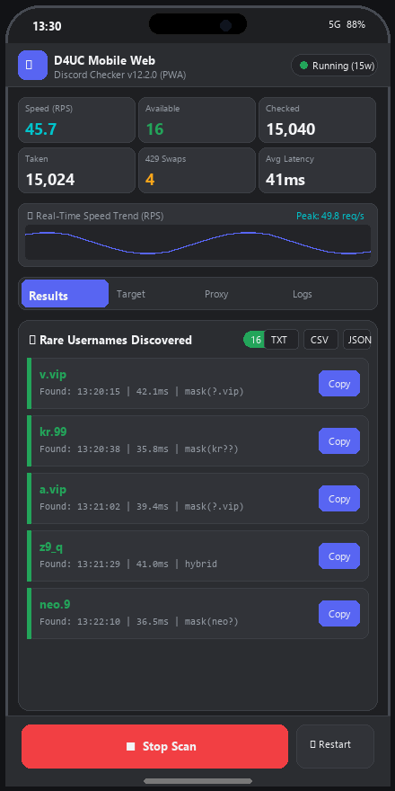
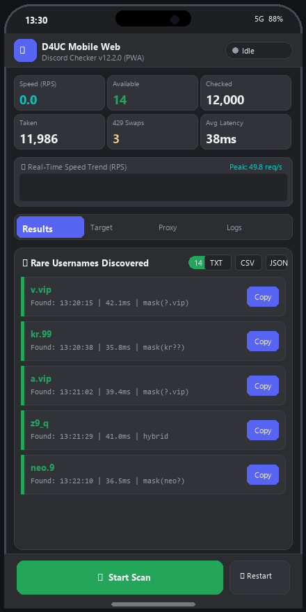
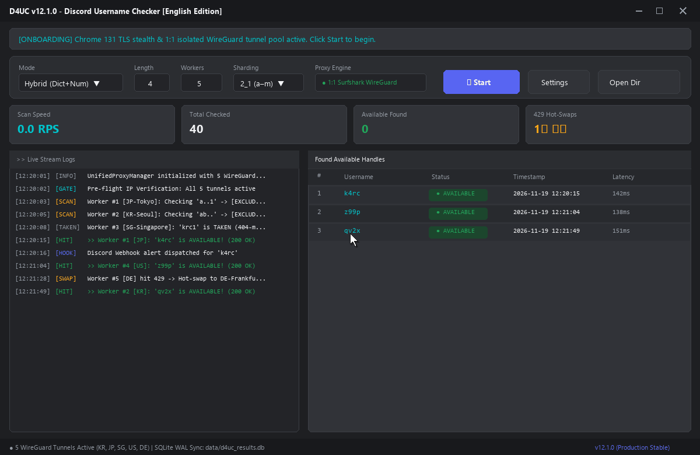
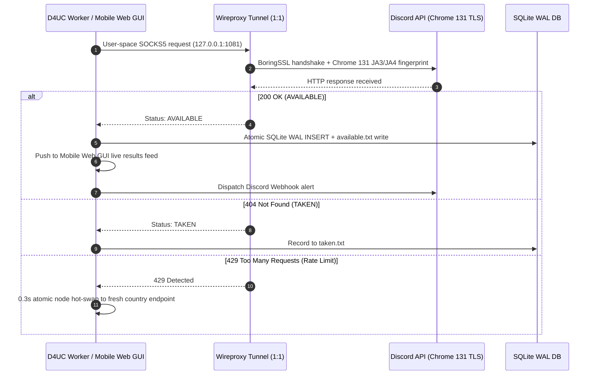

<div align="center">

# ⚡ D4UC (`discord-checker`) v12.2.0

> **High-Performance Discord Rare Username Availability Engine**  
> Mobile Touch-Optimized Web GUI & PWA · Chrome 131 TLS Stealth · 1:1 Isolated WireGuard Tunnels · 0.3s Atomic 429 Hot-Swap · SQLite WAL Multi-Sharding

<br />

| [KR 한국어](../ko/README.md) | [US English](./README.md) | [JP 日本語](../ja/README.md) | [CN 简体中文](../zh-CN/README.md) | [ES Español](../es/README.md) |
| :---: | :---: | :---: | :---: | :---: |
| [FR Français](../fr/README.md) | [DE Deutsch](../de/README.md) | [RU Русский](../ru/README.md) | [BR Português](../pt-BR/README.md) | [SA العربية](../ar/README.md) |

<p align="center"><sub>🌐 Also available: <a href="../hi/README.md">HI हिन्दी</a> • <a href="../id/README.md">ID Bahasa Indonesia</a></sub></p>

[](./CHANGELOG.md)
[](https://github.com/KRCUPRO/discord-checker/releases/tag/v12.4.0)
[](./LICENSE.md)
[](https://www.python.org/)
[](../../guides/README.md)
[](../../specs/01_NETWORK_CORE_ENGINE.md)
[](https://colab.research.google.com/github/KRCUPRO/discord-checker/blob/main/D4UC_Google_Colab.ipynb)
[](gas/README.md)
[](docs/MOBILE_AND_IPHONE_GUIDE.md)

<sub>Copyright (c) 2026 KRCUPRO · Proprietary & Confidential License (All Rights Reserved)</sub>

</div>

---


> ### ☁️ 100% Cloud Zero-Install: Google Colab & Google Apps Script 24/7
> **No installation or high-end PC required!** Run D4UC directly in the cloud on **any device — iPhone (Safari), iPad, Android, or Tablet** with zero local dependencies.
> - 🚀 **[Open In Google Colab](https://colab.research.google.com/github/KRCUPRO/discord-checker/blob/main/D4UC_Google_Colab.ipynb)**: Interactive In-Cell Web GUI with 10-language switching, Google Drive auto-sync (`drive_sync.py`), and real-time Discord Webhooks.
> - ⏱️ **[Google Apps Script 24/7 Checker](gas/README.md)**: 100% serverless, autonomous cron runner that checks 24 hours / 365 days even when your phone or PC is turned off.
> - 📱 **[Mobile & iPhone/Tablet Cloud Guide](docs/MOBILE_AND_IPHONE_GUIDE.md)**: Step-by-step 1-minute setup guide for mobile browsers.

<a id="-table-of-contents"></a><a id="table-of-contents"></a>
## 📑 Table of Contents
1. [📸 Interface Previews](#-interface-previews)
2. [✨ Key Capabilities](#-key-capabilities)
3. [🖥️ System Requirements & Dependencies](#-system-requirements-dependencies)
4. [📁 Repository Structure](#-repository-structure)
5. [🌐 Proxy Configuration & 🔑 Credentials](#-proxy-configuration-credentials)
6. [🚀 Installation & Execution](#-installation-execution)
7. [📱 Mobile Web GUI & PWA Remote Control Guide](#-mobile-web-gui-pwa-remote-control-guide)
8. [🧵 Concurrency & Worker Tuning](#-concurrency-worker-tuning)
9. [🔢 Username Generation Strategies](#-username-generation-strategies)
10. [🚫 Strict Username Exclusion Rules (e.g. `ab..`, `a..1`)](#-strict-username-exclusion-rules-eg-ab-a1)
11. [📡 Live Checker Engine Pipeline](#-live-checker-engine-pipeline)
12. [🔄 Proxy Session Management](#-proxy-session-management)
13. [🔁 Error Retries](#-error-retries)
14. [💾 Multi-tier Storage](#-multi-tier-storage)
15. [📊 Real-Time Statistics & Monitoring](#-real-time-statistics-monitoring)
16. [🛑 Stopping the Checker](#-stopping-the-checker)
17. [⚠️ Rate Limit Architecture](#-rate-limit-architecture)
18. [🔧 Troubleshooting Matrix](#-troubleshooting-matrix)
19. [📞 Discord Support: myuyayam](#-discord-support-myuyayam)
20. [⭐ Project Support (GitHub Star)](#-project-support-github-star)
21. [📚 Educational & Study Purpose Disclaimer](#-educational-study-purpose-disclaimer)

---

<a id="-interface-previews"></a><a id="interface-previews"></a>
## 📸 Interface Previews

### Mobile Touch-Optimized Responsive Web GUI (PWA - iPhone & Android)
[](../../guides/MOBILE_IOS_GUIDE.md)

### Mobile Interactive Real-Time Demo (1-Tap Touch Controls & Live Telemetry)
[](../../guides/MOBILE_IOS_GUIDE.md)

### Desktop GUI (English Edition)
[](../../guides/WINDOWS_GUIDE.md)

### Real-Time GUI Execution Demo (Smooth Mouse Interactions)
[](../../guides/WINDOWS_GUIDE.md)

### Headless CLI Dashboard
[](../../guides/TERMUX_DEBIAN_GUIDE.md)

### Docker & Linux Deployment
[](../../guides/DOCKER_GUIDE.md)

[⬆️ Back to Top](#-table-of-contents)

---

<a id="-key-capabilities"></a><a id="key-capabilities"></a>
## ✨ Key Capabilities
- **☁️ 100% Cloud Zero-Install (Google Colab & GAS 24/7)**: Run directly on iPhone (Safari), iPad, Android, or Tablet without any PC or local dependencies. Features real-time In-Cell Web GUI with 10-language switching, Google Drive auto-sync, and 24/7 unattended cron checks.

1. **Mobile Touch-Optimized Responsive Web GUI & PWA Engine (`http://<host>:5000`)**:
   - Host anywhere (PC, VPS, Docker, Termux) and manage scans remotely from any smartphone browser (iPhone Safari, Android Chrome).
   - Native **"Add to Home Screen" (PWA)** support via `manifest.json` and service worker, turning it into a borderless, full-screen mobile app without app store installation.
   - Touch-friendly controls: Big Start/Stop/Restart buttons, live RPS canvas graph, 1-tap username copy with toast feedback, and instant TXT/CSV/JSON downloads.
   - Remote hot-swapping of proxy keys (Surfshark multi-key pool, custom proxy files, Thordata), 8 candidate generation modes, and dynamic worker count adjustment (1–50 workers).

2. <a id="fnref-1"></a><a id="fnref1"></a>**Chrome 131 TLS JA3/JA4 Stealth (`curl_cffi` BoringSSL)[^1]**:
   - Eliminates detectable synthetic TLS signatures generated by standard Python HTTP libraries (`requests`, `aiohttp`, `httpx`).
   - Bit-for-bit identical Cipher Suites, Extensions, Supported Groups, and HTTP/2 SETTINGS frames mirroring official Google Chrome 131 to bypass Cloudflare/WAF challenges.

3. <a id="fnref-2"></a><a id="fnref2"></a>**1:1 User-Space WireGuard Tunnels (`wireproxy`)[^2]**:
   - Zero host network adapter modification. Does not hijack your PC's DNS or global routing.
   - Maps 142 global endpoints onto isolated local ports (`127.0.0.1:1081+`) per worker. Main PC traffic remains completely uninterrupted.

4. **0.3s Atomic 429 Hot-Swap**:
   - When a worker encounters HTTP 429 Rate Limit, only that specific worker rotates to a fresh country node within 300ms. Sibling workers keep running without stopping.

5. **Mathematical Sharding & SQLite WAL Sync**:
   - Split exhaustive scans across 2, 3, or 4 disjoint slices (`2_1`, `2_2`, `4_1`–`4_4`) with 0 duplicate checks across instances.
   - High-throughput concurrency backed by SQLite WAL mode (`data/d4uc_results.db`) and mirrored atomic text/CSV/JSON exports.

6. **8 Intelligent Candidate Generation Engines**:
   - Hybrid, Permutation, Dictionary, Pattern, Numeric, Custom Mask, Combinatorial, and Recheck.

7. **Cross-Platform Deployments**:
   - Standalone Windows `.exe` (4 editions including Web GUI), Mobile Web PWA, Linux/macOS headless CLI, Android Termux one-click script, and Multi-Arch Docker containers.

[⬆️ Back to Top](#-table-of-contents)

---

<a id="-system-requirements-dependencies"></a><a id="system-requirements-dependencies"></a>
## 🖥️ System Requirements & Dependencies

### Runtime
- **OS**: Windows 10/11 (64-bit), Linux (Debian 11+, Ubuntu 20.04+, Arch), macOS 12+ (Apple Silicon / Intel), Android 10+ (Termux), iOS Safari (Web UI)
- **Python**: 3.10, 3.11, 3.12 (Recommended: **Python 3.12**)
- **RAM**: Minimum 512 MB (~250 MB for 50 concurrent workers)
- **Network**: Broadband connection (Outbound UDP port 51820 for Surfshark WireGuard)

### Dependencies (`requirements.txt`)
- `curl_cffi >= 0.7.0`: Chrome 131 BoringSSL TLS impersonation
- `customtkinter >= 5.2.0`: Modern dark desktop GUI
- `rich >= 13.7.0`: Terminal live dashboard & telemetry
- `pydantic >= 2.6.0`: Configuration validation
- `pyyaml >= 6.0.1`: YAML config parser
- `pillow >= 10.2.0`: UI asset rendering

[⬆️ Back to Top](#-table-of-contents)

---

<a id="-repository-structure"></a><a id="repository-structure"></a>
## 📁 Repository Structure

```text
discord-checker/
├── config/                         # Configuration templates & .env.example
│   ├── .env.example                # Secret environment variables template
│   └── config.example.yaml         # Granular YAML configuration template
├── data/                           # 142 WireGuard cluster endpoints & SQLite DB
│   ├── surfshark_endpoints.json    # Global WireGuard public endpoints
│   └── d4uc_results.db (created)   # Discovered usernames SQLite WAL DB
├── deploy/                         # Packaging, Docker, APK and asset build scripts
│   ├── android/                    # Android native app project (com.krcupro.discordchecker)
│   ├── build_apk.py                # Reproducible Android release APK builder (.apk)
│   ├── build_exe.py                # 4-in-1 Windows standalone .exe compiler
│   ├── docker-compose.yml          # Docker Compose (single & 2shard profiles)
│   ├── Dockerfile                  # Multi-Arch lightweight container specification
│   ├── generate_assets.py          # High-fidelity visual asset generator
│   ├── generate_badges.py          # 12-language 1:1 localized SVG badge generator
│   ├── generate_mobile_assets.py   # Mobile PWA mockup & animated demo GIF generator
│   ├── install_debian.sh           # Termux / Debian dependency setup script
│   └── run.sh                      # Headless background execution launcher
├── docs/                           # Documentation, 11 translations, guides & assets
│   ├── assets/                     # Screenshots, animated GIFs, SVG badges
│   │   ├── badges/                 # 12-language SVG badges (update_badge_en.svg, etc.)
│   │   ├── mobile_web_main.png     # Mobile Web GUI smartphone screenshot
│   │   ├── mobile_web_demo.gif     # Mobile Web GUI 1-tap touch demo GIF
│   │   ├── gui_en_main.png         # English desktop GUI screenshot
│   │   ├── gui_en_demo.gif         # English desktop GUI demo GIF
│   │   ├── cli_dashboard.png       # Headless CLI dashboard screenshot
│   │   └── docker_linux_capture.png# Docker Linux capture screenshot
│   ├── guides/                     # Platform-specific guides
│   │   ├── MOBILE_IOS_GUIDE.md     # iOS Mobile PWA setup & remote control guide
│   │   ├── PC_GUIDE.md             # Windows & macOS PC setup guide
│   │   ├── DOCKER_GUIDE.md         # Docker & Compose container guide
│   │   └── TERMUX_DEBIAN_GUIDE.md  # Android Termux mobile setup guide
│   └── locales/                    # 11 full 1:1 translations (ja, zh-CN, es, etc.)
├── src/                            # Core engine source code
│   ├── generator/                  # 8 username generation engines & rule filters
│   ├── network/                    # Chrome 131 TLS client & backoff handler
│   ├── notify/                     # Discord Webhook live alerts
│   ├── proxy/                      # 1:1 WireGuard tunnel pool & proxy managers
│   ├── storage/                    # SQLite WAL & legacy text persistence
│   ├── ui/                         # Multilingual i18n, tooltips, CLI dashboard
│   │   └── web/                    # Mobile PWA web app (HTML5/CSS3/Vanilla JS)
│   ├── web_gui.py                  # Mobile responsive Web GUI & REST API server
│   ├── gui.py                      # CustomTkinter GUI orchestrator core
│   ├── gui_ko.py                   # Korean desktop GUI launcher
│   ├── gui_en.py                   # English desktop GUI launcher
│   └── run.py                      # Headless CLI launcher
├── tests/                          # Automated unit and integration test suite
├── CHANGELOG.md                    # Detailed version release notes
├── LICENSE                         # Proprietary License (KRCUPRO)
├── NOTICE                          # Third-party open-source attribution
├── README.md                       # US English master repository guide
├── requirements.txt                # Python package dependencies
└── SECURITY.md                     # Security & secret leak prevention policies
```

[⬆️ Back to Top](#-table-of-contents)

---

<a id="-proxy-configuration-credentials"></a><a id="proxy-configuration-credentials"></a>
## 🌐 Proxy Configuration & 🔑 Credentials

D4UC incorporates an isolated **1:1 user-space WireGuard tunnel pool** powered by `wireproxy` to bypass IP bans and rate limits without affecting host PC traffic.

### 1. Configuration
1. Copy `config/.env.example` to `.env` in the repository root:
   ```bash
   cp config/.env.example .env
   ```
2. Edit `.env` and provide your Surfshark WireGuard private key(s):
   ```ini
   # Multi-key pool: comma-separated keys for high-concurrency scaling
   SURFSHARK_PRIVATE_KEYS=YOUR_WIREGUARD_PRIVATE_KEY_1_HERE,YOUR_WIREGUARD_PRIVATE_KEY_2_HERE
   
   # Concurrency (Default: 5, Max: 50)
   D4UC_WORKERS=5
   
   # Discord Webhook alerts (Optional)
   D4UC_WEBHOOK=https://discord.com/api/webhooks/YOUR_WEBHOOK_ID/YOUR_WEBHOOK_TOKEN
   ```

### 2. Free Public Proxy Auto-Scraper & Live Multi-Threaded Validator (`--proxy free`) [NEW in v12.3.0]
D4UC now supports completely zero-cost operation via built-in open-source public proxy aggregation:
- **Automated Multi-Source Scraping**: Pulls continually updated proxy candidate lists from 14+ GitHub repositories and Hugging Face datasets (TheSpeedX, monosans, hookzof, roosterkid, ShiftyTR, mertguvencli, Hugging Face).
- **Multi-Protocol Support**: Seamlessly aggregates HTTP, HTTPS, SOCKS4, and SOCKS5 free proxies.
- **High-Speed Async Connection Gate**: Tests candidate proxies concurrently against real Discord endpoints (`/api/v9/unique-username/username-attempt-unauthed`) and Cloudflare edge traces. Filters out dead nodes, latency exceeding 3,500ms, and 403 WAF blocks.
- **Circuit Breaker & 429 Rotation**: Automatically cools down rate-limited nodes for 15s and rotates to the lowest-latency active node. Auto-refreshes the pool periodically in the background.
- **UI Integration**:
  - **Desktop GUI**: Select `🌐 Free Public Proxies (Auto Scrape)` in the proxy selector and click `[🔄 Scrape & Verify Free Proxies]` with live verified count badges.
  - **Mobile Web GUI**: Select `Free Public` in proxy mode, tap `🔄 Scrape & Verify Free Proxies`, or interact via `POST /api/proxy/scrape` and `GET /api/proxy/free_status`.
  - **CLI**: Execute with `python src/run.py --proxy free` (or `-p free`).

### 3. Zero-Leak Policy
- All secrets (`.env`, `config.yaml`, proxy credential files) are strictly excluded via `.gitignore`.
- Every automated build and git commit undergoes strict zero-leak auditing to guarantee zero private keys or credentials are ever committed.

[⬆️ Back to Top](#-table-of-contents)

---

<a id="-installation-execution"></a><a id="installation-execution"></a>
## 🚀 Installation & Execution
### ☁️ Method 0: 100% Zero-Install Cloud (Google Colab & Google Apps Script 24/7)
> **Recommended for iPhone, iPad, Android, Tablet, or users without Python installed.**

1. **Google Colab Notebook**:
   - Click [](https://colab.research.google.com/github/KRCUPRO/discord-checker/blob/main/D4UC_Google_Colab.ipynb) to launch.
   - Run the 3 cells in order: Environment Setup ➔ Configuration (Google Drive / Webhook) ➔ Launch Interactive In-Cell Web GUI (`src/ui/colab_gui.py`).
   - Switch languages on the fly across 10 languages (`ko`, `en`, `ja`, `zh`, `es`, `ru`, `fr`, `de`, `pt`, `vi`).
   - All valid hits and progress are automatically persisted to your Google Drive (`/content/drive/MyDrive/D4UC/`).
2. **Google Apps Script (GAS) 24/7 Autonomous Runner**:
   - Go to [gas/README.md](gas/README.md) and open `gas/D4UC_Checker.js`.
   - Paste into [script.google.com](https://script.google.com/) and run `setupChecker()`.
   - Automatically executes periodic checks 24 hours / 365 days using Google Cloud triggers even when your phone or PC is powered off.
   - Saves results directly to Google Drive and Google Sheets, and sends instant Discord Webhook notifications.
3. **Mobile & iPhone Step-by-Step Guide**: See [docs/MOBILE_AND_IPHONE_GUIDE.md](docs/MOBILE_AND_IPHONE_GUIDE.md).


### Method A: Standalone Windows Executables (`.exe`) & Android Package (`.apk`) — Zero Setup
Download pre-compiled binaries from [GitHub Releases v12.3.0](https://github.com/KRCUPRO/discord-checker/releases/tag/v12.4.0):
- `DiscordUsernameChecker_v12.3.0.apk`: **Android Smartphone 1-Tap Native Package** [NEW]
- `DiscordUsernameCheckerV2_Web.exe`: **Mobile Responsive Web GUI & PWA Server (Port 5000)**
- `DiscordUsernameCheckerV2_EN.exe`: English Desktop GUI
- `DiscordUsernameCheckerV2_KO.exe`: Korean Desktop GUI
- `DiscordUsernameCheckerV2_CLI.exe`: Headless Console CLI Dashboard

### Method B: Android Smartphone Native Package (`.apk`) — 1-Tap Installation [NEW]
Directly install and run D4UC on any Android phone (Galaxy, Pixel, Xiaomi, etc.):
1. Download [`DiscordUsernameChecker_v12.3.0.apk`](https://github.com/KRCUPRO/discord-checker/releases/download/v12.3.0/DiscordUsernameChecker_v12.3.0.apk).
2. Tap the downloaded APK file in notifications or your File Manager.
3. Allow "Install unknown apps" if prompted and tap **[Install]**.
4. Launch **`D4UC Discord Checker`** directly from your home screen.
- **Key Mobile Features**:
  - Offline bundled 12-language Discord-Dark touch-friendly Web GUI (`assets/www/index.html`).
  - Native Android clipboard copy with system Toast notification alerts.
  - Background Wake Lock prevention (`WAKE_LOCK`) to keep checking while screen is active.
  - Remote connect to PC/server D4UC engine via local Wi-Fi or server IP.

### Method C: Mobile Responsive Web GUI (Smartphone Remote Control)
```bash
# Start the Mobile Web GUI server (Default port: 5000)
python src/web_gui.py --port 5000

# Open your mobile browser (iPhone Safari or Android Chrome) on the same Wi-Fi:
# http://<YOUR_PC_IP>:5000
```

### Method C: Desktop GUI & Headless CLI from Source
```bash
# Set up Python virtual environment
python -m venv .venv
# Windows:
.\.venv\Scripts\Activate.ps1
# Linux / macOS:
source .venv/bin/activate

pip install -r requirements.txt

# Run English Desktop GUI
python src/gui_en.py

# Run Headless CLI
python src/run.py --mode hybrid --length 4 --workers 5
```

[⬆️ Back to Top](#-table-of-contents)

---

<a id="-mobile-web-gui-pwa-remote-control-guide"></a><a id="mobile-web-gui-pwa-remote-control-guide"></a>
## 📱 Mobile Web GUI & PWA Remote Control Guide
### 📱 100% Device-Agnostic Cloud Execution (iPhone, iPad, Android, Tablet)
In addition to the local PWA and Mobile Web GUI, D4UC can be run entirely in the cloud via **Google Colab** and **Google Apps Script (GAS)**:
- **iPhone / iPad Safari**: Open `D4UC_Google_Colab.ipynb` directly in Mobile Safari. No Mac or PC required.
- **24/7 Unattended Monitoring**: Google Apps Script triggers run persistently even when your mobile device screen is locked or turned off.
- **Cloud Notification**: Live Discord Webhooks notify your mobile Discord app immediately when a rare username is discovered.
- Complete guide: [docs/MOBILE_AND_IPHONE_GUIDE.md](docs/MOBILE_AND_IPHONE_GUIDE.md).


Monitor and steer your username searches from your smartphone while relaxing in bed.

### 1. "Add to Home Screen" (PWA Native App Installation)
1. Open your phone browser (iPhone Safari or Android Chrome) and navigate to `http://<HOST_IP>:5000`.
2. **iPhone Safari**: Tap the Share icon (square with arrow) ➔ Tap **"Add to Home Screen"**.
3. **Android Chrome**: Tap the three-dots menu (⋮) ➔ Tap **"Add to Home screen"** or **"Install App"**.
4. Tap the **D4UC Web** icon on your home screen to launch a full-screen, borderless native mobile experience.

### 2. Mobile Touch Features
- **Real-Time Telemetry Cards**: Monitor Scan Speed (RPS), Available Found, Total Checked, Taken, 429 Hot-Swaps, and Latency in real time.
- **Pure HTML5 Speed Canvas**: Lightweight, zero-dependency rolling speed curve rendering live scanner throughput.
- **1-Tap Username Copy**: Tap the [Copy] button next to any found handle to copy immediately to the clipboard with haptic/toast confirmation.
- **One-Click Export**: Download discoveries directly to your phone as TXT, CSV, or JSON.
- **Mobile Remote Hot-Swap**:
  - Switch between all 8 candidate generation modes on the fly.
  - Tune target length (3–6 chars) and sharding keys (`2_1`, `2_2`, etc.).
  - Drag the worker slider (1–50 workers) for instant, seamless concurrency scaling.
  - Update Surfshark WireGuard keys and proxy endpoints directly from mobile.

[⬆️ Back to Top](#-table-of-contents)

---

<a id="-concurrency-worker-tuning"></a><a id="concurrency-worker-tuning"></a>
## 🧵 Concurrency & Worker Tuning

- **Default Recommendation**: `5` workers (~12–15 RPS)
- **Low-Resource / Conservative**: `1`–`3` workers
- **High-Throughput Multi-Tunnel Pool**: `10`–`20` workers (Supports up to 50 workers)
- **Principle**:
  - D4UC allocates one dedicated WireGuard user-space tunnel port per worker (`1081`, `1082`, etc.).
  - 5 workers route through 5 distinct international endpoints simultaneously (e.g. Tokyo, Seoul, Singapore, Frankfurt, New York).
  - Increasing workers distributes traffic across disjoint IPs, drastically reducing rate limits.

[⬆️ Back to Top](#-table-of-contents)

---

<a id="-username-generation-strategies"></a><a id="username-generation-strategies"></a>
## 🔢 Username Generation Strategies

D4UC provides **8 specialized candidate generation engines**:

| Mode Key | Strategy | Description & Example |
| :--- | :--- | :--- |
| `hybrid` (Recommended) | Dictionary stems + numeric/pattern mutations | Highly practical rare identifiers (`krc1`, `v1be`, `neo9`) |
| `permutation` | Mathematical exhaustive permutation | Full scan across `a-z`, `0-9`, `_` (Supports `2_1`, `2_2` sharding) |
| `dictionary` | 3–6 character English lexicon | Real vocabulary words and high-value 2-3 syllable terms |
| `pattern` | Visual symmetry and repetition | Aesthetic patterns (`aaaa`, `abba`, `abab`, `aabb`) |
| `numeric` | Sequential and repetitive numbers | Numeric handles (`0000`–`9999`, poker numbers `7777`, `1234`) |
| `custom_mask` | Prefix, suffix, and middle-dot rules | Custom templates (`kr??`, `??99`, `?.vip`, `??.??`) |
| `combinatorial` | Phonotactic CVCV / VCCV structures | Pronounceable, brandable consonant-vowel combinations |
| `recheck` | Previously `TAKEN` handles | Re-verifies past taken handles to catch recently freed names |

[⬆️ Back to Top](#-table-of-contents)

---

<a id="-strict-username-exclusion-rules-eg-ab-a1"></a><a id="strict-username-exclusion-rules-eg-ab-a1"></a>
## 🚫 Strict Username Exclusion Rules (e.g. `ab..`, `a..1`)

Handles violating Discord's official username policies are **100% excluded during candidate generation**, saving network bandwidth and compute:

1. **Consecutive Dots Forbidden (`..`)**:
   - ❌ `ab..` (trailing consecutive dots) ➔ **Automatically rejected**
   - ❌ `a..1` (middle consecutive dots) ➔ **Automatically rejected**
   - ❌ `..kr` (leading consecutive dots) ➔ **Automatically rejected**
2. **Leading & Trailing Dots Forbidden (`.`)**:
   - ❌ `.abc` (starts with a dot) ➔ **Automatically rejected**
   - ❌ `abc.` (ends with a dot) ➔ **Automatically rejected**
3. **Restricted Character Set**:
   - Only lowercase Latin letters (`a-z`), digits (`0-9`), underscores (`_`), and single dots (`.`) are permitted.
4. **Length Bounds**:
   - Handles shorter than 2 or longer than 32 characters are excluded per Discord specifications.
5. **System Reserved Handles**:
   - Reserved handles such as `discord`, `clyde`, `system`, and `everyone` are automatically filtered.

> Every rule is strictly enforced by `DiscordRuleValidator.is_valid()` in `src/generator/base.py` and validated by 84 automated unit tests.

[⬆️ Back to Top](#-table-of-contents)

---

<a id="-live-checker-engine-pipeline"></a><a id="live-checker-engine-pipeline"></a>
## 📡 Live Checker Engine Pipeline



[⬆️ Back to Top](#-table-of-contents)

---

<a id="-proxy-session-management"></a><a id="proxy-session-management"></a>
## 🔄 Proxy Session Management

- **Single-Responsibility Async Sessions**:
  - Each worker maintains its own persistent `curl_cffi.requests.AsyncSession`.
  - HTTP requests serialize through the worker's dedicated Wireproxy port, maximizing TCP keep-alive reuse.
- **Zero-Leak Lifecycle**:
  - On shutdown, all async sessions and background `wireproxy` processes are safely terminated with zero orphaned processes (Zero-Zombie).

[⬆️ Back to Top](#-table-of-contents)

---

<a id="-error-retries"></a><a id="error-retries"></a>
## 🔁 Error Retries

1. **Network Timeouts & DNS Glitches**:
   - Handled via exponential backoff (0.5s ➔ 1.0s ➔ 2.0s) with up to 3 automatic retries.
2. **Cloudflare WAF Challenges**:
   - Stale or challenged sessions are discarded and the tunnel is re-established immediately.
3. **429 Rate Limits**:
   - Candidate is preserved in the retry queue; the affected worker hot-swaps to a fresh endpoint within 300ms.

[⬆️ Back to Top](#-table-of-contents)

---

<a id="-multi-tier-storage"></a><a id="multi-tier-storage"></a>
## 💾 Multi-tier Storage

Results are permanently indexed across multiple redundant storage formats:

| Path | Format | Purpose |
| :--- | :--- | :--- |
| `data/d4uc_results.db` | **SQLite (WAL mode)** | ACID transactions, concurrent multi-process writes, indexed lookups |
| `available.txt` | UTF-8 Text | Real-time line-delimited list of available handles |
| `taken.txt` | UTF-8 Text | Handles currently in use (used for Recheck mode) |
| `checked_history.txt` | UTF-8 Text | Global scan cache to prevent duplicate checks |
| `available_usernames.csv` | CSV Format | Spreadsheet format for external data pipelines |
| `available_usernames.json`| JSON Format | Structured data for REST API and web dashboard integrations |

[⬆️ Back to Top](#-table-of-contents)

---

<a id="-real-time-statistics-monitoring"></a><a id="real-time-statistics-monitoring"></a>
## 📊 Real-Time Statistics & Monitoring

The Mobile Web GUI, Desktop GUI, and CLI dashboard render telemetry updated every 30ms:
- **Scan Speed (RPS)**: Completed requests per second (5-second rolling average)
- **Total Checked**: Total handles checked in the current session
- **Available Count**: Rare available handles discovered
- **Taken Count**: Handles currently registered
- **429 Hot-Swaps**: Successful rate-limit node rotations
- **Latency**: Discord API round-trip time (ms)

[⬆️ Back to Top](#-table-of-contents)

---

<a id="-stopping-the-checker"></a><a id="stopping-the-checker"></a>
## 🛑 Stopping the Checker

- **Mobile Web GUI**: Tap the prominent red `■ Stop Search` button to immediately halt requests.
- **Desktop GUI**: Click the `■ Stop` button to safely flush queues and enter standby within 0.5s.
- **CLI**: Press `Ctrl + C` (`SIGINT`) to commit SQLite WAL checkpoints and shut down proxy tunnels cleanly.

[⬆️ Back to Top](#-table-of-contents)

---

<a id="-rate-limit-architecture"></a><a id="rate-limit-architecture"></a>
## ⚠️ Rate Limit Architecture

- When Discord returns `429 Too Many Requests`, D4UC does not stall the entire application.
- Instead, D4UC's **atomic 429 hot-swap engine** isolates the affected worker and assigns it a fresh international endpoint within 300ms. Sibling workers continue uninterrupted.

[⬆️ Back to Top](#-table-of-contents)

---

<a id="-troubleshooting-matrix"></a><a id="troubleshooting-matrix"></a>
## 🔧 Troubleshooting Matrix

| Symptom | Cause | Solution |
| :--- | :--- | :--- |
| Mobile Web GUI not reachable | Phone and PC on different networks | Connect phone to the same Wi-Fi router as the PC and ensure Windows Firewall allows port 5000. |
| `Wireproxy binary not found` | Missing binary in `bin/` | Verify `bin/wireproxy.exe` is present or execute `deploy/build_exe.py`. |
| `Port already in use: 1081` | Orphaned previous process | Close leftover Python or wireproxy processes via Task Manager. |
| Windows Defender Firewall popup | Missing rule | Whitelist port or run firewall setup script (`../../guides/PC_GUIDE.md`). |
| `No module named curl_cffi` | Virtual environment not active | Activate `.venv` and execute `pip install -r requirements.txt`. |

[⬆️ Back to Top](#-table-of-contents)

---

<a id="-discord-support-myuyayam"></a><a id="discord-support-myuyayam"></a>
## 📞 Discord Support: myuyayam

- For feature suggestions, bug reports, and technical assistance, reach out on Discord to **`myuyayam`**.
- For business or enterprise inquiries, use GitHub Issues or Discord DM.

[⬆️ Back to Top](#-table-of-contents)

---

<a id="-project-support-github-star"></a><a id="project-support-github-star"></a>
## ⭐ Project Support (GitHub Star)

If you find D4UC valuable, please consider giving the repository a **Star (⭐)**!  
Your support and feedback drive ongoing development.

[⬆️ Back to Top](#-table-of-contents)

---

<a id="-educational-study-purpose-disclaimer"></a><a id="educational-study-purpose-disclaimer"></a>
## 📚 Educational & Study Purpose Disclaimer

> **[Educational & Research Purpose Only]**
> 
> This software is created strictly for technical research and computer networking education regarding **modern TLS fingerprinting architectures (Chrome 131 BoringSSL JA3/JA4), mobile PWA responsive interfaces, user-space tunneling architectures (Wireproxy), and SQLite WAL concurrency sharding**.
> 
> 1. Use of this tool for causing excessive traffic, denial of service (DoS), disrupting platform operations, or unauthorized squatting of accounts is strictly prohibited.
> 2. Users must comply with the target platform's Terms of Service and all applicable regional laws. Any legal or administrative responsibility arising from improper usage rests solely with the individual operator.
> 3. The developers and contributors provide no warranties and disclaim all liability for individual operational outcomes.

[⬆️ Back to Top](#-table-of-contents)

---

<a id="-footnotes-technical-references"></a><a id="footnotes-technical-references"></a><a id="footnote-heading"></a>
### 📚 Footnotes & Technical References

<a id="footnote-1"></a><a id="fn-1"></a>
[^1]: The Chrome 131 BoringSSL handshake completely neutralizes TLS fingerprinting defenses deployed by Cloudflare and modern WAFs. [↩ Back to Reference](#fnref-1) · [⬆️ Back to Top](#-table-of-contents)

<a id="footnote-2"></a><a id="fn-2"></a>
[^2]: wireproxy is a lightweight user-space Go binary translating WireGuard protocol into isolated local SOCKS5 proxies without root privileges. [↩ Back to Reference](#fnref-2) · [⬆️ Back to Top](#-table-of-contents)

[⬆️ Back to Top](#-table-of-contents)