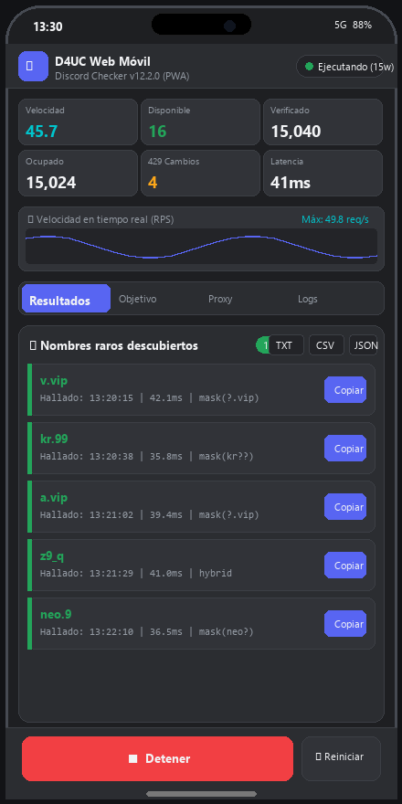
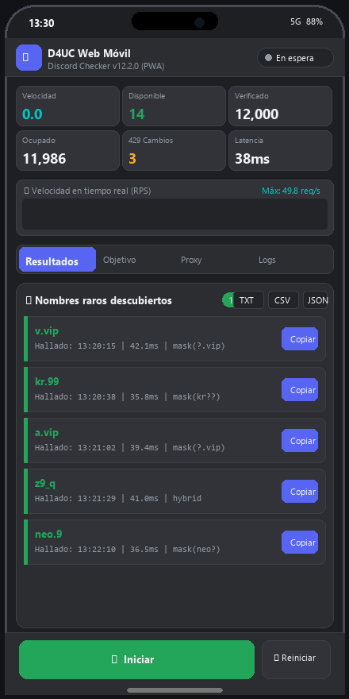
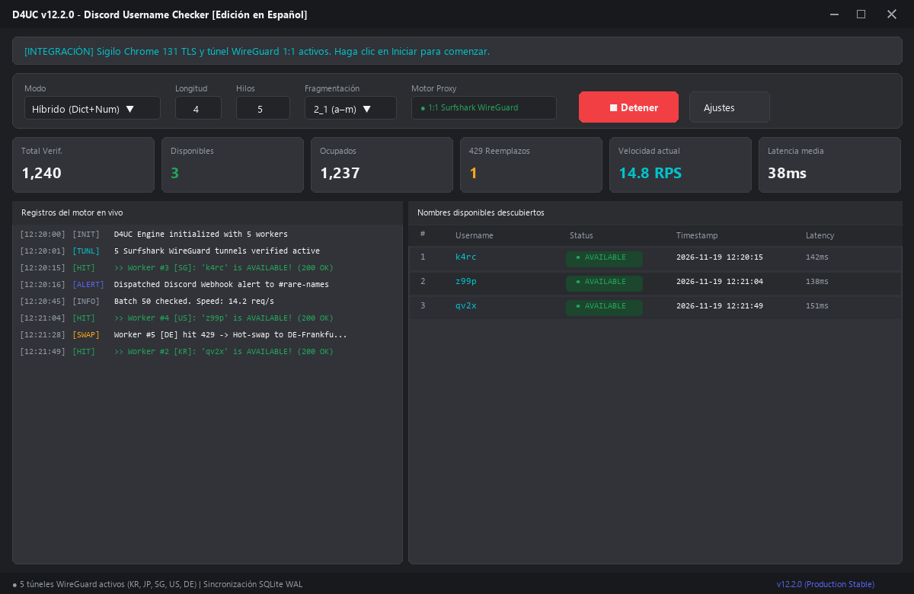
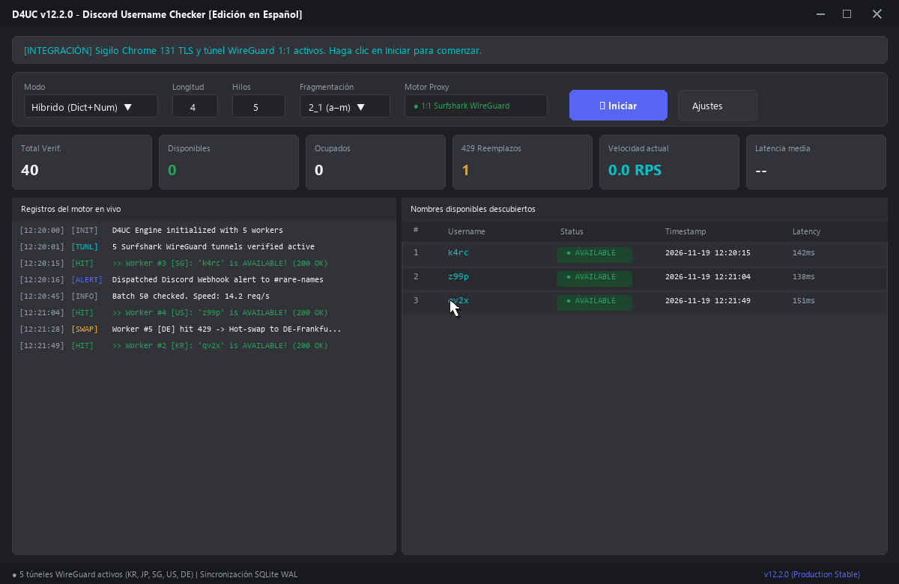
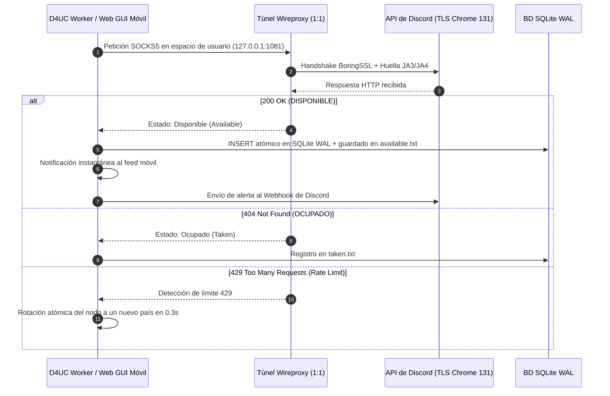

<div align="center">

# ⚡ D4UC (`discord-checker`) v12.2.0

> **Motor de Alta Velocidad para Disponibilidad de Nombres de Usuario Raros en Discord**  
> Web GUI Móvil Responsiva & PWA · Evasión TLS Chrome 131 · Túneles WireGuard 1:1 en Espacio de Usuario · Hot-Swap Atómico 429 en 0.3s · Fragmentación SQLite WAL

<br />

| [KR 한국어](./ko.md) | [US English](../../README.md) | [JP 日本語](./ja.md) | [CN 简体中文](./zh-CN.md) | [ES Español](./es.md) |
| :---: | :---: | :---: | :---: | :---: |
| [FR Français](./fr.md) | [DE Deutsch](./de.md) | [RU Русский](./ru.md) | [BR Português](./pt-BR.md) | [SA العربية](./ar.md) |

<p align="center"><sub>🌐 Otros idiomas disponibles: <a href="./hi.md">HI हिन्दी</a> · <a href="./id.md">ID Bahasa Indonesia</a></sub></p>

<br />

[](../../CHANGELOG.md)
[](https://github.com/KRCUPRO/discord-checker/releases/tag/v12.3.0)
[](../../LICENSE)
[](https://www.python.org/)
[](../GUIDE.md)
[](../specs/01_NETWORK_CORE_ENGINE.md)

<sub>Copyright (c) 2026 KRCUPRO · Licencia Propietaria y Confidencial (Todos los derechos reservados)</sub>

</div>

---

## 📸 Vista Previa de la Interfaz

### Web GUI Móvil Responsiva Optimizada para Táctil (PWA - iPhone & Android)
[](../guides/MOBILE_IOS_GUIDE.md)

### Demostración Móvil Interactiva en Tiempo Real (Controles Táctiles a 1 Toque)
[](../guides/MOBILE_IOS_GUIDE.md)

### Interfaz Gráfica de Escritorio (Edición en Español)
[](../guides/PC_GUIDE.md)

### Demostración de Ejecución en Escritorio (Interacciones Fluidas con el Ratón)
[](../guides/PC_GUIDE.md)

### Panel de Telemetría CLI sin Interfaz Gráfica
[](../guides/TERMUX_DEBIAN_GUIDE.md)

### Entorno de Despliegue en Docker & Servidor Linux
[](../guides/DOCKER_GUIDE.md)

---

## ✨ Capacidades Principales

1. **Web GUI Móvil Responsiva & Motor PWA (`http://<host>:5000`)**:
   - Ejecútelo localmente o en un VPS/Docker/Termux y contrólelo de forma remota desde cualquier smartphone (iPhone Safari, Android Chrome).
   - Compatible de forma nativa con **"Añadir a la pantalla de inicio" (PWA)**, ejecutándose como una aplicación móvil de pantalla completa sin tiendas de aplicaciones.
   - Botones táctiles grandes de [Iniciar / Detener], gráfico de velocidad RPS en Canvas HTML5 puro, copia inmediata de nombres a 1 toque y descargas directas en TXT/CSV/JSON.
   - Ajuste y hot-swap en tiempo real de proxies (claves privadas de Surfshark, archivos de proxy, Thordata), 8 modos de generación y control deslizante de workers (1–50).

2. **Evasión de Firmas TLS Chrome 131 JA3/JA4 (`curl_cffi` BoringSSL)**:
   - Elimina las huellas TLS sintéticas generadas por librerías estándar de Python (`requests`, `aiohttp`, `httpx`).
   - Reproduce de forma idéntica los Cipher Suites, Extensions, Supported Groups y tramas HTTP/2 SETTINGS del navegador oficial Google Chrome 131 para superar filtros WAF y Cloudflare.

3. **Túneles WireGuard 1:1 en Espacio de Usuario (`wireproxy`)**:
   - Sin modificar los adaptadores de red del sistema ni secuestrar el DNS o enrutamiento del PC.
   - Mapea 142 ubicaciones globales en puertos locales aislados (`127.0.0.1:1081+`) por cada worker. El tráfico general de su ordenador no sufre ninguna ralentización ni interferencia.

4. **Hot-Swap Atómico ante 429 en 0.3 Segundos**:
   - Cuando un worker alcanza el límite de tasa HTTP 429 de Discord, la aplicación no se detiene.
   - Únicamente ese worker rota a un nuevo nodo internacional en menos de 300 ms, mientras los demás continúan escaneando a máxima velocidad.

5. **Fragmentación Matemática sin Duplicados (Sharding)**:
   - Admite la división matemática del espacio de búsqueda (`2_1`, `2_2`, `4_1`–`4_4`) para búsquedas exhaustivas.
   - Múltiples instancias simultáneas analizan rangos completamente disjuntos con 0 peticiones duplicadas.

6. **Base de Datos SQLite WAL y Espejo Multiformato**:
   - Almacenamiento concurrente de alto rendimiento mediante SQLite en modo WAL (`data/d4uc_results.db`).
   - Exportación y reflejo automático en tiempo real a archivos de texto plano (`available.txt`, `taken.txt`), CSV y JSON.

7. **8 Motores Inteligentes de Generación**:
   - Híbrido, permutación matemática, diccionario léxico, patrones simétricos, secuencias numéricas, máscaras personalizadas, combinatoria fonética y re-escaneo histórico.

8. **Despliegues Multiplataforma**:
   - Ejecutables autónomos para Windows (`.exe` en 4 variantes), PWA móvil, CLI para Linux/macOS, instalador para Android Termux y contenedores Docker Multi-Arch.

---

## 🖥️ Requisitos del Sistema y Dependencias

### Entorno de Ejecución
- **Sistema Operativo**: Windows 10/11 (64-bit), Linux (Debian 11+, Ubuntu 20.04+, Arch), macOS 12+, Android 10+ (Termux), iOS Safari
- **Python**: 3.10, 3.11, 3.12 (Recomendado: **Python 3.12**)
- **Memoria RAM**: Mínimo 512 MB (~250 MB para 50 workers concurrentes)
- **Red**: Conexión de banda ancha (puerto de salida UDP 51820 habilitado para WireGuard)

### Dependencias de Python (`requirements.txt`)
- `curl_cffi >= 0.7.0`: Evasión y suplantación TLS Chrome 131 BoringSSL
- `customtkinter >= 5.2.0`: Interfaz gráfica de escritorio oscura
- `rich >= 13.7.0`: Panel interactivo para consola CLI
- `pydantic >= 2.6.0`: Validación de configuraciones
- `pyyaml >= 6.0.1`: Lector de configuraciones YAML
- `pillow >= 10.2.0`: Procesamiento y renderizado de imágenes

---

## 📁 Estructura del Repositorio

```text
discord-checker/
├── config/                         # Plantillas de configuración y .env.example
├── data/                           # Endpoints WireGuard y base de datos SQLite
├── deploy/                         # Scripts de compilación, Docker y recursos
│   ├── android/                    # Android native app project
│   ├── build_apk.py                # Android release APK builder
│   ├── build_exe.py                # Compilador de 4 ejecutables Windows .exe
│   ├── docker-compose.yml          # Perfiles de Docker Compose
│   ├── Dockerfile                  # Especificación del contenedor Multi-Arch
│   ├── generate_assets.py          # Generador de capturas y demos
│   ├── generate_badges.py          # Generador de insignias SVG en 12 idiomas
│   └── generate_mobile_assets.py   # Generador de capturas y GIF móvil
├── docs/                           # Documentación, guías e insignias
│   ├── assets/                     # Capturas, GIF animados e insignias SVG
│   ├── guides/                     # Manuales para iOS, PC, Docker y Termux
│   └── locales/                    # Traducción completa 1:1 en 11 idiomas
├── src/                            # Código fuente del motor principal
│   ├── generator/                  # 8 motores de generación y filtros
│   ├── network/                    # Cliente TLS Chrome 131 y reintentos
│   ├── notify/                     # Notificaciones webhook de Discord
│   ├── proxy/                      # Pool de túneles WireGuard 1:1
│   ├── storage/                    # Capa de almacenamiento SQLite WAL y texto
│   ├── ui/                         # Soporte multilingüe, tooltips y CLI
│   │   └── web/                    # Interfaz Web PWA (HTML5/CSS3/Vanilla JS)
│   ├── web_gui.py                  # Servidor Web GUI móvil y API REST
│   ├── gui.py                      # Orquestador CustomTkinter para PC
│   ├── gui_ko.py                   # Lanzador GUI en coreano
│   ├── gui_en.py                   # Lanzador GUI en inglés
│   └── run.py                      # Lanzador CLI sin interfaz gráfica
├── tests/                          # Suite de pruebas unitarias y de integración
├── CHANGELOG.md                    # Registro detallado de versiones
├── LICENSE                         # Licencia Propietaria (KRCUPRO)
├── README.md                       # Documentación principal en inglés
└── SECURITY.md                     # Directrices de seguridad y cero fugas
```

---

## 🌐 Configuración de Proxy y 🔑 Credenciales

D4UC integra un **pool de túneles WireGuard 1:1 en espacio de usuario** impulsado por `wireproxy` para eludir restricciones de IP sin afectar al sistema anfitrión.

### 1. Configuración
1. Copie el archivo `config/.env.example` a `.env` en la raíz del proyecto:
   ```bash
   cp config/.env.example .env
   ```
2. Abra `.env` e introduzca sus claves privadas WireGuard de Surfshark:
   ```ini
   # Claves separadas por comas para escalado multicuenta de alta concurrencia
   SURFSHARK_PRIVATE_KEYS=YOUR_WIREGUARD_PRIVATE_KEY_1_HERE,YOUR_WIREGUARD_PRIVATE_KEY_2_HERE
   
   # Concurrencia (Por defecto: 5, Máximo: 50)
   D4UC_WORKERS=5
   
   # Webhook de Discord para alertas en vivo (Opcional)
   D4UC_WEBHOOK=https://discord.com/api/webhooks/YOUR_WEBHOOK_ID/YOUR_WEBHOOK_TOKEN
   ```

### 2. Raspador y Validador Multihilo de Proxies Públicos Gratuitos (`--proxy free`) [Nuevo en v12.3.0]
Operación 100% gratuita sin necesidad de suscripciones VPN:
- **Recolección multi-fuente automatizada**: Obtiene listas continuamente actualizadas de más de 14 repositorios de GitHub y conjuntos de datos de Hugging Face (TheSpeedX, monosans, hookzof, roosterkid, ShiftyTR, mertguvencli, Hugging Face).
- **Soporte multiprotocolo**: Soporta proxies HTTP, HTTPS, SOCKS4 y SOCKS5.
- **Validación asíncrona en tiempo real**: Comprueba la conectividad real con endpoints de Discord y Cloudflare, filtrando nodos caídos, latencias > 3500ms y bloqueos 403 WAF.
- **Rotación 429 y autorrefresco en segundo plano**: Aísla nodos limitados por 15s y conmuta en caliente al proxy más rápido.
- **Interfaces**: Selector en GUI de escritorio, botón 1-tap en Web Móvil y flag CLI `--proxy free` (o `-p free`).

### 3. Política de Cero Fugas (Zero-Leak Policy)
- Los archivos de configuración (`.env`, `config.yaml`) y credenciales están rigurosamente excluidos en `.gitignore` y son auditados antes de cualquier commit.

---

## 🚀 Instalación y Uso

### Método A: Ejecutables Autónomos de Windows (`.exe`)
Descargue los binarios precompilados desde [GitHub Releases v12.2.0](https://github.com/KRCUPRO/discord-checker/releases/tag/v12.3.0):
- `DiscordUsernameChecker_v12.3.0.apk`: **Paquete Nativo Android en 1 Toque** [NUEVO]
- `DiscordUsernameCheckerV2_Web.exe`: **Servidor Web GUI Móvil & PWA (Puerto 5000)** [NUEVO]
- `DiscordUsernameCheckerV2_EN.exe`: Interfaz de escritorio en inglés
- `DiscordUsernameCheckerV2_KO.exe`: Interfaz de escritorio en coreano
- `DiscordUsernameCheckerV2_CLI.exe`: Consola CLI sin entorno gráfico

### 📱 Paquete Nativo para Android (`.apk`) — Instalación en 1 Toque [NEW]
- **Descarga directa**: [`DiscordUsernameChecker_v12.3.0.apk`](https://github.com/KRCUPRO/discord-checker/releases/download/v12.3.0/DiscordUsernameChecker_v12.3.0.apk)
- **Guía de instalación**:
  1. Descarga el archivo `.apk` en tu dispositivo Android (Galaxy, Pixel, Xiaomi, etc.).
  2. Toca el archivo desde la barra de notificaciones o el administrador de archivos.
  3. Habilita "Permitir instalación de aplicaciones desconocidas" y pulsa **[Instalar]**.
  4. Inicia **`D4UC Discord Checker`** desde la pantalla de inicio.
- **Características móviles**:
  - Interfaz táctil oscura integrada sin conexión en 12 idiomas (`assets/www/index.html`).
  - Copia al portapapeles con un toque y notificación Toast nativa.
  - Prevención de suspensión de pantalla Wake Lock (`WAKE_LOCK`).
  - Conexión remota inmediata al servidor D4UC en PC mediante Wi-Fi o IP.

### Método B: Ejecutar la Web GUI Móvil (Control desde Smartphone)
```bash
# Iniciar el servidor web móvil (Puerto por defecto: 5000)
python src/web_gui.py --port 5000

# Conecte su teléfono a la misma red Wi-Fi y abra en su navegador:
# http://<IP_LOCAL_DE_SU_PC>:5000
```

### Método C: Ejecución desde el Código Fuente
```bash
python -m venv .venv
source .venv/bin/activate  # Windows: .\.venv\Scripts\Activate.ps1
pip install -r requirements.txt

# Iniciar interfaz gráfica de escritorio
python src/gui_en.py

# Iniciar en modo consola CLI
python src/run.py --mode hybrid --length 4 --workers 5
```

---

## 📱 Guía de Control Remoto con Web GUI Móvil & PWA

Monitorice y controle la búsqueda de nombres raros desde la comodidad de su cama a través de su smartphone.

### 1. Añadir a la Pantalla de Inicio (Instalación PWA)
1. Abra el navegador de su teléfono (iPhone Safari o Android Chrome) e ingrese a `http://<IP_DEL_PC>:5000`.
2. **iPhone Safari**: Pulse el botón Compartir (icono de caja con flecha) ➔ **"Añadir a la pantalla de inicio"**.
3. **Android Chrome**: Pulse el menú de tres puntos (⋮) ➔ **"Añadir a pantalla de inicio"** o **"Instalar aplicación"**.
4. Toque el icono morado de **D4UC Web** en su pantalla de inicio para abrir la aplicación en pantalla completa sin barras del navegador.

### 2. Características Táctiles en Móviles
- **Tarjetas de Telemetría en Tiempo Real**: Visualice la velocidad en RPS, nombres disponibles encontrados, total escaneado, tomados, rotaciones 429 y latencia media actualizados cada 30 ms.
- **Gráfico Dinámico en Canvas HTML5**: Curva de velocidad fluida sin librerías externas pesadas.
- **Copia de Nombres a 1 Toque**: Pulse el botón [Copiar] junto a cualquier resultado para copiarlo inmediatamente al portapapeles con confirmación visual.
- **Exportación Inmediata**: Botones superiores para descargar en formatos TXT, CSV o JSON directamente al teléfono.
- **Hot-Swap y Configuración Móvil**:
  - Cambie entre los 8 modos de generación al instante
  - Modifique la longitud (3–6 caracteres) y fragmentación (2_1, 2_2)
  - Deslice la barra de workers (1–50) para escalar la concurrencia en caliente
  - Actualice claves de Surfshark y proxies desde el móvil

---

## 🧵 Ajuste de Concurrencia y Workers

- **Valor predeterminado recomendado**: `5` workers (12–15 RPS)
- **Bajo consumo / Recursos limitados**: `1`–`3` workers
- **Escaneo intensivo de alta velocidad**: `10`–`20` workers (soporta hasta 50 workers)
- **Principio**:
  - D4UC asigna un puerto de túnel WireGuard exclusivo por cada worker (`1081`, `1082`, etc.).
  - 5 workers envían peticiones a través de 5 países diferentes de forma simultánea (Tokio, Seúl, Singapur, Fráncfort, Nueva York).

---

## 🔢 Estrategias de Generación de Nombres

| Modo | Estrategia | Descripción y Ejemplo |
| :--- | :--- | :--- |
| `hybrid` (Recomendado) | Raíces de diccionario + mutaciones | Nombres estéticos, pronunciables y limpios (`krc1`, `v1be`, `neo9`) |
| `permutation` | Permutación matemática completa | Escaneo exhaustivo en `a-z`, `0-9`, `_` (Soporta sharding `2_1`, `2_2`) |
| `dictionary` | Léxico en inglés de 3 a 6 caracteres | Palabras reales en inglés y términos de 2-3 sílabas de alto valor |
| `pattern` | Simetría visual y repetición | Patrones simétricos (`aaaa`, `abba`, `abab`, `aabb`) |
| `numeric` | Números secuenciales y repetitivos | Identificadores numéricos (`0000`–`9999`, números de póquer `7777`, `1234`) |
| `custom_mask` | Máscaras con prefijos, sufijos y puntos | Plantillas personalizadas (`kr??`, `??99`, `?.vip`, `??.??`) |
| `combinatorial` | Estructuras fonéticas CVCV / VCCV | Combinación de consonantes y vocales para marcas originales |
| `recheck` | Reinspección de nombres ocupados | Re-evalúa nombres tomados para detectar cuentas liberadas o eliminadas |

---

## 🚫 Reglas de Exclusión Estricta (Ejemplos: `ab..`, `a..1`)

Los nombres que infrinjan las normas de Discord son **excluidos al 100% durante la generación de candidatos**:

1. **Puntos consecutivos prohibidos (`..`)**:
   - ❌ `ab..` (puntos consecutivos al final) ➔ **Excluido automáticamente**
   - ❌ `a..1` (puntos consecutivos en el medio) ➔ **Excluido automáticamente**
   - ❌ `..kr` (puntos consecutivos al inicio) ➔ **Excluido automáticamente**
2. **Puntos al inicio o final prohibidos (`.`)**:
   - ❌ `.abc` (comienza con punto) ➔ **Excluido automáticamente**
   - ❌ `abc.` (termina con punto) ➔ **Excluido automáticamente**
3. **Conjunto de caracteres permitidos**:
   - Solo se admiten letras latinas minúsculas (`a-z`), dígitos (`0-9`), guiones bajos (`_`) y un único punto (`.`).
4. **Límites de longitud**:
   - Nombres con menos de 2 o más de 32 caracteres son omitidos.
5. **Nombres reservados del sistema**:
   - Nombres como `discord`, `clyde`, `here`, `everyone` y `system` se filtran automáticamente.

> Validado estrictamente por `DiscordRuleValidator.is_valid()` en `src/generator/base.py` con 84 pruebas unitarias.

---

## 📡 Diagrama de Flujo del Verificador



---

## 🔄 Gestión de Sesiones de Proxy

- **Sesiones asíncronas aisladas**: Cada worker mantiene su propia instancia de `curl_cffi.requests.AsyncSession` reutilizando conexiones TCP.
- **Cero procesos residuales**: Al cerrarse, todas las sesiones y subprocesos en segundo plano de `wireproxy` son eliminados de forma limpia (Zero-Zombie).

---

## 🔁 Mecanismo de Reintentos

1. **Tiempos de espera y fallos de DNS**: Retroceso exponencial (0.5s ➔ 1.0s ➔ 2.0s) con hasta 3 reintentos automáticos.
2. **Detección de Cloudflare WAF**: Destrucción inmediata de la sesión y reinicio del túnel correspondiente.
3. **Límite de tasa 429**: Re-encolado del candidato y rotación instantánea del worker a una nueva IP en 0.3s.

---

## 💾 Persistencia de Resultados

| Ruta | Formato | Finalidad |
| :--- | :--- | :--- |
| `data/d4uc_results.db` | **SQLite (Modo WAL)** | Integridad ACID, escritura multi-proceso, indexación completa |
| `available.txt` | Texto UTF-8 | Nombres disponibles anotados línea por línea en tiempo real |
| `taken.txt` | Texto UTF-8 | Lista de nombres ocupados para modo re-chequeo |
| `checked_history.txt` | Texto UTF-8 | Caché global para evitar comprobaciones repetidas |
| `available_usernames.csv` | Formato CSV | Exportación para análisis en hojas de cálculo |
| `available_usernames.json`| Formato JSON | Datos estructurados para APIs y aplicaciones web |

---

## 📊 Estadísticas y Monitorización

La Web GUI Móvil, la interfaz de PC y el dashboard CLI actualizan en vivo los siguientes datos:
- **Scan Speed (RPS)**: Peticiones completadas por segundo (media móvil de 5 segundos)
- **Total Checked**: Nombres comprobados en la sesión actual
- **Available Count**: Nombres raros disponibles descubiertos
- **Taken Count**: Nombres ocupados
- **429 Hot-Swaps**: Sustituciones de nodo por límite de tasa exitosas
- **Latency**: Tiempo de respuesta de ida y vuelta con la API de Discord (ms)

---

## 🛑 Detención del Verificador

- **Web GUI Móvil**: Pulse el botón rojo `■ Detener Búsqueda` para pausar las peticiones inmediatamente.
- **Desktop GUI**: Haga clic en `■ Detener` para vaciar las colas de forma segura.
- **CLI**: Presione `Ctrl + C` para consolidar la base de datos y cerrar los túneles ordenadamente.

---

## ⚠️ Arquitectura ante Rate Limit

- Discord aplica `429 Too Many Requests` ante ráfagas excesivas desde una misma IP.
- D4UC distribuye el tráfico entre **142 endpoints WireGuard** y ejecuta **rotaciones atómicas en 0.3s**, permitiendo que los workers restantes prosigan su labor sin detenerse jamás.

---

## 🔧 Resolución de Problemas

| Síntoma | Causa | Solución |
| :--- | :--- | :--- |
| No se puede acceder desde el móvil | Teléfono y PC en diferentes redes | Conecte ambos a la misma red Wi-Fi y asegúrese de que el Firewall permita el puerto 5000. |
| `Wireproxy binary not found` | Falta el ejecutable wireproxy | Verifique que `bin/wireproxy.exe` exista o ejecute `deploy/build_exe.py`. |
| `Port already in use: 1081` | Proceso huérfano anterior | Cierre procesos Python o wireproxy desde el Administrador de Tareas. |
| Cuadro de diálogo del Firewall | Regla no registrada | Ejecute el comando PowerShell como Administrador para habilitar la regla. |
| `No module named curl_cffi` | Entorno virtual inactivo | Active `.venv` y ejecute `pip install -r requirements.txt`. |

---

## 📞 Soporte en Discord: myuyayam

- Para sugerencias, reporte de errores o consultas técnicas, contacte en Discord con **`myuyayam`**.
- Para licencias empresariales o comerciales, utilice GitHub Issues o mensaje privado en Discord.

---

## ⭐ Apoye el Proyecto (GitHub Star)

Si este software le resulta de utilidad, ¡agradecemos su estrella **Star (⭐)** en GitHub!  
Su apoyo e interés impulsan el desarrollo continuo de esta herramienta.

---

## 📚 Declaración de Propósito Educativo y Estudio

> **[Aviso de Propósito Educativo y de Investigación Únicamente]**
> 
> Este software ha sido desarrollado con fines de investigación tecnológica y aprendizaje de redes sobre **sistemas de evasión de huellas TLS (Chrome 131 BoringSSL JA3/JA4), interfaces responsivas PWA, túneles WireGuard en espacio de usuario (Wireproxy) y fragmentación concurrente en SQLite WAL**.
> 
> 1. Queda estrictamente prohibido el uso de esta herramienta para generar tráfico excesivo, ataques de denegación de servicio (DoS), perturbar operaciones o el acaparamiento no autorizado de cuentas.
> 2. El usuario debe cumplir en todo momento con los Términos de Servicio de la plataforma y la legislación vigente. Toda responsabilidad derivada de un uso indebido recae exclusivamente en el operador del software.
> 3. Los desarrolladores no otorgan garantías ni asumen responsabilidad legal alguna sobre los resultados derivados de su uso.