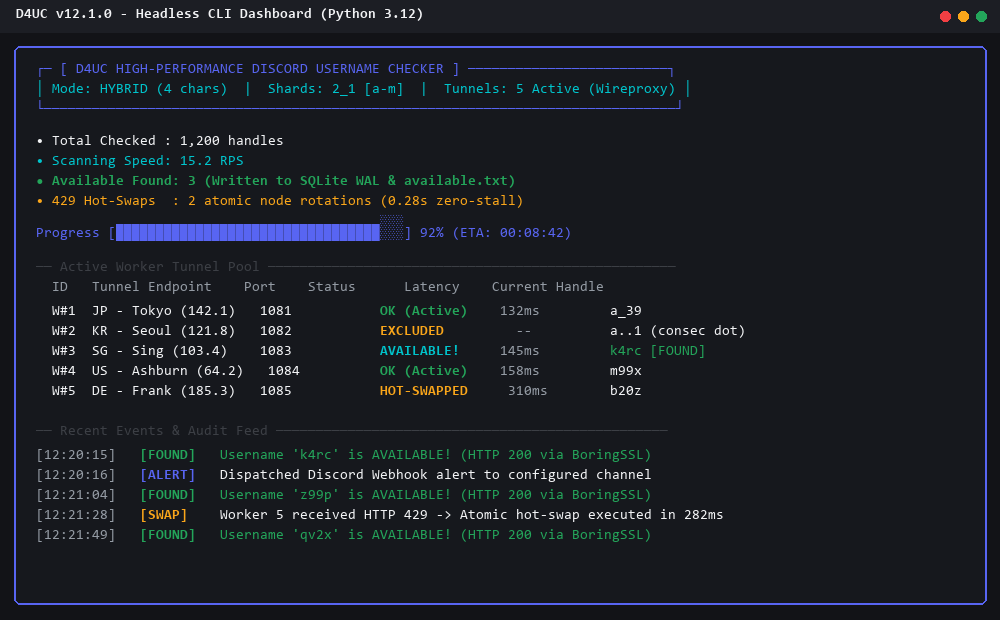
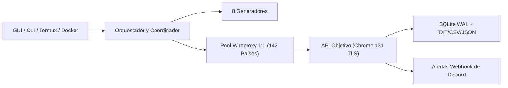

<div align="center">

<br />

| [KR 한국어](./ko.md) | [US English](../../README.md) | [JP 日本語](./ja.md) | [CN 简体中文](./zh-CN.md) | [ES Español](./es.md) |
| :---: | :---: | :---: | :---: | :---: |
| [FR Français](./fr.md) | [DE Deutsch](./de.md) | [RU Русский](./ru.md) | [BR Português](./pt-BR.md) | [SA العربية](./ar.md) |

<p align="center"><sub>🌐 Also available: <a href="./hi.md">HI हिन्दी</a> · <a href="./id.md">ID Bahasa Indonesia</a></sub></p>

<br />

[](../../CHANGELOG.md)

# ⚡ D4UC (`discord-checker`)

> **Motor de Verificación de Nombres de Usuario Poco Comunes para Discord — Suplantación TLS Chrome 131, Pool Multitúnel Aislado 1:1 y Sharding SQLite WAL.**

[](https://github.com/KRCUPRO/discord-checker/releases/tag/v12.1.0)
[](../../LICENSE)
[](https://www.python.org/)
[](../GUIDE.md)
[](../specs/01_NETWORK_CORE_ENGINE.md)

<sub>Copyright (c) 2026 KRCUPRO · Licencia Propietaria y Confidencial (Todos los Derechos Reservados)</sub>

</div>

---

## 📸 Vista previa de la interfaz

[](../guides/PC_GUIDE.md)

[](../guides/PC_GUIDE.md)

[](../guides/TERMUX_DEBIAN_GUIDE.md)

[](../guides/DOCKER_GUIDE.md)

---

<details open>
<summary><b>🌟 Descripción General y Capacidades Clave</b></summary>

Los verificadores tradicionales fallan frente a las defensas modernas por tres cuellos de botella:
1. **Bloqueo por Huella TLS**: Las librerías HTTP estándar son detectadas por Cloudflare/WAF debido a sus firmas JA3/JA4.
2. **Interferencia de VPN en todo el Sistema**: Un cliente VPN convencional secuestra el tráfico y el DNS de todo el equipo.
3. **Bloqueos en Cascada 429 y Colisiones**: Un límite de tasa detiene todos los hilos, y múltiples ventanas corrompen los archivos de salida.

**D4UC (`discord-checker`)** resuelve los tres problemas con una arquitectura aislada y multiplataforma:
- **Sigilo TLS Chrome 131 JA3/JA4**: Basado en `curl_cffi` (BoringSSL) con cabeceras sincronizadas idénticas a Chrome 131 real.
- **Túneles WireGuard en Espacio de Usuario 1:1 (`wireproxy`)**: Asigna 142 clústeres globales a puertos locales (`127.0.0.1:1081+`) por trabajador sin modificar la red del sistema operativo.
- **Intercambio Atómico en 0.3s ante 429**: Solo el trabajador limitado cambia instantáneamente de país mientras los demás continúan sin pausa.
- **Sharding Matemático y SQLite WAL**: Divide búsquedas en 2, 3 o 4 segmentos disjuntos (`2_1`, `2_2`, `4_1`–`4_4`) sincronizados en `data/d4uc_results.db` sin duplicados.

</details>

---

<details open>
<summary><b>🥊 Comparativa: Scripts Clásicos vs D4UC v12</b></summary>

| Capacidad | Scripts Tradicionales | ⚡ D4UC v12 (`discord-checker`) |
| :--- | :---: | :---: |
| **Sigilo TLS** | ❌ Detectado en `requests` / `aiohttp` | **✅ Suplantación BoringSSL Chrome 131 JA3/JA4** |
| **Aislamiento de Red** | ❌ Requiere VPN global del SO | **✅ Pool `wireproxy` en espacio de usuario (1:1)** |
| **Recuperación 429** | ❌ Pausa global o fallo total | **✅ Cambio atómico de 0.3s por trabajador** |
| **Sharding Paralelo** | ❌ Comprobaciones duplicadas | **✅ Segmentos disjuntos + SQLite WAL concurrente** |
| **Plataformas e Interfaz** | ⚠️ Solo consola básica | **✅ GUI Escritorio, Rich CLI, Termux Android y Docker** |
| **Higiene de Secretos** | ⚠️ Riesgo de claves expuestas | **✅ `.gitignore` estricto, `.env` y plantillas limpias** |

</details>

---

<details open>
<summary><b>🧬 8 Modos de Generación de Nombres</b></summary>

| Modo | Estrategia | Uso Ideal |
| :--- | :--- | :--- |
| `hybrid` | Raíces de diccionario + simetría/números | Descubrimiento rápido general |
| `permutation` | Espacio exhaustivo (`a–z`, `0–9`, `_`) | Cobertura completa mediante sharding (`2_1`, `2_2`) |
| `dictionary` | Palabras y sílabas de 3–6 letras | Nombres legibles de alto valor |
| `pattern` | Patrones simétricos (`aaaa`, `abba`, `abab`) | Estructuras visualmente distintivas |
| `numeric` | Secuencias y repeticiones (`0000`–`9999`) | Identificadores numéricos cortos |
| `custom_mask` | Prefijos, sufijos y puntos (`??.vip`, `kr??`) | Iniciales, marcas y ubicación exacta de puntos |
| `combinatorial` | Sílabas fonéticas CVCV / VCCV | Nombres originales pronunciables |
| `recheck` | Reevaluación de registros `TAKEN` | Detectar nombres recién liberados |

</details>

---

<details open>
<summary><b>🏛️ Arquitectura y Estructura del Repositorio</b></summary>



```text
discord-checker/
├── config/                  # Plantillas .env.example y config.example.yaml
├── data/                    # Base pública de 142 clústeres y plantilla de credenciales
├── deploy/                  # Dockerfile, docker-compose.yml, scripts Termux y PyInstaller
├── docs/                    # Guías, 11 traducciones, mapa de arquitectura y specs
├── src/                     # GUI (KO/EN), CLI y motor modular
├── tests/                   # Suite de pruebas automatizadas (68 pruebas)
├── CHANGELOG.md             # Historial de versiones
├── LICENSE                  # Licencia Propietaria (KRCUPRO)
├── NOTICE                   # Avisos de terceros
├── README.md                # Documentación principal en inglés
├── requirements.txt         # Dependencias de Python
└── SECURITY.md              # Política de seguridad
```

</details>

---

<details open>
<summary><b>🚀 Inicio Rápido en 4 Plataformas</b></summary>

#### 1. GUI de Escritorio (Windows / Desktop)
```bash
git clone https://github.com/KRCUPRO/discord-checker.git
cd discord-checker
python -m venv .venv
.\.venv\Scripts\activate
pip install -r requirements.txt

python src/gui_ko.py
python src/gui_en.py
```

#### 2. CLI Headless y Sharding
```bash
python src/run.py
python src/run.py --mode permutation --length 4 --shard 2_1 --workers 5
python src/run.py --no-dashboard
```

#### 3. Docker y Multi-Contenedor
```bash
cp config/.env.example .env
docker compose -f deploy/docker-compose.yml up -d
docker compose -f deploy/docker-compose.yml --profile 2shard up -d
```

#### 4. Android Termux (`proot-distro debian`)
```bash
chmod +x deploy/install_debian.sh deploy/run.sh
./deploy/install_debian.sh
termux-wake-lock
nohup ./deploy/run.sh --no-dashboard > output.log 2>&1 &
```

</details>

---

<details>
<summary><b>⚙️ Configuración y Variables de Entorno</b></summary>

Copia [config/.env.example](../../config/.env.example) a `.env`:

```ini
SURFSHARK_PRIVATE_KEYS=YOUR_SURFSHARK_WIREGUARD_PRIVATE_KEY_HERE
D4UC_MODE=hybrid
D4UC_LENGTH=4
D4UC_WORKERS=5
D4UC_PROXY=surfshark
D4UC_WEBHOOK=
```

Consulta [SECURITY.md](../../SECURITY.md) para más detalles.

</details>

---

<details open>
<summary><b>📄 Licencia y Atribución</b></summary>

Copyright (c) 2026 **KRCUPRO**. Todos los Derechos Reservados.  
Licenciado bajo la [LICENCIA DE SOFTWARE PROPIETARIA Y CONFIDENCIAL](../../LICENSE).  
Avisos de código abierto de terceros en [NOTICE](../../NOTICE).

</details>

---

## 🚫 Nombres de Usuario Excluidos (Ejemplos: `ab..`, `a..1`)

De acuerdo con las reglas oficiales de nombres de usuario de Discord, los siguientes patrones quedan 100% excluidos antes del escaneo:
1. **Puntos consecutivos prohibidos (`..`)**:
   - `ab..` (Puntos consecutivos al final) ➔ **Excluido**
   - `a..1` (Puntos consecutivos en medio) ➔ **Excluido**
   - `..kr` (Puntos consecutivos al inicio) ➔ **Excluido**
2. **Prohibido punto único al inicio o final (`.`)**: `.abc`, `abc.` ➔ **Excluido**
3. **Caracteres válidos**: Solo minúsculas (`a-z`), dígitos (`0-9`), guion bajo (`_`) y punto simple (`.`).
4. **Palabras reservadas**: `discord`, `clyde`, `system`, `everyone` filtradas automáticamente.

## 📞 Contacto Discord : myuyayam

Para consultas o soporte técnico, contactar en Discord: **`myuyayam`**.
