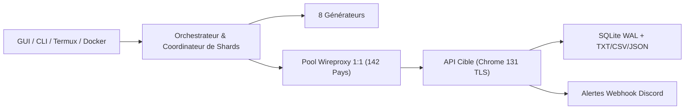

<div align="center">

<br />

| [KR 한국어](./ko.md) | [US English](../../README.md) | [JP 日本語](./ja.md) | [CN 简体中文](./zh-CN.md) | [ES Español](./es.md) |
| :---: | :---: | :---: | :---: | :---: |
| [FR Français](./fr.md) | [DE Deutsch](./de.md) | [RU Русский](./ru.md) | [BR Português](./pt-BR.md) | [SA العربية](./ar.md) |
| [HI हिन्दी](./hi.md) | [ID Bahasa Indonesia](./id.md) | | | |

<br />

[](../../CHANGELOG.md)

# ⚡ D4UC (`discord-checker`)

> **Moteur Haute Performance de Vérification de Noms d'Utilisateur Discord — Usurpation TLS Chrome 131, Pool Multi-Tunnels Isolé 1:1 & Sharding SQLite WAL.**

[](https://github.com/KRCUPRO/discord-checker/releases/tag/v12.1.0)
[](../../LICENSE)
[](https://www.python.org/)
[](../GUIDE.md)
[](../specs/01_NETWORK_CORE_ENGINE.md)

<sub>Copyright (c) 2026 KRCUPRO · Licence Logicielle Propriétaire et Confidentielle (Tous Droits Réservés)</sub>

</div>

---

<details open>
<summary><b>🌟 Aperçu & Capacités Clés</b></summary>

Les scripts classiques échouent face aux protections edge modernes à cause de trois goulets d'étranglement :
1. **Blocage par Empreinte TLS** : Les clients HTTP standards sont bloqués par Cloudflare/WAF via leurs signatures JA3/JA4.
2. **Perturbation VPN Globale** : Un client VPN classique détourne tout le trafic réseau et DNS de votre machine.
3. **Pannes en Cascade 429 & Conflits** : Un rate-limit bloque tous les threads, et lancer plusieurs instances corrompt les fichiers.

**D4UC (`discord-checker`)** résout ces trois défis dans une architecture multiplateforme isolée :
- **Furtivité TLS Chrome 131 JA3/JA4** : Propulsé par `curl_cffi` (BoringSSL) avec des en-têtes synchronisés identiques à un vrai navigateur Chrome 131.
- **Tunnels WireGuard en Espace Utilisateur 1:1 (`wireproxy`)** : Mappe 142 nœuds mondiaux sur des ports locaux dédiés (`127.0.0.1:1081+`) sans toucher aux interfaces réseau du système.
- **Bascule Atomique en 0,3s sur 429** : Seul le worker limité pivote immédiatement vers un nouveau pays ; les autres continuent sans interruption.
- **Sharding Mathématique & SQLite WAL** : Divise les analyses exhaustives en 2, 3 ou 4 tranches disjointes (`2_1`, `2_2`, `4_1`–`4_4`) sans aucun doublon.

</details>

---

<details open>
<summary><b>🥊 Matrice Comparative : Scripts Classiques vs D4UC v12</b></summary>

| Capacité | Scripts Classiques | ⚡ D4UC v12 (`discord-checker`) |
| :--- | :---: | :---: |
| **Furtivité TLS** | ❌ Bloqué sous `requests` / `aiohttp` | **✅ Empreinte BoringSSL Chrome 131 JA3/JA4** |
| **Isolation Réseau Hôte** | ❌ VPN système complet requis | **✅ Pool `wireproxy` en espace utilisateur (1:1)** |
| **Reprise après 429** | ❌ Arrêt global ou plantage | **✅ Bascule atomique 0,3s par worker + Cooldown** |
| **Sharding Multi-Instances** | ❌ Doublons & verrous de fichiers | **✅ Tranches disjointes + SQLite WAL concurrent** |
| **Plateformes & Interface** | ⚠️ CLI basique uniquement | **✅ GUI Desktop, Rich CLI, Termux Android & Docker** |
| **Hygiène des Secrets** | ⚠️ Risque de clés codées en dur | **✅ `.gitignore` strict, `.env` & modèles sécurisés** |

</details>

---

<details open>
<summary><b>🧬 8 Modes de Génération de Pseudonymes</b></summary>

| Mode | Stratégie | Meilleur Usage |
| :--- | :--- | :--- |
| `hybrid` | Dictionnaire + mutations symétriques/numériques | Découverte rapide polyvalente |
| `permutation` | Espace exhaustif (`a–z`, `0–9`, `_`) | Couverture totale par sharding (`2_1`, `2_2`) |
| `dictionary` | Mots et syllabes de 3–6 lettres | Identifiants lisibles à forte valeur |
| `pattern` | Motifs symétriques (`aaaa`, `abba`, `abab`) | Motifs rares visuellement distinctifs |
| `numeric` | Chiffres séquentiels ou répétés (`0000`–`9999`) | Identifiants numériques courts |
| `custom_mask` | Préfixe, suffixe et points (`??.vip`, `kr??`) | Initiales, marques et placement exact de points |
| `combinatorial` | Syllabes phonétiques CVCV / VCCV | Noms originaux prononçables |
| `recheck` | Réévaluation des entrées `TAKEN` | Détection des pseudos nouvellement libérés |

</details>

---

<details open>
<summary><b>🏛️ Architecture & Structure du Dépôt</b></summary>



```text
discord-checker/
├── config/                  # Modèles .env.example & config.example.yaml
├── data/                    # Base publique des 142 clusters & modèle d'identifiants
├── deploy/                  # Dockerfile, docker-compose.yml, scripts Termux & PyInstaller
├── docs/                    # Guides, 11 traductions, architecture & spécifications
├── src/                     # GUI (KO/EN), CLI & moteur modulaire
├── tests/                   # Suite de tests automatisés (68 tests)
├── CHANGELOG.md             # Journal des modifications
├── LICENSE                  # Licence Propriétaire (KRCUPRO)
├── NOTICE                   # Mentions tierces
├── README.md                # Documentation principale en anglais
├── requirements.txt         # Dépendances Python
└── SECURITY.md              # Politique de sécurité
```

</details>

---

<details open>
<summary><b>🚀 Démarrage Rapide sur 4 Plateformes</b></summary>

#### 1. Interface Graphique (Windows / Desktop)
```bash
git clone https://github.com/KRCUPRO/discord-checker.git
cd discord-checker
python -m venv .venv
.\.venv\Scripts\activate
pip install -r requirements.txt

python src/gui_ko.py
python src/gui_en.py
```

#### 2. CLI Headless & Sharding
```bash
python src/run.py
python src/run.py --mode permutation --length 4 --shard 2_1 --workers 5
python src/run.py --no-dashboard
```

#### 3. Docker & Multi-Conteneurs
```bash
cp config/.env.example .env
docker compose -f deploy/docker-compose.yml up -d
docker compose -f deploy/docker-compose.yml --profile 2shard up -d
```

#### 4. Android Termux (`proot-distro debian`)
```bash
chmod +x deploy/install_debian.sh deploy/run.sh
./deploy/install_debian.sh
termux-wake-lock
nohup ./deploy/run.sh --no-dashboard > output.log 2>&1 &
```

</details>

---

<details>
<summary><b>⚙️ Configuration & Variables d'Environnement</b></summary>

Copiez [config/.env.example](../../config/.env.example) vers `.env` :

```ini
SURFSHARK_PRIVATE_KEYS=YOUR_SURFSHARK_WIREGUARD_PRIVATE_KEY_HERE
D4UC_MODE=hybrid
D4UC_LENGTH=4
D4UC_WORKERS=5
D4UC_PROXY=surfshark
D4UC_WEBHOOK=
```

Consultez [SECURITY.md](../../SECURITY.md) pour les bonnes pratiques de sécurité.

</details>

---

<details open>
<summary><b>📄 Licence & Attribution</b></summary>

Copyright (c) 2026 **KRCUPRO**. Tous Droits Réservés.  
Sous licence [PROPRIETARY & CONFIDENTIAL SOFTWARE LICENSE](../../LICENSE).  
Les mentions des composants open source tiers figurent dans [NOTICE](../../NOTICE).

</details>

---

## 🚫 Noms d'utilisateur Exclus (Exemples: `ab..`, `a..1`)

Conformément aux règles d'identifiants de Discord, les motifs suivants sont exclus à 100% avant toute requête:
1. **Points consécutifs interdits (`..`)**:
   - `ab..` (Points consécutifs à la fin) ➔ **Exclu**
   - `a..1` (Points consécutifs au milieu) ➔ **Exclu**
   - `..kr` (Points consécutifs au début) ➔ **Exclu**
2. **Point en début ou fin interdit (`.`)**: `.abc`, `abc.` ➔ **Exclu**
3. **Caractères valides**: Uniquement minuscules (`a-z`), chiffres (`0-9`), souligné (`_`) et point unique (`.`).

## 📞 Contact Discord : myuyayam

Support et questions sur Discord : **`myuyayam`**.
