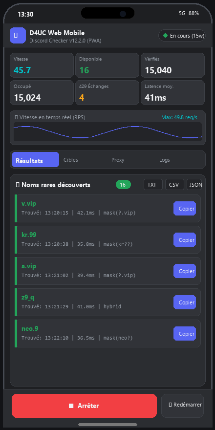
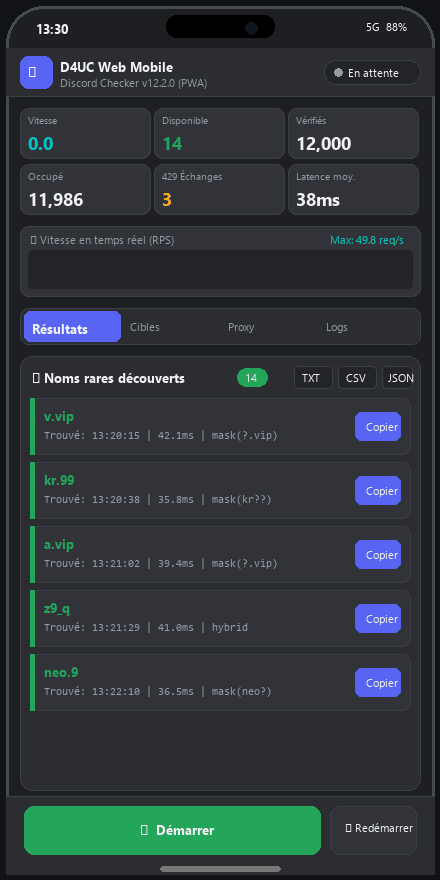
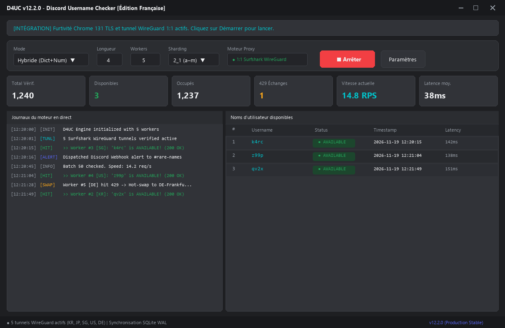
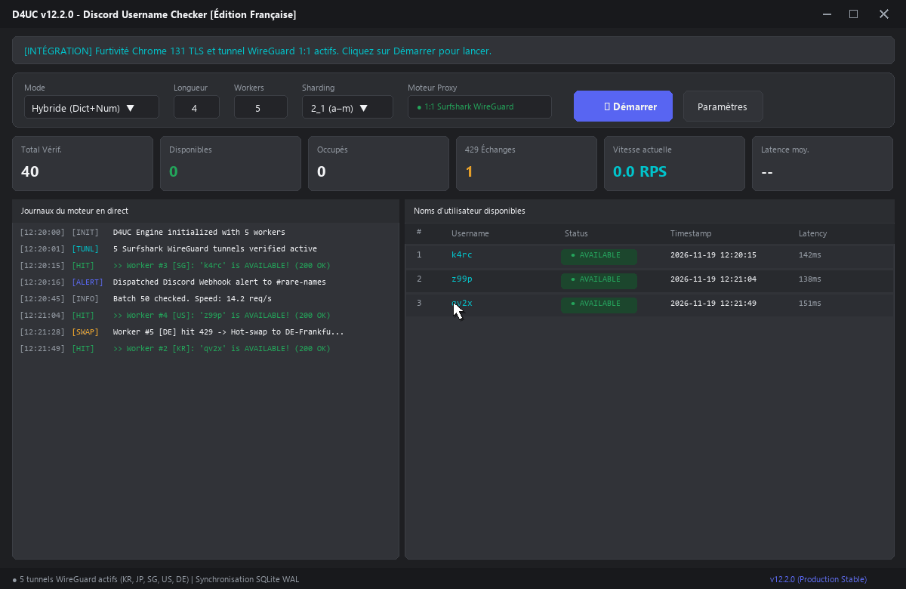
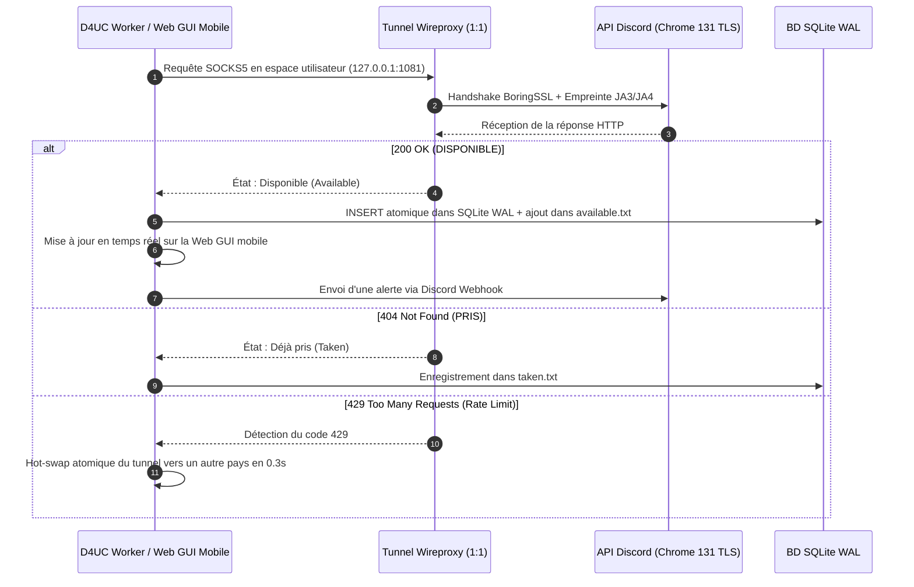

<div align="center">

# ⚡ D4UC (`discord-checker`) v12.2.0

> **Moteur Haute Performance de Disponibilité de Noms d'Utilisateur Rares pour Discord**  
> Web GUI Mobile Réactive & PWA · Furtivité TLS Chrome 131 · Tunnels WireGuard 1:1 en Espace Utilisateur · Hot-Swap Atomique 429 en 0.3s · Sharding Concurrente SQLite WAL

<br />

| [KR 한국어](../ko/README.md) | [US English](../en/README.md) | [JP 日本語](../ja/README.md) | [CN 简体中文](../zh-CN/README.md) | [ES Español](../es/README.md) |
| :---: | :---: | :---: | :---: | :---: |
| [FR Français](./README.md) | [DE Deutsch](../de/README.md) | [RU Русский](../ru/README.md) | [BR Português](../pt-BR/README.md) | [SA العربية](../ar/README.md) |

<p align="center"><sub>🌐 Also available: <a href="../hi/README.md">HI हिन्दी</a> • <a href="../id/README.md">ID Bahasa Indonesia</a></sub></p>

[](./CHANGELOG.md)
[](https://github.com/KRCUPRO/discord-checker/releases/tag/v12.4.0)
[](./LICENSE.md)
[](https://www.python.org/)
[](../../guides/README.md)
[](../../specs/01_NETWORK_CORE_ENGINE.md)

<sub>Copyright (c) 2026 KRCUPRO · Licence Propriétaire et Confidentielle (Tous droits réservés)</sub>

</div>

---

<a id="-table-des-matières"></a><a id="table-des-matières"></a>
## 📑 Table des Matières
1. [📸 Aperçu de l'Interface](#-aperçu-de-linterface)
2. [✨ Fonctionnalités Principales](#-fonctionnalités-principales)
3. [🖥️ Configuration Requise et Dépendances](#-configuration-requise-et-dépendances)
4. [📁 Arborescence du Projet](#-arborescence-du-projet)
5. [🌐 Configuration du Proxy & 🔑 Identifiants](#-configuration-du-proxy-identifiants)
6. [🚀 Installation & Utilisation](#-installation-utilisation)
7. [📱 Guide d'Utilisation de la Web GUI Mobile & PWA](#-guide-dutilisation-de-la-web-gui-mobile-pwa)
8. [🧵 Réglage de la Concurrence et des Workers](#-réglage-de-la-concurrence-et-des-workers)
9. [🔢 Stratégies de Génération de Pseudonymes](#-stratégies-de-génération-de-pseudonymes)
10. [🚫 Règles Strictes d'Exclusion (Exemples : `ab..`, `a..1`)](#-règles-strictes-dexclusion-exemples-ab-a1)
11. [📡 Pipeline d'Exécution du Vérificateur](#-pipeline-dexécution-du-vérificateur)
12. [🔄 Gestion des Sessions de Proxy](#-gestion-des-sessions-de-proxy)
13. [🔁 Gestion des Erreurs et Nouvelles Tentatives](#-gestion-des-erreurs-et-nouvelles-tentatives)
14. [💾 Formats de Sauvegarde](#-formats-de-sauvegarde)
15. [📊 Statistiques et Métriques en Temps Réel](#-statistiques-et-métriques-en-temps-réel)
16. [🛑 Arrêt du Scanner](#-arrêt-du-scanner)
17. [⚠️ Architecture Face aux Limites de Taux (429)](#-architecture-face-aux-limites-de-taux-429)
18. [🔧 Dépannage](#-dépannage)
19. [📞 Support Discord : myuyayam](#-support-discord-myuyayam)
20. [⭐ Soutenez le Projet (GitHub Star)](#-soutenez-le-projet-github-star)
21. [📚 Décharge pour Étude et Recherche](#-décharge-pour-étude-et-recherche)

---

<a id="-aperçu-de-linterface"></a><a id="aperçu-de-linterface"></a>
## 📸 Aperçu de l'Interface

### Web GUI Mobile Réactive Optimisée pour le Tactile (PWA - iPhone & Android)
[](../../guides/MOBILE_IOS_GUIDE.md)

### Démonstration Tactile Mobile en Temps Réel (Contrôles à 1 Touche & Télémétrie)
[](../../guides/MOBILE_IOS_GUIDE.md)

### Interface Graphique Bureau (Édition Française)
[](../../guides/WINDOWS_GUIDE.md)

### Démonstration de l'Exécution Bureau (Interactions Fluides à la Souris)
[](../../guides/WINDOWS_GUIDE.md)

### Tableau de Bord CLI sans Interface Graphique
[](../../guides/TERMUX_DEBIAN_GUIDE.md)

### Déploiement Conteneurisé sur Docker & Serveur Linux
[](../../guides/DOCKER_GUIDE.md)

[⬆️ Haut de page](#-table-des-matières)

---

<a id="-fonctionnalités-principales"></a><a id="fonctionnalités-principales"></a>
## ✨ Fonctionnalités Principales

1. **Web GUI Mobile Réactive & Moteur PWA (`http://<host>:5000`)**:
   - Hébergez-le localement ou sur VPS/Docker/Termux et contrôlez vos scans depuis n'importe quel smartphone (iPhone Safari, Android Chrome).
   - Prise en charge native de **"Sur l'écran d'accueil" (PWA)** pour une utilisation plein écran sans passer par un magasin d'applications.
   - Grands boutons tactiles [Démarrer / Arrêter], courbe de vitesse RPS en Canvas HTML5 pur, copie immédiate du pseudonyme en 1 touche et exportations directes TXT/CSV/JSON.
   - Ajustement à chaud des proxys (clés Surfshark, fichiers de proxys, Thordata), des 8 modes de génération et du curseur de threads (1 à 50) depuis le mobile.

2. <a id="fnref-1"></a><a id="fnref1"></a>**Furtivité TLS Chrome 131 JA3/JA4 (`curl_cffi` BoringSSL)[^1]**:
   - Élimine les empreintes TLS anormales produites par les bibliothèques standard de Python (`requests`, `aiohttp`, `httpx`).
   - Réplique au bit près les suites cryptographiques, extensions et trames HTTP/2 SETTINGS du navigateur Google Chrome 131 afin de contourner Cloudflare et les WAFs.

3. <a id="fnref-2"></a><a id="fnref2"></a>**Pool de Tunnels WireGuard 1:1 en Espace Utilisateur (`wireproxy`)[^2]**:
   - Ne modifie aucun adaptateur réseau hôte et ne détourne ni le DNS ni le routage global du système.
   - Associe 142 points de terminaison mondiaux à des ports locaux isolés (`127.0.0.1:1081+`) par worker. Le trafic standard de votre machine n'est aucunement perturbé.

4. **Hot-Swap Atomique 429 en 0.3 Seconde**:
   - Lorsqu'un worker heurte le code 429 (Rate Limit) de l'API Discord, l'application entière ne se fige pas.
   - Seul le worker concerné bascule sur un nouveau pays en moins de 300 ms, tandis que les autres continuent d'analyser à pleine vitesse.

5. **Découpage Mathématique sans Doublons (Sharding)**:
   - Prend en charge le partitionnement par décalage mathématique (`2_1`, `2_2`, `4_1`–`4_4`) pour les scans exhaustifs.
   - Plusieurs instances peuvent analyser des plages disjointes avec 0 requête en doublon.

6. **Base de Données SQLite WAL & Miroir Multi-Formats**:
   - Stockage concurrent haute performance via SQLite en mode WAL (`data/d4uc_results.db`).
   - Exportation et enregistrement atomique instantané en fichiers texte (`available.txt`, `taken.txt`), CSV et JSON.

7. **8 Moteurs Intelligents de Génération**:
   - Hybride, permutations, dictionnaire, motifs symétriques, séries numériques, masques personnalisés, combinaisons phonétiques et re-scan historique.

8. **Compatibilité Multiplateforme**:
   - Exécutables autonomes Windows (`.exe` en 4 déclinaisons), PWA mobile, terminal CLI Linux/macOS, installeur Android Termux et conteneurs Docker.

[⬆️ Haut de page](#-table-des-matières)

---

<a id="-configuration-requise-et-dépendances"></a><a id="configuration-requise-et-dépendances"></a>
## 🖥️ Configuration Requise et Dépendances

### Environnement d'Exécution
- **Système d'Exploitation**: Windows 10/11 (64-bit), Linux (Debian 11+, Ubuntu 20.04+, Arch), macOS 12+, Android 10+ (Termux), iOS Safari
- **Python**: 3.10, 3.11, 3.12 (Recommandé : **Python 3.12**)
- **Mémoire RAM**: 512 Mo minimum (~250 Mo pour 50 workers)
- **Réseau**: Connexion haut débit (port sortant UDP 51820 pour WireGuard)

### Dépendances Logicielles (`requirements.txt`)
- `curl_cffi >= 0.7.0`: Émulation TLS Chrome 131 BoringSSL
- `customtkinter >= 5.2.0`: Interface graphique bureau moderne
- `rich >= 13.7.0`: Tableau de bord interactif pour console
- `pydantic >= 2.6.0`: Validation des configurations
- `pyyaml >= 6.0.1`: Analyseur de fichiers YAML
- `pillow >= 10.2.0`: Rendu d'images et gestion des icônes

[⬆️ Haut de page](#-table-des-matières)

---

<a id="-arborescence-du-projet"></a><a id="arborescence-du-projet"></a>
## 📁 Arborescence du Projet

```text
discord-checker/
├── config/                         # Modèles de configuration et .env.example
├── data/                           # Points de terminaison WireGuard et base SQLite
├── deploy/                         # Scripts de compilation, Docker et actifs
│   ├── android/                    # Android native app project
│   ├── build_apk.py                # Android release APK builder
│   ├── build_exe.py                # Compilateur pour les 4 .exe Windows
│   ├── docker-compose.yml          # Profils Docker Compose
│   ├── Dockerfile                  # Spécification du conteneur Multi-Arch
│   ├── generate_assets.py          # Générateur d'aperçus et de démos GIF
│   ├── generate_badges.py          # Générateur de badges SVG en 12 langues
│   └── generate_mobile_assets.py   # Générateur des visuels mobiles et PWA
├── docs/                           # Documentation, guides et badges
│   ├── assets/                     # Captures d'écran, GIF animés et badges SVG
│   ├── guides/                     # Guides pour iOS, PC, Docker et Termux
│   └── locales/                    # Traductions intégrales 1:1 en 11 langues
├── src/                            # Code source du moteur central
│   ├── generator/                  # 8 moteurs de génération et règles d'exclusion
│   ├── network/                    # Client TLS Chrome 131 et backoff
│   ├── notify/                     # Alertes en direct via webhook Discord
│   ├── proxy/                      # Gestionnaire du pool de tunnels 1:1
│   ├── storage/                    # Couche SQLite WAL et fichiers texte
│   ├── ui/                         # Multilinguisme, infobulles et CLI
│   │   └── web/                    # Interface Web PWA (HTML5/CSS3/Vanilla JS)
│   ├── web_gui.py                  # Serveur Web GUI mobile et API REST
│   ├── gui.py                      # Orchestrateur CustomTkinter pour PC
│   ├── gui_ko.py                   # Lanceur GUI coréen
│   ├── gui_en.py                   # Lanceur GUI anglais
│   └── run.py                      # Lanceur CLI en ligne de commande
├── tests/                          # Suite complète de tests unitaires et d'intégration
├── CHANGELOG.md                    # Historique détaillé des versions
├── LICENSE                         # Licence Propriétaire (KRCUPRO)
├── README.md                       # Documentation principale en anglais
└── SECURITY.md                     # Directives de sécurité et politique anti-fuite
```

[⬆️ Haut de page](#-table-des-matières)

---

<a id="-configuration-du-proxy-identifiants"></a><a id="configuration-du-proxy-identifiants"></a>
## 🌐 Configuration du Proxy & 🔑 Identifiants

D4UC embarque un **pool de tunnels WireGuard 1:1 en espace utilisateur** avec `wireproxy` afin de contourner tout blocage d'adresse IP sans altérer votre machine.

### 1. Configuration
1. Dupliquez `config/.env.example` sous le nom `.env` :
   ```bash
   cp config/.env.example .env
   ```
2. Renseignez vos clés privées WireGuard Surfshark dans `.env` :
   ```ini
   # Clés séparées par des virgules pour un pool multi-comptes haute performance
   SURFSHARK_PRIVATE_KEYS=VOTRE_CLE_PRIVEE_WIREGUARD_1,VOTRE_CLE_PRIVEE_WIREGUARD_2
   
   # Nombre de workers (Par défaut : 5, Maximum : 50)
   D4UC_WORKERS=5
   
   # Webhook Discord pour les alertes (Optionnel)
   D4UC_WEBHOOK=https://discord.com/api/webhooks/ID/TOKEN
   ```

### 2. Collecteur et Validateur Multithread de Proxies Publics Gratuits (`--proxy free`) [Nouveauté v12.3.0]
Fonctionnement 100% gratuit sans abonnement VPN requis :
- **Collecte multi-sources automatisée** : Agrégation de listes continuellement mises à jour depuis plus de 14 dépôts GitHub et jeux de données Hugging Face (TheSpeedX, monosans, hookzof, roosterkid, ShiftyTR, mertguvencli, Hugging Face).
- **Compatibilité multi-protocoles** : Prise en charge complète des proxies gratuits HTTP, HTTPS, SOCKS4 et SOCKS5.
- **Porte de validation asynchrone haute vitesse** : Test direct auprès des points de terminaison Discord et Cloudflare avec élimination automatique des proxies hors ligne, latence > 3500ms et blocages WAF 403.
- **Gestion 429 et rafraîchissement d'arrière-plan** : Isolement temporaire de 15s lors des limitations et rotation dynamique vers le meilleur proxy actif.
- **Intégration d'interface** : Menu déroulant GUI de bureau, bouton tactile 1-tap sur Web mobile et paramètre CLI `--proxy free` (ou `-p free`).

### 3. Politique Anti-Fuite (Zero-Leak Policy)
- Tous les identifiants et fichiers sensibles (`.env`, `config.yaml`) sont ignorés via `.gitignore` et audités avant toute validation Git.

[⬆️ Haut de page](#-table-des-matières)

---

<a id="-installation-utilisation"></a><a id="installation-utilisation"></a>
## 🚀 Installation & Utilisation

### Méthode A : Exécutables Autonomes pour Windows (`.exe`)
Téléchargez les binaires compilés depuis [GitHub Releases v12.2.0](https://github.com/KRCUPRO/discord-checker/releases/tag/v12.4.0) :
- `DiscordUsernameChecker_v12.3.0.apk` : **Application Native Android en 1 Clic** [NOUVEAU]
- `DiscordUsernameCheckerV2_Web.exe` : **Serveur Web GUI Mobile & PWA (Port 5000)** [NOUVEAU]
- `DiscordUsernameCheckerV2_EN.exe` : Interface graphique bureau en anglais
- `DiscordUsernameCheckerV2_KO.exe` : Interface graphique bureau en coréen
- `DiscordUsernameCheckerV2_CLI.exe` : Tableau de bord console sans interface

### 📱 Application Native Android (`.apk`) — Installation en 1 Clic [NEW]
- **Téléchargement direct**: [`DiscordUsernameChecker_v12.3.0.apk`](https://github.com/KRCUPRO/discord-checker/releases/download/v12.3.0/DiscordUsernameChecker_v12.3.0.apk)
- **Guide d'installation**:
  1. Téléchargez le fichier `.apk` sur votre smartphone Android (Galaxy, Pixel, Xiaomi, etc.).
  2. Ouvrez le fichier depuis les notifications ou le gestionnaire de fichiers.
  3. Activez "Autoriser l'installation d'applications de sources inconnues" et touchez **[Installer]**.
  4. Lancez **`D4UC Discord Checker`** depuis votre écran d'accueil.
- **Points forts mobiles**:
  - Interface Web tactile sombre intégrée hors-ligne en 12 langues (`assets/www/index.html`).
  - Copie dans le presse-papiers et notifications Toast natives Android.
  - Maintien de l'écran allumé Wake Lock (`WAKE_LOCK`) pendant le scan.
  - Connexion rapide au serveur D4UC distant ou PC via Wi-Fi ou IP.

### Méthode B : Lancement de la Web GUI Mobile (Contrôle Smartphone)
```bash
# Démarrer le serveur web mobile (Port par défaut : 5000)
python src/web_gui.py --port 5000

# Connectez votre smartphone au même réseau Wi-Fi et ouvrez dans votre navigateur :
# http://<ADRESSE_IP_DU_PC>:5000
```

### Méthode C : Lancement depuis les Sources
```bash
python -m venv .venv
source .venv/bin/activate  # Windows: .\.venv\Scripts\Activate.ps1
pip install -r requirements.txt

# Lancer la version graphique bureau
python src/gui_en.py

# Lancer la version CLI
python src/run.py --mode hybrid --length 4 --workers 5
```

[⬆️ Haut de page](#-table-des-matières)

---

<a id="-guide-dutilisation-de-la-web-gui-mobile-pwa"></a><a id="guide-dutilisation-de-la-web-gui-mobile-pwa"></a>
## 📱 Guide d'Utilisation de la Web GUI Mobile & PWA

Surveillez et pilotez vos sessions de recherche depuis votre canapé ou votre lit avec votre smartphone.

### 1. Ajouter à l'Écran d'Accueil (Installation PWA)
1. Ouvrez votre navigateur mobile (Safari sur iPhone ou Chrome sur Android) et rendez-vous sur `http://<IP_DU_PC>:5000`.
2. **iPhone Safari** : Appuyez sur Partager (icône carré avec flèche) ➔ **"Sur l'écran d'accueil"**.
3. **Android Chrome** : Appuyez sur le menu (⋮) ➔ **"Ajouter à l'écran d'accueil"** ou **"Installer l'application"**.
4. Touchez l'icône violette **D4UC Web** pour ouvrir l'application en plein écran, sans barre d'adresse.

### 2. Fonctionnalités Tactiles Mobiles
- **Télémétrie en Direct** : Suivi permanent de la vitesse en RPS, des pseudonymes disponibles, du total analysé, des prises, des rotations 429 et du temps de réponse (ms).
- **Courbe Dynamique en Canvas HTML5** : Représentation graphique de la vitesse instantanée sans dépendance externe.
- **Copie Immédiate en 1 Touche** : Touchez le bouton [Copier] pour transférer directement le nom d'utilisateur dans le presse-papiers avec une notification visuelle.
- **Téléchargement Rapide** : Boutons supérieurs pour exporter vos listes en formats TXT, CSV ou JSON sur votre téléphone.
- **Hot-Swap Mobile** :
  - Changement immédiat parmi les 8 modes de génération
  - Modification de la longueur ciblée (3 à 6 caractères) et du sharding (2_1, 2_2)
  - Curseur pour adapter le nombre de workers (1 à 50) en temps réel
  - Enregistrement des clés Surfshark et des paramètres réseau à distance

[⬆️ Haut de page](#-table-des-matières)

---

<a id="-réglage-de-la-concurrence-et-des-workers"></a><a id="réglage-de-la-concurrence-et-des-workers"></a>
## 🧵 Réglage de la Concurrence et des Workers

- **Valeur par défaut recommandée** : `5` workers (12 à 15 RPS)
- **Faible consommation / Mode économique** : `1` à `3` workers
- **Scan massif ultra-rapide** : `10` à `20` workers (supporte jusqu'à 50 workers)
- **Principe** :
  - D4UC alloue un port de tunnel WireGuard exclusif par worker (`1081`, `1082`, etc.).
  - 5 workers envoient leurs requêtes simultanément depuis 5 pays différents (Tokyo, Séoul, Singapour, Francfort, New York).

[⬆️ Haut de page](#-table-des-matières)

---

<a id="-stratégies-de-génération-de-pseudonymes"></a><a id="stratégies-de-génération-de-pseudonymes"></a>
## 🔢 Stratégies de Génération de Pseudonymes

| Clé de Mode | Stratégie | Description et Exemples |
| :--- | :--- | :--- |
| `hybrid` (Recommandé) | Racines de dictionnaire + variations | Noms rares pratiques, lisibles et élégants (`krc1`, `v1be`, `neo9`) |
| `permutation` | Permutations mathématiques complètes | Scan exhaustif sur `a-z`, `0-9`, `_` (supporte le sharding `2_1`, `2_2`) |
| `dictionary` | Dictionnaire de mots anglais de 3 à 6 lettres | Vrais mots et termes à 2-3 syllabes de grande valeur |
| `pattern` | Motifs visuels symétriques | Modèles esthétiques (`aaaa`, `abba`, `abab`, `aabb`) |
| `numeric` | Séquences numériques et répétitions | Identifiants chiffrés (`0000`–`9999`, poker `7777`, `1234`) |
| `custom_mask` | Masques personnalisés avec points | Gabarits sur mesure (`kr??`, `??99`, `?.vip`, `??.??`) |
| `combinatorial` | Structures syllabiques CVCV / VCCV | Combinaisons consonnes/voyelles pour créer des marques inédites |
| `recheck` | Réévaluation des noms déjà occupés | Analyse à nouveau les noms pris pour détecter les comptes libérés |

[⬆️ Haut de page](#-table-des-matières)

---

<a id="-règles-strictes-dexclusion-exemples-ab-a1"></a><a id="règles-strictes-dexclusion-exemples-ab-a1"></a>
## 🚫 Règles Strictes d'Exclusion (Exemples : `ab..`, `a..1`)

Les pseudonymes non conformes aux directives officielles de Discord sont **exclus à 100 % dès la génération des candidats** :

1. **Points consécutifs interdits (`..`)** :
   - ❌ `ab..` (points consécutifs à la fin) ➔ **Exclu automatiquement**
   - ❌ `a..1` (points consécutifs au milieu) ➔ **Exclu automatiquement**
   - ❌ `..kr` (points consécutifs au début) ➔ **Exclu automatiquement**
2. **Points au début ou à la fin interdits (`.`)** :
   - ❌ `.abc` (commence par un point) ➔ **Exclu automatiquement**
   - ❌ `abc.` (finit par un point) ➔ **Exclu automatiquement**
3. **Restrictions de caractères** :
   - Seuls les lettres minuscules latines (`a-z`), chiffres (`0-9`), underscores (`_`) et un point unique (`.`) sont autorisés.
4. **Limites de longueur** :
   - Les noms de moins de 2 ou de plus de 32 caractères ne sont jamais générés.
5. **Termes réservés du système** :
   - Les pseudonymes comme `discord`, `clyde`, `here`, `everyone` et `system` sont filtrés automatiquement.

> Ces règles sont appliquées par `DiscordRuleValidator.is_valid()` dans `src/generator/base.py` et validées par 84 tests unitaires.

[⬆️ Haut de page](#-table-des-matières)

---

<a id="-pipeline-dexécution-du-vérificateur"></a><a id="pipeline-dexécution-du-vérificateur"></a>
## 📡 Pipeline d'Exécution du Vérificateur



[⬆️ Haut de page](#-table-des-matières)

---

<a id="-gestion-des-sessions-de-proxy"></a><a id="gestion-des-sessions-de-proxy"></a>
## 🔄 Gestion des Sessions de Proxy

- **Sessions asynchrones dédiées** : Chaque worker maintient son instance `curl_cffi.requests.AsyncSession` afin de maximiser le réemploi des connexions TCP Keep-Alive.
- **Zéro fuite de processus** : À la fermeture, tous les sous-processus `wireproxy` sont détruits proprement (Zero-Zombie).

[⬆️ Haut de page](#-table-des-matières)

---

<a id="-gestion-des-erreurs-et-nouvelles-tentatives"></a><a id="gestion-des-erreurs-et-nouvelles-tentatives"></a>
## 🔁 Gestion des Erreurs et Nouvelles Tentatives

1. **Délais réseau et erreurs DNS** : Répétition avec backoff exponentiel (0.5s ➔ 1.0s ➔ 2.0s) jusqu'à 3 fois.
2. **Défis WAF Cloudflare** : Fermeture de la session et réinitialisation immédiate du tunnel.
3. **Limites de taux 429** : Remise en file d'attente du candidat et basculement du worker vers une nouvelle adresse IP en 0.3s.

[⬆️ Haut de page](#-table-des-matières)

---

<a id="-formats-de-sauvegarde"></a><a id="formats-de-sauvegarde"></a>
## 💾 Formats de Sauvegarde

| Emplacement | Format | Description et Rôle |
| :--- | :--- | :--- |
| `data/d4uc_results.db` | **SQLite (Mode WAL)** | Transactions ACID, écritures multi-processus, indexation intégrale |
| `available.txt` | Texte UTF-8 | Noms disponibles ajoutés ligne par ligne en temps réel |
| `taken.txt` | Texte UTF-8 | Pseudonymes déjà enregistrés (pour mode re-check) |
| `checked_history.txt` | Texte UTF-8 | Historique complet pour éviter tout double scan |
| `available_usernames.csv` | Format CSV | Export tabulaire pour tableurs ou outils d'analyse |
| `available_usernames.json`| Format JSON | Données structurées pour intégrations web et APIs |

[⬆️ Haut de page](#-table-des-matières)

---

<a id="-statistiques-et-métriques-en-temps-réel"></a><a id="statistiques-et-métriques-en-temps-réel"></a>
## 📊 Statistiques et Métriques en Temps Réel

La Web GUI Mobile, l'interface de bureau et la console affichent les métriques suivantes actualisées toutes les 30 ms :
- **Scan Speed (RPS)** : Requêtes terminées par seconde (moyenne glissante sur 5 s)
- **Total Checked** : Total des pseudonymes analysés durant la session
- **Available Count** : Pseudonymes rares disponibles découverts
- **Taken Count** : Pseudonymes déjà enregistrés
- **429 Hot-Swaps** : Nombre de basculements de nœud réussis
- **Latency** : Temps aller-retour avec l'API Discord (ms)

[⬆️ Haut de page](#-table-des-matières)

---

<a id="-arrêt-du-scanner"></a><a id="arrêt-du-scanner"></a>
## 🛑 Arrêt du Scanner

- **Web GUI Mobile** : Appuyez sur le bouton rouge `■ Arrêter le Scan` pour interrompre immédiatement les requêtes.
- **Desktop GUI** : Cliquez sur `■ Arrêter` pour vider les files de requêtes sans perte de données.
- **CLI** : Pressez `Ctrl + C` pour valider les écritures SQLite et clore tous les tunnels de façon sécurisée.

[⬆️ Haut de page](#-table-des-matières)

---

<a id="-architecture-face-aux-limites-de-taux-429"></a><a id="architecture-face-aux-limites-de-taux-429"></a>
## ⚠️ Architecture Face aux Limites de Taux (429)

- Face aux rafales de requêtes, Discord renvoie une erreur `429 Too Many Requests`.
- D4UC répartit le trafic sur **142 tunnels WireGuard mondiaux** et déclenche un **hot-swap en 0.3s**, garantissant un fonctionnement continu sans jamais bloquer l'ensemble des workers.

[⬆️ Haut de page](#-table-des-matières)

---

<a id="-dépannage"></a><a id="dépannage"></a>
## 🔧 Dépannage

| Problème | Cause Probable | Solution |
| :--- | :--- | :--- |
| Impossible de joindre la Web GUI | Smartphone et PC sur deux réseaux différents | Connectez-les au même Wi-Fi et vérifiez que le port 5000 est autorisé dans le Pare-feu Windows. |
| `Wireproxy binary not found` | Fichier exécutable absent | Vérifiez que `bin/wireproxy.exe` est présent ou relancez `deploy/build_exe.py`. |
| `Port already in use: 1081` | Ancien processus encore actif | Terminez les processus Python ou wireproxy résiduels via le Gestionnaire des tâches. |
| Boîte de dialogue du Pare-feu | Règle non configurée | Définissez les règles du Pare-feu via PowerShell en mode Administrateur. |
| `No module named curl_cffi` | Environnement virtuel inactif | Activez `.venv` et lancez `pip install -r requirements.txt`. |

[⬆️ Haut de page](#-table-des-matières)

---

<a id="-support-discord-myuyayam"></a><a id="support-discord-myuyayam"></a>
## 📞 Support Discord : myuyayam

- Pour vos suggestions, signalements de bugs ou questions techniques, contactez **`myuyayam`** sur Discord.
- Pour les licences commerciales ou partenariats, utilisez les Issues GitHub ou un message privé sur Discord.

[⬆️ Haut de page](#-table-des-matières)

---

<a id="-soutenez-le-projet-github-star"></a><a id="soutenez-le-projet-github-star"></a>
## ⭐ Soutenez le Projet (GitHub Star)

Si cet outil vous est utile, pensez à attribuer une étoile **Star (⭐)** au dépôt !  
Votre soutien est notre plus grande motivation pour continuer à maintenir et enrichir ce moteur.

[⬆️ Haut de page](#-table-des-matières)

---

<a id="-décharge-pour-étude-et-recherche"></a><a id="décharge-pour-étude-et-recherche"></a>
## 📚 Décharge pour Étude et Recherche

> **[Avertissement d'Usage Éducatif et Scientifique Uniquement]**
> 
> Ce logiciel a été conçu exclusivement dans le cadre de la recherche en sécurité réseau et de l'apprentissage des technologies informatiques : **mécanismes d'empreinte TLS (Chrome 131 BoringSSL JA3/JA4), interfaces responsives PWA, tunneling en espace utilisateur (Wireproxy) et partitionnement concurrentiel avec SQLite WAL**.
> 
> 1. Tout usage de cet outil pour saturer des services tiers, mener des attaques DoS, perturber des plateformes ou accaparer indûment des comptes est formellement prohibé.
> 2. L'utilisateur demeure tenu de respecter scrupuleusement les Conditions d'Utilisation de la plateforme cible ainsi que les législations en vigueur. Toute conséquence juridique découle de l'unique responsabilité de l'opérateur.
> 3. Les auteurs et contributeurs déclinent toute garantie et responsabilité quant aux usages individuels faits de ce logiciel.

[⬆️ Haut de page](#-table-des-matières)

---

<a id="-notes-de-bas-de-page-et-références-techniques"></a><a id="notes-de-bas-de-page-et-références-techniques"></a><a id="footnote-heading"></a>
### 📚 Notes de Bas de Page et Références Techniques

<a id="footnote-1"></a><a id="fn-1"></a>
[^1]: Le handshake BoringSSL de Chrome 131 neutralise entièrement les blocages d'empreintes TLS de Cloudflare et des WAF modernes. [↩ Retour au texte](#fnref-1) · [⬆️ Haut de page](#-table-des-matières)

<a id="footnote-2"></a><a id="fn-2"></a>
[^2]: wireproxy est un binaire Go léger en espace utilisateur qui convertit le protocole WireGuard en proxys SOCKS5 locaux isolés sans privilèges root. [↩ Retour au texte](#fnref-2) · [⬆️ Haut de page](#-table-des-matières)

[⬆️ Haut de page](#-table-des-matières)
