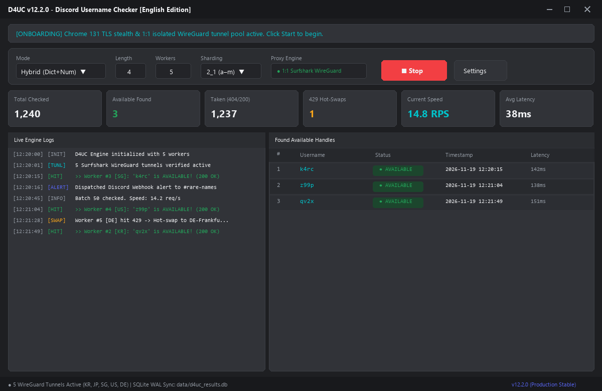
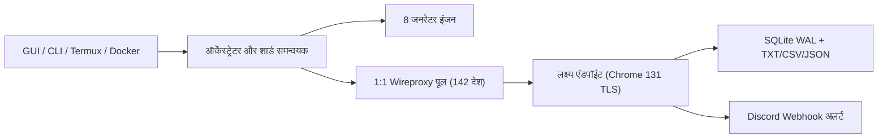

<div align="center">

<br />

| [KR 한국어](./ko.md) | [US English](../../README.md) | [JP 日本語](./ja.md) | [CN 简体中文](./zh-CN.md) | [ES Español](./es.md) |
| :---: | :---: | :---: | :---: | :---: |
| [FR Français](./fr.md) | [DE Deutsch](./de.md) | [RU Русский](./ru.md) | [BR Português](./pt-BR.md) | [SA العربية](./ar.md) |

<p align="center"><sub>🌐 Also available: <a href="./hi.md">HI हिन्दी</a> · <a href="./id.md">ID Bahasa Indonesia</a></sub></p>

<br />

[](../../CHANGELOG.md)

# ⚡ D4UC (`discord-checker`)

> **उच्च-प्रदर्शन Discord दुर्लभ यूज़रनेम उपलब्धता इंजन — Chrome 131 TLS छद्मावरण, 1:1 पृथक मल्टी-टनल पूल और SQLite WAL शार्डिंग।**

[](https://github.com/KRCUPRO/discord-checker/releases/tag/v12.1.0)
[](../../LICENSE)
[](https://www.python.org/)
[](../GUIDE.md)
[](../specs/01_NETWORK_CORE_ENGINE.md)

<sub>Copyright (c) 2026 KRCUPRO · स्वामित्व और गोपनीय सॉफ़्टवेयर लाइसेंस (सर्वाधिकार सुरक्षित)</sub>

</div>

---

## 📸 इंटरफ़ेस पूर्वावलोकन

[](../guides/PC_GUIDE.md)

[](../guides/PC_GUIDE.md)

[](../guides/TERMUX_DEBIAN_GUIDE.md)

[](../guides/DOCKER_GUIDE.md)

---

<details open>
<summary><b>🌟 अवलोकन और मुख्य क्षमताएँ</b></summary>

आधुनिक एज सुरक्षा के सामने पारंपरिक यूज़रनेम चेकर तीन प्रमुख अड़चनों के कारण विफल होते हैं:
1. **TLS फ़िंगरप्रिंट अवरोध**: सामान्य HTTP लाइब्रेरी को JA3/JA4 सिग्नेचर से Cloudflare/WAF तुरंत ब्लॉक कर देता है।
2. **पूरे सिस्टम में VPN हस्तक्षेप**: डेस्कटॉप VPN चालू करने से पूरे कंप्यूटर का नेटवर्क और DNS बदल जाता है।
3. **429 रुकावट और मल्टी-प्रोसेस टकराव**: रेट-लिमिट लगने पर सभी वर्कर रुक जाते हैं और समानांतर विंडो फ़ाइलों को खराब कर देती हैं।

**D4UC (`discord-checker`)** पृथक क्रॉस-प्लेटफ़ॉर्म आर्किटेक्चर में इन तीनों समस्याओं को हल करता है:
- **Chrome 131 TLS JA3/JA4 स्टेल्थ**: `curl_cffi` (BoringSSL) द्वारा वास्तविक Chrome 131 ब्राउज़र जैसा TLS हैंडशेक और HTTP हेडर।
- **1:1 यूज़र-स्पेस WireGuard टनल (`wireproxy`)**: प्रत्येक वर्कर को OS नेटवर्क प्रभावित किए बिना 142 वैश्विक एंडपॉइंट्स में से अलग लोकल पोर्ट (`127.0.0.1:1081+`) मिलता है।
- **0.3 सेकंड में एटॉमिक 429 हॉट-स्वैप**: केवल सीमित वर्कर तुरंत नए देश के नोड पर स्विच होता है, जबकि अन्य बिना रुके चलते रहते हैं।
- **गणितीय शार्डिंग और SQLite WAL सिंक**: 2, 3 या 4 भागों (`2_1`, `2_2`, `4_1`–`4_4`) में विभाजित स्कैन बिना किसी दोहराव के `data/d4uc_results.db` में सहेजे जाते हैं।

</details>

---

<details open>
<summary><b>🥊 तुलना मैट्रिक्स: पारंपरिक स्क्रिप्ट बनाम D4UC v12</b></summary>

| क्षमता | पारंपरिक स्क्रिप्ट | ⚡ D4UC v12 (`discord-checker`) |
| :--- | :---: | :---: |
| **TLS स्टेल्थ** | ❌ `requests` / `aiohttp` तुरंत ब्लॉक | **✅ BoringSSL Chrome 131 JA3/JA4 छद्मावरण** |
| **होस्ट नेटवर्क अलगाव** | ❌ पूरे सिस्टम का VPN आवश्यक | **✅ यूज़र-स्पेस `wireproxy` पूल (1:1 प्रति वर्कर)** |
| **429 रिकवरी** | ❌ पूरा प्रोग्राम रुकना या क्रैश | **✅ 0.3s प्रति-वर्कर हॉट-स्वैप + कूलडाउन कतार** |
| **मल्टी-इंस्टेंस शार्डिंग** | ❌ डुप्लिकेट जाँच और लॉक त्रुटि | **✅ असंबद्ध शार्ड्स + SQLite WAL समकालिक सिंक** |
| **प्लेटफ़ॉर्म और UI** | ⚠️ केवल सामान्य CLI | **✅ डेस्कटॉप GUI, Rich CLI, Android Termux और Docker** |
| **सीक्रेट सुरक्षा** | ⚠️ हार्डकोड कुंजी का जोखिम | **✅ सख्त `.gitignore`, `.env` और सुरक्षित टेम्पलेट** |

</details>

---

<details open>
<summary><b>🧬 8 यूज़रनेम जनरेशन मोड</b></summary>

| मोड कुंजी | रणनीति | सर्वोत्तम उपयोग |
| :--- | :--- | :--- |
| `hybrid` | शब्दकोश मूल + सममित/संख्यात्मक रूप | तेज़ और स्वच्छ नामों की खोज |
| `permutation` | संपूर्ण क्रमचय (`a–z`, `0–9`, `_`) | शार्डिंग (`2_1`, `2_2`) के साथ पूर्ण स्कैन |
| `dictionary` | 3–6 अक्षरों के शब्द व शब्दांश | सार्थक और दुर्लभ नाम |
| `pattern` | सममित पैटर्न (`aaaa`, `abba`, `abab`) | विशिष्ट दिखने वाले दुर्लभ पैटर्न |
| `numeric` | क्रमिक/दोहराए गए अंक (`0000`–`9999`) | छोटे संख्यात्मक हैंडल |
| `custom_mask` | उपसर्ग, प्रत्यय व डॉट नियम (`??.vip`, `kr??`) | लक्षित ब्रांड व शुरुआती अक्षर |
| `combinatorial` | ध्वन्यात्मक CVCV / VCCV शब्दांश | उच्चारण योग्य नए नाम |
| `recheck` | पुराने `TAKEN` रिकॉर्ड की पुनः जाँच | नए खाली हुए नाम पकड़ना |

</details>

---

<details open>
<summary><b>🏛️ सिस्टम आर्किटेक्चर और रिपॉजिटरी संरचना</b></summary>



```text
discord-checker/
├── config/                  # .env.example और config.example.yaml टेम्पलेट
├── data/                    # 142 क्लस्टर डेटाबेस और क्रेडेंशियल टेम्पलेट
├── deploy/                  # Dockerfile, docker-compose.yml, Termux और PyInstaller
├── docs/                    # गाइड, 11 भाषा अनुवाद, आर्किटेक्चर और स्पेसिफिकेशन
├── src/                     # GUI (KO/EN), CLI और मॉड्यूलर कोर इंजन
├── tests/                   # स्वचालित रिग्रेशन परीक्षण सूट (68 जाँच)
├── CHANGELOG.md             # संस्करण इतिहास
├── LICENSE                  # स्वामित्व लाइसेंस (KRCUPRO)
├── NOTICE                   # तृतीय-पक्ष सूचनाएँ
├── README.md                # मुख्य अंग्रेज़ी प्रलेखन
├── requirements.txt         # Python निर्भरताएँ
└── SECURITY.md              # सुरक्षा नीति
```

</details>

---

<details open>
<summary><b>🚀 4 प्लेटफ़ॉर्म पर त्वरित शुरुआत</b></summary>

#### 1. डेस्कटॉप GUI (Windows / Desktop)
```bash
git clone https://github.com/KRCUPRO/discord-checker.git
cd discord-checker
python -m venv .venv
.\.venv\Scripts\activate
pip install -r requirements.txt

python src/gui_ko.py
python src/gui_en.py
```

#### 2. हेडलेस CLI और शार्डिंग
```bash
python src/run.py
python src/run.py --mode permutation --length 4 --shard 2_1 --workers 5
python src/run.py --no-dashboard
```

#### 3. Docker और मल्टी-कंटेनर
```bash
cp config/.env.example .env
docker compose -f deploy/docker-compose.yml up -d
docker compose -f deploy/docker-compose.yml --profile 2shard up -d
```

#### 4. Android Termux (`proot-distro debian`)
```bash
chmod +x deploy/install_debian.sh deploy/run.sh
./deploy/install_debian.sh
termux-wake-lock
nohup ./deploy/run.sh --no-dashboard > output.log 2>&1 &
```

</details>

---

<details>
<summary><b>⚙️ कॉन्फ़िगरेशन और एनवायरनमेंट वेरिएबल्स</b></summary>

[config/.env.example](../../config/.env.example) को `.env` में कॉपी करें:

```ini
SURFSHARK_PRIVATE_KEYS=YOUR_SURFSHARK_WIREGUARD_PRIVATE_KEY_HERE
D4UC_MODE=hybrid
D4UC_LENGTH=4
D4UC_WORKERS=5
D4UC_PROXY=surfshark
D4UC_WEBHOOK=
```

सुरक्षा विवरण के लिए [SECURITY.md](../../SECURITY.md) देखें।

</details>

---

<details open>
<summary><b>📄 लाइसेंस और श्रेय</b></summary>

Copyright (c) 2026 **KRCUPRO**. सर्वाधिकार सुरक्षित।  
[PROPRIETARY & CONFIDENTIAL SOFTWARE LICENSE](../../LICENSE) के अंतर्गत लाइसेंस प्राप्त।  
तृतीय-पक्ष ओपन-सोर्स सूचनाएँ [NOTICE](../../NOTICE) में दर्ज हैं।

</details>

---

## 🚫 अमान्य उपयोगकर्ता नाम बहिष्करण नियम (उदाहरण: `ab..`, `a..1`)

Discord के नियमों के अनुसार निम्नलिखित अमान्य पैटर्न पूरी तरह बहिष्कृत हैं:
1. **लगातार बिंदु प्रतिबंधित (`..`)**:
   - `ab..` (अंत में लगातार बिंदु) ➔ **बहिष्कृत**
   - `a..1` (मध्य में लगातार बिंदु) ➔ **बहिष्कृत**
   - `..kr` (शुरुआत में लगातार बिंदु) ➔ **बहिष्कृत**
2. **आरंभ या अंत में बिंदु प्रतिबंधित (`.`)**: `.abc`, `abc.` ➔ **बहिष्कृत**

## 📞 संपर्क Discord : myuyayam

सहायता एवं पूछताछ के लिए Discord: **`myuyayam`**.
