<div align="center">

# 🏛️ D4UC आर्किटेक्चर मैपिंग और सिस्टम ब्लूप्रिंट (ARCHITECTURE_MAP.md)

> **शून्य-हानि अतुल्यकालिक संगामिति, 0% टकराव डेटाबेस सिंक, TLS स्टेल्थ प्रतिरूपण और 1:1 आइसोलेटेड टनलिंग**

<br />

| [KR 한국어](../ko/ARCHITECTURE_MAP.md) | [US English](../en/ARCHITECTURE_MAP.md) | [JP 日本語](../ja/ARCHITECTURE_MAP.md) | [CN 简体中文](../zh-CN/ARCHITECTURE_MAP.md) | [ES Español](../es/ARCHITECTURE_MAP.md) |
| :---: | :---: | :---: | :---: | :---: |
| [FR Français](../fr/ARCHITECTURE_MAP.md) | [DE Deutsch](../de/ARCHITECTURE_MAP.md) | [RU Русский](../ru/ARCHITECTURE_MAP.md) | [BR Português](../pt-BR/ARCHITECTURE_MAP.md) | [SA العربية](../ar/ARCHITECTURE_MAP.md) |

<p align="center"><sub>🌐 Also available: <a href="./ARCHITECTURE_MAP.md">HI हिन्दी</a> • <a href="../id/ARCHITECTURE_MAP.md">ID Bahasa Indonesia</a></sub></p>

<br />

[](./CHANGELOG.md)
[](./ARCHITECTURE_MAP.md)

</div>

---

<a id="-विषय-सूची"></a>
## 📑 विषय सूची
1. [1. स्तरित सिस्टम आर्किटेक्चर (Layered Architecture)](#-1-स्तरित-सिस्टम-आर्किटेक्चर-layered-architecture)
2. [2. एंड-टू-एंड निष्पादन प्रवाह (End-to-End Execution Flow)](#-2-एंड-टू-एंड-निष्पादन-प्रवाह-end-to-end-execution-flow)
3. [3. उच्च-थ्रूपुट समवर्तीता और डेडलॉक रोकथाम संरचना](#-3-उच्च-थ्रूपुट-समवर्तीता-और-डेडलॉक-रोकथाम-संरचना)
4. [4. डेटा प्रवाह और SQLite WAL दृढ़ता](#-4-डेटा-प्रवाह-और-sqlite-wal-दृढ़ता)
5. [5. सुरक्षा और नेटवर्क अलगाव तंत्र](#-5-सुरक्षा-और-नेटवर्क-अलगाव-तंत्र)

---

## 💎 मुख्य वास्तुशिल्प सिद्धांत
- **शून्य-हानि अतुल्यकालिक संगामिति**: `asyncio` इवेंट लूप पर अधिकतम 50 समवर्ती कार्यकर्ताओं द्वारा गैर-अवरोधक समानांतर निष्पादन।
- **0% टकराव दृढ़ता**: `busy_timeout=5000ms` के साथ SQLite WAL बहु-प्रक्रिया लॉक टकराव को पूरी तरह से समाप्त करता है।
- **Chrome 131 TLS स्टेल्थ**: `curl_cffi` द्वारा Chrome 131 JA3/JA4 फिंगरप्रिंट का सटीक पुनरुत्पादन।
- **1:1 यूजर-स्पेस टनल अलगाव**: `wireproxy` होस्ट ऑपरेटिंग सिस्टम की नेटवर्क सेटिंग्स को बदले बिना सुरक्षित रूटिंग प्रदान करता है।

---

<a id="-1-स्तरित-सिस्टम-आर्किटेक्चर-layered-architecture"></a>
## 🏛️ 1. स्तरित सिस्टम आर्किटेक्चर (Layered Architecture)

```mermaid
graph TD
    subgraph Layer 1: Presentation ["1. Presentation Layer (UI / CLI)"]
        GUI_KO["src/gui_ko.py (Korean GUI)"]
        GUI_EN["src/gui_en.py (English GUI)"]
        GUI_WEB["src/web_gui.py (Mobile Touch Web GUI / PWA)"]
        CLI["src/run.py (Headless CLI + Rich Dashboard)"]
    end

    subgraph Layer 2: Orchestration ["2. Orchestration & Worker Loop"]
        ORCH["Orchestrator / Async Worker Loop"]
        METRICS["DashboardMetrics (RPS, Available, Taken, 429)"]
        SHARD["Sharding Coordinator (2_1, 2_2, 3_1...)"]
    end

    subgraph Layer 3: Network & Stealth ["3. Network & TLS Stealth"]
        CLIENT["DiscordApiClient (curl_cffi AsyncSession)"]
        TLS["Chrome 131 TLS JA3/JA4 Fingerprint"]
        HEADERS["Browser Headers (sec-ch-ua, Referer, Accept)"]
    end

    subgraph Layer 4: Proxy Infrastructure ["4. Proxy Infrastructure & Multi-Tunnel"]
        UPM["UnifiedProxyManager"]
        SURF["SurfsharkProxyProvider (1:1 Multi-Tunnel)"]
        FREE["FreeProxyProvider (18 Open-Source Pools)"]
        WIRE["Wireproxy Process Daemon (User-Space Netstack)"]
        COOLDOWN["429 Cooldown Queue & 0.3s Atomic Hot-Swap Engine"]
    end

    subgraph Layer 5: Candidate Generator ["5. Candidate Username Generator Engine"]
        GEN_FACT["create_generator() Factory"]
        HYBRID["HybridGenerator"]
        PERM["PermutationGenerator (Sharded Math Engine)"]
        DICT["DictionaryGenerator"]
        MASK["CustomMaskGenerator"]
        OTHER_GEN["Pattern / Numeric / Combinatorial / Recheck"]
    end

    subgraph Layer 6: Storage & Notify ["6. Persistent Storage & Notifications"]
        STORAGE["StorageManager (Async Queue Worker)"]
        SQLITE["SQLite WAL (d4uc_results.db, busy_timeout=5s)"]
        MIRROR["Legacy Mirror (available.txt, taken.txt)"]
        WEBHOOK["DiscordWebhookNotifier (0.1s Dispatch)"]
    end

    GUI_KO & GUI_EN & GUI_WEB & CLI --> ORCH
    ORCH --> GEN_FACT
    GEN_FACT --> HYBRID & PERM & DICT & MASK & OTHER_GEN
    ORCH --> CLIENT
    CLIENT --> TLS & HEADERS
    ORCH --> UPM
    UPM --> SURF & FREE & WIRE & COOLDOWN
    ORCH --> STORAGE
    STORAGE --> SQLITE & MIRROR & WEBHOOK
```



### स्तर 1: प्रस्तुति स्तर (Presentation)
`src/gui_ko.py` (कोरियाई), `src/gui_en.py` (अंग्रेजी), `src/web_gui.py` (मोबाइल Web GUI / PWA), `src/run.py` (Rich CLI)।

### स्तर 2: ऑर्केस्ट्रेशन स्तर (Orchestration)
बैकग्राउंड वर्कर पूल लूप, रीयल-टाइम टेलीमेट्री मेट्रिक्स (RPS, उपलब्ध, 429), और शार्डिंग कोऑर्डिनेटर (`2_1`, `2_2`)।

### स्तर 3: नेटवर्क और TLS स्टेल्थ
`DiscordApiClient` (`curl_cffi` AsyncSession), Chrome 131 TLS फिंगरप्रिंटिंग और ब्राउज़र हेडर अनुकरण।

### स्तर 4: प्रॉक्सी इंफ्रास्ट्रक्चर
`UnifiedProxyManager`, `SurfsharkProxyProvider` (1:1), `FreeProxyProvider`, और 0.3s में 429 हॉट-स्वैप।

### स्तर 5: जनरेशन इंजन (Candidate Generator)
`create_generator()` फैक्ट्री: क्रमपरिवर्तन, हाइब्रिड, शब्दकोश, मास्क, पैटर्न, संख्यात्मक, संयोजन, पुनर्परीक्षण।

### स्तर 6: संग्रहण और सूचनाएं
`StorageManager`, SQLite WAL (`d4uc_results.db`), txt फ़ाइल मिररिंग और Discord Webhook सूचनाएं।


[⬆️ विषय सूची पर वापस जाएं](#-विषय-सूची)

---

<a id="-2-एंड-टू-एंड-निष्पादन-प्रवाह-end-to-end-execution-flow"></a>
## 🔄 2. एंड-टू-एंड निष्पादन प्रवाह (End-to-End Execution Flow)

```text
[Candidate Generator] ──(Next Batch)──> [Orchestrator Worker Pool]
                                                    │
                                            (Lease Isolated SOCKS5)
                                                    ▼
                                        [Unified Proxy Manager]
                                                    │
                                          (Chrome 131 TLS Impersonation)
                                                    ▼
                                        [Discord API Endpoint]
                                                    │
                                         (Response Dispatch)
                        ┌───────────────────────────┴───────────────────────────┐
                        ▼                                                       ▼
               HTTP 200 / Taken                                         HTTP 429 Rate Limit
                        │                                                       │
        ┌───────────────┴───────────────┐                             (0.3s Atomic Hot-Swap)
        ▼                               ▼                                       ▼
 [SQLite WAL Storage]       [Discord Webhook Push]                  [Rotate to Fresh Country]
```

[⬆️ विषय सूची पर वापस जाएं](#-विषय-सूची)

---

<a id="-3-उच्च-थ्रूपुट-समवर्तीता-और-डेडलॉक-रोकथाम-संरचना"></a>
## ⚡ 3. उच्च-थ्रूपुट समवर्तीता और डेडलॉक रोकथाम संरचना

- **Non-blocking Concurrency**: All network I/O operations are scheduled on Python's native `asyncio` event loop.
- **429 Atomic Hot-Swap**: When an isolated worker hits Discord's 429 rate limit, its specific Wireproxy local port is seamlessly reassigned to an available server node in under 0.3s without affecting concurrent workers.
- **Zero Lock Deadlock**: SQLite WAL journal mode coupled with Python-level queueing completely eliminates `database is locked` operational exceptions.

[⬆️ विषय सूची पर वापस जाएं](#-विषय-सूची)

---

<a id="-4-डेटा-प्रवाह-और-sqlite-wal-दृढ़ता"></a>
## 💾 4. डेटा प्रवाह और SQLite WAL दृढ़ता

- **Primary Database**: `data/d4uc_results.db` configured with `PRAGMA journal_mode = WAL` and `PRAGMA synchronous = NORMAL`.
- **Text File Mirroring**: For maximum legacy compatibility, all newly verified rare handles are concurrently appended to `available.txt` and `checked_history.txt`.

[⬆️ विषय सूची पर वापस जाएं](#-विषय-सूची)

---

<a id="-5-सुरक्षा-और-नेटवर्क-अलगाव-तंत्र"></a>
## 🛡️ 5. सुरक्षा और नेटवर्क अलगाव तंत्र

- **Zero-Leak Policy**: All local credentials, WireGuard configuration files, and secrets are strictly excluded from version control.
- **User-Space Network Isolation**: All proxy traffic is terminated in user space (`wireproxy`), preventing interference with system-wide DNS or routing tables.

[⬆️ विषय सूची पर वापस जाएं](#-विषय-सूची)
