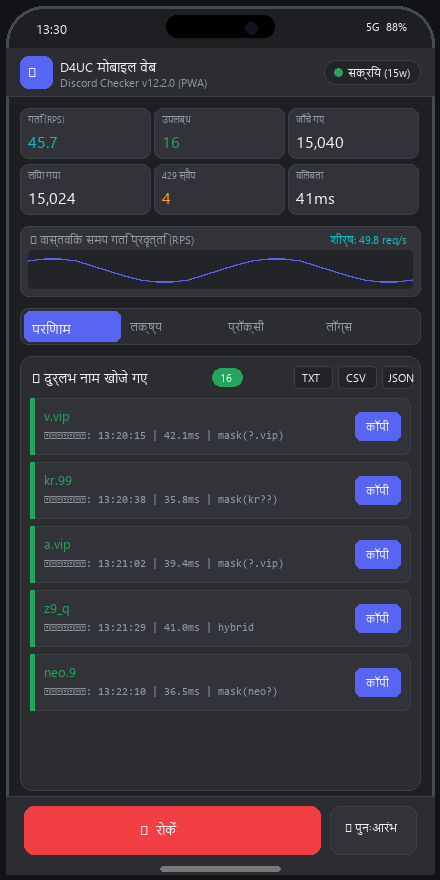
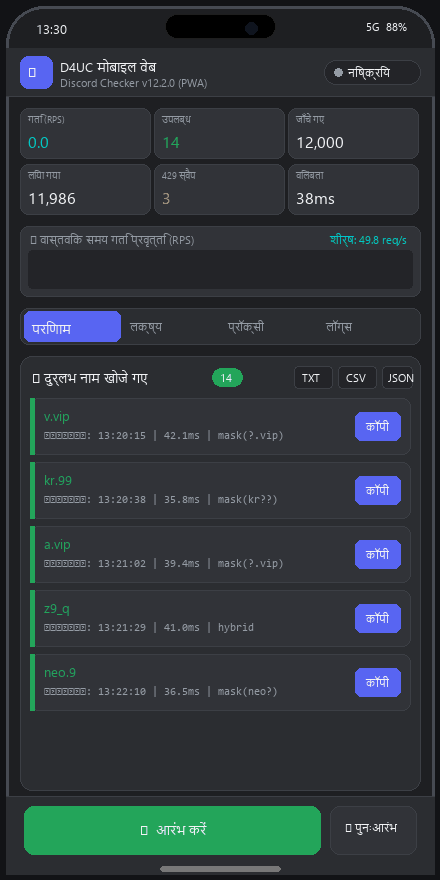
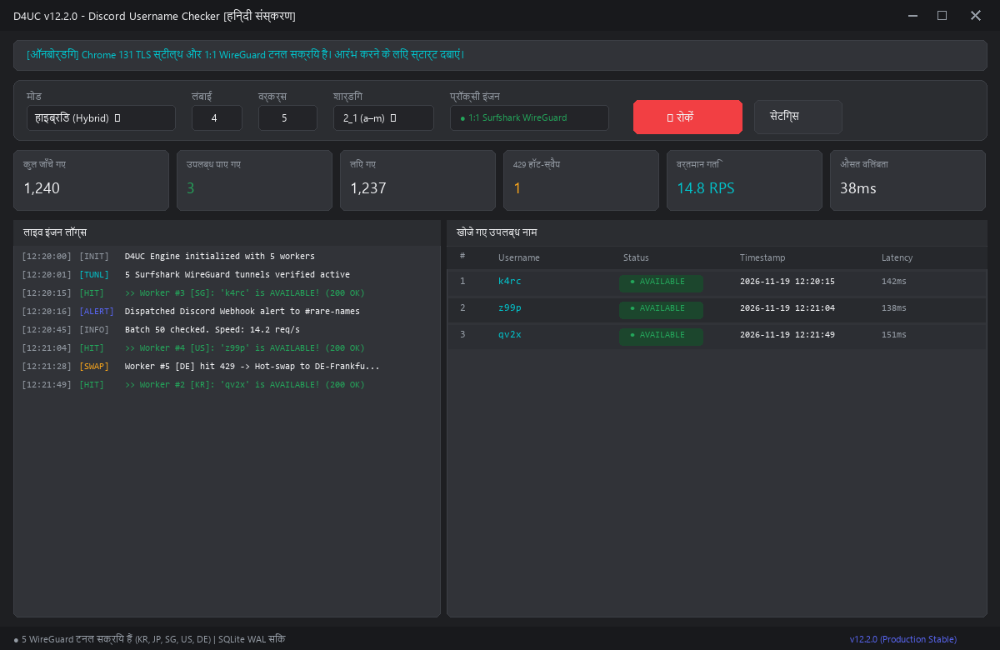
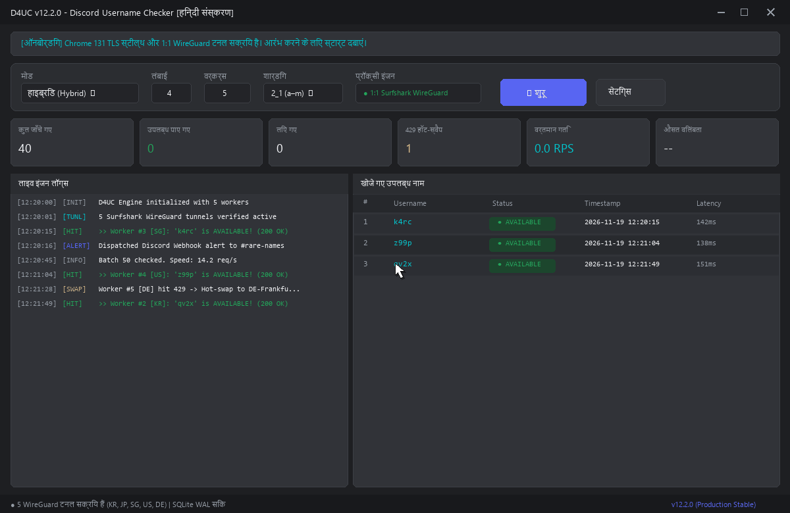
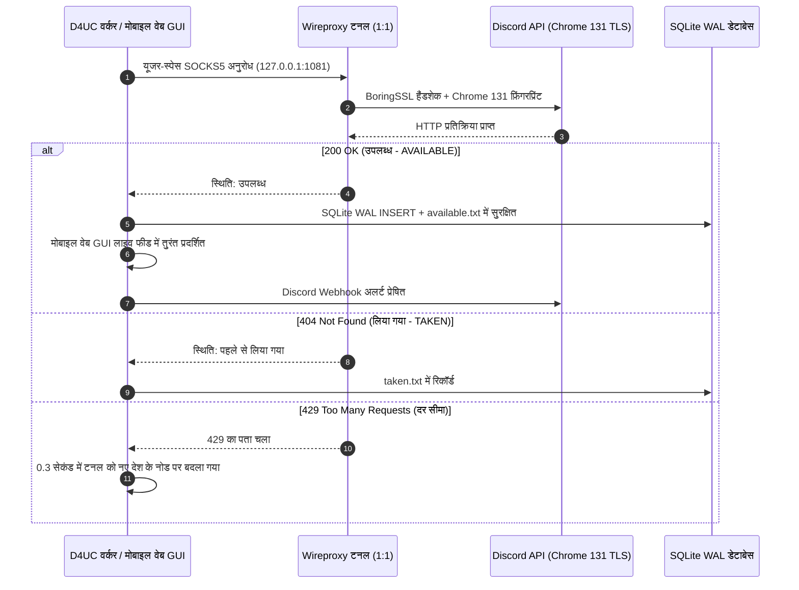

<div align="center">

# ⚡ D4UC (`discord-checker`) v12.2.0

> **उच्च-प्रदर्शन डिस्कोर्ड दुर्लभ यूज़रनेम उपलब्धता खोज इंजन**  
> मोबाइल रिस्पॉन्सिव वेब GUI और PWA · Chrome 131 TLS स्टेल्थ छद्मावरण · 1:1 आइसोलेटेड WireGuard टनल पूल · 0.3 सेकंड का 429 हॉट-स्वैप · SQLite WAL शार्डिंग

<br />

| [KR 한국어](../ko/README.md) | [US English](../en/README.md) | [JP 日本語](../ja/README.md) | [CN 简体中文](../zh-CN/README.md) | [ES Español](../es/README.md) |
| :---: | :---: | :---: | :---: | :---: |
| [FR Français](../fr/README.md) | [DE Deutsch](../de/README.md) | [RU Русский](../ru/README.md) | [BR Português](../pt-BR/README.md) | [SA العربية](../ar/README.md) |

<p align="center"><sub>🌐 Also available: <a href="./README.md">HI हिन्दी</a> • <a href="../id/README.md">ID Bahasa Indonesia</a></sub></p>

[](./CHANGELOG.md)
[](https://github.com/KRCUPRO/discord-checker/releases/tag/v12.4.0)
[](./LICENSE.md)
[](https://www.python.org/)
[](../../guides/README.md)
[](../../specs/01_NETWORK_CORE_ENGINE.md)

<sub>Copyright (c) 2026 KRCUPRO · प्रोप्राइटरी और गोपनीय लाइसेंस (सर्वाधिकार सुरक्षित)</sub>

</div>

---

<a id="-सामग्री-तालिका"></a><a id="सामग्री-तालिका"></a>
## 📑 सामग्री तालिका
1. [📸 इंटरफ़ेस पूर्वावलोकन](#-इटरफस-परववलकन)
2. [✨ मुख्य क्षमताएं और विशेषताएं](#-मखय-कषमतए-और-वशषतए)
3. [🖥️ सिस्टम आवश्यकताएं और निर्भरताएं](#-ससटम-आवशयकतए-और-नरभरतए)
4. [📁 रिपॉजिटरी संरचना](#-रपजटर-सरचन)
5. [🌐 प्रॉक्सी कॉन्फ़िगरेशन और 🔑 क्रेडेंशियल](#-परकस-कनफगरशन-और-करडशयल)
6. [🚀 स्थापना और निष्पादन](#-सथपन-और-नषपदन)
7. [📱 मोबाइल वेब GUI और PWA रिमोट कंट्रोल गाइड](#-मबइल-वब-gui-और-pwa-रमट-कटरल-गइड)
8. [🧵 समवर्ती वर्कर ट्यूनिंग](#-समवरत-वरकर-टयनग)
9. [🔢 यूज़रनेम जनरेशन रणनीतियाँ](#-यजरनम-जनरशन-रणनतय)
10. [🚫 सख्त बहिष्करण नियम (उदाहरण: `ab..`, `a..1`)](#-सखत-बहषकरण-नयम-उदहरण-ab-a1)
11. [📡 चेकर निष्पादन प्रवाह](#-चकर-नषपदन-परवह)
12. [🔄 प्रॉक्सी सत्र प्रबंधन](#-परकस-सतर-परबधन)
13. [🔁 त्रुटि प्रबंधन और पुनः प्रयास](#-तरट-परबधन-और-पन-परयस)
14. [💾 परिणाम फ़ाइल प्रारूप](#-परणम-फइल-पररप)
15. [📊 रीयल-टाइम आंकड़े और निगरानी](#-रयल-टइम-आकड-और-नगरन)
16. [🛑 चेकर को रोकना](#-चकर-क-रकन)
17. [⚠️ दर सीमा (Rate Limit) से निपटना](#-दर-सम-rate-limit-स-नपटन)
18. [🔧 समस्या निवारण](#-समसय-नवरण)
19. [📞 डिस्कोर्ड सहायता: myuyayam](#-डसकरड-सहयत-myuyayam)
20. [⭐ प्रोजेक्ट का समर्थन करें (GitHub Star)](#-परजकट-क-समरथन-कर-github-star)
21. [📚 शैक्षणिक एवं अध्ययन उद्देश्य सूचना](#-शकषणक-एव-अधययन-उददशय-सचन)

---

<a id="-इटरफस-परववलकन"></a><a id="इटरफस-परववलकन"></a>
## 📸 इंटरफ़ेस पूर्वावलोकन

### मोबाइल टच-अनुकूलित वेब GUI (PWA - iPhone और Android)
[](../../guides/MOBILE_IOS_GUIDE.md)

### मोबाइल वेब इंटरैक्टिव लाइव डेमो (1-टैप टच नियंत्रण और वास्तविक समय टेलीमेट्री)
[](../../guides/MOBILE_IOS_GUIDE.md)

### डेस्कटॉप GUI (हिन्दी संस्करण)
[](../../guides/WINDOWS_GUIDE.md)

### वास्तविक समय डेस्कटॉप GUI निष्पादन डेमो (सहज माउस इंटरैक्शन)
[](../../guides/WINDOWS_GUIDE.md)

### हेडलेस CLI टर्मिनल डैशबोर्ड
[](../../guides/TERMUX_DEBIAN_GUIDE.md)

### डॉकर और लिनक्स सर्वर परिनियोजन वातावरण
[](../../guides/DOCKER_GUIDE.md)

[⬆️ सामग्री सूची पर वापस जाएं](#-सामग्री-तालिका)

---

<a id="-मखय-कषमतए-और-वशषतए"></a><a id="मखय-कषमतए-और-वशषतए"></a>
## ✨ मुख्य क्षमताएं और विशेषताएं

1. **मोबाइल रिस्पॉन्सिव वेब GUI और PWA इंजन (`http://<host>:5000`)**:
   - इसे अपने PC, VPS, Docker या Termux पर चलाएं और किसी भी स्मार्टफोन ब्राउज़र (iPhone Safari, Android Chrome) से दूरस्थ रूप से नियंत्रित करें।
   - **"होम स्क्रीन पर जोड़ें" (PWA)** का पूर्ण समर्थन, जिससे यह बिना ऐप स्टोर के फुल-स्क्रीन नेटिव मोबाइल ऐप की तरह काम करता है।
   - बड़े टच-फ्रेंडली [प्रारंभ / रोकें] बटन, शुद्ध HTML5 Canvas पर रीयल-टाइम RPS गति वक्र, 1-टैप से यूज़रनेम कॉपी, और TXT/CSV/JSON तुरंत डाउनलोड।
   - प्रॉक्सी (Surfshark निजी कुंजी पूल, कस्टम फ़ाइलें, Thordata), 8 जनरेशन मोड और वर्कर स्लाइडर (1–50) को मोबाइल से सीधे रिमोट हॉट-स्वैप करें।

2. <a id="fnref-1"></a><a id="fnref1"></a>**Chrome 131 TLS JA3/JA4 स्टेल्थ छद्मावरण (`curl_cffi` BoringSSL)[^1]**:
   - मानक पायथन लाइब्रेरीज़ (`requests`, `aiohttp`, `httpx`) द्वारा उत्पन्न कृत्रिम TLS फ़िंगरप्रिंट को पूरी तरह समाप्त करता है।
   - आधिकारिक Google Chrome 131 ब्राउज़र के सिफर सुइट्स, एक्सटेंशन और HTTP/2 सेटिंग्स फ़्रेम की सटीक नकल कर Cloudflare और WAF को बायपास करता है।

3. <a id="fnref-2"></a><a id="fnref2"></a>**1:1 यूजर-स्पेस WireGuard टनल पूल (`wireproxy`)[^2]**:
   - होस्ट OS के नेटवर्क एडेप्टर को बदले बिना और PC के समग्र DNS या रूटिंग को बाधित किए बिना कार्य करता है।
   - प्रति वर्कर एक अलग स्थानीय पोर्ट (`127.0.0.1:1081+`) आवंटित करता है जो दुनिया भर के 142 सर्वरों से 1:1 जुड़ा होता है। आपके मुख्य PC ट्रैफ़िक पर 0.00% प्रभाव पड़ता है।

4. **0.3 सेकंड में 429 हॉट-स्वैप रिकवरी**:
   - किसी वर्कर को Discord API से 429 दर सीमा मिलने पर पूरी प्रक्रिया नहीं रुकती।
   - केवल प्रभावित वर्कर 300 मिलीसेकंड के भीतर दूसरे देश के नोड पर स्वतः स्विच हो जाता है, जबकि शेष वर्कर पूरी गति से चलते रहते हैं।

5. **गणितीय डुप्लिकेट-मुक्त शार्डिंग (Sharding)**:
   - व्यापक खोज के लिए गणितीय ऑफ़सेट विभाजन (`2_1`, `2_2`, `4_1`–`4_4`) का समर्थन।
   - एक साथ कई इंस्टेंस चलाने पर भी अलग-अलग क्षेत्रों की जांच होती है, जिससे डुप्लिकेट अनुरोधों की संख्या 0 होती है।

6. **SQLite WAL उच्च समवर्ती भंडारण और बहु-प्रारूप सिंक**:
   - उच्च समवर्ती लेखन के लिए SQLite WAL मोड (`data/d4uc_results.db`) का उपयोग।
   - उपलब्ध नाम तुरंत टेक्स्ट फ़ाइलों (`available.txt`, `taken.txt`), CSV और JSON में स्वतः सुरक्षित हो जाते हैं।

7. **8 बुद्धिमान यूज़रनेम जनरेशन इंजन**:
   - हाइब्रिड, क्रमपरिवर्तन (Permutation), शब्दकोश (Dictionary), सममित पैटर्न, संख्यात्मक श्रृंखला, कस्टम मास्क, ध्वन्यात्मक संयोजन और इतिहास पुनः जांच।

8. **क्रॉस-प्लेटफ़ॉर्म समर्थन**:
   - Windows स्टैंडअलोन निष्पादन योग्य फ़ाइलें (4 प्रकार की `.exe`), मोबाइल PWA, Linux/macOS CLI, Android Termux स्क्रिप्ट और Docker कंटेनर।

[⬆️ सामग्री सूची पर वापस जाएं](#-सामग्री-तालिका)

---

<a id="-ससटम-आवशयकतए-और-नरभरतए"></a><a id="ससटम-आवशयकतए-और-नरभरतए"></a>
## 🖥️ सिस्टम आवश्यकताएं और निर्भरताएं

### रनटाइम आवश्यकताएं
- **ऑपरेटिंग सिस्टम**: Windows 10/11 (64-बिट), Linux (Debian 11+, Ubuntu 20.04+, Arch), macOS 12+, Android 10+ (Termux), iOS Safari
- **Python संस्करण**: Python 3.10, 3.11, 3.12 (अनुशंसित: **Python 3.12**)
- **RAM**: न्यूनतम 512 MB (~250 MB 50 समानांतर वर्करों के लिए)
- **नेटवर्क**: ब्रॉडबैंड इंटरनेट (WireGuard के लिए आउटबाउंड UDP पोर्ट 51820 खुला होना चाहिए)

### मुख्य लाइब्रेरीज़ (`requirements.txt`)
- `curl_cffi >= 0.7.0`: Chrome 131 BoringSSL TLS फ़िंगरप्रिंट प्रतिरूपण
- `customtkinter >= 5.2.0`: डार्क थीम डेस्कटॉप GUI
- `rich >= 13.7.0`: रीयल-टाइम CLI कंसोल डैशबोर्ड
- `pydantic >= 2.6.0`: कॉन्फ़िगरेशन सत्यापन
- `pyyaml >= 6.0.1`: YAML फ़ाइल पार्सर
- `pillow >= 10.2.0`: छवि और आइकन रेंडरिंग

[⬆️ सामग्री सूची पर वापस जाएं](#-सामग्री-तालिका)

---

<a id="-रपजटर-सरचन"></a><a id="रपजटर-सरचन"></a>
## 📁 रिपॉजिटरी संरचना

```text
discord-checker/
├── config/                         # कॉन्फ़िगरेशन टेम्पलेट और .env.example
├── data/                           # WireGuard नोड्स और SQLite डेटाबेस
├── deploy/                         # बिल्ड, डॉकर और ऑटोमेशन स्क्रिप्ट्स
│   ├── android/                    # Android native app project
│   ├── build_apk.py                # Android release APK builder
│   ├── build_exe.py                # 4-इन-1 Windows .exe कंपाइलर
│   ├── docker-compose.yml          # Docker Compose सेटिंग्स
│   ├── Dockerfile                  # मल्टी-आर्क कंटेनर विशिष्टता
│   ├── generate_assets.py          # विजुअल डेमो और स्क्रीनशॉट जनरेटर
│   ├── generate_badges.py          # 12 भाषाओं के SVG बैज जनरेटर
│   └── generate_mobile_assets.py   # मोबाइल PWA डेमो और GIF जनरेटर
├── docs/                           # दस्तावेज़ीकरण, बहुभाषी नियमावली और बैज
│   ├── assets/                     # स्क्रीनशॉट, एनिमेटेड GIF और SVG बैज
│   ├── guides/                     # iOS, PC, Docker और Termux विस्तृत गाइड
│   └── locales/                    # 11 भाषाओं में पूर्ण 1:1 अनुवादित दस्तावेज़
├── src/                            # कोर इंजन सोर्स कोड
│   ├── generator/                  # 8 जनरेशन इंजन और बहिष्करण नियम फ़िल्टर
│   ├── network/                    # Chrome 131 TLS क्लाइंट और बैकऑफ़ नियंत्रक
│   ├── notify/                     # Discord Webhook लाइव अलर्ट मॉड्यूल
│   ├── proxy/                      # 1:1 WireGuard टनल पूल मैनेजर
│   ├── storage/                    # SQLite WAL और टेक्स्ट स्टोरेज परत
│   ├── ui/                         # बहुभाषी i18n, टूलटिप्स और CLI
│   │   └── web/                    # मोबाइल PWA वेब ऐप (HTML5/CSS3/Vanilla JS)
│   ├── web_gui.py                  # मोबाइल रिस्पॉन्सिव वेब GUI और REST API सर्वर
│   ├── gui.py                      # CustomTkinter डेस्कटॉप ऑर्केस्ट्रेटर
│   ├── gui_ko.py                   # कोरियाई डेस्कटॉप GUI लॉन्चर
│   ├── gui_en.py                   # अंग्रेजी डेस्कटॉप GUI लॉन्चर
│   └── run.py                      # हेडलेस CLI निष्पादन लॉन्चर
├── tests/                          # स्वचालित परीक्षण सूट
├── CHANGELOG.md                    # विस्तृत रिलीज़ नोट्स
├── LICENSE                         # प्रोप्राइटरी सॉफ्टवेयर लाइसेंस
├── README.md                       # मुख्य अंग्रेजी गाइड
└── SECURITY.md                     # सुरक्षा नीतियां और लीक रोकथाम
```

[⬆️ सामग्री सूची पर वापस जाएं](#-सामग्री-तालिका)

---

<a id="-परकस-कनफगरशन-और-करडशयल"></a><a id="परकस-कनफगरशन-और-करडशयल"></a>
## 🌐 प्रॉक्सी कॉन्फ़िगरेशन और 🔑 क्रेडेंशियल

D4UC आईपी प्रतिबंधों को बायपास करने के लिए **1:1 यूजर-स्पेस WireGuard टनल पूल** (`wireproxy`) का उपयोग करता है।

### 1. सेटअप निर्देश
1. प्रोजेक्ट रूट में `config/.env.example` को `.env` के रूप में कॉपी करें:
   ```bash
   cp config/.env.example .env
   ```
2. `.env` खोलें और अपनी Surfshark WireGuard निजी कुंजी (Private Key) दर्ज करें:
   ```ini
   # एकाधिक कुंजियों को कॉमा से अलग करके उच्च समवर्ती पूल बनाएं
   SURFSHARK_PRIVATE_KEYS=YOUR_WIREGUARD_PRIVATE_KEY_1_HERE,YOUR_WIREGUARD_PRIVATE_KEY_2_HERE
   
   # वर्कर संख्या (डिफ़ॉल्ट: 5, अधिकतम: 50)
   D4UC_WORKERS=5
   
   # डिस्कोर्ड वेबहुक अलर्ट URL (वैकल्पिक)
   D4UC_WEBHOOK=https://discord.com/api/webhooks/YOUR_WEBHOOK_ID/YOUR_WEBHOOK_TOKEN
   ```

### 2. निःशुल्क सार्वजनिक प्रॉक्सी स्क्रैपर और लाइव मल्टी-थ्रेडेड वैलिडेटर (`--proxy free`) [v12.3.0 में नया]
बिना किसी सशुल्क वीपीएन सदस्यता के 100% मुफ़्त संचालन:
- **स्वचालित बहु-स्रोत संग्रह**: 14+ से अधिक गिटहब रिपॉजिटरी और हगिंग फेस डेटासेट से लगातार अपडेट की गई प्रॉक्सी सूचियाँ प्राप्त करता है।
- **मल्टी-प्रोटोकॉल समर्थन**: HTTP, HTTPS, SOCKS4 और SOCKS5 निःशुल्क प्रॉक्सी का पूर्ण समर्थन।
- **रीयल-टाइम हाई-स्पीड एसिंक्रोनस परीक्षण**: वास्तविक डिस्कॉर्ड और क्लाउडफ्लेयर एंडपॉइंट्स के साथ सीधा परीक्षण, धीमे (>3500ms), निष्क्रिय और 403 WAF ब्लॉक प्रॉक्सी को स्वचालित रूप से हटाना।
- **429 रोटेशन और बैकग्राउंड ऑटो-रिफ्रेश**: 429 दर-सीमा आने पर 15 सेकंड के लिए नोड को अलग करना और सबसे तेज़ सक्रिय प्रॉक्सी पर हॉट-स्वैप करना।
- **यूआई एकीकरण**: डेस्कटॉप जीयूआई, मोबाइल वेब जीयूआई पर 1-टैप बटन और सीएलआई विकल्प `--proxy free` (या `-p free`)।

### 3. शून्य-लीक नीति (Zero-Leak Policy)
- सभी निजी कुंजियां और क्रेडेंशियल फ़ाइलें `.gitignore` द्वारा सुरक्षित हैं और किसी भी कमिट से पहले जांच की जाती हैं।

[⬆️ सामग्री सूची पर वापस जाएं](#-सामग्री-तालिका)

---

<a id="-सथपन-और-नषपदन"></a><a id="सथपन-और-नषपदन"></a>
## 🚀 स्थापना और निष्पादन

### तरीका A: Windows स्टैंडअलोन निष्पादन योग्य फ़ाइलें (`.exe`)
Python इंस्टॉल किए बिना तुरंत चलाने के लिए [GitHub Releases v12.2.0](https://github.com/KRCUPRO/discord-checker/releases/tag/v12.4.0) से डाउनलोड करें:
- `DiscordUsernameChecker_v12.3.0.apk`: **एंड्रॉइड स्मार्टफोन 1-टैप नेटिव पैकेज** [नया]
- `DiscordUsernameCheckerV2_Web.exe`: **मोबाइल वेब GUI और PWA सर्वर (पोर्ट 5000)** [नया]
- `DiscordUsernameCheckerV2_EN.exe`: अंग्रेजी डेस्कटॉप GUI
- `DiscordUsernameCheckerV2_KO.exe`: कोरियाई डेस्कटॉप GUI
- `DiscordUsernameCheckerV2_CLI.exe`: हेडलेस कंसोल CLI

### 📱 एंड्रॉइड स्मार्टफोन नेटिव पैकेज (`.apk`) — 1-टैप आसान इंस्टॉलेशन [NEW]
- **सीधा डाउनलोड**: [`DiscordUsernameChecker_v12.3.0.apk`](https://github.com/KRCUPRO/discord-checker/releases/download/v12.3.0/DiscordUsernameChecker_v12.3.0.apk)
- **स्थापना निर्देश**:
  1. अपने एंड्रॉइड डिवाइस (Galaxy, Pixel, Xiaomi आदि) पर `.apk` फ़ाइल डाउनलोड करें।
  2. नोटिफिकेशन या फाइल मैनेजर से फाइल पर टैप करें।
  3. "अज्ञात स्रोतों से ऐप्स इंस्टॉल करने की अनुमति दें" विकल्प चुनें और **[इंस्टॉल करें]** पर टैप करें।
  4. होम स्क्रीन से **`D4UC Discord Checker`** खोलें।
- **मुख्य मोबाइल विशेषताएं**:
  - ऑफ़लाइन 12 भाषाओं में टच-अनुकूल Discord-Dark वेब GUI (`assets/www/index.html`)।
  - 1-टैप क्लिपबोर्ड कॉपी और नेटिव एंड्रॉइड टोस्ट (Toast) सूचनाएं।
  - स्क्रीन को चालू रखने के लिए वेक लॉक (`WAKE_LOCK`) सपोर्ट।
  - स्थानीय वाई-फाई या आईपी पते के जरिए पीसी/सर्वर डी4यूसी बैकएंड से रिमोट कनेक्शन।

### तरीका B: मोबाइल वेब GUI प्रारंभ करें (स्मार्टफ़ोन से नियंत्रण)
```bash
# मोबाइल वेब GUI सर्वर शुरू करें (डिफ़ॉल्ट पोर्ट: 5000)
python src/web_gui.py --port 5000

# अपने स्मार्टफ़ोन ब्राउज़र (Safari या Chrome) में PC के IP पर जाएं:
# http://<PC_LOCAL_IP>:5000
```

### तरीका C: स्रोत कोड से निष्पादन
```bash
python -m venv .venv
source .venv/bin/activate  # Windows: .\.venv\Scripts\Activate.ps1
pip install -r requirements.txt

# डेस्कटॉप GUI चलाएं
python src/gui_en.py

# CLI कंसोल चलाएं
python src/run.py --mode hybrid --length 4 --workers 5
```

[⬆️ सामग्री सूची पर वापस जाएं](#-सामग्री-तालिका)

---

<a id="-मबइल-वब-gui-और-pwa-रमट-कटरल-गइड"></a><a id="मबइल-वब-gui-और-pwa-रमट-कटरल-गइड"></a>
## 📱 मोबाइल वेब GUI और PWA रिमोट कंट्रोल गाइड

बिस्तर पर आराम करते हुए अपने स्मार्टफोन से दुर्लभ यूज़रनेम की खोज की निगरानी और नियंत्रण करें।

### 1. होम स्क्रीन पर जोड़ें (PWA इंस्टॉलेशन)
1. अपने स्मार्टफ़ोन ब्राउज़र में `http://<PC_IP>:5000` खोलें।
2. **iPhone Safari**: शेयर बटन ➔ **"होम स्क्रीन पर जोड़ें"** पर टैप करें।
3. **Android Chrome**: मेनू (⋮) ➔ **"होम स्क्रीन में जोड़ें"** या **"ऐप इंस्टॉल करें"** पर टैप करें।
4. होम स्क्रीन पर बने **D4UC Web** आइकन पर टैप करें और बिना किसी यूआरएल बार के नेटिव ऐप की तरह आनंद लें।

### 2. मोबाइल टच विशेषताएं
- **रीयल-टाइम बड़े टेलीमेट्री कार्ड**: गति (RPS), उपलब्ध यूज़रनेम, कुल जांच, टेकन, 429 हॉट-स्वैप और विलंबता (ms)।
- **HTML5 Canvas गति वक्र**: बिना किसी बाहरी भारी लाइब्रेरी के रीयल-टाइम स्कैन गति ग्राफ।
- **1-टैप यूज़रनेम कॉपी**: किसी भी उपलब्ध नाम के आगे [कॉपी] बटन दबाएं और कंपन/टोस्ट सूचना के साथ क्लिपबोर्ड पर कॉपी करें।
- **एक-क्लिक निर्यात**: TXT, CSV, या JSON प्रारूप में तुरंत अपने फ़ोन पर डाउनलोड करें।
- **मोबाइल से रिमोट हॉट-स्वैप**:
  - 8 जनरेशन मोड के बीच तुरंत स्विच करें
  - नाम की लंबाई (3–6 वर्ण) और शार्डिंग पैरामीटर बदलें
  - वर्कर स्लाइडर (1–50) से तुरंत समानांतर थ्रेड्स घटाएं/बढ़ाएं
  - सर्फ़शार्क कुंजियों और नेटवर्क सेटिंग्स को रिमोटली सुरक्षित करें

[⬆️ सामग्री सूची पर वापस जाएं](#-सामग्री-तालिका)

---

<a id="-समवरत-वरकर-टयनग"></a><a id="समवरत-वरकर-टयनग"></a>
## 🧵 समवर्ती वर्कर ट्यूनिंग

- **अनुशंसित डिफ़ॉल्ट मान**: `5` वर्कर (~12–15 RPS)
- **किफायती / स्थिर मोड**: `1`–`3` वर्कर
- **अल्ट्रा-हाई स्पीड स्कैन**: `10`–`20` वर्कर (50 तक समर्थित)
- **कार्यप्रणाली**:
  - D4UC प्रति वर्कर एक अलग WireGuard पोर्ट (`1081`, `1082`, आदि) असाइन करता है।
  - 5 वर्कर 5 अलग-अलग देशों (टोक्यो, सियोल, सिंगापुर, फ्रैंकफर्ट, न्यूयॉर्क) के माध्यम से एक साथ अनुरोध भेजते हैं।

[⬆️ सामग्री सूची पर वापस जाएं](#-सामग्री-तालिका)

---

<a id="-यजरनम-जनरशन-रणनतय"></a><a id="यजरनम-जनरशन-रणनतय"></a>
## 🔢 यूज़रनेम जनरेशन रणनीतियाँ

| मोड की | रणनीति | विवरण और उदाहरण |
| :--- | :--- | :--- |
| `hybrid` (अनुशंसित) | शब्द मूल + संख्यात्मक/पैटर्न म्यूटेशन | व्यावहारिक और दुर्लभ नाम (`krc1`, `v1be`, `neo9`) |
| `permutation` | पूर्ण गणितीय क्रमपरिवर्तन | `a-z`, `0-9`, `_` पर पूर्ण स्कैन (`2_1`, `2_2` शार्डिंग समर्थित) |
| `dictionary` | 3–6 अक्षरों का अंग्रेजी शब्दकोश | वास्तविक अर्थपूर्ण अंग्रेजी शब्द और 2-3 शब्दांश वाले मूल्यवान नाम |
| `pattern` | सममित और आवर्ती दृश्य पैटर्न | दिखने में सुंदर पैटर्न (`aaaa`, `abba`, `abab`, `aabb`) |
| `numeric` | अनुक्रमिक और दोहराए जाने वाले नंबर | संख्यात्मक नाम (`0000`–`9999`, पोकर नंबर `7777`, `1234`) |
| `custom_mask` | उपसर्ग, प्रत्यय और बिंदु नियम | कस्टम पैटर्न (`kr??`, `??99`, `?.vip`, `??.??`) |
| `combinatorial` | ध्वन्यात्मक CVCV / VCCV संरचनाएं | स्वर और व्यंजन के मेल से बने नए ब्रांड नाम |
| `recheck` | पूर्व-अधिग्रहीत नामों की पुनः जांच | पहले से लिए गए नामों की फिर से जांच कर हटाए गए खाते ढूंढना |

[⬆️ सामग्री सूची पर वापस जाएं](#-सामग्री-तालिका)

---

<a id="-सखत-बहषकरण-नयम-उदहरण-ab-a1"></a><a id="सखत-बहषकरण-नयम-उदहरण-ab-a1"></a>
## 🚫 सख्त बहिष्करण नियम (उदाहरण: `ab..`, `a..1`)

डिस्कोर्ड की आधिकारिक यूज़रनेम नीति का उल्लंघन करने वाले नामों को **जनरेशन के समय ही 100% बाहर कर दिया जाता है**:

1. **लगातार दो बिंदुओं की मनाही (`..`)**:
   - ❌ `ab..` (अंत में दो बिंदु) ➔ **स्वतः बाहर**
   - ❌ `a..1` (मध्य में दो बिंदु) ➔ **स्वतः बाहर**
   - ❌ `..kr` (शुरुआत में दो बिंदु) ➔ **स्वतः बाहर**
2. **प्रारंभ या अंत में बिंदु की मनाही (`.`)**:
   - ❌ `.abc` (बिंदु से शुरू) ➔ **स्वतः बाहर**
   - ❌ `abc.` (बिंदु पर समाप्त) ➔ **स्वतः बाहर**
3. **अनुमत वर्ण**:
   - केवल छोटे लैटिन अक्षर (`a-z`), अंक (`0-9`), अंडरस्कोर (`_`) और एकल बिंदु (`.`)।
4. **लंबाई सीमाएं**:
   - 2 से कम या 32 से अधिक वर्ण वाले नाम नहीं बनाए जाते।
5. **सिस्टम आरक्षित नाम**:
   - `discord`, `clyde`, `here`, `everyone`, `system` जैसे नाम स्वतः फ़िल्टर हो जाते हैं।

> सभी नियम `src/generator/base.py` के `DiscordRuleValidator.is_valid()` द्वारा लागू किए जाते हैं और 84 परीक्षणों द्वारा सत्यापित हैं।

[⬆️ सामग्री सूची पर वापस जाएं](#-सामग्री-तालिका)

---

<a id="-चकर-नषपदन-परवह"></a><a id="चकर-नषपदन-परवह"></a>
## 📡 चेकर निष्पादन प्रवाह



[⬆️ सामग्री सूची पर वापस जाएं](#-सामग्री-तालिका)

---

<a id="-परकस-सतर-परबधन"></a><a id="परकस-सतर-परबधन"></a>
## 🔄 प्रॉक्सी सत्र प्रबंधन

- **पृथक अतुल्यकालिक सत्र**: प्रत्येक वर्कर TCP कीप-अलाइव दक्षता बनाए रखने के लिए स्वतंत्र `curl_cffi.requests.AsyncSession` संचालित करता है।
- **शून्य-प्रक्रिया रिसाव (Zero-Zombie)**: प्रोग्राम बंद होने पर सभी बैकग्राउंड प्रक्रियाएं पूरी तरह से सुरक्षित रूप से समाप्त हो जाती हैं।

[⬆️ सामग्री सूची पर वापस जाएं](#-सामग्री-तालिका)

---

<a id="-तरट-परबधन-और-पन-परयस"></a><a id="तरट-परबधन-और-पन-परयस"></a>
## 🔁 त्रुटि प्रबंधन और पुनः प्रयास

1. **नेटवर्क टाइमआउट और DNS ग्लिच**: 3 बार तक एक्सपोनेंशियल बैकऑफ़ (0.5s ➔ 1.0s ➔ 2.0s) के साथ पुनः प्रयास।
2. **Cloudflare WAF चुनौतियां**: सत्र को समाप्त कर तुरंत टनल को रीसेट किया जाता है।
3. **429 दर सीमा**: प्रभावित वर्कर 0.3 सेकंड में नए आईपी पर स्वतः माइग्रेट हो जाता है।

[⬆️ सामग्री सूची पर वापस जाएं](#-सामग्री-तालिका)

---

<a id="-परणम-फइल-पररप"></a><a id="परणम-फइल-पररप"></a>
## 💾 परिणाम फ़ाइल प्रारूप

| पथ | प्रारूप | उद्देश्य |
| :--- | :--- | :--- |
| `data/d4uc_results.db` | **SQLite (WAL मोड)** | ACID लेनदेन, समवर्ती बहु-प्रक्रिया लेखन, पूर्ण अनुक्रमण |
| `available.txt` | UTF-8 टेक्स्ट | उपलब्ध नामों की रीयल-टाइम लाइन-दर-लाइन सूची |
| `taken.txt` | UTF-8 टेक्स्ट | पहले से पंजीकृत नाम (पुनः जांच मोड हेतु) |
| `checked_history.txt` | UTF-8 टेक्स्ट | दोहराव रोकने के लिए वैश्विक स्कैन इतिहास |
| `available_usernames.csv` | CSV प्रारूप | स्प्रेडशीट और डेटा विश्लेषण हेतु तालिका |
| `available_usernames.json`| JSON प्रारूप | वेब डैशबोर्ड और REST API एकीकरण हेतु संरचित डेटा |

[⬆️ सामग्री सूची पर वापस जाएं](#-सामग्री-तालिका)

---

<a id="-रयल-टइम-आकड-और-नगरन"></a><a id="रयल-टइम-आकड-और-नगरन"></a>
## 📊 रीयल-टाइम आंकड़े और निगरानी

मोबाइल वेब GUI, डेस्कटॉप ऐप और कंसोल पर हर 30 मिलीसेकंड में निम्नलिखित मेट्रिक्स अपडेट होते हैं:
- **Scan Speed (RPS)**: प्रति सेकंड पूरे किए गए अनुरोध
- **Total Checked**: वर्तमान सत्र में जाँचे गए कुल नाम
- **Available Count**: खोजे गए दुर्लभ उपलब्ध नाम
- **Taken Count**: पहले से पंजीकृत नाम
- **429 Hot-Swaps**: सफल नोड रोटेशन संख्या
- **Latency**: डिस्कोर्ड सर्वर की राउंड-ट्रिप प्रतिक्रिया समय (ms)

[⬆️ सामग्री सूची पर वापस जाएं](#-सामग्री-तालिका)

---

<a id="-चकर-क-रकन"></a><a id="चकर-क-रकन"></a>
## 🛑 चेकर को रोकना

- **मोबाइल वेब GUI**: नीचे लाल रंग का `■ खोज रोकें` बटन दबाएं।
- **डेस्कटॉप GUI**: शीर्ष पर `■ रोकें` बटन दबाएं।
- **CLI**: `Ctrl + C` दबाकर सुरक्षित रूप से डेटाबेस को सुरक्षित करें और टनल बंद करें।

[⬆️ सामग्री सूची पर वापस जाएं](#-सामग्री-तालिका)

---

<a id="-दर-सम-rate-limit-स-नपटन"></a><a id="दर-सम-rate-limit-स-नपटन"></a>
## ⚠️ दर सीमा (Rate Limit) से निपटना

- जब एक ही आईपी से बहुत अधिक अनुरोध आते हैं, तो डिस्कोर्ड `429 Too Many Requests` लौटाता है।
- D4UC ट्रैफ़िक को **142 वैश्विक WireGuard सर्वरों** में बांटता है और **0.3s हॉट-स्वैप** करता है, जिससे अन्य सभी वर्कर बिना रुके काम करते रहते हैं।

[⬆️ सामग्री सूची पर वापस जाएं](#-सामग्री-तालिका)

---

<a id="-समसय-नवरण"></a><a id="समसय-नवरण"></a>
## 🔧 समस्या निवारण

| समस्या | संभावित कारण | समाधान |
| :--- | :--- | :--- |
| मोबाइल पर वेब GUI नहीं खुल रहा | फ़ोन और PC अलग-अलग नेटवर्क पर हैं | दोनों को एक ही वाई-फ़ाई से कनेक्ट करें और Windows Firewall में पोर्ट 5000 की अनुमति दें। |
| `Wireproxy binary not found` | wireproxy फ़ाइल मौजूद नहीं है | जांचें कि `bin/wireproxy.exe` है या `deploy/build_exe.py` चलाएं। |
| `Port already in use: 1081` | पिछली प्रक्रिया बंद नहीं हुई | टास्क मैनेजर से पुरानी Python या wireproxy प्रक्रिया समाप्त करें। |
| फ़ायरवॉल अनुमति डायलॉग आना | नियम पंजीकृत नहीं है | व्यवस्थापक के रूप में PowerShell चलाकर फ़ायरवॉल नियम जोड़ें। |
| `No module named curl_cffi` | वर्चुअल वातावरण सक्रिय नहीं है | `.venv` सक्रिय करें और `pip install -r requirements.txt` चलाएं। |

[⬆️ सामग्री सूची पर वापस जाएं](#-सामग्री-तालिका)

---

<a id="-डसकरड-सहयत-myuyayam"></a><a id="डसकरड-सहयत-myuyayam"></a>
## 📞 डिस्कोर्ड सहायता: myuyayam

- सुझावों, बग रिपोर्ट या तकनीकी सहायता के लिए डिस्कोर्ड पर **`myuyayam`** से संपर्क करें।
- व्यावसायिक लाइसेंस हेतु GitHub Issues या डिस्कोर्ड डायरेक्ट मैसेज का उपयोग करें।

[⬆️ सामग्री सूची पर वापस जाएं](#-सामग्री-तालिका)

---

<a id="-परजकट-क-समरथन-कर-github-star"></a><a id="परजकट-क-समरथन-कर-github-star"></a>
## ⭐ प्रोजेक्ट का समर्थन करें (GitHub Star)

यदि यह प्रोजेक्ट आपके लिए उपयोगी रहा है, तो कृपया GitHub पर **Star (⭐)** देकर हमारा समर्थन करें!  
आपकी प्रतिक्रिया हमें इस इंजन को निरंतर बेहतर बनाने की प्रेरणा देती है।

[⬆️ सामग्री सूची पर वापस जाएं](#-सामग्री-तालिका)

---

<a id="-शकषणक-एव-अधययन-उददशय-सचन"></a><a id="शकषणक-एव-अधययन-उददशय-सचन"></a>
## 📚 शैक्षणिक एवं अध्ययन उद्देश्य सूचना

> **[केवल शैक्षणिक एवं अनुसंधान उद्देश्य हेतु]**
> 
> यह सॉफ्टवेयर आधुनिक नेटवर्क सुरक्षा: **TLS फ़िंगरप्रिंटिंग (Chrome 131 BoringSSL JA3/JA4), मोबाइल PWA आर्किटेक्चर, यूजर-स्पेस WireGuard टनलिंग (`wireproxy`), और SQLite WAL समवर्ती शार्डिंग** के तकनीकी अध्ययन और नेटवर्क इंजीनियरिंग के अनुसंधान हेतु बनाया गया है।
> 
> 1. सेवा अस्वीकार (DoS) हमलों, दुर्भावनापूर्ण ट्रैफ़िक पैदा करने या खातों की अनधिकृत जमाखोरी के लिए इस उपकरण का उपयोग पूर्णतः वर्जित है।
> 2. उपयोगकर्ताओं को संबंधित प्लेटफ़ॉर्म की सेवा की शर्तों (Terms of Service) और लागू कानूनों का पालन करना अनिवार्य है। दुरुपयोग की समस्त विधिक जिम्मेदारी ऑपरेटर की होगी।
> 3. डेवलपर और योगदानकर्ता व्यक्तिगत उपयोग के परिणामों के लिए कोई कानूनी वारंटी या दायित्व स्वीकार नहीं करते हैं।

[⬆️ सामग्री सूची पर वापस जाएं](#-सामग्री-तालिका)

---

<a id="-पद-लख-और-तकनक-सदरभ"></a><a id="पद-लख-और-तकनक-सदरभ"></a><a id="footnote-heading"></a>
### 📚 पाद लेख और तकनीकी संदर्भ

<a id="footnote-1"></a><a id="fn-1"></a>
[^1]: Chrome 131 BoringSSL हैंडशेक Cloudflare और आधुनिक WAF द्वारा लगाए गए TLS फ़िंगरप्रिंटिंग अवरोधों को पूरी तरह से निष्प्रभावी कर देता है। [↩ संदर्भ पर वापस जाएं](#fnref-1) · [⬆️ सामग्री सूची पर वापस जाएं](#-सामग्री-तालिका)

<a id="footnote-2"></a><a id="fn-2"></a>
[^2]: wireproxy यूजर-स्पेस में चलने वाला एक हल्का Go बाइनरी है जो बिना रूट अनुमतियों के WireGuard प्रोटोकॉल को अलग स्थानीय SOCKS5 प्रॉक्सी में परिवर्तित करता है। [↩ संदर्भ पर वापस जाएं](#fnref-2) · [⬆️ सामग्री सूची पर वापस जाएं](#-सामग्री-तालिका)

[⬆️ सामग्री सूची पर वापस जाएं](#-सामग्री-तालिका)
