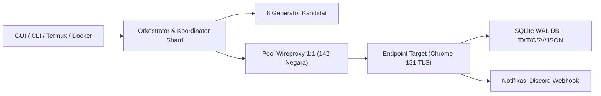

<div align="center">

<p align="center">
  <a href="../../README.md">🇺🇸 English</a> · <a href="./ko.md">🇰🇷 한국어</a> · <a href="./ja.md">🇯🇵 日本語</a> · <a href="./zh-CN.md">🇨🇳 中文</a> · <a href="./es.md">🇪🇸 Español</a> · <a href="./de.md">🇩🇪 Deutsch</a><br />
  <a href="./fr.md">🇫🇷 Français</a> · <a href="./pt-BR.md">🇧🇷 Português</a> · <a href="./ru.md">🇷🇺 Русский</a> · <a href="./hi.md">🇮🇳 हिन्दी</a> · <a href="./ar.md">🇸🇦 العربية</a> · <strong>🇮🇩 Bahasa Indonesia</strong>
</p>

# ⚡ D4UC (`discord-checker`)

> **Mesin Pemeriksa Ketersediaan Username Langka Discord Berkecepatan Tinggi — Stealth TLS Chrome 131, Pool Multi-Tunnel Terisolasi 1:1 & Sharding SQLite WAL.**

[](https://github.com/KRCUPRO/discord-checker/releases/tag/v12.0.0)
[](../../LICENSE)
[](https://www.python.org/)
[](../GUIDE.md)
[](../specs/01_NETWORK_CORE_ENGINE.md)

<sub>Copyright (c) 2026 KRCUPRO · Lisensi Perangkat Lunak Eksklusif & Rahasia (Hak Cipta Dilindungi)</sub>

</div>

---

<details open>
<summary><b>🌟 Ringkasan & Kemampuan Utama</b></summary>

Skrip pemeriksa username lama sering gagal menghadapi proteksi edge modern akibat tiga kendala utama:
1. **Pemblokiran Sidik Jari TLS**: Pustaka HTTP standar langsung terdeteksi oleh Cloudflare/WAF lewat tanda tangan JA3/JA4.
2. **Gangguan VPN Seluruh Sistem**: Klien VPN desktop mengalihkan seluruh koneksi jaringan dan DNS komputer Anda.
3. **Kemacetan Berantai 429 & Bentrok File**: Batas kecepatan menghentikan seluruh worker, sementara multi-jendela merusak berkas hasil.

**D4UC (`discord-checker`)** menyelesaikan ketiganya dalam arsitektur lintas platform yang terisolasi:
- **Stealth TLS Chrome 131 JA3/JA4**: Berbasis `curl_cffi` (BoringSSL) dengan header sinkron yang identik dengan Chrome 131 asli.
- **Tunnel WireGuard User-Space 1:1 (`wireproxy`)**: Memetakan 142 endpoint global ke port lokal khusus (`127.0.0.1:1081+`) per worker tanpa menyentuh adapter jaringan OS.
- **Hot-Swap Atomik 0,3 Detik saat 429**: Hanya worker yang terkena limit yang langsung berpindah negara; worker lain terus berjalan tanpa henti.
- **Sharding Matematis & SQLite WAL**: Memecah pemindaian ke 2, 3, atau 4 irisan terpisah (`2_1`, `2_2`, `4_1`–`4_4`) ke `data/d4uc_results.db` tanpa pemeriksaan ganda.

</details>

---

<details open>
<summary><b>🥊 Matriks Perbandingan: Skrip Lama vs D4UC v12</b></summary>

| Kemampuan | Skrip Lama | ⚡ D4UC v12 (`discord-checker`) |
| :--- | :---: | :---: |
| **Stealth TLS** | ❌ `requests` / `aiohttp` langsung terblokir | **✅ Penyamaran BoringSSL Chrome 131 JA3/JA4** |
| **Isolasi Jaringan Host** | ❌ Memerlukan VPN seluruh sistem | **✅ Pool `wireproxy` User-Space (1:1 per worker)** |
| **Pemulihan 429** | ❌ Berhenti total atau crash | **✅ Hot-swap per worker 0,3 dtk + antrean cooldown** |
| **Sharding Multi-Instans** | ❌ Pemeriksaan ganda & konflik berkas | **✅ Irisan terpisah + sinkronisasi SQLite WAL** |
| **Platform & UI** | ⚠️ Hanya skrip CLI sederhana | **✅ GUI Desktop, Rich CLI, Android Termux & Docker** |
| **Keamanan Kredensial** | ⚠️ Risiko kunci tertanam di kode | **✅ `.gitignore` ketat, injeksi `.env` & templat bersih** |

</details>

---

<details open>
<summary><b>🧬 8 Mode Generasi Username</b></summary>

| Mode | Strategi | Penggunaan Terbaik |
| :--- | :--- | :--- |
| `hybrid` | Kata kamus + mutasi simetri/angka | Pencarian cepat nama bersih |
| `permutation` | Ruang penuh (`a–z`, `0–9`, `_`) | Cakupan penuh dengan sharding (`2_1`, `2_2`) |
| `dictionary` | Kata & suku kata 3–6 huruf | Nama terbaca bernilai tinggi |
| `pattern` | Pola simetris (`aaaa`, `abba`, `abab`) | Pola unik yang mencolok secara visual |
| `numeric` | Angka berurutan/berulang (`0000`–`9999`) | ID angka pendek |
| `custom_mask` | Awalan, akhiran & aturan titik (`??.vip`, `kr??`) | Inisial merek dan posisi titik spesifik |
| `combinatorial` | Suku kata fonetik CVCV / VCCV | Nama unik yang mudah diucapkan |
| `recheck` | Memeriksa ulang catatan `TAKEN` sebelumnya | Menangkap nama yang baru tersedia kembali |

</details>

---

<details open>
<summary><b>🏛️ Arsitektur Sistem & Struktur Repositori</b></summary>



```text
discord-checker/
├── config/                  # Templat .env.example & config.example.yaml
├── data/                    # Basis data 142 cluster & templat kredensial
├── deploy/                  # Dockerfile, docker-compose.yml, Termux & PyInstaller
├── docs/                    # Panduan utama, 11 terjemahan bahasa, arsitektur & spek
├── src/                     # GUI (KO/EN), CLI & mesin inti modular
├── tests/                   # Suite pengujian regresi otomatis (68 pengujian)
├── CHANGELOG.md             # Riwayat versi
├── LICENSE                  # Lisensi Eksklusif (KRCUPRO)
├── NOTICE                   # Pemberitahuan komponen pihak ketiga
├── README.md                # Dokumentasi utama bahasa Inggris
├── requirements.txt         # Dependensi Python
└── SECURITY.md              # Kebijakan keamanan
```

</details>

---

<details open>
<summary><b>🚀 Mulai Cepat di 4 Platform</b></summary>

#### 1. GUI Desktop (Windows / Desktop)
```bash
git clone https://github.com/KRCUPRO/discord-checker.git
cd discord-checker
python -m venv .venv
.\.venv\Scripts\activate
pip install -r requirements.txt

python src/gui_ko.py
python src/gui_en.py
```

#### 2. Headless CLI & Sharding
```bash
python src/run.py
python src/run.py --mode permutation --length 4 --shard 2_1 --workers 5
python src/run.py --no-dashboard
```

#### 3. Docker & Multi-Kontainer
```bash
cp config/.env.example .env
docker compose -f deploy/docker-compose.yml up -d
docker compose -f deploy/docker-compose.yml --profile 2shard up -d
```

#### 4. Android Termux (`proot-distro debian`)
```bash
chmod +x deploy/install_debian.sh deploy/run.sh
./deploy/install_debian.sh
termux-wake-lock
nohup ./deploy/run.sh --no-dashboard > output.log 2>&1 &
```

</details>

---

<details>
<summary><b>⚙️ Konfigurasi & Variabel Lingkungan</b></summary>

Salin [config/.env.example](../../config/.env.example) ke `.env`:

```ini
SURFSHARK_PRIVATE_KEYS=YOUR_SURFSHARK_WIREGUARD_PRIVATE_KEY_HERE
D4UC_MODE=hybrid
D4UC_LENGTH=4
D4UC_WORKERS=5
D4UC_PROXY=surfshark
D4UC_WEBHOOK=
```

Lihat [SECURITY.md](../../SECURITY.md) untuk panduan keamanan lengkap.

</details>

---

<details open>
<summary><b>📄 Lisensi & Atribusi</b></summary>

Copyright (c) 2026 **KRCUPRO**. Hak Cipta Dilindungi Undang-Undang.  
Dilisensikan di bawah [PROPRIETARY & CONFIDENTIAL SOFTWARE LICENSE](../../LICENSE).  
Pemberitahuan komponen sumber terbuka pihak ketiga tercatat di [NOTICE](../../NOTICE).

</details>
