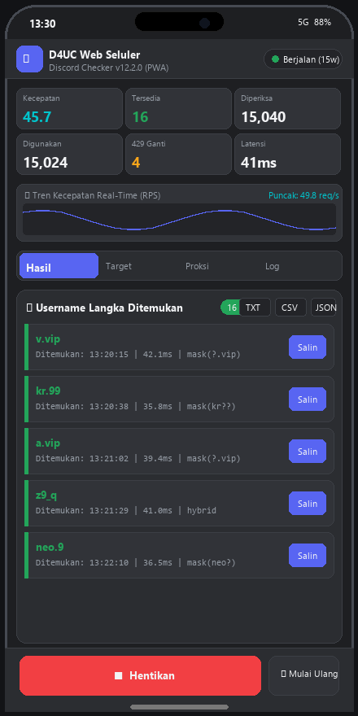
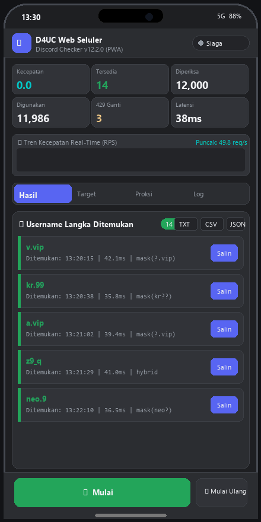
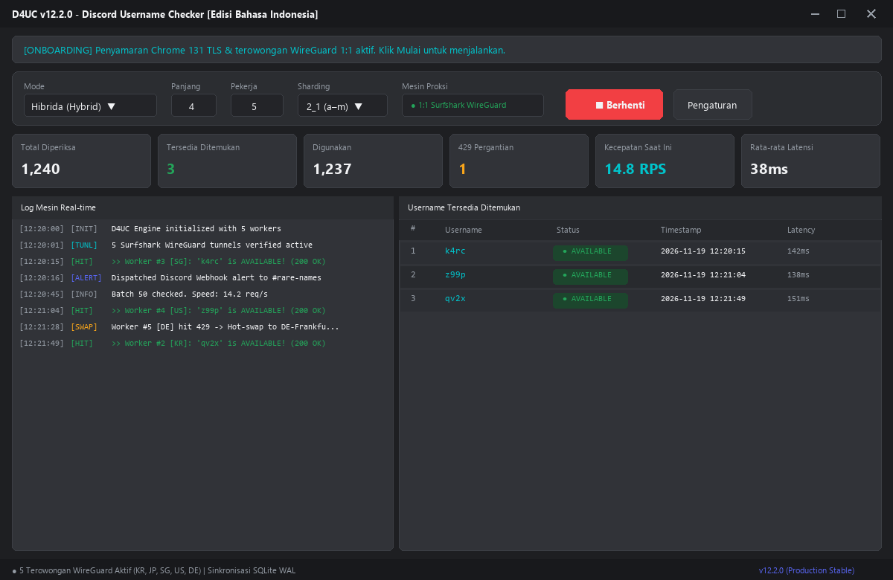
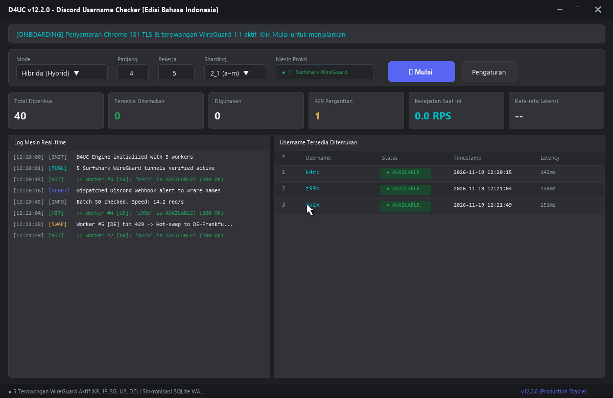
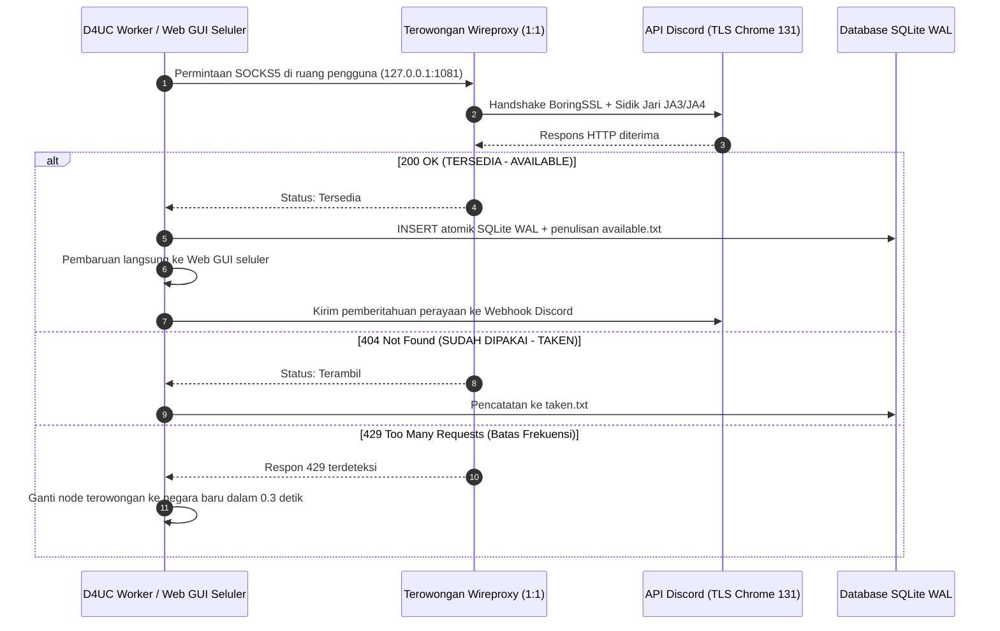

<div align="center">

# ⚡ D4UC (`discord-checker`) v12.2.0

> **Mesin Pemeriksa Ketersediaan Nama Pengguna Langka Discord Berkecepatan Tinggi**  
> Web GUI Responsif Seluler & PWA · Penyamaran TLS Chrome 131 · Pool Terowongan WireGuard 1:1 di Ruang Pengguna · Hot-Swap Atomik 429 dalam 0.3 Detik · Sharding Bersamaan SQLite WAL

<br />

| [KR 한국어](../ko/README.md) | [US English](../en/README.md) | [JP 日本語](../ja/README.md) | [CN 简体中文](../zh-CN/README.md) | [ES Español](../es/README.md) |
| :---: | :---: | :---: | :---: | :---: |
| [FR Français](../fr/README.md) | [DE Deutsch](../de/README.md) | [RU Русский](../ru/README.md) | [BR Português](../pt-BR/README.md) | [SA العربية](../ar/README.md) |

<p align="center"><sub>🌐 Also available: <a href="../hi/README.md">HI हिन्दी</a> • <a href="./README.md">ID Bahasa Indonesia</a></sub></p>

[](./CHANGELOG.md)
[](https://github.com/KRCUPRO/discord-checker/releases/tag/v12.4.0)
[](./LICENSE.md)
[](https://www.python.org/)
[](../../guides/README.md)
[](../../specs/01_NETWORK_CORE_ENGINE.md)

<sub>Hak Cipta (c) 2026 KRCUPRO · Lisensi Kepemilikan & Rahasia (Semua Hak Dilindungi)</sub>

</div>

---

<a id="-daftar-isi"></a><a id="daftar-isi"></a>
## 📑 Daftar Isi
1. [📸 Pratinjau Antarmuka](#-pratinjau-antarmuka)
2. [✨ Fitur & Kemampuan Utama](#-fitur-kemampuan-utama)
3. [🖥️ Kebutuhan Sistem & Dependensi](#-kebutuhan-sistem-dependensi)
4. [📁 Struktur Direktori](#-struktur-direktori)
5. [🌐 Konfigurasi Proksi & 🔑 Kredensial](#-konfigurasi-proksi-kredensial)
6. [🚀 Pemasangan & Penggunaan](#-pemasangan-penggunaan)
7. [📱 Panduan Kendali Jarak Jauh Web GUI Seluler & PWA](#-panduan-kendali-jarak-jauh-web-gui-seluler-pwa)
8. [🧵 Pengaturan Beban dan Jumlah Pekerja (Workers)](#-pengaturan-beban-dan-jumlah-pekerja-workers)
9. [🔢 Strategi Pembuatan Nama Pengguna](#-strategi-pembuatan-nama-pengguna)
10. [🚫 Aturan Pengecualian Ketat (Contoh: `ab..`, `a..1`)](#-aturan-pengecualian-ketat-contoh-ab-a1)
11. [📡 Alur Kerja Mesin Pemeriksa](#-alur-kerja-mesin-pemeriksa)
12. [🔄 Pengelolaan Sesi Proksi](#-pengelolaan-sesi-proksi)
13. [🔁 Penanganan Kesalahan dan Percobaan Ulang](#-penanganan-kesalahan-dan-percobaan-ulang)
14. [💾 Format Penyimpanan Data](#-format-penyimpanan-data)
15. [📊 Metrik & Pemantauan Real-Time](#-metrik-pemantauan-real-time)
16. [🛑 Menghentikan Proses](#-menghentikan-proses)
17. [⚠️ Penanganan Batas Frekuensi (429)](#-penanganan-batas-frekuensi-429)
18. [🔧 Panduan Mengatasi Masalah](#-panduan-mengatasi-masalah)
19. [📞 Bantuan Discord: myuyayam](#-bantuan-discord-myuyayam)
20. [⭐ Dukung Proyek Ini (GitHub Star)](#-dukung-proyek-ini-github-star)
21. [📚 Pemberitahuan Tujuan Pembelajaran dan Penelitian](#-pemberitahuan-tujuan-pembelajaran-dan-penelitian)

---

<a id="-pratinjau-antarmuka"></a><a id="pratinjau-antarmuka"></a>
## 📸 Pratinjau Antarmuka

### Web GUI Responsif Ramah Sentuhan Seluler (PWA - iPhone & Android)
[](../../guides/MOBILE_IOS_GUIDE.md)

### Demonstrasi Langsung Operasi Seluler (Kontrol 1 Ketukan & Telemetri Real-Time)
[](../../guides/MOBILE_IOS_GUIDE.md)

### GUI Desktop PC (Edisi Bahasa Indonesia)
[](../../guides/WINDOWS_GUIDE.md)

### Demonstrasi Eksekusi GUI Desktop (Interaksi Mouse yang Halus)
[](../../guides/WINDOWS_GUIDE.md)

### Dasbor Terminal CLI Headless
[](../../guides/TERMUX_DEBIAN_GUIDE.md)

### Lingkungan Penerapan Docker & Server Linux
[](../../guides/DOCKER_GUIDE.md)

[⬆️ Kembali ke Daftar Isi](#-daftar-isi)

---

<a id="-fitur-kemampuan-utama"></a><a id="fitur-kemampuan-utama"></a>
## ✨ Fitur & Kemampuan Utama

1. **Web GUI Responsif Seluler & Mesin PWA (`http://<host>:5000`)**:
   - Jalankan di PC, VPS, Docker, atau Termux dan kendalikan secara nirkabel dari peramban ponsel pintar mana pun (iPhone Safari, Android Chrome).
   - Mendukung penuh **"Tambahkan ke Layar Utama" (PWA)** sehingga berfungsi seperti aplikasi seluler layar penuh tanpa toko aplikasi.
   - Tombol sentuh besar [Mulai / Berhenti], grafik Canvas kecepatan RPS murni, salin nama instan 1 ketukan, dan unduh langsung format TXT/CSV/JSON.
   - Konfigurasi jarak jauh dan pergantian langsung proksi (kunci privat Surfshark, file proksi, Thordata), 8 mode pembuat nama, dan slider pekerja (1–50) dari ponsel.

2. <a id="fnref-1"></a><a id="fnref1"></a>**Penyamaran TLS Chrome 131 JA3/JA4 (`curl_cffi` BoringSSL)[^1]**:
   - Menghilangkan jejak TLS sintetis yang biasa ditinggalkan oleh pustaka HTTP standar Python (`requests`, `aiohttp`, `httpx`).
   - Meniru Cipher Suites, Extensions, dan frame HTTP/2 SETTINGS persis seperti peramban resmi Google Chrome 131 untuk melewati WAF dan Cloudflare.

3. <a id="fnref-2"></a><a id="fnref2"></a>**Pool Terowongan WireGuard 1:1 di Ruang Pengguna (`wireproxy`)[^2]**:
   - Beroperasi tanpa memodifikasi kartu jaringan host dan tanpa mengganggu DNS atau rute sistem komputer Anda.
   - Mengalokasikan port lokal terisolasi (`127.0.0.1:1081+`) untuk setiap pekerja yang terhubung ke 142 server di seluruh dunia. Lalu lintas internet normal komputer Anda tidak terganggu sama sekali (0.00% interferensi).

4. **Hot-Swap Atomik 429 dalam 0.3 Detik**:
   - Saat sebuah thread terkena batas frekuensi HTTP 429 Discord, proses pemeriksaan tidak akan berhenti secara global.
   - Hanya pekerja tersebut yang beralih ke node negara lain dalam waktu 300 ms, sementara pekerja lainnya terus memindai dengan kecepatan penuh.

5. **Sharding Matematis Tanpa Duplikasi**:
   - Mendukung pembagian ruang pencarian matematis (`2_1`, `2_2`, `4_1`–`4_4`) untuk pemindaian menyeluruh.
   - Beberapa jendela GUI atau kontainer Docker dapat berjalan serentak memeriksa rentang yang berbeda dengan 0% permintaan ganda.

6. **SQLite WAL & Pencadangan Sinkron Multi-Format**:
   - Penyimpanan berkinerja tinggi dengan integritas transaksi melalui SQLite mode WAL (`data/d4uc_results.db`).
   - Nama yang tersedia langsung disinkronkan ke file teks (`available.txt`, `taken.txt`), CSV, dan JSON secara atomik.

7. **8 Algoritma Pembuat Nama Pengguna**:
   - Hibrida, permutasi matematis, kamus leksikal, pola simetris, urutan angka, masker khusus, kombinasi fonetik, dan verifikasi ulang riwayat.

8. **Dukungan Lintas Platform**:
   - File eksekusi mandiri untuk Windows (4 edisi `.exe`), PWA seluler, konsol CLI Linux/macOS, skrip instalasi Android Termux, dan kontainer Docker.

[⬆️ Kembali ke Daftar Isi](#-daftar-isi)

---

<a id="-kebutuhan-sistem-dependensi"></a><a id="kebutuhan-sistem-dependensi"></a>
## 🖥️ Kebutuhan Sistem & Dependensi

### Lingkungan Eksekusi
- **Sistem Operasi**: Windows 10/11 (64-bit), Linux (Debian 11+, Ubuntu 20.04+, Arch), macOS 12+, Android 10+ (Termux), iOS Safari
- **Versi Python**: Python 3.10, 3.11, 3.12 (Disarankan: **Python 3.12**)
- **Memori RAM**: Minimal 512 MB (~250 MB untuk 50 pekerja serentak)
- **Jaringan**: Akses internet broadband (port keluar UDP 51820 diizinkan untuk WireGuard)

### Pustaka Utama (`requirements.txt`)
- `curl_cffi >= 0.7.0`: Penyamaran TLS Chrome 131 BoringSSL
- `customtkinter >= 5.2.0`: Antarmuka grafis desktop tema gelap
- `rich >= 13.7.0`: Dasbor konsol dan telemetri terminal
- `pydantic >= 2.6.0`: Validasi konfigurasi
- `pyyaml >= 6.0.1`: Parser file YAML
- `pillow >= 10.2.0`: Pemrosesan gambar dan render ikon

[⬆️ Kembali ke Daftar Isi](#-daftar-isi)

---

<a id="-struktur-direktori"></a><a id="struktur-direktori"></a>
## 📁 Struktur Direktori

```text
discord-checker/
├── config/                         # Templat konfigurasi dan .env.example
├── data/                           # Titik akhir WireGuard dan database SQLite
├── deploy/                         # Skrip build, Docker, dan generator aset
│   ├── android/                    # Android native app project
│   ├── build_apk.py                # Android release APK builder
│   ├── build_exe.py                # Kompiler 4 file mandiri .exe Windows
│   ├── docker-compose.yml          # Konfigurasi Docker Compose
│   ├── Dockerfile                  # Spesifikasi kontainer Multi-Arch
│   ├── generate_assets.py          # Generator tangkapan layar dan demo GIF
│   ├── generate_badges.py          # Generator lencana SVG untuk 12 bahasa
│   └── generate_mobile_assets.py   # Generator tangkapan layar PWA dan GIF
├── docs/                           # Dokumentasi, panduan, dan aset visual
│   ├── assets/                     # Tangkapan layar, GIF, dan lencana SVG
│   ├── guides/                     # Panduan untuk iOS, PC, Docker, dan Termux
│   └── locales/                    # Terjemahan lengkap 1:1 dalam 11 bahasa
├── src/                            # Kode sumber mesin utama
│   ├── generator/                  # 8 mesin pembuat nama dan filter aturan
│   ├── network/                    # Klien jaringan TLS Chrome 131 dan backoff
│   ├── notify/                     # Modul pemberitahuan webhook Discord
│   ├── proxy/                      # Pengelola pool terowongan WireGuard 1:1
│   ├── storage/                    # Lapisan penyimpanan SQLite WAL dan teks
│   ├── ui/                         # Multibahasa i18n, tooltip, dan CLI
│   │   └── web/                    # Antarmuka Web PWA (HTML5/CSS3/Vanilla JS)
│   ├── web_gui.py                  # Server Web GUI seluler dan REST API
│   ├── gui.py                      # Orkestrator CustomTkinter untuk desktop
│   ├── gui_ko.py                   # Titik masuk GUI Korea
│   ├── gui_en.py                   # Titik masuk GUI Inggris
│   └── run.py                      # Titik masuk konsol CLI
├── tests/                          # Rangkaian pengujian otomatis
├── CHANGELOG.md                    # Catatan rilis dan riwayat versi
├── LICENSE                         # Lisensi Perangkat Lunak Kepemilikan
├── README.md                       # Panduan utama dalam bahasa Inggris
└── SECURITY.md                     # Kebijakan keamanan dan pencegahan kebocoran
```

[⬆️ Kembali ke Daftar Isi](#-daftar-isi)

---

<a id="-konfigurasi-proksi-kredensial"></a><a id="konfigurasi-proksi-kredensial"></a>
## 🌐 Konfigurasi Proksi & 🔑 Kredensial

D4UC mengintegrasikan **pool terowongan WireGuard 1:1 di ruang pengguna** melalui `wireproxy` untuk mencegah pembatasan alamat IP.

### 1. Langkah Pengaturan
1. Salin file `config/.env.example` menjadi `.env` di direktori utama:
   ```bash
   cp config/.env.example .env
   ```
2. Buka `.env` dan masukkan kunci privat Surfshark WireGuard Anda:
   ```ini
   # Pisahkan dengan koma untuk menggunakan beberapa kunci sekaligus
   SURFSHARK_PRIVATE_KEYS=KUNCI_PRIVAT_WIREGUARD_1,KUNCI_PRIVAT_WIREGUARD_2
   
   # Jumlah pekerja (Default: 5, Maksimal: 50)
   D4UC_WORKERS=5
   
   # Webhook Discord untuk pemberitahuan (Opsional)
   D4UC_WEBHOOK=https://discord.com/api/webhooks/ID/TOKEN
   ```

### 2. Pengikis & Penguji Multithread Proksi Publik Gratis (`--proxy free`) [Baru di v12.3.0]
Operasi 100% gratis tanpa memerlukan langganan VPN berbayar:
- **Pengumpulan multi-sumber otomatis**: Mengambil daftar proksi yang terus diperbarui dari 14+ repositori GitHub dan dataset Hugging Face (TheSpeedX, monosans, hookzof, roosterkid, ShiftyTR, mertguvencli, Hugging Face).
- **Dukungan multi-protokol**: Mendukung penuh proksi gratis HTTP, HTTPS, SOCKS4, dan SOCKS5.
- **Pemeriksaan koneksi asinkron langsung**: Menguji konektivitas nyata terhadap endpoint Discord dan Cloudflare, menyaring node mati, latensi > 3500ms, dan blokir WAF 403.
- **Rotasi batas kecepatan 429 & penyegaran latar belakang**: Mengisolasi node selama 15 detik saat terkena rate limit dan beralih otomatis ke proksi aktif tercepat.
- **Integrasi antarmuka**: Tersedia di GUI Desktop, tombol 1-ketuk di Web Seluler, dan opsi CLI `--proxy free` (atau `-p free`).

### 3. Kebijakan Anti-Bocor (Zero-Leak Policy)
- Semua kunci privat dan file konfigurasi dikecualikan secara ketat oleh `.gitignore` dan diperiksa sebelum setiap commit.

[⬆️ Kembali ke Daftar Isi](#-daftar-isi)

---

<a id="-pemasangan-penggunaan"></a><a id="pemasangan-penggunaan"></a>
## 🚀 Pemasangan & Penggunaan

### Metode A: Program Mandiri untuk Windows (`.exe`)
Unduh aplikasi yang telah dikompilasi dari [GitHub Releases v12.2.0](https://github.com/KRCUPRO/discord-checker/releases/tag/v12.4.0):
- `DiscordUsernameChecker_v12.3.0.apk`: **Paket Aplikasi Android (1 Ketukan)** [BARU]
- `DiscordUsernameCheckerV2_Web.exe`: **Server Web GUI Seluler & PWA (Port 5000)** [BARU]
- `DiscordUsernameCheckerV2_EN.exe`: GUI Desktop Bahasa Inggris
- `DiscordUsernameCheckerV2_KO.exe`: GUI Desktop Bahasa Korea
- `DiscordUsernameCheckerV2_CLI.exe`: Dasbor Konsol CLI Headless

### 📱 Paket Aplikasi Android (`.apk`) — Instalasi 1 Ketuk [NEW]
- **Unduh langsung**: [`DiscordUsernameChecker_v12.3.0.apk`](https://github.com/KRCUPRO/discord-checker/releases/download/v12.3.0/DiscordUsernameChecker_v12.3.0.apk)
- **Panduan Instalasi**:
  1. Unduh berkas `.apk` ke ponsel Android Anda (Galaxy, Pixel, Xiaomi, dll.).
  2. Buka berkas dari bilah notifikasi atau pengelola berkas.
  3. Aktifkan izin "Instal aplikasi dari sumber tidak dikenal" lalu ketuk **[Instal]**.
  4. Jalankan **`D4UC Discord Checker`** langsung dari layar utama.
- **Fitur Utama Mobile**:
  - Antarmuka sentuh Discord-Dark bawaan offline dalam 12 bahasa (`assets/www/index.html`).
  - Salin ke papan klip 1 ketukan dengan notifikasi Toast native Android.
  - Pencegah layar mati Wake Lock (`WAKE_LOCK`) selama pemindaian aktif.
  - Koneksi cepat ke backend D4UC di PC melalui Wi-Fi atau alamat IP.

### Metode B: Menjalankan Web GUI Seluler (Kendali Lewat Ponsel)
```bash
# Jalankan server web seluler (Port default: 5000)
python src/web_gui.py --port 5000

# Buka peramban di ponsel Anda yang terhubung ke Wi-Fi yang sama:
# http://<ALAMAT_IP_KOMPUTER_ANDA>:5000
```

### Metode C: Menjalankan dari Kode Sumber
```bash
python -m venv .venv
source .venv/bin/activate  # Windows: .\.venv\Scripts\Activate.ps1
pip install -r requirements.txt

# Menjalankan GUI Desktop
python src/gui_en.py

# Menjalankan Konsol CLI
python src/run.py --mode hybrid --length 4 --workers 5
```

[⬆️ Kembali ke Daftar Isi](#-daftar-isi)

---

<a id="-panduan-kendali-jarak-jauh-web-gui-seluler-pwa"></a><a id="panduan-kendali-jarak-jauh-web-gui-seluler-pwa"></a>
## 📱 Panduan Kendali Jarak Jauh Web GUI Seluler & PWA

Pantau pencarian nama pengguna langka dan ubah pengaturannya langsung dari ponsel Anda.

### 1. Tambahkan ke Layar Utama (Instalasi PWA)
1. Buka `http://<IP_KOMPUTER>:5000` di ponsel Anda (Safari di iPhone atau Chrome di Android).
2. **iPhone Safari**: Ketuk tombol Bagikan ➔ pilih **"Tambahkan ke Layar Utama"**.
3. **Android Chrome**: Ketuk menu titik tiga (⋮) ➔ pilih **"Tambahkan ke Layar Utama"** atau **"Instal Aplikasi"**.
4. Ketuk ikon ungu **D4UC Web** untuk menjalankan aplikasi layar penuh tanpa bilah peramban.

### 2. Fitur Sentuh pada Ponsel
- **Kartu Telemetri Real-Time**: Pantau kecepatan RPS, temuan tersedia, total diperiksa, terambil, rotasi 429, dan latensi (ms).
- **Grafik Kecepatan Canvas HTML5**: Visualisasi pergerakan kecepatan pemindaian secara ringan tanpa pustaka luar.
- **Salin Nama 1 Ketukan**: Ketuk tombol [Salin] di samping nama yang ditemukan untuk langsung menyalin ke papan klip ponsel.
- **Unduh Cepat**: Tombol di bagian atas untuk mengunduh daftar dalam format TXT, CSV, atau JSON.
- **Penggantian Setelan Jarak Jauh (Hot-Swap)**:
  - Beralih di antara 8 mode pembuatan nama secara instan
  - Mengubah panjang nama (3–6 karakter) dan konfigurasi sharding
  - Mengatur slider jumlah pekerja (1–50) saat aplikasi berjalan
  - Memperbarui kunci Surfshark dan setelan proksi secara nirkabel

[⬆️ Kembali ke Daftar Isi](#-daftar-isi)

---

<a id="-pengaturan-beban-dan-jumlah-pekerja-workers"></a><a id="pengaturan-beban-dan-jumlah-pekerja-workers"></a>
## 🧵 Pengaturan Beban dan Jumlah Pekerja (Workers)

- **Nilai standar yang disarankan**: `5` pekerja (~12–15 RPS)
- **Konsumsi daya rendah**: `1`–`3` pekerja
- **Kecepatan pemindaian tinggi**: `10`–`20` pekerja (mendukung hingga 50 pekerja)
- **Cara Kerja**:
  - D4UC mengalokasikan port terowongan WireGuard khusus untuk tiap pekerja (`1081`, `1082`, dst.).
  - 5 pekerja melakukan kueri secara serentak melalui 5 negara yang berbeda (Tokyo, Seoul, Singapura, Frankfurt, New York).

[⬆️ Kembali ke Daftar Isi](#-daftar-isi)

---

<a id="-strategi-pembuatan-nama-pengguna"></a><a id="strategi-pembuatan-nama-pengguna"></a>
## 🔢 Strategi Pembuatan Nama Pengguna

| Kunci Mode | Strategi Pembuatan | Keterangan & Contoh |
| :--- | :--- | :--- |
| `hybrid` (Disarankan) | Kata dasar kamus + angka/simetri | Nama akun langka yang rapi, mudah dibaca, dan bernilai (`krc1`, `v1be`, `neo9`) |
| `permutation` | Permutasi menyeluruh matematis | Pemindaian lengkap kombinasi `a-z`, `0-9`, `_` (dengan sharding `2_1`, `2_2`) |
| `dictionary` | Kamus bahasa Inggris 3–6 huruf | Kosakata nyata dan kata pendek 2-3 suku kata bernilai tinggi |
| `pattern` | Pola simetris dan pengulangan | Pola visual yang rapi (`aaaa`, `abba`, `abab`, `aabb`) |
| `numeric` | Angka berurutan dan berulang | Seri angka (`0000`–`9999`, angka poker `7777`, `1234`) |
| `custom_mask` | Aturan awalan, akhiran, dan titik | Pola kustom sesuai selera (`kr??`, `??99`, `?.vip`, `??.??`) |
| `combinatorial` | Struktur suku kata CVCV / VCCV | Kombinasi konsonan dan vokal untuk nama merek baru yang dapat dieja |
| `recheck` | Pengecekan ulang daftar terambil | Memeriksa kembali nama yang pernah terambil untuk mencari akun yang dilepas |

[⬆️ Kembali ke Daftar Isi](#-daftar-isi)

---

<a id="-aturan-pengecualian-ketat-contoh-ab-a1"></a><a id="aturan-pengecualian-ketat-contoh-ab-a1"></a>
## 🚫 Aturan Pengecualian Ketat (Contoh: `ab..`, `a..1`)

Nama pengguna yang melanggar aturan resmi Discord **dikecualikan 100% sejak tahap pembuatan kandidat**:

1. **Dilarang menggunakan dua titik berurutan (`..`)**:
   - ❌ `ab..` (titik ganda di akhir) ➔ **Otomatis dikecualikan**
   - ❌ `a..1` (titik ganda di tengah) ➔ **Otomatis dikecualikan**
   - ❌ `..kr` (titik ganda di awal) ➔ **Otomatis dikecualikan**
2. **Dilarang meletakkan titik di awal atau akhir (`.`)**:
   - ❌ `.abc` (diawali titik) ➔ **Otomatis dikecualikan**
   - ❌ `abc.` (diakhiri titik) ➔ **Otomatis dikecualikan**
3. **Karakter yang Diizinkan**:
   - Hanya huruf kecil (`a-z`), angka (`0-9`), garis bawah (`_`), dan satu tanda titik (`.`).
4. **Batas Panjang Nama**:
   - Nama kurang dari 2 atau lebih dari 32 karakter tidak akan pernah dibuat.
5. **Kata Khusus Sistem**:
   - Nama seperti `discord`, `clyde`, `here`, `everyone`, dan `system` disaring secara otomatis.

> Divalidasi secara ketat oleh `DiscordRuleValidator.is_valid()` dalam `src/generator/base.py` dengan 84 pengujian otomatis.

[⬆️ Kembali ke Daftar Isi](#-daftar-isi)

---

<a id="-alur-kerja-mesin-pemeriksa"></a><a id="alur-kerja-mesin-pemeriksa"></a>
## 📡 Alur Kerja Mesin Pemeriksa



[⬆️ Kembali ke Daftar Isi](#-daftar-isi)

---

<a id="-pengelolaan-sesi-proksi"></a><a id="pengelolaan-sesi-proksi"></a>
## 🔄 Pengelolaan Sesi Proksi

- **Sesi Asinkron Terpisah**: Setiap pekerja memelihara instance `curl_cffi.requests.AsyncSession` mandiri untuk efisiensi koneksi Keep-Alive TCP.
- **Bebas Proses Menggantung (Zero-Zombie)**: Saat dimatikan, semua proses latar belakang `wireproxy` dihentikan secara bersih tanpa sisa.

[⬆️ Kembali ke Daftar Isi](#-daftar-isi)

---

<a id="-penanganan-kesalahan-dan-percobaan-ulang"></a><a id="penanganan-kesalahan-dan-percobaan-ulang"></a>
## 🔁 Penanganan Kesalahan dan Percobaan Ulang

1. **Batas Waktu Jaringan & Kendala DNS**: Percobaan ulang otomatis hingga 3 kali dengan jeda eksponensial (0.5s ➔ 1.0s ➔ 2.0s).
2. **Tantangan Cloudflare WAF**: Penutupan sesi secara langsung dan pembuatan ulang terowongan seketika.
3. **Batas Frekuensi 429**: Memasukkan kembali nama ke antrean dan mengalihkan pekerja ke IP baru dalam 0.3 detik.

[⬆️ Kembali ke Daftar Isi](#-daftar-isi)

---

<a id="-format-penyimpanan-data"></a><a id="format-penyimpanan-data"></a>
## 💾 Format Penyimpanan Data

| Lokasi | Format | Fungsi dan Peran |
| :--- | :--- | :--- |
| `data/d4uc_results.db` | **SQLite (Mode WAL)** | Transaksi ACID aman, penulisan multi-proses serentak, pengindeksan penuh |
| `available.txt` | Teks UTF-8 | Daftar nama yang tersedia, ditulis per baris secara real-time |
| `taken.txt` | Teks UTF-8 | Daftar nama yang telah dipakai (untuk mode recheck) |
| `checked_history.txt` | Teks UTF-8 | Riwayat lengkap guna mencegah pemeriksaan ganda |
| `available_usernames.csv` | Format CSV | Tabel untuk pengolahan spreadsheet dan analisis data |
| `available_usernames.json`| Format JSON | Data terstruktur untuk integrasi web dan REST API |

[⬆️ Kembali ke Daftar Isi](#-daftar-isi)

---

<a id="-metrik-pemantauan-real-time"></a><a id="metrik-pemantauan-real-time"></a>
## 📊 Metrik & Pemantauan Real-Time

Web GUI Seluler, aplikasi desktop, dan konsol terminal memperbarui metrik berikut setiap 30 ms:
- **Scan Speed (RPS)**: Jumlah pemeriksaan selesai per detik (rata-rata bergerak 5 detik)
- **Total Checked**: Total nama yang telah diperiksa pada sesi saat ini
- **Available Count**: Jumlah nama langka tersedia yang berhasil ditemukan
- **Taken Count**: Jumlah nama yang sudah terdaftar
- **429 Hot-Swaps**: Frekuensi pergantian IP proksi yang berhasil
- **Latency**: Waktu respons bolak-balik dengan server Discord (ms)

[⬆️ Kembali ke Daftar Isi](#-daftar-isi)

---

<a id="-menghentikan-proses"></a><a id="menghentikan-proses"></a>
## 🛑 Menghentikan Proses

- **Web GUI Seluler**: Ketuk tombol merah `■ Berhenti Mencari`.
- **Desktop GUI**: Klik tombol `■ Berhenti`.
- **CLI**: Tekan `Ctrl + C` untuk menyimpan database dan menutup seluruh terowongan secara aman.

[⬆️ Kembali ke Daftar Isi](#-daftar-isi)

---

<a id="-penanganan-batas-frekuensi-429"></a><a id="penanganan-batas-frekuensi-429"></a>
## ⚠️ Penanganan Batas Frekuensi (429)

- Discord mengirimkan respon `429 Too Many Requests` jika menerima terlalu banyak kueri dari satu alamat IP.
- D4UC menyebarkan kueri ke **142 terowongan WireGuard global** dan mengeksekusi **hot-swap dalam 0.3 detik**, membuat pekerja lainnya dapat terus berjalan tanpa henti.

[⬆️ Kembali ke Daftar Isi](#-daftar-isi)

---

<a id="-panduan-mengatasi-masalah"></a><a id="panduan-mengatasi-masalah"></a>
## 🔧 Panduan Mengatasi Masalah

| Kendala | Penyebab Umum | Solusi |
| :--- | :--- | :--- |
| Web GUI tidak terbuka di ponsel | Ponsel dan komputer berada pada jaringan berbeda | Hubungkan keduanya ke Wi-Fi yang sama dan pastikan port 5000 diizinkan di Windows Firewall. |
| `Wireproxy binary not found` | File eksekusi wireproxy hilang | Pastikan file `bin/wireproxy.exe` ada atau jalankan `deploy/build_exe.py`. |
| `Port already in use: 1081` | Proses sebelumnya belum tertutup | Hentikan proses Python atau wireproxy yang tersisa melalui Task Manager. |
| Muncul dialog Firewall | Aturan belum terdaftar | Jalankan perintah penambahan aturan di PowerShell sebagai Administrator. |
| `No module named curl_cffi` | Virtual environment belum aktif | Aktifkan `.venv` lalu jalankan `pip install -r requirements.txt`. |

[⬆️ Kembali ke Daftar Isi](#-daftar-isi)

---

<a id="-bantuan-discord-myuyayam"></a><a id="bantuan-discord-myuyayam"></a>
## 📞 Bantuan Discord: myuyayam

- Untuk saran fitur, pelaporan bug, atau konsultasi teknis, silakan hubungi **`myuyayam`** di Discord.
- Untuk pertanyaan lisensi bisnis dan komersial, hubungi melalui GitHub Issues atau DM Discord.

[⬆️ Kembali ke Daftar Isi](#-daftar-isi)

---

<a id="-dukung-proyek-ini-github-star"></a><a id="dukung-proyek-ini-github-star"></a>
## ⭐ Dukung Proyek Ini (GitHub Star)

Jika proyek ini bermanfaat bagi Anda, berikan dukungan dengan menekan tombol **Star (⭐)** di repositori GitHub!  
Dukungan dan masukan Anda adalah pendorong utama kelanjutan pengembangan perangkat lunak ini.

[⬆️ Kembali ke Daftar Isi](#-daftar-isi)

---

<a id="-pemberitahuan-tujuan-pembelajaran-dan-penelitian"></a><a id="pemberitahuan-tujuan-pembelajaran-dan-penelitian"></a>
## 📚 Pemberitahuan Tujuan Pembelajaran dan Penelitian

> **[Pemberitahuan Khusus untuk Tujuan Edukasi dan Riset]**
> 
> Perangkat lunak ini dikembangkan semata-mata untuk riset rekayasa jaringan dan studi keamanan: **sidik jari TLS (Chrome 131 BoringSSL JA3/JA4), pengembangan aplikasi Web PWA responsif seluler, tunneling ruang pengguna (Wireproxy), dan konkurensi SQLite WAL**.
> 
> 1. Dilarang keras menggunakan alat ini untuk melancarkan serangan Denial of Service (DoS), membebani server secara ilegal, atau memperjualbelikan akun secara tidak sah.
> 2. Pengguna bertanggung jawab penuh untuk mematuhi Ketentuan Layanan (Terms of Service) platform dan hukum yang berlaku. Segala risiko akibat penyalahgunaan ditanggung sepenuhnya oleh operator.
> 3. Pengembang dan kontributor tidak memberikan jaminan dan tidak bertanggung jawab atas hasil operasional perorangan.

[⬆️ Kembali ke Daftar Isi](#-daftar-isi)

---

<a id="-catatan-kaki-referensi-teknis"></a><a id="catatan-kaki-referensi-teknis"></a><a id="footnote-heading"></a>
### 📚 Catatan Kaki & Referensi Teknis

<a id="footnote-1"></a><a id="fn-1"></a>
[^1]: Jabat tangan Chrome 131 BoringSSL sepenuhnya menetralkan pemblokiran sidik jari TLS dari Cloudflare dan WAF modern. [↩ Kembali ke teks](#fnref-1) · [⬆️ Kembali ke Daftar Isi](#-daftar-isi)

<a id="footnote-2"></a><a id="fn-2"></a>
[^2]: wireproxy adalah biner Go ringan di ruang pengguna yang mengubah protokol WireGuard menjadi proksi SOCKS5 lokal terisolasi tanpa izin root. [↩ Kembali ke teks](#fnref-2) · [⬆️ Kembali ke Daftar Isi](#-daftar-isi)

[⬆️ Kembali ke Daftar Isi](#-daftar-isi)
