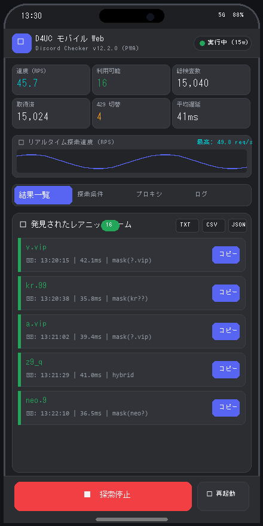
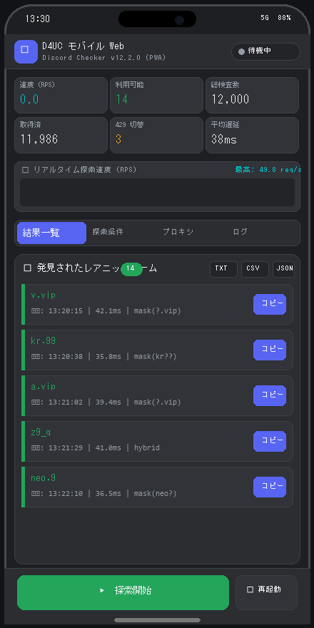
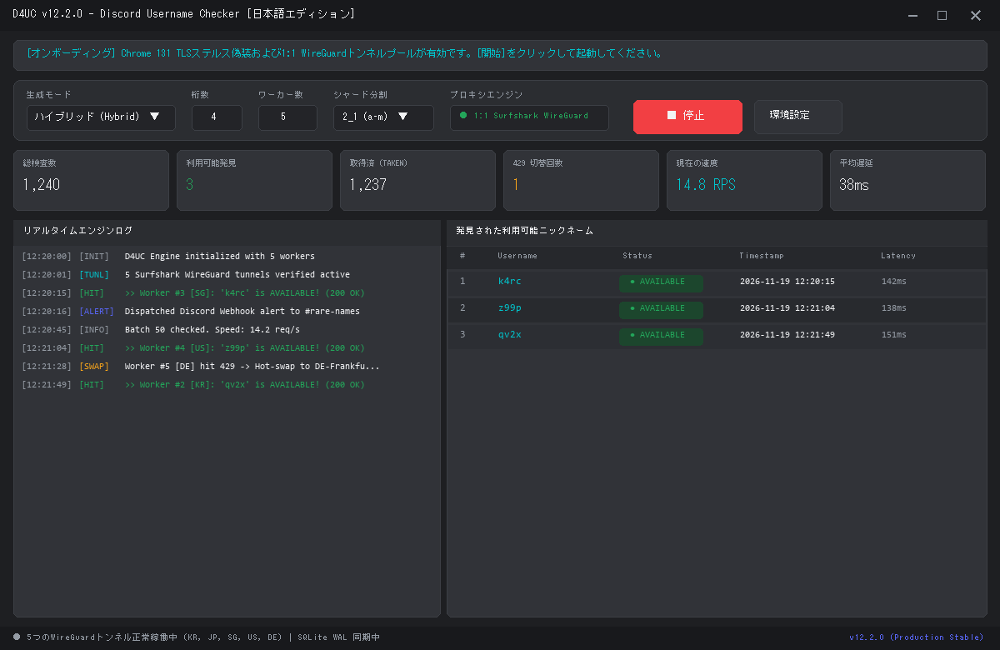
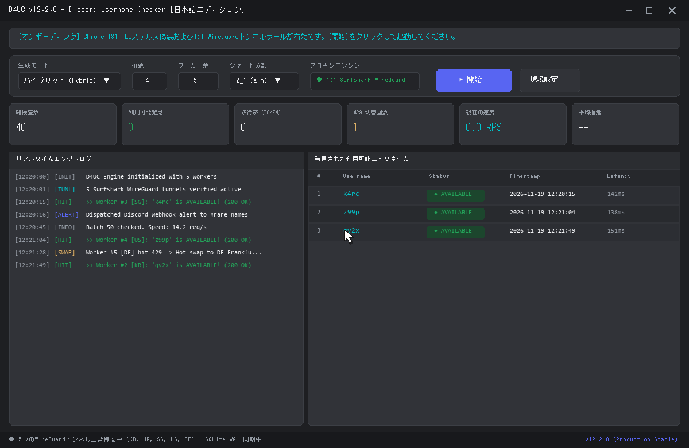
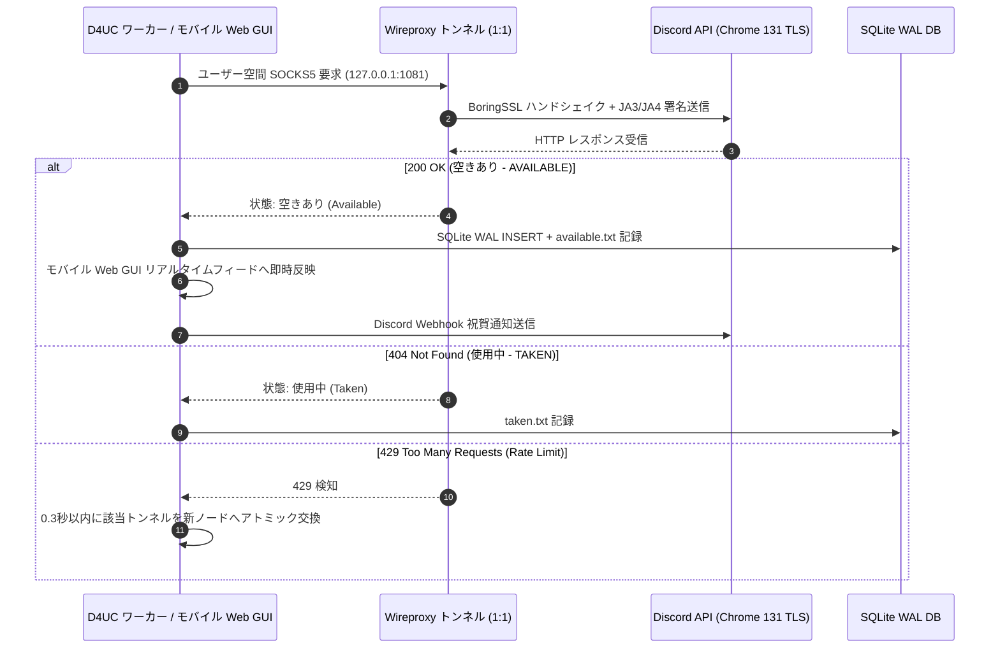

<div align="center">

# ⚡ D4UC (`discord-checker`) v12.2.0

> **高性能 Discord 希少ユーザー名空き状況探索エンジン**  
> モバイルレスポンシブ Web GUI & PWA · Chrome 131 TLS ステルス偽装 · 1:1 ユーザー空間 WireGuard トンネルプール · 0.3秒アトミック 429 ホットスワップ · SQLite WAL マルチシャーディング

<br />

| [KR 한국어](./ko.md) | [US English](../../README.md) | [JP 日本語](./ja.md) | [CN 简体中文](./zh-CN.md) | [ES Español](./es.md) |
| :---: | :---: | :---: | :---: | :---: |
| [FR Français](./fr.md) | [DE Deutsch](./de.md) | [RU Русский](./ru.md) | [BR Português](./pt-BR.md) | [SA العربية](./ar.md) |

<p align="center"><sub>🌐 その他の言語ドキュメント: <a href="./hi.md">HI हिन्दी</a> · <a href="./id.md">ID Bahasa Indonesia</a></sub></p>

<br />

[](../../CHANGELOG.md)
[](https://github.com/KRCUPRO/discord-checker/releases/tag/v12.3.0)
[](../../LICENSE)
[](https://www.python.org/)
[](../GUIDE.md)
[](../specs/01_NETWORK_CORE_ENGINE.md)

<sub>Copyright (c) 2026 KRCUPRO · 独占ソフトウェアライセンス (All Rights Reserved)</sub>

</div>

---

## 📸 インターフェース プレビュー

### モバイルタッチ最適化レスポンシブ Web GUI (PWA - iPhone & Android)
[](../guides/MOBILE_IOS_GUIDE.md)

### モバイル Web リアルタイム操作デモ (1-Tap タッチ操作 & ライブテレメトリ)
[](../guides/MOBILE_IOS_GUIDE.md)

### デスクトップ GUI 実行画面 (日本語エディション)
[](../guides/PC_GUIDE.md)

### リアルタイム GUI 動作デモ (スムーズなマウス操作)
[](../guides/PC_GUIDE.md)

### ヘッドレスト CLI ダッシュボード
[](../guides/TERMUX_DEBIAN_GUIDE.md)

### Docker & Linux サーバーデプロイ環境
[](../guides/DOCKER_GUIDE.md)

---

## ✨ 主な機能

1. **モバイルレスポンシブ Web GUI & PWA エンジン (`http://<host>:5000`)**:
   - PC、VPS、Docker、Termux のいずれで稼働していても、スマートフォン（iPhone Safari、Android Chrome）ブラウザから完全遠隔操作が可能。
   - **ホーム画面に追加 (PWA)** に対応し、App Store や Google Play を経由せず全画面ネイティブアプリとしてワンタップ起動。
   - 親指操作に最適化された巨大な [探索開始/停止] ボタン、純粋な HTML5 キャンバスリアルタイム RPS グラフ、1-Tap クリップボードコピー、TXT/CSV/JSON 即時エクスポート。
   - プロキシ設定（Surfshark 秘密鍵プール、独自プロキシファイル、Thordata）、8 つの探索モード、ワーカー数スライダー（1〜50）をスマホからリアルタイム遠隔ホットスワップ可能。

2. **Chrome 131 TLS JA3/JA4 ステルス偽装 (`curl_cffi` BoringSSL)**:
   - 一般的な Python HTTP ライブラリ（`requests`, `aiohttp`, `httpx`）の不自然な TLS 署名を完全に排除。
   - 最新の公式 Google Chrome 131 ブラウザと完全に一致する Cipher Suites、Extensions、Supported Groups、HTTP/2 SETTINGS フレームをエミュレートし、Cloudflare や WAF による事前ブロックを無力化。

3. **1:1 ユーザー空間 WireGuard トンネルプール (`wireproxy`)**:
   - ホスト OS のネットワークアダプターを乗っ取ったりルーティングテーブルを書き換えたりしません。
   - ユーザー空間の軽量バイナリ `wireproxy` を通じてワーカーごとに独立したローカルポート（`127.0.0.1:1081+`）を割り当て、世界 142 拠点のエンドポイントに 1:1 でマップ。
   - メイン PC の業務、Web 閲覧、オンラインゲーム、通話トラフィックに 0.00% の干渉や速度低下も与えません。

4. **0.3秒アトミック 429 ホットスワップ**:
   - 特定のワーカーが Discord API の 429 Rate Limit に達しても、プロセス全体が停止することはありません。
   - 429 を受信したワーカーのみが 0.3 秒以内に自動的に別の国（例：`JP-Tokyo` ➔ `KR-Seoul`）のノードへ切り替わり、他のワーカーは停止することなく高速探索を継続します。

5. **数学的重複ゼロ分割シャーディング**:
   - 4 文字の全数調査や大規模な辞書・順列スキャンにおいて、数学的オフセット分割（`2_1`, `2_2`, `4_1`–`4_4`）をサポート。
   - 複数の GUI、CLI、Docker コンテナを同時起動しても、互いに重複しない候補群を検査するため重複リクエストが 0 件です。

6. **SQLite WAL 同時書き込み & レガシーミラーリング**:
   - 高速な並行書き込みを実現する SQLite WAL モード（`data/d4uc_results.db`）を主 DB として採用。
   - 発見されたユーザー名はテキストファイル（`available.txt`, `taken.txt`）および CSV/JSON にも即時同期保存されます。

7. **8 つのインテリジェント候補生成エンジン**:
   - ハイブリッド、完全順列、辞書単語、対称パターン、数字配列、カスタムマスク、音節結合、過去履歴再検証の 8 つの生成モードを搭載。

8. **クロスプラットフォーム対応**:
   - Windows 10/11 向けスタンドアロン実行ファイル（4 種の `.exe`）、モバイル Web PWA、Linux/macOS CLI、Android Termux、Docker を網羅。

---

## 🖥️ 動作要件 & 依存関係

### 1. ランタイム環境
- **OS**: Windows 10/11 (64-bit), Linux (Debian 11+, Ubuntu 20.04+, Arch), macOS 12+, Android 10+ (Termux), iOS Safari
- **Python**: 3.10, 3.11, 3.12 (推奨: **Python 3.12**)
- **RAM**: 最低 512 MB（50 ワーカー稼働時 約 250 MB 消費）
- **ネットワーク**: ブロードバンド回線（Surfshark WireGuard UDP ポート 51820 送信許可環境）

### 2. 主要 Python ライブラリ (`requirements.txt`)
- `curl_cffi >= 0.7.0`: Chrome 131 BoringSSL TLS ステルス偽装
- `customtkinter >= 5.2.0`: ダークテーマデスクトップ GUI
- `rich >= 13.7.0`: ターミナルリアルタイムダッシュボード
- `pydantic >= 2.6.0`: 環境設定バリデーション
- `pyyaml >= 6.0.1`: YAML 設定ファイル解析
- `pillow >= 10.2.0`: UI 画像処理およびアイコン描画

---

## 📁 ディレクトリ構成

```text
discord-checker/
├── config/                         # 設定テンプレート & .env.example
├── data/                           # 142 拠点 WireGuard エンドポイント & SQLite DB
├── deploy/                         # ビルド、Docker & 各種自動化スクリプト
│   ├── android/                    # Android native app project
│   ├── build_apk.py                # Android release APK builder
│   ├── build_exe.py                # 4 種 Windows .exe コンパイラ
│   ├── docker-compose.yml          # Docker Compose 設定
│   ├── Dockerfile                  # Multi-Arch コンテナ仕様
│   ├── generate_assets.py          # 高解像度アセット生成スクリプト
│   ├── generate_badges.py          # 12 言語 1:1 SVG バッジ生成スクリプト
│   └── generate_mobile_assets.py   # モバイル PWA 画像 & デモ GIF 生成
├── docs/                           # ドキュメント、11 言語翻訳、ガイド & アセット
│   ├── assets/                     # スクリーンショット、アニメーション GIF、SVG
│   ├── guides/                     # iOS、PC、Docker、Termux 詳細ガイド
│   └── locales/                    # 11 言語 1:1 翻訳ドキュメント
├── src/                            # コアエンジンソースコード
│   ├── generator/                  # 8 つのユーザー名生成エンジン & ルールフィルタ
│   ├── network/                    # Chrome 131 TLS クライアント & バックオフ
│   ├── notify/                     # Discord Webhook 通知モジュール
│   ├── proxy/                      # 1:1 WireGuard トンネルプールマネージャー
│   ├── storage/                    # SQLite WAL & テキストストレージ
│   ├── ui/                         # 多言語 (i18n), ツールチップ, CLI
│   │   └── web/                    # モバイル PWA Web UI (HTML5/CSS3/Vanilla JS)
│   ├── web_gui.py                  # モバイルレスポンシブ Web GUI サーバー
│   ├── gui.py                      # CustomTkinter GUI オーケストレーター
│   ├── gui_ko.py                   # 韓国語デスクトップ GUI エントリ
│   ├── gui_en.py                   # 英語デスクトップ GUI エントリ
│   └── run.py                      # ヘッドレスト CLI エントリ
├── tests/                          # ユニット / 統合テストスイート
├── CHANGELOG.md                    # バージョン別変更履歴
├── LICENSE                         # プロプライエタリライセンス
├── README.md                       # 英語マスタードキュメント
└── SECURITY.md                     # セキュリティポリシー
```

---

## 🌐 プロキシ設定 & 🔑 認証情報

D4UC は IP BAN や Rate Limit を回避するため、**Surfshark WireGuard 1:1 トンネルプール**を内蔵しています。

### 1. 設定手順
1. リポジトリ直下の `config/.env.example` をコピーして `.env` を作成します：
   ```bash
   cp config/.env.example .env
   ```
2. `.env` を開き、Surfshark の WireGuard 秘密鍵（Private Key）を入力します：
   ```ini
   # カンマ区切りで複数の秘密鍵を登録可能（高並列化）
   SURFSHARK_PRIVATE_KEYS=YOUR_WIREGUARD_PRIVATE_KEY_1_HERE,YOUR_WIREGUARD_PRIVATE_KEY_2_HERE
   
   # ワーカー数 (デフォルト: 5, 最大: 50)
   D4UC_WORKERS=5
   
   # Discord Webhook 通知 URL (任意)
   D4UC_WEBHOOK=https://discord.com/api/webhooks/YOUR_WEBHOOK_ID/YOUR_WEBHOOK_TOKEN
   ```

### 2. 無料公開プロキシ自動収集 & リアルタイム検証機 (`--proxy free`) [v12.3.0 新機能]
有料 VPN やプロキシの契約なしで 100% 無料で探索を実行できるオープンソース公開プロキシ収集・検証エンジンを搭載：
- **自動マルチソース収集**: GitHub および Hugging Face で継続更新される 14 以上の公開プロキシリスト（TheSpeedX, monosans, hookzof, roosterkid, ShiftyTR, mertguvencli, Hugging Face）を高速並列収集。
- **マルチプロトコル対応**: HTTP, HTTPS, SOCKS4, SOCKS5 無料プロキシを完全サポート。
- **リアルタイム高速非同期接続ゲート**: 実際の Discord ユーザー名 API エンドポイントおよび Cloudflare エッジに対する疎通をテストし、低速ノード（>3500ms）や 403 WAF ブロックノードを自動除外。
- **429 ローテーション & バックグラウンド自動更新**: 429 Rate Limit を検知したノードを 15 秒間隔離し、最低レイテンシのアクティブノードへ即座にホットスワップ切替。
- **UI 操作**: デスクトップ GUI の `🌐 無料プロキシ自動収集`、モバイル Web GUI の 1-Tap `🔄 無料プロキシ収集 & 検証` ボタン、CLI `--proxy free`（または `-p free`）に対応。

### 3. 機密情報保護 (Zero-Leak Policy)
- 秘密鍵、設定ファイル（`.env`, `config.yaml`）、認証情報は `.gitignore` により厳重に Git から除外されています。

---

## 🚀 インストール & 実行

### 方法 A: Windows 向けスタンドアロン実行ファイル (`.exe`)
Python 環境構築なしで即座に実行したい場合、[GitHub Releases v12.2.0](https://github.com/KRCUPRO/discord-checker/releases/tag/v12.3.0) からダウンロードします：
- `DiscordUsernameChecker_v12.3.0.apk`: **Android スマホ専用 1タップ パッケージ** [NEW]
- `DiscordUsernameCheckerV2_Web.exe`: **モバイル Web GUI & PWA サーバー (ポート 5000)** [NEW]
- `DiscordUsernameCheckerV2_EN.exe`: 英語デスクトップ GUI
- `DiscordUsernameCheckerV2_KO.exe`: 韓国語デスクトップ GUI
- `DiscordUsernameCheckerV2_CLI.exe`: ヘッドレスト CLI ダッシュボード

### 📱 Android スマートフォン専用パッケージ (`.apk`) — 1タップ簡単インストール [NEW]
- **ダウンロード**: [`DiscordUsernameChecker_v12.3.0.apk`](https://github.com/KRCUPRO/discord-checker/releases/download/v12.3.0/DiscordUsernameChecker_v12.3.0.apk)
- **インストール手順**:
  1. 上記リンクから `.apk` を端末にダウンロードします。
  2. 通知またはファイルマネージャーからダウンロードした APK をタップします。
  3. セキュリティ警告が出た場合は「提供元不明のアプリのインストールを許可」を選択し、**[インストール]** をタップします。
  4. ホーム画面の **`D4UC Discord Checker`** をタップして即座に起動します。
- **主な機能**:
  - オフライン内蔵の 12 言語対応 Discord ダークテーマ タッチ GUI (`assets/www/index.html`)
  - ワンタップでのネイティブクリップボードコピー＆システムトースト通知
  - スキャン中の画面スリープを防止する Wake Lock (`WAKE_LOCK`)
  - PC またはリモートサーバーの D4UC バックエンド IP への簡単接続

### 方法 B: モバイルレスポンシブ Web GUI の起動 (スマホ遠隔操作)
```bash
# モバイル Web GUI サーバーを起動 (デフォルトポート: 5000)
python src/web_gui.py --port 5000

# 同一 Wi-Fi に接続したスマホのブラウザ (Safari / Chrome) でアクセス:
# http://192.168.0.x:5000
```

### 方法 C: ソースコードからのデスクトップ GUI / CLI 実行
```bash
python -m venv .venv
source .venv/bin/activate  # Windows: .\.venv\Scripts\Activate.ps1
pip install -r requirements.txt

# 英語デスクトップ GUI 起動
python src/gui_en.py

# CLI 起動
python src/run.py --mode hybrid --length 4 --workers 5
```

---

## 📱 モバイル Web GUI & PWA 遠隔操作ガイド

ベッドに横になりながらスマートフォンで探索状況を監視し、自由に設定を変更できます。

### 1. ホーム画面に追加 (PWA ネイティブアプリ化)
1. スマートフォンで `http://<PCのIPアドレス>:5000` にアクセスします。
2. **iPhone Safari**: 画面下部の共有ボタン ➔ **「ホーム画面に追加」** をタップ。
3. **Android Chrome**: 右上メニュー (⋮) ➔ **「ホーム画面に追加」** または **「アプリをインストール」** をタップ。
4. ホーム画面に作成された紫色の **D4UC Web** アイコンをタップすると、URL バーのない全画面ネイティブアプリとして起動します。

### 2. モバイルタッチ操作機能
- **大型リアルタイムテレメトリ**: RPS 速度、空き発見数、総検査数、Taken 数、429 ホットスワップ数、平均応答速度を 30ms 単位で常時表示。
- **純粋な HTML5 キャンバス波形**: ライブラリゼロで描画される美しい探索速度リアルタイムグラフ。
- **1-Tap ユーザー名コピー**: 発見された候補横の [コピー] をタップすると、振動とトースト通知でクリップボードにコピー。
- **ワンクリックエクスポート**: 上部の [TXT], [CSV], [JSON] ボタンでスマホ端末へ即時保存。
- **モバイル設定ホットスワップ**:
  - 生成モード 8 種のタブ切り替え
  - 文字数（3〜6文字）やシャーディング設定（2_1, 2_2 など）の即時変更
  - ワーカー数スライダー（1〜50）によるリアルタイム動的スケール（Hot-Scale）
  - Surfshark 秘密鍵やプロキシ情報の遠隔保存

---

## 🧵 スレッド・ワーカー数調整

- **推奨デフォルト値**: `5` ワーカー（RPS 約 12〜15）
- **低負荷・省電力**: `1`〜`3` ワーカー
- **超高速全数スキャン**: `10`〜`20` ワーカー（最大 50 ワーカー対応）
- **仕組み**:
  - D4UC は 1 ワーカーごとに独立した WireGuard トンネルポート（`1081`, `1082` など）を 1:1 で割り当てます。
  - 5 ワーカーであれば、東京、ソウル、シンガポール、フランクフルト、ニューヨークなど 5 つの異なる国際エンドポイントから並行リクエストが送信されます。

---

## 🔢 ユーザー名生成モード

| モードキー | 生成戦略 | 動作詳細と例 |
| :--- | :--- | :--- |
| `hybrid` (推奨) | 辞書語幹＋数字/記号変異 | 高品質で自然な希少 ID を高速探索 (`krc1`, `v1be`, `neo9`) |
| `permutation` | 数学的完全順列探索 | `a-z`, `0-9`, `_` の組み合わせ全探索（`2_1`, `2_2` シャーディング対応） |
| `dictionary` | 3〜6文字英単語辞書 | 意味のある英単語、発音可能な高価値ワード |
| `pattern` | 視覚的対称/反復パターン | `aaaa`, `abba`, `abab`, `aabb` などの美形パターン |
| `numeric` | 連続・反復数字配列 | `0000`–`9999`、ポーカーナンバー (`7777`, `1234`) |
| `custom_mask` | 接頭辞・接尾辞・ドット制御 | `kr??`, `??99`, `?.vip`, `??.??` などの指定パターン |
| `combinatorial` | 音韻論的 CVCV / VCCV 構造 | 子音＋母音＋子音の組み合わせで発音可能な造語を生成 |
| `recheck` | 既存 `TAKEN` リスト再検証 | 過去に使用中だった ID のうち、退会や変更で解放された名前を追跡 |

---

## 🚫 生成から除外されるユーザー名 (例: `ab..`, `a..1`)

Discord の公式ユーザー名ポリシーに基づき、以下の無効なユーザー名は候補生成時に **100% 事前除外**されます：

1. **連続したドット (`..`) の禁止**:
   - ❌ `ab..` (末尾の連続ドット) ➔ **自動除外**
   - ❌ `a..1` (中間の連続ドット) ➔ **自動除外**
   - ❌ `..kr` (先頭の連続ドット) ➔ **自動除外**
2. **先頭および末尾の単一ドット (`.`) の禁止**:
   - ❌ `.abc` (ドットで開始) ➔ **自動除外**
   - ❌ `abc.` (ドットで終了) ➔ **自動除外**
3. **許可文字の制限**:
   - 英小文字 (`a-z`)、数字 (`0-9`)、アンダースコア (`_`)、単一ドット (`.`) 以外の記号（`@`, `#`, `$`, スペースなど）は除外されます。
4. **文字数制限**:
   - Discord の仕様上、2文字未満および32文字を超えるユーザー名は生成されません。
5. **システム予約語・禁止語**:
   - `discord`, `clyde`, `here`, `everyone`, `system` などの予約語は自動的にフィルタリングされます。

> すべての検証ルールは `src/generator/base.py` の `DiscordRuleValidator.is_valid()` によって厳格に管理され、84 種のテストを通過しています。

---

## 📡 チェカー実行パイプライン



---

## 🔄 プロキシセッション管理

- **単一責務の非同期セッション**: 各ワーカーは独立した `curl_cffi.requests.AsyncSession` を保持し、Keep-Alive 効率を最大化します。
- **リソース完全回収 (Zero-Zombie)**: 終了時にはすべての非同期セッションとバックグラウンド `wireproxy` プロセスを安全に終了します。

---

## 🔁 エラー発生時の再試行

1. **一時的なネットワークタイムアウト / DNS エラー**: 指数バックオフ（0.5s ➔ 1.0s ➔ 2.0s）を適用し最大 3 回自動再試行。
2. **Cloudflare WAF チャレンジ検知**: セッションを破棄し、トンネルを即時リセット。
3. **429 Rate Limit 検知**: 候補を再試行キューに保持したまま、該当ワーカーのみ 0.3 秒で新ノードへホットスワップ。

---

## 💾 保存ファイル形式

| ファイルパス | 形式 | 用途と特徴 |
| :--- | :--- | :--- |
| `data/d4uc_results.db` | **SQLite (WAL モード)** | トランザクション保証、複数プロセス同時記録、インデックス付き全量保存 |
| `available.txt` | UTF-8 テキスト | 空きユーザー名を 1 行に 1 つずつリアルタイム追記 |
| `taken.txt` | UTF-8 テキスト | すでに使用中のユーザー名一覧（再検証用） |
| `checked_history.txt` | UTF-8 テキスト | 重複チェック防止用全履歴キャッシュ |
| `available_usernames.csv` | CSV 形式 | 外部分析ツール連携用スプレッドシートデータ |
| `available_usernames.json`| JSON 形式 | REST API およびダッシュボード連携用構造化データ |

---

## 📊 リアルタイム統計 & モニタリング

モバイル Web GUI、デスクトップ GUI、CLI ダッシュボードで以下の指標がリアルタイム表示されます：
- **Scan Speed (RPS)**: 1秒あたりの検査完了数（5秒間ローリング平均）
- **Total Checked**: 現在セッションで検査済みの総候補数
- **Available Count**: 発見された希少な空きユーザー名の総数
- **Taken Count**: 使用中のユーザー名数
- **429 Hot-Swaps**: レート制限によるノード切り替え成功回数
- **Latency**: 各トンネルの Discord API 往復応答時間 (ms)

---

## 🛑 チェッカーの停止

- **モバイル Web GUI**: 画面下の赤い `■ 探索停止` ボタンをタップすると即時停止します。
- **デスクトップ GUI**: 上部の `■ 停止` ボタンを押すと安全にキューがフラッシュされ待機状態に戻ります。
- **CLI**: `Ctrl + C` を入力すると、安全にチェックポイントを保存し全トンネルを終了します。

---

## ⚠️ レート制限 (Rate Limit)

- Discord API は同一 IP からの過剰なリクエストに対して `429 Too Many Requests` を返します。
- D4UC は 142 箇所のグローバル WireGuard トンネルプールによりトラフィックを分散し、429 を受けたトンネルのみを 0.3 秒で自動切り替えるため、探索を止めることなく永続稼働が可能です。

---

## 🔧 トラブルシューティング

| 症状 | 原因 | 解決策 |
| :--- | :--- | :--- |
| モバイル Web に繋がらない | スマホと PC が異なる Wi-Fi に接続されている | 同じ Wi-Fi ネットワークに接続し、PC のファイアウォールでポート 5000 の着信を許可してください。 |
| `Wireproxy binary not found` | wireproxy 実行ファイルが存在しない | `bin/wireproxy.exe` を確認するか、`deploy/build_exe.py` を実行してください。 |
| `Port already in use: 1081` | 前回のプロセスが残存している | タスクマネージャーで残留 Python / wireproxy プロセスを終了してください。 |
| ファイアウォール許可ダイアログが出る | Defender ルール未登録 | 管理者 PowerShell でファイアウォール許可ルールを登録してください。 |
| `No module named curl_cffi` | 仮想環境が有効化されていない | `.venv` をアクティベートし、`pip install -r requirements.txt` を実行してください。 |

---

## 📞 お問い合わせ Discord : myuyayam

- 機能提案、バグ報告、技術的なサポートは Discord **`myuyayam`** までご連絡ください。
- エンタープライズやビジネス利用に関するご相談は GitHub Issues または Discord DM をご利用ください。

---

## ⭐ プロジェクトの応援 (GitHub Star)

このプロジェクトが役立ちましたら、リポジトリ右上の **Star (⭐)** を押して応援をお願いいたします！  
皆様のフィードバックが開発の大きな励みになります。

---

## 📚 学習および研究目的の明示

> **[学習・研究目的の免責事項 — Educational & Research Purpose Only]**
> 
> 本ソフトウェアは、**現代の TLS フィンガープリント機構（Chrome 131 BoringSSL JA3/JA4）、モバイル PWA レスポンシブ設計、ユーザー空間トンネリングアーキテクチャ（Wireproxy）、および SQLite WAL による並行シャーディング制御**に関する技術検証およびネットワーク工学の学習目的で作成されています。
> 
> 1. 本ツールを使用した過剰なトラフィック誘発、サービス妨害（DoS）、プラットフォーム運営の妨害、アカウントの不当な買い占めや転売行為を固く禁止します。
> 2. 利用者は対象プラットフォームの利用規約（Terms of Service）および関連法規を遵守する義務を負い、本ツールの利用により生じた一切の責任は実行者自身に帰属します。
> 3. 開発者および貢献者は、利用者の個別の運用結果についていかなる保証や法的責任も負いません。