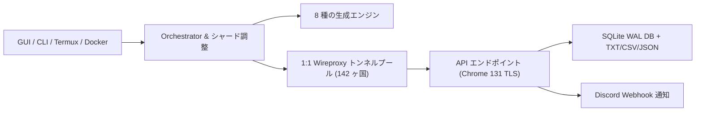

<div align="center">

<p align="center">
  <a href="../../README.md">🇺🇸 English</a> · <a href="./ko.md">🇰🇷 한국어</a> · <strong>🇯🇵 日本語</strong> · <a href="./zh-CN.md">🇨🇳 中文</a> · <a href="./es.md">🇪🇸 Español</a> · <a href="./de.md">🇩🇪 Deutsch</a><br />
  <a href="./fr.md">🇫🇷 Français</a> · <a href="./pt-BR.md">🇧🇷 Português</a> · <a href="./ru.md">🇷🇺 Русский</a> · <a href="./hi.md">🇮🇳 हिन्दी</a> · <a href="./ar.md">🇸🇦 العربية</a> · <a href="./id.md">🇮🇩 Bahasa Indonesia</a>
</p>

# ⚡ D4UC (`discord-checker`)

> **高性能 Discord 希少ユーザー名空き状況チェッカー — Chrome 131 TLS 偽装・1:1 隔離マルチトンネルプール・SQLite WAL シャーディング対応。**

[](https://github.com/KRCUPRO/discord-checker/releases/tag/v12.0.0)
[](../../LICENSE)
[](https://www.python.org/)
[](../GUIDE.md)
[](../specs/01_NETWORK_CORE_ENGINE.md)

<sub>Copyright (c) 2026 KRCUPRO · 独占ソフトウェアライセンス (All Rights Reserved)</sub>

</div>

---

<details open>
<summary><b>🌟 概要と主要機能</b></summary>

従来のユーザー名チェッカーは、現代のエッジ防御環境において 3 つの大きなボトルネックを抱えていました：
1. **TLS フィンガープリント検知**: 標準的な HTTP ライブラリは JA3/JA4 署名によって即座に Cloudflare/WAF にブロックされます。
2. **ホスト全体の VPN 干渉**: デスクトップ VPN を起動すると PC 全体の通信や DNS が上書きされます。
3. **429 連鎖停止とマルチプロセス競合**: レート制限で全ワーカーが停止し、複数起動時に結果ファイルが破損します。

**D4UC (`discord-checker`)** は完全隔離されたクロスプラットフォーム設計により、これらすべてを解決します：
- **Chrome 131 TLS JA3/JA4 ステルス偽装**: `curl_cffi` (BoringSSL) により実際の Chrome 131 と同等の TLS ハンドシェイクを送信。
- **1:1 ユーザー空間 WireGuard トンネル (`wireproxy`)**: 各ワーカーを 142 ヶ国のローカルポート (`127.0.0.1:1081+`) へ個別に割り当て、OS のネットワーク設定に影響を与えません。
- **0.3 秒アトミック 429 ホットスワップ**: 429 を受けたワーカーのみ即座に別国のノードへ切り替え、他のワーカーは停止しません。
- **数学的シャーディングと SQLite WAL 同期**: 全探索範囲を 2/3/4 分割 (`2_1`, `2_2`, `4_1`–`4_4`) し、重複ゼロで `data/d4uc_results.db` へ同時保存します。

</details>

---

<details open>
<summary><b>🥊 比較マトリクス: 従来スクリプト vs D4UC v12</b></summary>

| 項目 | 従来スクリプト | ⚡ D4UC v12 (`discord-checker`) |
| :--- | :---: | :---: |
| **TLS ステルス性能** | ❌ `requests` / `aiohttp` が即検知 | **✅ BoringSSL Chrome 131 JA3/JA4 偽装** |
| **ホスト通信の隔離** | ❌ システム全体の VPN が必須 | **✅ ユーザー空間 `wireproxy` (ワーカー単位 1:1)** |
| **429 復旧速度** | ❌ 全体停止またはエラー終了 | **✅ 0.3 秒ワーカー単位ホットスワップ + クールダウン** |
| **並列シャーディング** | ❌ 重複チェック・ファイルロック競合 | **✅ 非重複分割 + SQLite WAL 同時同期** |
| **対応環境・UI** | ⚠️ CLI スクリプトのみ | **✅ デスクトップ GUI (韓/英), Rich CLI, Android Termux, Docker** |
| **機密情報管理** | ⚠️ キーのハードコード危険性 | **✅ 厳格な `.gitignore`, `.env` 注入 & ダミーテンプレート** |

</details>

---

<details open>
<summary><b>🧬 8 つのユーザー名生成モード</b></summary>

| モードキー | 生成戦略 | 主な用途 |
| :--- | :--- | :--- |
| `hybrid` | 辞書語幹＋対称/数字の複合変異 | 高品質な空きユーザー名を高速探索 |
| `permutation` | 網羅的順列探索 (`a–z`, `0–9`, `_`) | 2/3/4 分割シャーディング (`2_1`, `2_2`) 全数調査 |
| `dictionary` | 3–6 文字の英単語・音節ベース | 意味のある希少ワード探索 |
| `pattern` | 対称・反復パターン (`aaaa`, `abba`, `abab`) | 視覚的に整った希少パターン |
| `numeric` | 連続・反復数字 (`0000`–`9999`) | 短い数字 ID の探索 |
| `custom_mask` | 接頭辞・接尾辞・ドット制御 (`??.vip`, `kr??`) | 特定ブランドやイニシャル向け |
| `combinatorial` | 音韻規則 CVCV / VCCV 音節生成 | 発音しやすいオリジナル名探索 |
| `recheck` | 過去の `TAKEN` 履歴を再検証 | 解放された ID の捕捉 |

</details>

---

<details open>
<summary><b>🏛️ アーキテクチャとディレクトリ構成</b></summary>



```text
discord-checker/
├── config/                  # .env.example & config.example.yaml テンプレート
├── data/                    # 142 クラスタ定義 & 認証情報テンプレート
├── deploy/                  # Dockerfile, docker-compose.yml, Termux & PyInstaller
├── docs/                    # ガイド・11 言語翻訳・アーキテクチャ図・技術仕様
├── src/                     # GUI (韓/英), CLI & コアエンジンモジュール
├── tests/                   # 回帰・並行性テストスイート (68 テスト)
├── CHANGELOG.md             # 変更履歴
├── LICENSE                  # 独占ソフトウェアライセンス (KRCUPRO)
├── NOTICE                   # サードパーティ OSS 表記
├── README.md                # 英語版メイン README
├── requirements.txt         # Python 依存ライブラリ
└── SECURITY.md              # セキュリティ方針
```

</details>

---

<details open>
<summary><b>🚀 4 つのプラットフォームでのクイックスタート</b></summary>

#### 1. デスクトップ GUI (Windows / Desktop)
```bash
git clone https://github.com/KRCUPRO/discord-checker.git
cd discord-checker
python -m venv .venv
.\.venv\Scripts\activate
pip install -r requirements.txt

python src/gui_ko.py
python src/gui_en.py
```

#### 2. ヘッドレス CLI & シャーディング
```bash
python src/run.py
python src/run.py --mode permutation --length 4 --shard 2_1 --workers 5
python src/run.py --no-dashboard
```

#### 3. Docker & マルチコンテナ並列実行
```bash
cp config/.env.example .env
docker compose -f deploy/docker-compose.yml up -d
docker compose -f deploy/docker-compose.yml --profile 2shard up -d
```

#### 4. Android Termux (`proot-distro debian`)
```bash
chmod +x deploy/install_debian.sh deploy/run.sh
./deploy/install_debian.sh
termux-wake-lock
nohup ./deploy/run.sh --no-dashboard > output.log 2>&1 &
```

</details>

---

<details>
<summary><b>⚙️ 環境変数設定 (.env)</b></summary>

[config/.env.example](../../config/.env.example) を `.env` にコピーして設定します:

```ini
SURFSHARK_PRIVATE_KEYS=YOUR_SURFSHARK_WIREGUARD_PRIVATE_KEY_HERE
D4UC_MODE=hybrid
D4UC_LENGTH=4
D4UC_WORKERS=5
D4UC_PROXY=surfshark
D4UC_WEBHOOK=
```

詳細は [セキュリティポリシー](../../SECURITY.md) をご覧ください。

</details>

---

<details open>
<summary><b>📄 ライセンスと著作権</b></summary>

Copyright (c) 2026 **KRCUPRO**. All Rights Reserved.  
[独占ソフトウェアライセンス (LICENSE)](../../LICENSE) により保護されています。  
サードパーティライブラリの権利表記は [NOTICE](../../NOTICE) をご確認ください。

</details>
