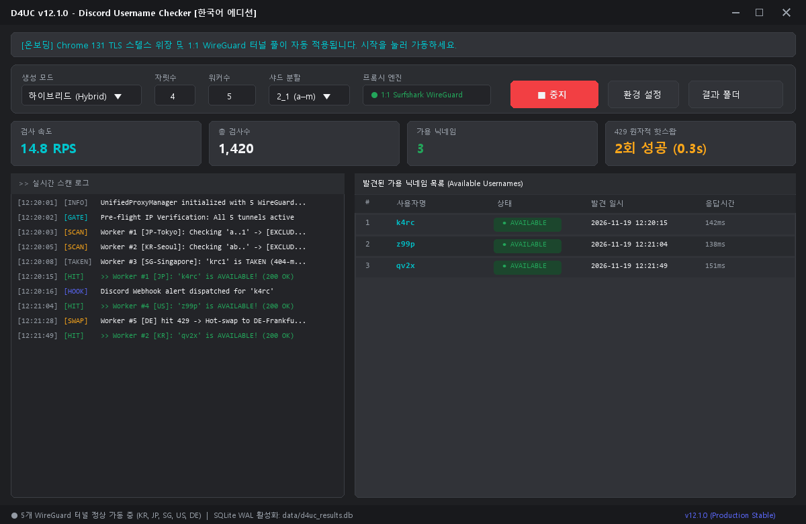
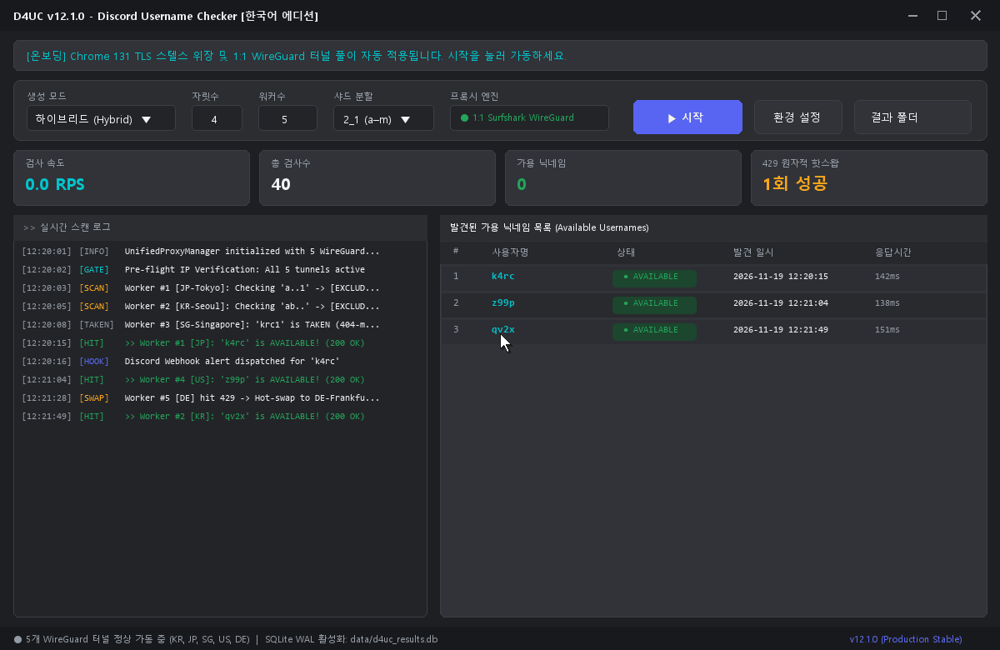
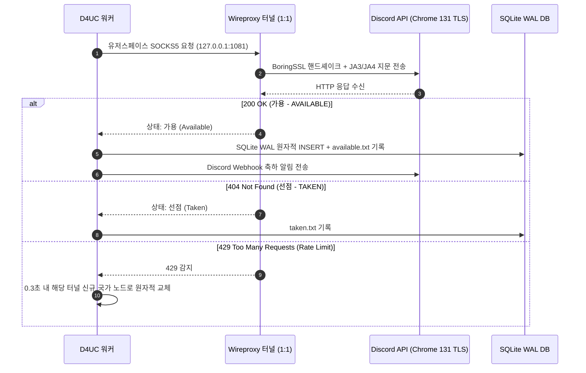

<div align="center">

# ⚡ D4UC (`discord-checker`) v12.1.0

> **고성능 디스코드 희귀 사용자명 가용성 탐색 엔진**  
> Chrome 131 TLS 스텔스 위장 · 1:1 유저스페이스 다중 WireGuard 터널 풀 · 0.3초 원자적 429 핫스왑 · SQLite WAL 다중 분할 샤딩

<br />

| [KR 한국어](./ko.md) | [US English](../../README.md) | [JP 日本語](./ja.md) | [CN 简体中文](./zh-CN.md) | [ES Español](./es.md) |
| :---: | :---: | :---: | :---: | :---: |
| [FR Français](./fr.md) | [DE Deutsch](./de.md) | [RU Русский](./ru.md) | [BR Português](./pt-BR.md) | [SA العربية](./ar.md) |

<p align="center"><sub>🌐 기타 언어 문서: <a href="./hi.md">HI हिन्दी</a> · <a href="./id.md">ID Bahasa Indonesia</a></sub></p>

<br />

[](../../CHANGELOG.md)
[](https://github.com/KRCUPRO/discord-checker/releases/tag/v12.1.0)
[](../../LICENSE)
[](https://www.python.org/)
[](../GUIDE.md)
[](../specs/01_NETWORK_CORE_ENGINE.md)

<sub>Copyright (c) 2026 KRCUPRO · 독점 소프트웨어 라이선스 (All Rights Reserved)</sub>

</div>

---

## 📸 인터페이스 미리보기

### 데스크톱 GUI 실행 화면
[](../guides/PC_GUIDE.md)

### 실시간 GUI 동작 데모 (자연스러운 마우스 조작)
[](../guides/PC_GUIDE.md)

### 헤드리스 CLI 대시보드
[](../guides/TERMUX_DEBIAN_GUIDE.md)

### Docker & Linux 서버 배포 환경
[](../guides/DOCKER_GUIDE.md)

---

## ✨ 주요 기능

1. **Chrome 131 TLS JA3/JA4 스텔스 위장 (`curl_cffi` BoringSSL)**:
   - 일반 Python HTTP 라이브러리(`requests`, `aiohttp`, `httpx`)에서 감지되는 비정상 TLS 핑거프린트를 완전히 탈피했습니다.
   - 실제 최신 Google Chrome 131 브라우저의 암호화 스위트(Cipher Suites), 확장 필드(Extensions), 타원 곡선(Supported Groups), HTTP/2 SETTINGS 프레임 시그니처를 100% 동일하게 에뮬레이션하여 Cloudflare 및 WAF의 사전 차단을 원천 무력화합니다.

2. **1:1 유저스페이스 WireGuard 터널 풀 (`wireproxy`)**:
   - 데스크톱 VPN 클라이언트처럼 호스트 OS의 네트워크 어댑터를 가로채거나 라우팅 테이블을 변경하지 않습니다.
   - 유저스페이스에서 동작하는 경량 `wireproxy` 바이너리를 통하여 워커마다 독립된 로컬 포트(`127.0.0.1:1081+`)를 할당하며, 글로벌 142개 엔드포인트를 1:1로 매핑합니다.
   - 메인 PC의 업무, 웹서핑, 게임, 메신저 트래픽에는 0.00%의 속도 저하 및 IP 간섭도 발생하지 않습니다.

3. **0.3초 원자적 429 핫스왑 (Atomic Rate-Limit Recovery)**:
   - 특정 워커가 Discord API의 429 Rate Limit에 도달하더라도 전체 프로세스가 일시 정지되거나 중단되지 않습니다.
   - 429를 수신한 해당 워커만 0.3초 이내에 다른 국가 엔드포인트(예: `JP-Tokyo` ➔ `KR-Seoul`)로 즉시 교체되며, 나머지 형제 워커들은 정상 속도로 검사를 계속 유지합니다.

4. **수학적 무중복 분할 샤딩 (Mathematical Sharding)**:
   - 4자리 전수조사(`permutation`) 및 대규모 조합 스캔 시 수학적 오프셋 분할 알고리즘(`2_1`, `2_2`, `4_1`–`4_4` 등)을 지원합니다.
   - 여러 개의 GUI 창, CLI 터미널, 도커 컨테이너를 동시에 실행해도 서로 다른 후보군을 검사하므로 중복 요청이 0건입니다.

5. **SQLite WAL 멀티 프로세스 동시 기록 & 레거시 포맷 미러링**:
   - 고성능 동시성 저장을 위해 `PRAGMA journal_mode = WAL`이 적용된 SQLite(`data/d4uc_results.db`)를 주 데이터베이스로 사용합니다.
   - 발견 즉시 기존 텍스트 파일(`available.txt`, `taken.txt`, `checked_history.txt`) 및 CSV/JSON 포맷으로도 실시간 원자적 미러링을 수행합니다.

6. **8대 지능형 닉네임 생성 엔진**:
   - 하이브리드, 완전 순열, 사전 단어, 대칭 패턴, 숫자 배열, 커스텀 마스크, 음절 조합, 과거 이력 재점검 등 8가지 전문 생성 모드를 탑재했습니다.

7. **크로스 플랫폼 지원**:
   - Windows 10/11 전용 단독 실행 파일(`.exe`), Linux/macOS 헤드리스 CLI, Android Termux 모바일 원클릭 스크립트, Multi-Arch Docker 컨테이너를 모두 제공합니다.

---

## 🖥️ 필수 환경 & 필요한 라이브러리

### 1. 런타임 요구 사양
- **운영체제**: Windows 10/11 (64-bit), Linux (Debian 11+, Ubuntu 20.04+, Arch, Alpine), macOS 12+ (Apple Silicon / Intel), Android 10+ (Termux)
- **Python 버전**: Python 3.10, 3.11, 3.12 (권장: **Python 3.12**)
- **메모리(RAM)**: 최소 512 MB 이상 (50워커 가동 시 약 250 MB 점유)
- **네트워크**: 광대역 인터넷 (Surfshark WireGuard UDP 통신 포트 51820 허용 환경)

### 2. 핵심 Python 라이브러리 (`requirements.txt`)
- `curl_cffi >= 0.7.0`: Chrome 131 BoringSSL TLS 지문 위장 엔진
- `customtkinter >= 5.2.0`: 모던 다크 테마 데스크톱 GUI
- `rich >= 13.7.0`: 실시간 CLI 대시보드 및 터미널 시각화
- `pydantic >= 2.6.0`: 환경 설정 유효성 검증
- `pyyaml >= 6.0.1`: YAML 설정 파일 파싱
- `pillow >= 10.2.0`: GUI 이미지 처리 및 아이콘 렌더링

---

## 📁 프로젝트 구조

```text
discord-checker/
├── config/                         # 설정 템플릿 및 환경 변수
│   ├── .env.example                # 시크릿 환경 변수 예시 파일
│   └── config.example.yaml         # 상세 설정 YAML 템플릿
├── data/                           # 데이터베이스 및 글로벌 클러스터 정보
│   ├── surfshark_endpoints.json    # 142개 글로벌 WireGuard 클러스터 공용 엔드포인트
│   └── d4uc_results.db (생성됨)     # 발견된 닉네임 SQLite WAL 데이터베이스
├── deploy/                         # 배포, 컨테이너 및 빌드 스크립트
│   ├── build_exe.py                # 3종 Windows .exe 자동 패키징 스크립트
│   ├── docker-compose.yml          # 도커 컴포즈 (단일 및 2shard 프로파일)
│   ├── Dockerfile                  # Multi-Arch 경량 컨테이너 이미지 명세
│   ├── install_debian.sh           # Termux / Debian 원클릭 의존성 설치 스크립트
│   └── run.sh                      # 헤드리스 백그라운드 원클릭 실행 스크립트
├── docs/                           # 기술 문서, 다국어 매뉴얼 및 가이드
│   ├── assets/                     # 고해상도 스크린샷, 데모 GIF, 배지
│   │   ├── badges/                 # SVG 배지 (update_badge.svg 등)
│   │   ├── gui_ko_main.png         # 한국어 GUI 메인 스크린샷
│   │   ├── gui_ko_demo.gif         # 한국어 GUI 실시간 데모 GIF
│   │   ├── cli_dashboard.png       # Rich CLI 대시보드 스크린샷
│   │   └── docker_linux_capture.png# 도커 리눅스 실행 캡처
│   ├── guides/                     # 플랫폼별 심층 가이드
│   │   ├── MOBILE_IOS_GUIDE.md     # iOS 모바일 환경 안내 및 원격 제어
│   │   ├── PC_GUIDE.md             # Windows / macOS PC 설정 가이드
│   │   ├── DOCKER_GUIDE.md         # Docker & Compose 컨테이너 가이드
│   │   └── TERMUX_DEBIAN_GUIDE.md  # Android Termux 배포 가이드
│   └── locales/                    # 11개 언어 현지화 문서 (ko, en, ja, zh-CN 등)
├── src/                            # 소스 코드 핵심 엔진
│   ├── generator/                  # 8대 닉네임 생성 엔진 및 규칙 필터
│   ├── network/                    # Chrome 131 TLS 클라이언트 및 백오프 로직
│   ├── notify/                     # Discord Webhook 실시간 알림 모듈
│   ├── proxy/                      # 1:1 WireGuard 터널 풀 및 유저스페이스 매니저
│   ├── storage/                    # SQLite WAL & 레거시 텍스트 저장소
│   ├── ui/                         # 다국어(i18n), 툴팁, CLI 대시보드
│   ├── gui.py                      # CustomTkinter GUI 오케스트레이터 코어
│   ├── gui_ko.py                   # 한국어 GUI 전용 진입점
│   ├── gui_en.py                   # 영어 GUI 전용 진입점
│   └── run.py                      # 헤드리스 CLI 실행 진입점
├── tests/                          # 84개 전수 단위/통합 회귀 테스트 스위트
├── CHANGELOG.md                    # 버전별 상세 릴리스 노트
├── LICENSE                         # 독점 소프트웨어 라이선스 (KRCUPRO)
├── NOTICE                          # 서드파티 오픈소스 고지
├── README.md                       # 영문 글로벌 대표 문서
├── requirements.txt                # Python 의존성 목록
└── SECURITY.md                     # 보안 및 시크릿 유출 방지 가이드라인
```

---

## 🌐 프록시 설정 & 🔑 프록시 인증 정보

D4UC는 IP 차단과 Rate Limit을 완벽하게 우회하기 위해 **Surfshark WireGuard 유저스페이스 1:1 터널 풀**을 탑재하고 있습니다.

### 1. 설정 방법
1. 저장소 루트의 `config/.env.example`을 복사하여 `.env` 파일을 생성합니다:
   ```bash
   cp config/.env.example .env
   ```
2. `.env` 파일을 열고 Surfshark 계정의 WireGuard 개인키(Private Key)를 입력합니다:
   ```ini
   # 콤마(,)로 구분하여 최대 수십 개의 개인키를 멀티 계정 풀로 등록 가능
   SURFSHARK_PRIVATE_KEYS=YOUR_WIREGUARD_PRIVATE_KEY_1_HERE,YOUR_WIREGUARD_PRIVATE_KEY_2_HERE
   
   # 워커 수 (기본: 5)
   D4UC_WORKERS=5
   
   # 디스코드 웹훅 알림 (선택)
   D4UC_WEBHOOK=https://discord.com/api/webhooks/YOUR_WEBHOOK_ID/YOUR_WEBHOOK_TOKEN
   ```

### 2. 철저한 보안 원칙 (Zero-Leak Policy)
- 개인키, 설정 파일(`.env`, `config.yaml`), 프록시 자격증명 파일은 프로젝트 내의 `.gitignore`에 의해 엄격히 제외되어 있습니다.
- 깃허브 커밋이나 외부에 절대 노출되지 않도록 설계되어 있으며, 커밋 시 자동으로 비밀값 유출 여부를 정밀 검사합니다.

---

## 🚀 설치 및 실행

### 방법 A: Windows 전용 단독 실행 파일 (`.exe`) — 무설치 원클릭
Python 설치 없이 바로 실행하고자 하는 경우, [GitHub Releases v12.1.0](https://github.com/KRCUPRO/discord-checker/releases/tag/v12.1.0)에서 실행 파일을 다운로드합니다:
- `DiscordUsernameCheckerV2_KO.exe`: 한국어 데스크톱 GUI
- `DiscordUsernameCheckerV2_EN.exe`: 영어 데스크톱 GUI
- `DiscordUsernameCheckerV2_CLI.exe`: 헤드리스 콘솔 CLI 대시보드

### 방법 B: 소스코드 직접 실행 (Windows / macOS / Linux)
```bash
# 1. 저장소 클론
git clone https://github.com/KRCUPRO/discord-checker.git
cd discord-checker

# 2. 가상환경 생성 및 활성화
python -m venv .venv
# Windows PowerShell:
.\.venv\Scripts\Activate.ps1
# Linux / macOS:
source .venv/bin/activate

# 3. 필수 의존성 설치
pip install -r requirements.txt

# 4. GUI 실행
python src/gui_ko.py   # 한국어 GUI
python src/gui_en.py   # 영어 GUI

# 5. CLI 실행
python src/run.py --mode hybrid --length 4 --workers 5
```

---

## 🧵 스레드 개수 설정

- **기본 권장값**: `5` 워커 (RPS 약 12~15)
- **안정성 중심 (단일 터널/저사양)**: `1` ~ `3` 워커
- **초고속 전수 스캔 (다중 터널 풀 확보 시)**: `10` ~ `20` 워커 (최대 50 워커 지원)
- **원칙**:
  - D4UC는 1개의 워커마다 1개의 독립된 WireGuard 터널 포트를 1:1로 매핑합니다.
  - 워커 수가 5개이면 로컬 포트 `1081`, `1082`, `1083`, `1084`, `1085`가 각각 독립된 국가 엔드포인트(예: 일본, 한국, 싱가포르, 미국, 독일)로 라우팅됩니다.
  - 따라서 스레드를 늘려도 IP가 분산되므로 Discord 서버로부터 429 차단을 맞을 확률이 대폭 감소합니다.

---

## 🔢 사용자명 생성 방식

D4UC는 탐색 목적에 맞는 **8가지 생성 엔진**을 제공합니다:

| 모드 키 | 생성 전략 | 동작 상세 및 예시 |
| :--- | :--- | :--- |
| `hybrid` (권장) | 단어 어간 + 대칭/숫자 변형 | 실용적이고 깔끔한 레어 아이디 발굴 (예: `krc1`, `v1be`, `neo9`) |
| `permutation` | 수학적 완전 순열 | `a-z`, `0-9`, `_` 조합 전수 탐색 (`2_1`, `2_2` 샤딩 지원) |
| `dictionary` | 3~6글자 영단어 어휘 사전 | 영단어, 발음 가능한 2~3음절 고가치 단어 탐색 |
| `pattern` | 시각적 대칭/반복 패턴 | `aaaa`, `abba`, `abab`, `aabb` 등 시각적 레어 패턴 |
| `numeric` | 순차 및 반복 숫자 | `0000`–`9999`, 포커 넘버(`7777`, `1234`) 탐색 |
| `custom_mask` | 접두사·접미사·중간점 마스크 | `kr??`, `??99`, `??.??` 등 커스텀 패턴 지정 탐색 |
| `combinatorial` | 음운학적 CVCV / VCCV 구조 | 자음+모음+자음 조합으로 발음 가능한 신규 브랜드명 생성 |
| `recheck` | 기존 `TAKEN` 목록 재점검 | 과거 선점되었던 닉네임 중 회원 탈퇴/변경으로 풀린 계정 추적 |

---

## 🚫 생성에서 제외되는 사용자명 (예시: `ab..`, `a..1`)

Discord 사용자명 정책(Community Guidelines & Username Rules)에 위배되는 잘못된 닉네임은 시간과 네트워크 자원을 낭비하지 않도록 **후보 생성 단계에서 100% 사전에 제외**됩니다:

1. **연속된 마침표 금지 (`..`)**:
   - ❌ `ab..` (후행 연속 점) ➔ **자동 제외**
   - ❌ `a..1` (중간 연속 점) ➔ **자동 제외**
   - ❌ `..kr` (선행 연속 점) ➔ **자동 제외**
2. **선행 및 후행 마침표 금지 (`.`)**:
   - ❌ `.abc` (점으로 시작) ➔ **자동 제외**
   - ❌ `abc.` (점으로 끝남) ➔ **자동 제외**
3. **특수문자 제한**:
   - 영문 소문자(`a-z`), 숫자(`0-9`), 밑줄(`_`), 마침표(`.`) 외의 모든 기호(`@`, `#`, `$`, `-`, 공백 등)는 제외됩니다.
4. **글자수 제한**:
   - Discord 정책에 따라 2자 미만 또는 32자 초과 닉네임은 생성되지 않습니다 (기본 타깃: 4자리 희귀 닉네임).
5. **Discord 예약어 및 금지어**:
   - `discord`, `clyde`, `here`, `everyone`, `system` 등 시스템 예약 닉네임은 자동 필터링됩니다.

> 모든 규칙은 `src/generator/base.py`의 `DiscordRuleValidator.is_valid()`에 의해 엄격하게 검증되며, `tests/test_exclusion_rules.py`의 84개 테스트를 통해 무결성이 입증되었습니다.

---

## 📡 사용자명 체커 동작



---

## 🔄 프록시 Session 관리

- **단일 책임 비동기 세션**:
  - 각 워커는 고유한 `curl_cffi.requests.AsyncSession` 인스턴스를 유지합니다.
  - 워커마다 바인딩된 Wireproxy 로컬 포트를 통해 모든 HTTP 요청을 직렬화하여 연결 재사용(Keep-Alive) 효율을 극대화합니다.
- **연결 누수 0%**:
  - 체커 종료 시 등록된 모든 비동기 세션을 정상 `close()`하며, 백그라운드 Wireproxy 서브프로세스를 완전히 회수(Zero-Zombie)합니다.

---

## 🔁 오류 발생 시 재시도

1. **일시적 네트워크 타임아웃 / DNS 오류**:
   - 지수 백오프(Exponential Backoff: 0.5s ➔ 1.0s ➔ 2.0s)를 적용하여 최대 3회 자동 재시도합니다.
2. **Cloudflare WAF 챌린지 감지**:
   - TLS 핸드셰이크가 왜곡되거나 WAF 챌린지 페이지가 반환되면 해당 세션을 파기하고 즉시 터널을 리셋합니다.
3. **429 Rate Limit 감지**:
   - 즉시 쿨다운 큐로 이동하고, 해당 터널은 0.3초 내에 새로운 국가 엔드포인트로 핫스왑됩니다.

---

## 💾 결과 파일

탐색 결과는 무결성을 보장하기 위해 다중 계층으로 영구 보존됩니다:

| 파일 경로 | 저장 형식 | 용도 및 보존 방식 |
| :--- | :--- | :--- |
| `data/d4uc_results.db` | **SQLite (WAL 모드)** | 트랜잭션 보장, 다중 프로세스 동시 기록, 가용/선점/일시/레이턴시 전체 인덱싱 |
| `available.txt` | UTF-8 텍스트 | 가용(Available) 사용자명만 한 줄에 하나씩 실시간 추가 기록 |
| `taken.txt` | UTF-8 텍스트 | 이미 선점된 사용자명 목록 (재점검 모드용) |
| `checked_history.txt` | UTF-8 텍스트 | 중복 검사 방지용 전체 스캔 이력 캐시 |
| `available_usernames.csv` | CSV 포맷 | 타 분석 툴 연동용 스프레드시트 포맷 |
| `available_usernames.json`| JSON 포맷 | REST API 및 웹 대시보드 연동용 구조화 데이터 |

---

## 📊 실시간 체커 통계

GUI 상단 카드 및 CLI 대시보드를 통해 다음 지표가 30ms 단위로 실시간 렌더링됩니다:
- **Scan Speed (RPS)**: 초당 검사 완료 요청 수 (Rolling Window 5초 평균)
- **Total Checked**: 현재 세션에서 검사 완료된 총 사용자명 수
- **Available Count**: 발견된 희귀 가용 닉네임 총합
- **Taken Count**: 이미 사용 중인 닉네임 수
- **429 Hot-Swaps**: 무중단 원자적 프록시 노드 교체 성공 횟수
- **Latency**: 각 터널별 Discord API 응답 왕복 시간(ms)

---

## 🛑 체커 중지

- **GUI**: 상단의 `■ 중지` 버튼을 누르면 즉시 새로운 요청 발송이 중단되며, 진행 중인 세션이 안전하게 플러시된 후 0.5초 이내에 대기 상태로 전환됩니다.
- **CLI**: `Ctrl + C` 인터럽트 신호 입력 시 `SIGINT` 핸들러가 동작하여 SQLite WAL 체크포인트를 안전하게 커밋하고 모든 백그라운드 프록시 포트를 정리한 후 정상 종료됩니다.

---

## ⚠️ Rate Limit

- Discord API는 단일 IP 주소당 짧은 시간 내 과도한 요청이 발생할 경우 `429 Too Many Requests` 상태와 함께 `retry_after` 헤더를 반환합니다.
- D4UC는 단일 IP에 부하를 집중시키지 않고 **142개 글로벌 WireGuard 터널 풀을 워커 단위로 분산 라우팅**하므로, 특정 터널이 Rate Limit에 도달해도 0.3초 만에 새 터널로 교체되어 작업이 영구 지속됩니다.

---

## 🔧 문제 해결

| 증상 | 원인 | 해결 방법 |
| :--- | :--- | :--- |
| `Wireproxy binary not found` | wireproxy 실행 파일 누락 | `bin/wireproxy.exe`가 존재하는지 확인하거나 `deploy/build_exe.py`를 실행하세요. |
| `Port already in use: 1081` | 이전 작업 프로세스 잔존 | 작업 관리자에서 잔여 Python 또는 wireproxy 프로세스를 종료하세요. |
| 방화벽 허용 팝업이 뜨는 경우 | Windows Defender 방화벽 미등록 | PowerShell 관리자 권한으로 방화벽 허용 규칙을 등록하세요 (`docs/guides/PC_GUIDE.md` 참조). |
| `No module named curl_cffi` | 가상환경 미활성화 | `.venv\Scripts\activate` 후 `pip install -r requirements.txt`를 실행하세요. |

---

## 📞 문의 디스코드 : myuyayam

- 기능 건의, 버그 제보, 기술 문의는 디스코드 **`myuyayam`** 으로 연락주시기 바랍니다.
- 비즈니스 및 엔터프라이즈 라이선스 관련 문의는 GitHub Repository Issues 또는 Discord DM을 이용해주세요.

---

## ⭐ 프로젝트 지원 (GitHub Star)

이 프로젝트가 마음에 드셨다면 저장소 우측 상단의 **Star(⭐)** 버튼을 눌러 응원해주세요!  
여러분의 스타와 피드백은 오픈소스 엔진 개발에 가장 큰 원동력이 됩니다.

---

## 📚 공부 및 학습 목적

> **[학습 및 연구 목적 고지 — Educational & Research Purpose Only]**
> 
> 본 소프트웨어는 **현대 네트워크 환경의 TLS 핑거프린트 보안 구조(Chrome 131 BoringSSL JA3/JA4), 유저스페이스 터널링 아키텍처(Wireproxy), 그리고 SQLite WAL 동시성 제어 분할 샤딩**에 대한 순수한 기술 연구 및 컴퓨터 네트워크 학습 목적으로 제작되었습니다.
> 
> 1. 본 도구를 사용하여 특정 서비스에 대한 과도한 트래픽 유발, 서비스 거부(DoS), 시스템 운영 방해, 계정 무단 선점 등의 남용 행위를 엄격히 금지합니다.
> 2. 사용자는 해당 플랫폼의 서비스 이용약관(Terms of Service)과 관련 법령을 반드시 준수해야 하며, 본 도구의 부적절한 사용으로 인해 발생하는 모든 법적·행정적 책임은 전적으로 실행자 본인에게 있습니다.
> 3. 개발자 및 기여자는 사용자의 개별적 운용 결과에 대해 일체의 법적 보증이나 책임을 부담하지 않습니다.
