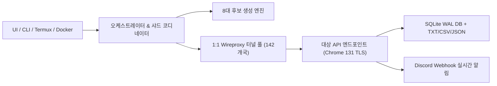

<div align="center">

<p align="center">
  <a href="../../README.md">🇺🇸 English</a> · <strong>🇰🇷 한국어</strong> · <a href="./ja.md">🇯🇵 日本語</a> · <a href="./zh-CN.md">🇨🇳 中文</a> · <a href="./es.md">🇪🇸 Español</a> · <a href="./de.md">🇩🇪 Deutsch</a><br />
  <a href="./fr.md">🇫🇷 Français</a> · <a href="./pt-BR.md">🇧🇷 Português</a> · <a href="./ru.md">🇷🇺 Русский</a> · <a href="./hi.md">🇮🇳 हिन्दी</a> · <a href="./ar.md">🇸🇦 العربية</a> · <a href="./id.md">🇮🇩 Bahasa Indonesia</a>
</p>

# ⚡ D4UC (`discord-checker`)

> **고성능 디스코드 희귀 사용자명 가용성 탐색 엔진 — Chrome 131 TLS 위장, 1:1 격리 다중 국가 터널 풀 및 SQLite WAL 분할 샤딩.**

[](https://github.com/KRCUPRO/discord-checker/releases/tag/v12.0.0)
[](../../LICENSE)
[](https://www.python.org/)
[](../GUIDE.md)
[](../specs/01_NETWORK_CORE_ENGINE.md)

<sub>Copyright (c) 2026 KRCUPRO · 독점 소프트웨어 라이선스 (All Rights Reserved)</sub>

</div>

---

<details open>
<summary><b>🌟 개요 및 핵심 기능</b></summary>

기존 사용자명 체커 스크립트는 현대 WAF/엣지 방어 환경에서 세 가지 구조적 병목에 직면합니다:
1. **TLS 핑거프린트 차단**: 일반 HTTP 라이브러리는 인위적인 JA3/JA4 지문으로 인해 Cloudflare/WAF에 즉시 차단됩니다.
2. **OS 전체 VPN 간섭**: 데스크톱 VPN 클라이언트를 켜면 내 PC 전체 인터넷과 DNS가 덮어씌워집니다.
3. **429 연쇄 멈춤 및 다중 창 충돌**: 속도 제한 시 전체 워커가 멈추고, 여러 창을 띄우면 결과 파일이 덮어써지거나 잠깁니다.

**D4UC (`discord-checker`)** 는 완전히 격리된 크로스 플랫폼 아키텍처로 세 문제를 모두 해결합니다:
- **Chrome 131 TLS JA3/JA4 스텔스 위장**: `curl_cffi` (BoringSSL) 기반으로 실제 Chrome 131 브라우저와 동일한 TLS 핸드셰이크 및 HTTP 헤더를 전송합니다.
- **1:1 유저스페이스 WireGuard 터널 풀 (`wireproxy`)**: 워커마다 142개 글로벌 엔드포인트를 독립 로컬 포트(`127.0.0.1:1081+`)에 1:1 바인딩하여 OS 네트워크 카드를 전혀 건드리지 않습니다.
- **0.3초 원자적 429 핫스왑**: 레이트리밋을 맞은 해당 워커만 즉시 신선한 국가 노드로 교체되며 다른 워커는 중단 없이 유지됩니다.
- **수학적 분할 샤딩 & SQLite WAL 동기화**: 전수 조사를 2·3·4분할(`2_1`, `2_2`, `4_1`–`4_4`)로 나누어 `data/d4uc_results.db`에 중복 검사 0%로 동시 기록합니다.

</details>

---

<details open>
<summary><b>🥊 기존 스크립트 vs D4UC v12 비교 매트릭스</b></summary>

| 평가 항목 | 기존 사용자명 스크립트 | ⚡ D4UC v12 (`discord-checker`) |
| :--- | :---: | :---: |
| **TLS 핸드셰이크 위장** | ❌ `requests` / `aiohttp` 지문 차단 | **✅ BoringSSL Chrome 131 JA3/JA4 스텔스 위장** |
| **호스트 네트워크 격리** | ❌ PC 전체 VPN 강제 적용 | **✅ 유저스페이스 `wireproxy` 워커 1:1 독립 풀** |
| **429 속도 제한 복구** | ❌ 전체 일시정지 또는 중단 | **✅ 워커 단위 0.3초 원자적 핫스왑 + 쿨다운 큐** |
| **다중 창/컨테이너 샤딩** | ❌ 중복 검사 및 파일 경합 | **✅ 수학적 무중복 분할 + SQLite WAL 동시 동기화** |
| **지원 플랫폼 및 UI** | ⚠️ CLI 스크립트 단일 지원 | **✅ 데스크톱 GUI(한/영), Rich CLI, Android Termux, Multi-Arch Docker** |
| **보안 및 저장소 위생** | ⚠️ 키 하드코딩 유출 위험 | **✅ 철저한 `.gitignore`, `.env` 주입 & 더미 템플릿** |

</details>

---

<details open>
<summary><b>🧬 8대 닉네임 생성 엔진 및 샤딩</b></summary>

| 모드 키 | 생성 전략 | 권장 용도 |
| :--- | :--- | :--- |
| `hybrid` | 사전 단어 어간 + 대칭/숫자 변형 결합 | 깔끔하고 실용적인 닉네임 신속 탐색 |
| `permutation` | 수학적 완전 순열 (`a–z`, `0–9`, `_`) | 2/3/4분할 샤딩(`2_1`, `2_2`) 기반 전수조사 |
| `dictionary` | 3–6자 영단어, 음절, 발음 가능 조합 | 의미 있는 레어 단어 발굴 |
| `pattern` | 대칭/반복 패턴 (`aaaa`, `abba`, `abab`) | 시각적으로 희귀한 구조 탐색 |
| `numeric` | 연속/반복 숫자 조합 (`0000`–`9999`) | 짧은 레어 숫자 아이디 탐색 |
| `custom_mask` | 접두사·접미사·중간점 마스크 (`??.vip`, `kr??`) | 특정 이니셜/브랜드/점 위치 지정 |
| `combinatorial` | 음운 구조 기반 CVCV / VCCV 음절 생성 | 발음 가능한 독창적 네이밍 |
| `recheck` | 과거 `TAKEN` 이력 주기적 재점검 | 탈퇴/변경으로 풀린 닉네임 포착 |

</details>

---

<details open>
<summary><b>🏛️ 시스템 아키텍처 및 디렉토리 구조</b></summary>



```text
discord-checker/
├── config/                  # .env.example & config.example.yaml 템플릿
├── data/                    # 142개 글로벌 클러스터 목록 & 자격증명 템플릿
├── deploy/                  # Dockerfile, docker-compose.yml, Termux & PyInstaller 스크립트
├── docs/                    # 통합 가이드, 11개국어 번역, 아키텍처 맵 & 상세 명세
├── src/                     # GUI(한/영), 헤드리스 CLI & 모듈형 코어 엔진
├── tests/                   # 자동화 회귀·동시성 테스트 스위트 (68종)
├── CHANGELOG.md             # 버전별 변경 이력
├── LICENSE                  # 독점 라이선스 (KRCUPRO)
├── NOTICE                   # 오픈소스 서드파티 고지
├── README.md                # 영문 대표 README
├── requirements.txt         # Python 의존성 목록
└── SECURITY.md              # 보안 및 시크릿 보호 정책
```

</details>

---

<details open>
<summary><b>🚀 4대 플랫폼 빠른 시작</b></summary>

#### 1. 데스크톱 GUI (Windows / Desktop)
```bash
git clone https://github.com/KRCUPRO/discord-checker.git
cd discord-checker
python -m venv .venv
.\.venv\Scripts\activate
pip install -r requirements.txt

# 한국어 / 영어 GUI 실행
python src/gui_ko.py
python src/gui_en.py
```

#### 2. 헤드리스 CLI & 다중 분할 샤딩
```bash
# 기본 하이브리드 스캔 (5워커)
python src/run.py

# 4자리 전수조사 2분할 1번 창 (a–m 범위)
python src/run.py --mode permutation --length 4 --shard 2_1 --workers 5

# 백그라운드 데몬용 스트리밍 로그 모드
python src/run.py --no-dashboard
```

#### 3. 도커 & 멀티 컨테이너 샤딩 (Docker)
```bash
# 환경변수 템플릿 복사 후 개인키 입력
cp config/.env.example .env

# 단일 백그라운드 컨테이너 실행
docker compose -f deploy/docker-compose.yml up -d

# 2분할 병렬 컨테이너 동시 기동 (2배속)
docker compose -f deploy/docker-compose.yml --profile 2shard up -d
```
> 상세 매뉴얼: [Docker 가이드](../guides/DOCKER_GUIDE.md)

#### 4. 안드로이드 모바일 Termux (`proot-distro debian`)
```bash
chmod +x deploy/install_debian.sh deploy/run.sh
./deploy/install_debian.sh

termux-wake-lock
nohup ./deploy/run.sh --no-dashboard > output.log 2>&1 &
```
> 상세 매뉴얼: [Termux Debian 가이드](../guides/TERMUX_DEBIAN_GUIDE.md)

</details>

---

<details>
<summary><b>⚙️ 설정 및 환경 변수 (.env)</b></summary>

[config/.env.example](../../config/.env.example)을 `.env`로 복사하거나 [config/config.example.yaml](../../config/config.example.yaml)을 `config/config.yaml`로 복사해 사용하세요:

```ini
SURFSHARK_PRIVATE_KEYS=YOUR_SURFSHARK_WIREGUARD_PRIVATE_KEY_HERE
D4UC_MODE=hybrid
D4UC_LENGTH=4
D4UC_WORKERS=5
D4UC_PROXY=surfshark
D4UC_WEBHOOK=
```

자세한 보안 수칙은 [보안 정책](../../SECURITY.md)과 [마스터 가이드](../GUIDE.md)를 참고하세요.

</details>

---

<details open>
<summary><b>📄 라이선스 및 저작권</b></summary>

Copyright (c) 2026 **KRCUPRO**. All Rights Reserved.  
[독점 및 기밀 소프트웨어 라이선스 (LICENSE)](../../LICENSE)에 따라 보호됩니다.  
서드파티 오픈소스 고지 사항은 [NOTICE](../../NOTICE)를 참고하세요.

</details>
