<div align="center">

# 🏛️ D4UC 아키텍처 매핑 및 시스템 구조도 (ARCHITECTURE_MAP.md)

> **무결성 비동기 병렬화, 0% 충돌 영구 동기화, TLS 스텔스 위장 및 1:1 유저스페이스 터널 격리**

<br />

| [KR 한국어](./ARCHITECTURE_MAP.md) | [US English](../en/ARCHITECTURE_MAP.md) | [JP 日本語](../ja/ARCHITECTURE_MAP.md) | [CN 简体中文](../zh-CN/ARCHITECTURE_MAP.md) | [ES Español](../es/ARCHITECTURE_MAP.md) |
| :---: | :---: | :---: | :---: | :---: |
| [FR Français](../fr/ARCHITECTURE_MAP.md) | [DE Deutsch](../de/ARCHITECTURE_MAP.md) | [RU Русский](../ru/ARCHITECTURE_MAP.md) | [BR Português](../pt-BR/ARCHITECTURE_MAP.md) | [SA العربية](../ar/ARCHITECTURE_MAP.md) |

<p align="center"><sub>🌐 Also available: <a href="../hi/ARCHITECTURE_MAP.md">HI हिन्दी</a> • <a href="../id/ARCHITECTURE_MAP.md">ID Bahasa Indonesia</a></sub></p>

<br />

[](./CHANGELOG.md)
[](./ARCHITECTURE_MAP.md)

</div>

---

<a id="목차"></a>
## 📑 목차
1. [1. 시스템 계층 아키텍처 (Layered Architecture)](#-1-시스템-계층-아키텍처-layered-architecture)
2. [2. 엔드투엔드 처리 흐름 (End-to-End Execution Flow)](#-2-엔드투엔드-처리-흐름-end-to-end-execution-flow)
3. [3. 고처리량 동시성 및 데드락 방지 구조](#-3-고처리량-동시성-및-데드락-방지-구조)
4. [4. 데이터 영속성 및 동기화 (SQLite WAL)](#-4-데이터-영속성-및-동기화-sqlite-wal)
5. [5. 보안 및 네트워크 격리 메커니즘](#-5-보안-및-네트워크-격리-메커니즘)

---

## 💎 핵심 설계 원칙
- **무결성 비동기 병렬화**: `asyncio` 이벤트 루프 기반으로 최대 50개 워커가 논블로킹 병렬 처리.
- **0% 충돌 영구 동기화**: SQLite WAL(Write-Ahead Logging) 및 `busy_timeout=5000ms`로 다중 프로세스 충돌 방지.
- **TLS 스텔스 위장**: `curl_cffi`를 통해 Chrome 131 JA3/JA4 핸드셰이크를 100% 동일하게 재현.
- **1:1 유저스페이스 터널 격리**: `wireproxy`를 활용하여 호스트 OS 네트워크 영향 없이 프로세스 격리 라우팅.

---

<a id="-1-시스템-계층-아키텍처-layered-architecture"></a>
## 🏛️ 1. 시스템 계층 아키텍처 (Layered Architecture)

```mermaid
graph TD
    subgraph Layer 1: Presentation ["1. Presentation Layer (UI / CLI)"]
        GUI_KO["src/gui_ko.py (Korean GUI)"]
        GUI_EN["src/gui_en.py (English GUI)"]
        GUI_WEB["src/web_gui.py (Mobile Touch Web GUI / PWA)"]
        CLI["src/run.py (Headless CLI + Rich Dashboard)"]
    end

    subgraph Layer 2: Orchestration ["2. Orchestration & Worker Loop"]
        ORCH["Orchestrator / Async Worker Loop"]
        METRICS["DashboardMetrics (RPS, Available, Taken, 429)"]
        SHARD["Sharding Coordinator (2_1, 2_2, 3_1...)"]
    end

    subgraph Layer 3: Network & Stealth ["3. Network & TLS Stealth"]
        CLIENT["DiscordApiClient (curl_cffi AsyncSession)"]
        TLS["Chrome 131 TLS JA3/JA4 Fingerprint"]
        HEADERS["Browser Headers (sec-ch-ua, Referer, Accept)"]
    end

    subgraph Layer 4: Proxy Infrastructure ["4. Proxy Infrastructure & Multi-Tunnel"]
        UPM["UnifiedProxyManager"]
        SURF["SurfsharkProxyProvider (1:1 Multi-Tunnel)"]
        FREE["FreeProxyProvider (18 Open-Source Pools)"]
        WIRE["Wireproxy Process Daemon (User-Space Netstack)"]
        COOLDOWN["429 Cooldown Queue & 0.3s Atomic Hot-Swap Engine"]
    end

    subgraph Layer 5: Candidate Generator ["5. Candidate Username Generator Engine"]
        GEN_FACT["create_generator() Factory"]
        HYBRID["HybridGenerator"]
        PERM["PermutationGenerator (Sharded Math Engine)"]
        DICT["DictionaryGenerator"]
        MASK["CustomMaskGenerator"]
        OTHER_GEN["Pattern / Numeric / Combinatorial / Recheck"]
    end

    subgraph Layer 6: Storage & Notify ["6. Persistent Storage & Notifications"]
        STORAGE["StorageManager (Async Queue Worker)"]
        SQLITE["SQLite WAL (d4uc_results.db, busy_timeout=5s)"]
        MIRROR["Legacy Mirror (available.txt, taken.txt)"]
        WEBHOOK["DiscordWebhookNotifier (0.1s Dispatch)"]
    end

    GUI_KO & GUI_EN & GUI_WEB & CLI --> ORCH
    ORCH --> GEN_FACT
    GEN_FACT --> HYBRID & PERM & DICT & MASK & OTHER_GEN
    ORCH --> CLIENT
    CLIENT --> TLS & HEADERS
    ORCH --> UPM
    UPM --> SURF & FREE & WIRE & COOLDOWN
    ORCH --> STORAGE
    STORAGE --> SQLITE & MIRROR & WEBHOOK
```



### Layer 1: 프레젠테이션 계층 (Presentation)
`src/gui_ko.py` (한글 GUI), `src/gui_en.py` (영문 GUI), `src/web_gui.py` (모바일 Web GUI / PWA), `src/run.py` (헤드리스 Rich CLI).

### Layer 2: 오케스트레이션 계층 (Orchestration)
백그라운드 워커 풀 루프, 대시보드 텔레메트리 메트릭스(RPS, 가용, 사용중, 429), 샤딩 분할 제어기(`2_1`, `2_2`).

### Layer 3: 네트워크 및 TLS 스텔스 위장 (Network & Stealth)
`DiscordApiClient` (curl_cffi AsyncSession), Chrome 131 TLS 지문 및 완벽한 브라우저 헤더 에뮬레이션.

### Layer 4: 프록시 인프라 및 다중 터널 (Proxy Infrastructure)
`UnifiedProxyManager`, `SurfsharkProxyProvider` (1:1 Multi-Tunnel), `FreeProxyProvider` (공개 프록시 풀), 429 원자적 핫스왑 큐.

### Layer 5: 후보 닉네임 생성 엔진 (Candidate Generator)
`create_generator()` 팩토리: 순열(Permutation), 하이브리드, 딕셔너리, 커스텀 마스크, 패턴, 숫자, 조합형, 재검증.

### Layer 6: 스토리지 및 알림 계층 (Storage & Notify)
`StorageManager` (비동기 큐 워커), SQLite WAL(`d4uc_results.db`), 레거시 txt 미러링(`available.txt`, `taken.txt`), Discord Webhook 푸시.


[⬆️ 목차 맨 위로 이동](#목차)

---

<a id="-2-엔드투엔드-처리-흐름-end-to-end-execution-flow"></a>
## 🔄 2. 엔드투엔드 처리 흐름 (End-to-End Execution Flow)

```text
[Candidate Generator] ──(Next Batch)──> [Orchestrator Worker Pool]
                                                    │
                                            (Lease Isolated SOCKS5)
                                                    ▼
                                        [Unified Proxy Manager]
                                                    │
                                          (Chrome 131 TLS Impersonation)
                                                    ▼
                                        [Discord API Endpoint]
                                                    │
                                         (Response Dispatch)
                        ┌───────────────────────────┴───────────────────────────┐
                        ▼                                                       ▼
               HTTP 200 / Taken                                         HTTP 429 Rate Limit
                        │                                                       │
        ┌───────────────┴───────────────┐                             (0.3s Atomic Hot-Swap)
        ▼                               ▼                                       ▼
 [SQLite WAL Storage]       [Discord Webhook Push]                  [Rotate to Fresh Country]
```

[⬆️ 목차 맨 위로 이동](#목차)

---

<a id="-3-고처리량-동시성-및-데드락-방지-구조"></a>
## ⚡ 3. 고처리량 동시성 및 데드락 방지 구조

- **Non-blocking Concurrency**: All network I/O operations are scheduled on Python's native `asyncio` event loop.
- **429 Atomic Hot-Swap**: When an isolated worker hits Discord's 429 rate limit, its specific Wireproxy local port is seamlessly reassigned to an available server node in under 0.3s without affecting concurrent workers.
- **Zero Lock Deadlock**: SQLite WAL journal mode coupled with Python-level queueing completely eliminates `database is locked` operational exceptions.

[⬆️ 목차 맨 위로 이동](#목차)

---

<a id="-4-데이터-영속성-및-동기화-sqlite-wal"></a>
## 💾 4. 데이터 영속성 및 동기화 (SQLite WAL)

- **Primary Database**: `data/d4uc_results.db` configured with `PRAGMA journal_mode = WAL` and `PRAGMA synchronous = NORMAL`.
- **Text File Mirroring**: For maximum legacy compatibility, all newly verified rare handles are concurrently appended to `available.txt` and `checked_history.txt`.

[⬆️ 목차 맨 위로 이동](#목차)

---

<a id="-5-보안-및-네트워크-격리-메커니즘"></a>
## 🛡️ 5. 보안 및 네트워크 격리 메커니즘

- **Zero-Leak Policy**: All local credentials, WireGuard configuration files, and secrets are strictly excluded from version control.
- **User-Space Network Isolation**: All proxy traffic is terminated in user space (`wireproxy`), preventing interference with system-wide DNS or routing tables.

[⬆️ 목차 맨 위로 이동](#목차)
