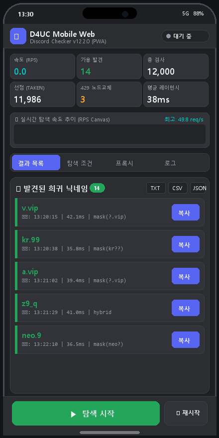
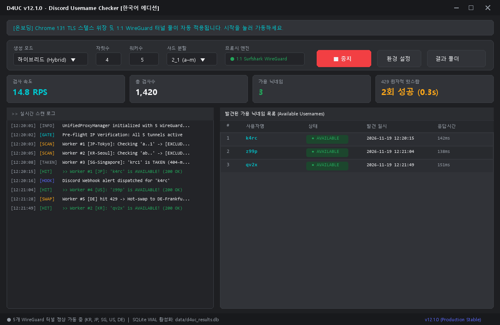
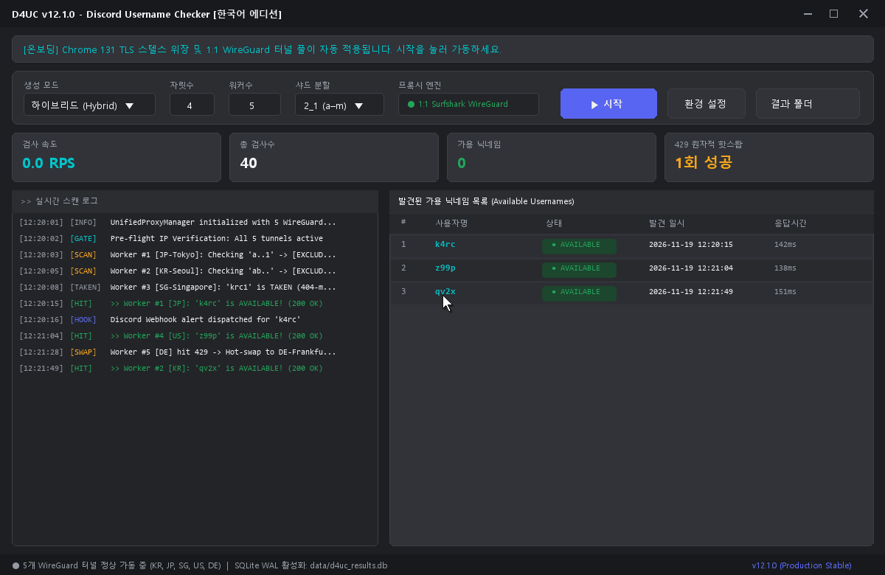
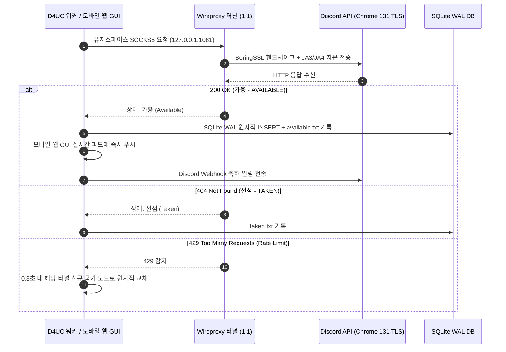

<div align="center">

# ⚡ D4UC (`discord-checker`) v12.2.0

> **고성능 디스코드 희귀 사용자명 가용성 탐색 엔진**  
> 모바일 반응형 웹 GUI & PWA · Chrome 131 TLS 스텔스 위장 · 1:1 유저스페이스 다중 WireGuard 터널 풀 · 0.3초 원자적 429 핫스왑 · SQLite WAL 다중 분할 샤딩

<br />

| [KR 한국어](./README.md) | [US English](../en/README.md) | [JP 日本語](../ja/README.md) | [CN 简体中文](../zh-CN/README.md) | [ES Español](../es/README.md) |
| :---: | :---: | :---: | :---: | :---: |
| [FR Français](../fr/README.md) | [DE Deutsch](../de/README.md) | [RU Русский](../ru/README.md) | [BR Português](../pt-BR/README.md) | [SA العربية](../ar/README.md) |

<p align="center"><sub>🌐 Also available: <a href="../hi/README.md">HI हिन्दी</a> • <a href="../id/README.md">ID Bahasa Indonesia</a></sub></p>

[](./CHANGELOG.md)
[](https://github.com/KRCUPRO/discord-checker/releases/tag/v12.4.0)
[](./LICENSE.md)
[](https://www.python.org/)
[](../../guides/README.md)
[](../../specs/01_NETWORK_CORE_ENGINE.md)
[](https://colab.research.google.com/github/KRCUPRO/discord-checker/blob/main/D4UC_Google_Colab.ipynb)
[](gas/README.md)
[](docs/MOBILE_AND_IPHONE_GUIDE.md)

<sub>Copyright (c) 2026 KRCUPRO · 독점 소프트웨어 라이선스 (All Rights Reserved)</sub>

</div>

---

> ### ☁️ 100% 클라우드 무설치: 구글 코랩(Google Colab) & 구글 앱스 스크립트(GAS) 24시간 무인 구동
> **PC나 복잡한 프로그램 설치 일체 불필요!** **아이폰(Safari), 아이패드, 갤럭시(Android), 태블릿, PC** 등 기종과 운영체제에 상관없이 브라우저만으로 즉시 실행됩니다.
> - 🚀 **[Google Colab 원클릭 실행](https://colab.research.google.com/github/KRCUPRO/discord-checker/blob/main/D4UC_Google_Colab.ipynb)**: 10개국어 실시간 전환 지원 인셀(In-Cell) 웹 대시보드(`src/ui/colab_gui.py`), 구글 드라이브 영구 저장(`drive_sync.py`), 디스코드 웹훅 실시간 전송.
> - ⏱️ **[구글 앱스 스크립트 24/7 체커](gas/README.md)**: 스마트폰 전원을 끄거나 컴퓨터를 종료해도 구글 서버리스 인프라에서 24시간 365일 무중단 자동 감시.
> - 📱 **[모바일 & 아이폰/태블릿 클라우드 가이드](docs/MOBILE_AND_IPHONE_GUIDE.md)**: 모바일 브라우저 1분 원스톱 가이드. <- 파일 없는 경우 : 위에 내용 참고

<a id="-목차"></a><a id="목차"></a>
## 📑 목차
1. [📸 인터페이스 미리보기](#-인터페이스-미리보기)
2. [✨ 주요 기능](#-주요-기능)
3. [🖥️ 필수 환경 & 필요한 라이브러리](#-필수-환경-필요한-라이브러리)
4. [📁 프로젝트 구조](#-프로젝트-구조)
5. [🌐 프록시 설정 & 🔑 프록시 인증 정보](#-프록시-설정-프록시-인증-정보)
6. [🚀 설치 및 실행](#-설치-및-실행)
7. [📱 모바일 웹 GUI & PWA 원격 제어 가이드](#-모바일-웹-gui-pwa-원격-제어-가이드)
8. [🧵 스레드 개수 설정](#-스레드-개수-설정)
9. [🔢 사용자명 생성 방식](#-사용자명-생성-방식)
10. [🚫 생성에서 제외되는 사용자명 (예시: `ab..`, `a..1`)](#-생성에서-제외되는-사용자명-예시-ab-a1)
11. [📡 사용자명 체커 동작](#-사용자명-체커-동작)
12. [🔄 프록시 Session 관리](#-프록시-session-관리)
13. [🔁 오류 발생 시 재시도](#-오류-발생-시-재시도)
14. [💾 결과 파일](#-결과-파일)
15. [📊 실시간 체커 통계](#-실시간-체커-통계)
16. [🛑 체커 중지](#-체커-중지)
17. [⚠️ Rate Limit](#-rate-limit)
18. [🔧 문제 해결](#-문제-해결)
19. [📞 문의 디스코드 : myuyayam](#-문의-디스코드-myuyayam)
20. [⭐ 프로젝트 지원 (GitHub Star)](#-프로젝트-지원-github-star)
21. [📚 공부 및 학습 목적](#-공부-및-학습-목적)

---

<a id="-인터페이스-미리보기"></a><a id="인터페이스-미리보기"></a>
## 📸 인터페이스 미리보기

### 모바일 터치 최적화 반응형 웹 GUI (PWA - iPhone & Android)
[](../../guides/MOBILE_IOS_GUIDE.md)

### 모바일 웹 실시간 조작 데모 (1-Tap 터치 제어 & 실시간 텔레메트리)
[](../../guides/MOBILE_IOS_GUIDE.md)

### 데스크톱 GUI 실행 화면
[](../../guides/WINDOWS_GUIDE.md)

### 실시간 GUI 동작 데모 (자연스러운 마우스 조작)
[](../../guides/WINDOWS_GUIDE.md)

### 헤드리스 CLI 대시보드
[](../../guides/TERMUX_DEBIAN_GUIDE.md)

### Docker & Linux 서버 배포 환경
[](../../guides/DOCKER_GUIDE.md)

[⬆️ 목차 맨 위로 이동](#-목차)

---

<a id="-주요-기능"></a><a id="주요-기능"></a>
## ✨ 주요 기능
- **☁️ 100% 클라우드 무설치 구동 (Google Colab & GAS 24/7)**: PC 없이 아이폰(Safari), 아이패드, 갤럭시, 태블릿에서 브라우저만으로 구동. 10개국어 실시간 UI, 구글 드라이브/시트 영구 저장 및 24시간 365일 무인 감시 트리거 지원.

1. **모바일 반응형 웹 GUI & PWA 엔진 (`http://<host>:5000`)**:
   - PC, VPS, Docker, Termux 어디서든 기동하여 스마트폰(iPhone Safari, Android Chrome) 브라우저로 원격 제어할 수 있습니다.
   - **홈 화면에 추가 (PWA)** 기능을 기본 지원하여 앱스토어 설치 없이 네이티브 전체화면 모바일 앱으로 실행됩니다.
   - 대형 터치 친화적 [탐색 시작/중지] 버튼, 실시간 RPS 캔버스 차트, 1-Tap 닉네임 원클릭 복사, TXT/CSV/JSON 즉시 다운로드를 제공합니다.
   - 프록시(Surfshark 개인키 풀, 커스텀 파일, Thordata), 8대 생성 모드, 워커 슬라이더(1~50개)를 스마트폰에서 즉시 원격 설정 및 핫스왑할 수 있습니다.

2. <a id="fnref-1"></a><a id="fnref1"></a>**Chrome 131 TLS JA3/JA4 스텔스 위장 (`curl_cffi` BoringSSL)[^1]**:
   - 일반 Python HTTP 라이브러리(`requests`, `aiohttp`, `httpx`)에서 감지되는 비정상 TLS 핑거프린트를 완전히 탈피했습니다.
   - 실제 최신 Google Chrome 131 브라우저의 암호화 스위트(Cipher Suites), 확장 필드(Extensions), 타원 곡선(Supported Groups), HTTP/2 SETTINGS 프레임 시그니처를 100% 동일하게 에뮬레이션하여 Cloudflare 및 WAF의 사전 차단을 원천 무력화합니다.

3. <a id="fnref-2"></a><a id="fnref2"></a>**1:1 유저스페이스 WireGuard 터널 풀 (`wireproxy`)[^2]**:
   - 데스크톱 VPN 클라이언트처럼 호스트 OS의 네트워크 어댑터를 가로채거나 라우팅 테이블을 변경하지 않습니다.
   - 유저스페이스에서 동작하는 경량 `wireproxy` 바이너리를 통하여 워커마다 독립된 로컬 포트(`127.0.0.1:1081+`)를 할당하며, 글로벌 142개 엔드포인트를 1:1로 매핑합니다.
   - 메인 PC의 업무, 웹서핑, 게임, 메신저 트래픽에는 0.00%의 속도 저하 및 IP 간섭도 발생하지 않습니다.

4. **0.3초 원자적 429 핫스왑 (Atomic Rate-Limit Recovery)**:
   - 특정 워커가 Discord API의 429 Rate Limit에 도달하더라도 전체 프로세스가 일시 정지되거나 중단되지 않습니다.
   - 429를 수신한 해당 워커만 0.3초 이내에 다른 국가 엔드포인트(예: `JP-Tokyo` ➔ `KR-Seoul`)로 즉시 교체되며, 나머지 형제 워커들은 정상 속도로 검사를 계속 유지합니다.

5. **수학적 무중복 분할 샤딩 (Mathematical Sharding)**:
   - 4자리 전수조사(`permutation`) 및 대규모 조합 스캔 시 수학적 오프셋 분할 알고리즘(`2_1`, `2_2`, `4_1`–`4_4` 등)을 지원합니다.
   - 여러 개의 GUI 창, CLI 터미널, 도커 컨테이너를 동시에 실행해도 서로 다른 후보군을 검사하므로 중복 요청이 0건입니다.

6. **SQLite WAL 멀티 프로세스 동시 기록 & 레거시 포맷 미러링**:
   - 고성능 동시성 저장을 위해 `PRAGMA journal_mode = WAL`이 적용된 SQLite(`data/d4uc_results.db`)를 주 데이터베이스로 사용합니다.
   - 발견 즉시 기존 텍스트 파일(`available.txt`, `taken.txt`, `checked_history.txt`) 및 CSV/JSON 포맷으로도 실시간 원자적 미러링을 수행합니다.

7. **8대 지능형 닉네임 생성 엔진**:
   - 하이브리드, 완전 순열, 사전 단어, 대칭 패턴, 숫자 배열, 커스텀 마스크, 음절 조합, 과거 이력 재점검 등 8가지 전문 생성 모드를 탑재했습니다.

8. **크로스 플랫폼 지원**:
   - Windows 10/11 전용 4종 단독 실행 파일(`.exe`), 모바일 웹 PWA, Linux/macOS 헤드리스 CLI, Android Termux 모바일 원클릭 스크립트, Multi-Arch Docker 컨테이너를 모두 제공합니다.

[⬆️ 목차 맨 위로 이동](#-목차)

---

<a id="-필수-환경-필요한-라이브러리"></a><a id="필수-환경-필요한-라이브러리"></a>
## 🖥️ 필수 환경 & 필요한 라이브러리

### 1. 런타임 요구 사양
- **운영체제**: Windows 10/11 (64-bit), Linux (Debian 11+, Ubuntu 20.04+, Arch, Alpine), macOS 12+ (Apple Silicon / Intel), Android 10+ (Termux), iOS Safari (웹 UI 접속)
- **Python 버전**: Python 3.10, 3.11, 3.12 (권장: **Python 3.12**)
- **메모리(RAM)**: 최소 512 MB 이상 (50워커 가동 시 약 250 MB 점유)
- **네트워크**: 광대역 인터넷 (Surfshark WireGuard UDP 통신 포트 51820 허용 환경)

### 2. 핵심 Python 라이브러리 (`requirements.txt`)
- `curl_cffi >= 0.7.0`: Chrome 131 BoringSSL TLS 지문 위장 엔진
- `customtkinter >= 5.2.0`: 모던 다크 테마 데스크톱 GUI
- `rich >= 13.7.0`: 실시간 CLI 대시보드 및 터미널 시각화
- `pydantic >= 2.6.0`: 환경 설정 유효성 검증
- `pyyaml >= 6.0.1`: YAML 설정 파일 파싱
- `pillow >= 10.2.0`: GUI 이미지 처리 및 아이콘 렌더링

[⬆️ 목차 맨 위로 이동](#-목차)

---

<a id="-프로젝트-구조"></a><a id="프로젝트-구조"></a>
## 📁 프로젝트 구조

```text
discord-checker/
├── config/                         # 설정 템플릿 및 환경 변수
│   ├── .env.example                # 시크릿 환경 변수 예시 파일
│   └── config.example.yaml         # 상세 설정 YAML 템플릿
├── data/                           # 데이터베이스 및 글로벌 클러스터 정보
│   ├── surfshark_endpoints.json    # 142개 글로벌 WireGuard 클러스터 공용 엔드포인트
│   └── d4uc_results.db (생성됨)     # 발견된 닉네임 SQLite WAL 데이터베이스
├── deploy/                         # 배포, 컨테이너, APK 및 빌드 스크립트
│   ├── android/                    # 안드로이드 네이티브 앱 프로젝트 (com.krcupro.discordchecker)
│   ├── build_apk.py                # 안드로이드 스마트폰 설치 패키지(.apk) 빌드 스크립트
│   ├── build_exe.py                # 4종 Windows .exe 자동 패키징 스크립트
│   ├── docker-compose.yml          # 도커 컴포즈 (단일 및 2shard 프로파일)
│   ├── Dockerfile                  # Multi-Arch 경량 컨테이너 이미지 명세
│   ├── generate_assets.py          # 고해상도 시각 자산 생성기
│   ├── generate_badges.py          # 12개 언어 1:1 현지화 SVG 배지 생성기
│   ├── generate_mobile_assets.py   # 모바일 PWA 스크린샷 및 데모 GIF 생성기
│   ├── install_debian.sh           # Termux / Debian 원클릭 의존성 설치 스크립트
│   └── run.sh                      # 헤드리스 백그라운드 원클릭 실행 스크립트
├── docs/                           # 기술 문서, 다국어 매뉴얼 및 가이드
│   ├── assets/                     # 고해상도 스크린샷, 데모 GIF, 배지
│   │   ├── badges/                 # 12개 언어 SVG 배지 (update_badge.svg 등)
│   │   ├── mobile_web_main.png     # 모바일 웹 GUI 스마트폰 화면 캡처
│   │   ├── mobile_web_demo.gif     # 모바일 웹 GUI 1-Tap 터치 데모 GIF
│   │   ├── gui_ko_main.png         # 한국어 GUI 메인 스크린샷
│   │   ├── gui_ko_demo.gif         # 한국어 GUI 실시간 데모 GIF
│   │   ├── cli_dashboard.png       # Rich CLI 대시보드 스크린샷
│   │   └── docker_linux_capture.png# 도커 리눅스 실행 캡처
│   ├── guides/                     # 플랫폼별 심층 가이드
│   │   ├── MOBILE_IOS_GUIDE.md     # iOS 모바일 PWA 환경 안내 및 원격 제어
│   │   ├── PC_GUIDE.md             # Windows / macOS PC 설정 가이드
│   │   ├── DOCKER_GUIDE.md         # Docker & Compose 컨테이너 가이드
│   │   └── TERMUX_DEBIAN_GUIDE.md  # Android Termux 배포 가이드
│   └── locales/                    # 11개 언어 1:1 완벽 번역 문서 (ja, zh-CN, es 등)
├── src/                            # 소스 코드 핵심 엔진
│   ├── generator/                  # 8대 닉네임 생성 엔진 및 규칙 필터
│   ├── network/                    # Chrome 131 TLS 클라이언트 및 백오프 로직
│   ├── notify/                     # Discord Webhook 실시간 알림 모듈
│   ├── proxy/                      # 1:1 WireGuard 터널 풀 및 유저스페이스 매니저
│   ├── storage/                    # SQLite WAL & 레거시 텍스트 저장소
│   ├── ui/                         # 다국어(i18n), 툴팁, CLI 대시보드
│   │   └── web/                    # 모바일 PWA 웹 인터페이스 (HTML5/CSS3/Vanilla JS)
│   ├── web_gui.py                  # 모바일 반응형 웹 GUI & REST API 백엔드
│   ├── gui.py                      # CustomTkinter GUI 오케스트레이터 코어
│   ├── gui_ko.py                   # 한국어 GUI 전용 진입점
│   ├── gui_en.py                   # 영어 GUI 전용 진입점
│   └── run.py                      # 헤드리스 CLI 실행 진입점
├── tests/                          # 단위/통합 회귀 테스트 스위트
├── CHANGELOG.md                    # 버전별 상세 릴리스 노트
├── LICENSE                         # 독점 소프트웨어 라이선스 (KRCUPRO)
├── NOTICE                          # 서드파티 오픈소스 고지
├── README.md                       # 영문 글로벌 대표 문서
├── requirements.txt                # Python 의존성 목록
└── SECURITY.md                     # 보안 및 시크릿 유출 방지 가이드라인
```

[⬆️ 목차 맨 위로 이동](#-목차)

---

<a id="-프록시-설정-프록시-인증-정보"></a><a id="프록시-설정-프록시-인증-정보"></a>
## 🌐 프록시 설정 & 🔑 프록시 인증 정보

D4UC는 IP 차단과 Rate Limit을 완벽하게 우회하기 위해 **Surfshark WireGuard 유저스페이스 1:1 터널 풀**을 탑재하고 있습니다.

### 1. 설정 방법
1. 저장소 루트의 `config/.env.example`을 복사하여 `.env` 파일을 생성합니다:
   ```bash
   cp config/.env.example .env
   ```
2. `.env` 파일을 열고 Surfshark 계정의 WireGuard 개인키(Private Key)를 입력합니다:
   ```ini
   # 콤마(,)로 구분하여 최대 수십 개의 개인키를 멀티 계정 풀로 등록 가능
   SURFSHARK_PRIVATE_KEYS=YOUR_WIREGUARD_PRIVATE_KEY_1_HERE,YOUR_WIREGUARD_PRIVATE_KEY_2_HERE
   
   # 워커 수 (기본: 5, 최대: 50)
   D4UC_WORKERS=5
   
   # 디스코드 웹훅 알림 (선택)
   D4UC_WEBHOOK=https://discord.com/api/webhooks/YOUR_WEBHOOK_ID/YOUR_WEBHOOK_TOKEN
   ```

### 2. 무료 공개 프록시 자동 수집 & 실시간 멀티스레드 검증기 (`--proxy free`) [v12.3.0 신규]
유료 VPN이나 프록시 결제 없이 100% 무료로 탐색을 진행할 수 있는 오픈소스 공개 프록시 수집/검증 엔진을 지원합니다:
- **자동 다중 소스 수집**: GitHub 및 Hugging Face에서 실시간 업데이트되는 14개 이상의 공개 프록시 목록(TheSpeedX, monosans, hookzof, roosterkid, ShiftyTR, mertguvencli, Hugging Face)을 고속 병렬 수집합니다.
- **다중 프로토콜 지원**: HTTP, HTTPS, SOCKS4, SOCKS5 무료 프록시를 완벽 지원합니다.
- **실시간 고속 비동기 검증 게이트**: 실제 Discord 사용자명 API 엔드포인트(`username-attempt-unauthed`) 및 Cloudflare 엣지 연결성을 실시간 테스트하여 불량 노드, 3,500ms 초과 고지연 노드, 403 WAF 차단 노드를 100% 자동 필터링합니다.
- **서킷 브레이커 & 429 노드 순환**: 429 Rate Limit 수신 시 해당 노드를 15초간 자동 격리(Cooldown)하고 최저 지연 시간 활성 노드로 즉시 핫스왑 전환하며, 백그라운드에서 주기적으로 프록시 풀을 자동 갱신합니다.
- **UI 지원**:
  - **데스크톱 GUI**: 프록시 선택창에서 `🌐 무료 프록시 자동 수집 (Free Public)` 선택 후 `[🔄 무료 프록시 수집 & 검증]` 버튼으로 실시간 검증 및 가용 수량 배지 확인.
  - **모바일 웹 GUI**: 프록시 설정 탭에서 1-탭 `🔄 무료 프록시 수집 & 검증` 버튼 터치 및 `/api/proxy/scrape`, `/api/proxy/free_status` REST API 제공.
  - **헤드리스 CLI**: `python src/run.py --proxy free` (또는 `-p free`) 옵션으로 자동 수집/검증 후 즉시 탐색 시작.

### 3. 철저한 보안 원칙 (Zero-Leak Policy)
- 개인키, 설정 파일(`.env`, `config.yaml`), 프록시 자격증명 파일은 프로젝트 내의 `.gitignore`에 의해 엄격히 제외되어 있습니다.
- 깃허브 커밋이나 외부에 절대 노출되지 않도록 설계되어 있으며, 커밋 시 자동으로 비밀값 유출 여부를 정밀 검사합니다.

[⬆️ 목차 맨 위로 이동](#-목차)

---

<a id="-설치-및-실행"></a><a id="설치-및-실행"></a>
## 🚀 설치 및 실행
### ☁️ 방식 0: 100% 클라우드 무설치 (Google Colab & 구글 앱스 스크립트 24시간 무인 체커)
> **아이폰, 아이패드, 갤럭시, 태블릿 사용자 또는 파이썬 설치 없이 즉시 실행하려는 분들에게 권장합니다.**

1. **Google Colab 노트북 구동**:
   - [](https://colab.research.google.com/github/KRCUPRO/discord-checker/blob/main/D4UC_Google_Colab.ipynb) 배지를 클릭하여 코랩에서 노트북을 엽니다.
   - 3개 셀을 순서대로 실행합니다: 환경 준비 ➔ 구글 드라이브 및 웹훅 설정 ➔ 대화형 인셀 웹 대시보드 기동.
   - 10개국어(`ko`, `en`, `ja`, `zh`, `es`, `ru`, `fr`, `de`, `pt`, `vi`) 실시간 언어 전환 및 실시간 발견 닉네임 표를 제공합니다.
   - 발견된 유효 닉네임과 진행 상태는 내 구글 드라이브(`/content/drive/MyDrive/D4UC/`)에 영구 보관됩니다.
2. **구글 앱스 스크립트(GAS) 24시간 무인 체커**:
   - [gas/README.md](gas/README.md) 및 [docs/GAS_24H_CHECKER_GUIDE.md](docs/GAS_24H_CHECKER_GUIDE.md) 안내에 따라 `gas/D4UC_Checker.js`를 복사하여 [script.google.com](https://script.google.com/)에 붙여넣고 `setupChecker()`를 1회 실행합니다.
   - 스마트폰이나 컴퓨터 전원을 꺼도 구글 인프라에서 시간 기반 트리거로 24시간 365일 무인 실행됩니다.
   - 유효 닉네임 발견 시 디스코드 웹훅으로 즉시 스마트폰 알림이 전송됩니다.
3. **모바일 전용 상세 가이드**: [docs/MOBILE_AND_IPHONE_GUIDE.md](docs/MOBILE_AND_IPHONE_GUIDE.md)를 참조하세요.


### 방법 A: Windows 전용 실행 파일 (`.exe`) & 안드로이드 패키지 (`.apk`) — 무설치 원클릭
Python 설치 없이 바로 실행하고자 하는 경우, [GitHub Releases v12.3.0](https://github.com/KRCUPRO/discord-checker/releases/tag/v12.4.0)에서 설치 파일을 다운로드합니다:
- `DiscordUsernameChecker_v12.3.0.apk`: **안드로이드 스마트폰 전용 1-탭 설치 패키지** [NEW]
- `DiscordUsernameCheckerV2_Web.exe`: **모바일 웹 GUI & PWA 서버 (포트 5000)**
- `DiscordUsernameCheckerV2_KO.exe`: 한국어 데스크톱 GUI
- `DiscordUsernameCheckerV2_EN.exe`: 영어 데스크톱 GUI
- `DiscordUsernameCheckerV2_CLI.exe`: 헤드리스 콘솔 CLI 대시보드

### 방법 A-1: 안드로이드 스마트폰 전용 설치 패키지 (`.apk`) — 1-탭 원클릭 설치 [NEW]
갤럭시, 픽셀, 샤오미 등 모든 안드로이드 스마트폰에 직접 설치하여 1-탭으로 간편하게 사용:
- **다운로드**: [`DiscordUsernameChecker_v12.3.0.apk`](https://github.com/KRCUPRO/discord-checker/releases/download/v12.3.0/DiscordUsernameChecker_v12.3.0.apk)
- **설치 및 사용 가이드**:
  1. 위 링크에서 `.apk` 파일을 다운로드합니다.
  2. 다운로드 완료 후 파일 알림을 터치하거나 '내 파일' 앱에서 실행합니다.
  3. 보안 설정에서 **"출처를 알 수 없는 앱 허용"**을 승인하고 **[설치]**를 완료합니다.
  4. 홈 화면의 **`D4UC Discord Checker`** 아이콘을 눌러 즉시 실행합니다.
- **주요 모바일 기능**:
  - 12개 언어 지원 Discord-Dark 터치 반응형 웹 GUI가 오프라인 내장되어 단독 실행 (`assets/www/index.html`)
  - 1-터치 네이티브 안드로이드 클립보드 복사 및 시스템 토스트(Toast) 팝업 알림
  - 화면 꺼짐 방지 Wake Lock (`WAKE_LOCK`) 토글 지원으로 안정적 연속 탐색
  - PC 또는 원격 서버의 D4UC 백엔드 IP에 1-클릭으로 연결하여 고속 원격 제어

### 방법 B: 모바일 반응형 웹 GUI 실행 (스마트폰 제어)
```bash
# 모바일 웹 GUI 서버 기동 (기본 포트: 5000)
python src/web_gui.py --port 5000

# 스마트폰 Safari / Chrome 브라우저에서 동일 Wi-Fi PC IP로 접속:
# http://192.168.0.x:5000
```

### 방법 C: 데스크톱 GUI 및 헤드리스 CLI 실행
```bash
# 가상환경 생성 및 실행
python -m venv .venv
.\.venv\Scripts\Activate.ps1
pip install -r requirements.txt

# 한국어 데스크톱 GUI 실행
python src/gui_ko.py

# CLI 대시보드 실행
python src/run.py --mode hybrid --length 4 --workers 5
```

[⬆️ 목차 맨 위로 이동](#-목차)

---

<a id="-모바일-웹-gui-pwa-원격-제어-가이드"></a><a id="모바일-웹-gui-pwa-원격-제어-가이드"></a>
## 📱 모바일 웹 GUI & PWA 원격 제어 가이드
### 📱 100% 기종 무관 클라우드 실행 (아이폰, 아이패드, 갤럭시, 태블릿 전 기종 지원)
로컬 PWA 실행 외에도, **Google Colab** 및 **구글 앱스 스크립트(GAS)**를 통해 완전한 무설치 클라우드 구동이 가능합니다:
- **아이폰 / 아이패드 Safari**: 모바일 사파리에서 `D4UC_Google_Colab.ipynb`를 열어 즉시 실행 (PC 필요 없음).
- **24시간 무인 백그라운드**: 구글 앱스 스크립트를 통해 기기 화면이 꺼져 있어도 24시간 365일 연속 감시.
- **실시간 스마트폰 알림**: 유효 닉네임 발견 시 디스코드 모바일 앱으로 웹훅 실시간 푸시 알림 수신.
- 상세 가이드: [docs/MOBILE_AND_IPHONE_GUIDE.md](docs/MOBILE_AND_IPHONE_GUIDE.md).


스마트폰에서 침대에 누워 편안하게 희귀 닉네임 탐색을 감시하고 제어할 수 있습니다.

### 1. 홈 화면에 추가 (PWA 네이티브 모바일 앱 설치)
1. 스마트폰(iPhone Safari 또는 Android Chrome)을 켜고 `http://<PC의 로컬 IP>:5000`에 접속합니다.
2. **iPhone Safari**: 브라우저 하단 공유 버튼(네모+화살표) ➔ **"홈 화면에 추가"** 탭
3. **Android Chrome**: 우측 상단 더보기(⋮) ➔ **"홈 화면에 추가"** 또는 **"앱 설치"** 탭
4. 홈 화면에 생성된 보라색 **D4UC Web** 아이콘을 터치하면 주소창 없는 전체화면 네이티브 앱으로 실행됩니다.

### 2. 모바일 터치 제어 기능
- **실시간 대형 텔레메트리**: 초당 속도(RPS), 가용 발견, 총 검사, 선점, 429 핫스왑, 레이턴시를 30ms 단위로 실시간 확인.
- **실시간 속도 캔버스 그래프**: 프레임워크 없는 순수 HTML5 캔버스로 탐색 속도 곡선을 매끄럽게 렌더링.
- **1-Tap 닉네임 즉시 복사**: 마음에 드는 가용 닉네임 옆 [복사] 버튼을 터치하면 진동/토스트 알림과 함께 클립보드 복사.
- **원클릭 내보내기**: 상단 [TXT], [CSV], [JSON] 버튼으로 스마트폰에 즉시 다운로드.
- **모바일 원격 설정 핫스왑**:
  - 생성 모드 8종(하이브리드, 순열, 사전, 대칭, 숫자, 마스크, 조합, 재점검) 탭 전환
  - 자릿수(3~6자) 및 샤딩 분할(2_1, 2_2 등) 즉시 변경
  - 워커 슬라이더(1~50개)를 통한 동시성 실시간 무중단 확장/축소 (Hot-Scale)
  - Surfshark WireGuard 개인키 및 프록시 설정 모바일에서 원격 저장

[⬆️ 목차 맨 위로 이동](#-목차)

---

<a id="-스레드-개수-설정"></a><a id="스레드-개수-설정"></a>
## 🧵 스레드 개수 설정

- **기본 권장값**: `5` 워커 (RPS 약 12~15)
- **안정성 중심 (단일 터널/저사양)**: `1` ~ `3` 워커
- **초고속 전수 스캔 (다중 터널 풀 확보 시)**: `10` ~ `20` 워커 (최대 50 워커 지원)
- **원칙**:
  - D4UC는 1개의 워커마다 1개의 독립된 WireGuard 터널 포트를 1:1로 매핑합니다.
  - 워커 수가 5개이면 로컬 포트 `1081`, `1082`, `1083`, `1084`, `1085`가 각각 독립된 국가 엔드포인트(예: 일본, 한국, 싱가포르, 미국, 독일)로 라우팅됩니다.
  - 따라서 스레드를 늘려도 IP가 분산되므로 Discord 서버로부터 429 차단을 맞을 확률이 대폭 감소합니다.

[⬆️ 목차 맨 위로 이동](#-목차)

---

<a id="-사용자명-생성-방식"></a><a id="사용자명-생성-방식"></a>
## 🔢 사용자명 생성 방식

D4UC는 탐색 목적에 맞는 **8가지 생성 엔진**을 제공합니다:

| 모드 키 | 생성 전략 | 동작 상세 및 예시 |
| :--- | :--- | :--- |
| `hybrid` (권장) | 단어 어간 + 대칭/숫자 변형 | 실용적이고 깔끔한 레어 아이디 발굴 (예: `krc1`, `v1be`, `neo9`) |
| `permutation` | 수학적 완전 순열 | `a-z`, `0-9`, `_` 조합 전수 탐색 (`2_1`, `2_2` 샤딩 지원) |
| `dictionary` | 3~6글자 영단어 어휘 사전 | 영단어, 발음 가능한 2~3음절 고가치 단어 탐색 |
| `pattern` | 시각적 대칭/반복 패턴 | `aaaa`, `abba`, `abab`, `aabb` 등 시각적 레어 패턴 |
| `numeric` | 순차 및 반복 숫자 | `0000`–`9999`, 포커 넘버(`7777`, `1234`) 탐색 |
| `custom_mask` | 접두사·접미사·중간점 마스크 | `kr??`, `??99`, `??.??` 등 커스텀 패턴 지정 탐색 |
| `combinatorial` | 음운학적 CVCV / VCCV 구조 | 자음+모음+자음 조합으로 발음 가능한 신규 브랜드명 생성 |
| `recheck` | 기존 `TAKEN` 목록 재점검 | 과거 선점되었던 닉네임 중 회원 탈퇴/변경으로 풀린 계정 추적 |

[⬆️ 목차 맨 위로 이동](#-목차)

---

<a id="-생성에서-제외되는-사용자명-예시-ab-a1"></a><a id="생성에서-제외되는-사용자명-예시-ab-a1"></a>
## 🚫 생성에서 제외되는 사용자명 (예시: `ab..`, `a..1`)

Discord 사용자명 정책(Community Guidelines & Username Rules)에 위배되는 잘못된 닉네임은 시간과 네트워크 자원을 낭비하지 않도록 **후보 생성 단계에서 100% 사전에 제외**됩니다:

1. **연속된 마침표 금지 (`..`)**:
   - ❌ `ab..` (후행 연속 점) ➔ **자동 제외**
   - ❌ `a..1` (중간 연속 점) ➔ **자동 제외**
   - ❌ `..kr` (선행 연속 점) ➔ **자동 제외**
2. **선행 및 후행 마침표 금지 (`.`)**:
   - ❌ `.abc` (점으로 시작) ➔ **자동 제외**
   - ❌ `abc.` (점으로 끝남) ➔ **자동 제외**
3. **특수문자 제한**:
   - 영문 소문자(`a-z`), 숫자(`0-9`), 밑줄(`_`), 마침표(`.`) 외의 모든 기호(`@`, `#`, `$`, `-`, 공백 등)는 제외됩니다.
4. **글자수 제한**:
   - Discord 정책에 따라 2자 미만 또는 32자 초과 닉네임은 생성되지 않습니다 (기본 타깃: 4자리 희귀 닉네임).
5. **Discord 예약어 및 금지어**:
   - `discord`, `clyde`, `here`, `everyone`, `system` 등 시스템 예약 닉네임은 자동 필터링됩니다.

> 모든 규칙은 `src/generator/base.py`의 `DiscordRuleValidator.is_valid()`에 의해 엄격하게 검증되며, `tests/test_exclusion_rules.py`의 84개 테스트를 통해 무결성이 입증되었습니다.

[⬆️ 목차 맨 위로 이동](#-목차)

---

<a id="-사용자명-체커-동작"></a><a id="사용자명-체커-동작"></a>
## 📡 사용자명 체커 동작



[⬆️ 목차 맨 위로 이동](#-목차)

---

<a id="-프록시-session-관리"></a><a id="프록시-session-관리"></a>
## 🔄 프록시 Session 관리

- **단일 책임 비동기 세션**:
  - 각 워커는 고유한 `curl_cffi.requests.AsyncSession` 인스턴스를 유지합니다.
  - 워커마다 바인딩된 Wireproxy 로컬 포트를 통해 모든 HTTP 요청을 직렬화하여 연결 재사용(Keep-Alive) 효율을 극대화합니다.
- **연결 누수 0%**:
  - 체커 종료 시 등록된 모든 비동기 세션을 정상 `close()`하며, 백그라운드 Wireproxy 서브프로세스를 완전히 회수(Zero-Zombie)합니다.

[⬆️ 목차 맨 위로 이동](#-목차)

---

<a id="-오류-발생-시-재시도"></a><a id="오류-발생-시-재시도"></a>
## 🔁 오류 발생 시 재시도

1. **일시적 네트워크 타임아웃 / DNS 오류**:
   - 지수 백오프(Exponential Backoff: 0.5s ➔ 1.0s ➔ 2.0s)를 적용하여 최대 3회 자동 재시도합니다.
2. **Cloudflare WAF 챌린지 감지**:
   - TLS 핸드셰이크가 왜곡되거나 WAF 챌린지 페이지가 반환되면 해당 세션을 파기하고 즉시 터널을 리셋합니다.
3. **429 Rate Limit 감지**:
   - 즉시 쿨다운 큐로 이동하고, 해당 터널은 0.3초 내에 새로운 국가 엔드포인트로 핫스왑됩니다.

[⬆️ 목차 맨 위로 이동](#-목차)

---

<a id="-결과-파일"></a><a id="결과-파일"></a>
## 💾 결과 파일

탐색 결과는 무결성을 보장하기 위해 다중 계층으로 영구 보존됩니다:

| 파일 경로 | 저장 형식 | 용도 및 보존 방식 |
| :--- | :--- | :--- |
| `data/d4uc_results.db` | **SQLite (WAL 모드)** | 트랜잭션 보장, 다중 프로세스 동시 기록, 가용/선점/일시/레이턴시 전체 인덱싱 |
| `available.txt` | UTF-8 텍스트 | 가용(Available) 사용자명만 한 줄에 하나씩 실시간 추가 기록 |
| `taken.txt` | UTF-8 텍스트 | 이미 선점된 사용자명 목록 (재점검 모드용) |
| `checked_history.txt` | UTF-8 텍스트 | 중복 검사 방지용 전체 스캔 이력 캐시 |
| `available_usernames.csv` | CSV 포맷 | 타 분석 툴 연동용 스프레드시트 포맷 |
| `available_usernames.json`| JSON 포맷 | REST API 및 웹 대시보드 연동용 구조화 데이터 |

[⬆️ 목차 맨 위로 이동](#-목차)

---

<a id="-실시간-체커-통계"></a><a id="실시간-체커-통계"></a>
## 📊 실시간 체커 통계

모바일 웹 GUI, 데스크톱 GUI 상단 카드 및 CLI 대시보드를 통해 다음 지표가 30ms 단위로 실시간 렌더링됩니다:
- **Scan Speed (RPS)**: 초당 검사 완료 요청 수 (Rolling Window 5초 평균)
- **Total Checked**: 현재 세션에서 검사 완료된 총 사용자명 수
- **Available Count**: 발견된 희귀 가용 닉네임 총합
- **Taken Count**: 이미 사용 중인 닉네임 수
- **429 Hot-Swaps**: 무중단 원자적 프록시 노드 교체 성공 횟수
- **Latency**: 각 터널별 Discord API 응답 왕복 시간(ms)

[⬆️ 목차 맨 위로 이동](#-목차)

---

<a id="-체커-중지"></a><a id="체커-중지"></a>
## 🛑 체커 중지

- **모바일 웹 GUI**: 하단의 붉은색 `■ 탐색 중지` 버튼을 탭하면 즉시 새로운 요청 발송이 중단되고 대기 상태로 전환됩니다.
- **데스크톱 GUI**: 상단의 `■ 중지` 버튼을 누르면 즉시 세션이 안전하게 플러시된 후 0.5초 이내에 대기 상태로 전환됩니다.
- **CLI**: `Ctrl + C` 인터럽트 신호 입력 시 `SIGINT` 핸들러가 동작하여 SQLite WAL 체크포인트를 안전하게 커밋하고 모든 백그라운드 프록시 포트를 정리한 후 정상 종료됩니다.

[⬆️ 목차 맨 위로 이동](#-목차)

---

<a id="-rate-limit"></a><a id="rate-limit"></a>
## ⚠️ Rate Limit

- Discord API는 단일 IP 주소당 짧은 시간 내 과도한 요청이 발생할 경우 `429 Too Many Requests` 상태와 함께 `retry_after` 헤더를 반환합니다.
- D4UC는 단일 IP에 부하를 집중시키지 않고 **142개 글로벌 WireGuard 터널 풀을 워커 단위로 분산 라우팅**하므로, 특정 터널이 Rate Limit에 도달해도 0.3초 만에 새 터널로 교체되어 작업이 영구 지속됩니다.

[⬆️ 목차 맨 위로 이동](#-목차)

---

<a id="-문제-해결"></a><a id="문제-해결"></a>
## 🔧 문제 해결

| 증상 | 원인 | 해결 방법 |
| :--- | :--- | :--- |
| 모바일 웹 접속 불가 | 스마트폰과 PC가 서로 다른 Wi-Fi 망에 접속됨 | PC와 스마트폰을 동일한 Wi-Fi 공유기에 연결하고 PC 방화벽에서 포트 5000 허용 여부를 확인하세요. |
| `Wireproxy binary not found` | wireproxy 실행 파일 누락 | `bin/wireproxy.exe`가 존재하는지 확인하거나 `deploy/build_exe.py`를 실행하세요. |
| `Port already in use: 1081` | 이전 작업 프로세스 잔존 | 작업 관리자에서 잔여 Python 또는 wireproxy 프로세스를 종료하세요. |
| 방화벽 허용 팝업이 뜨는 경우 | Windows Defender 방화벽 미등록 | PowerShell 관리자 권한으로 방화벽 허용 규칙을 등록하세요 (`../../guides/PC_GUIDE.md` 참조). |
| `No module named curl_cffi` | 가상환경 미활성화 | `.venv\Scripts\activate` 후 `pip install -r requirements.txt`를 실행하세요. |

[⬆️ 목차 맨 위로 이동](#-목차)

---

<a id="-문의-디스코드-myuyayam"></a><a id="문의-디스코드-myuyayam"></a>
## 📞 문의 디스코드 : myuyayam

- 기능 건의, 버그 제보, 기술 문의는 디스코드 **`myuyayam`** 으로 연락주시기 바랍니다.
- 비즈니스 및 엔터프라이즈 라이선스 관련 문의는 GitHub Repository Issues 또는 Discord DM을 이용해주세요.

[⬆️ 목차 맨 위로 이동](#-목차)

---

<a id="-프로젝트-지원-github-star"></a><a id="프로젝트-지원-github-star"></a>
## ⭐ 프로젝트 지원 (GitHub Star)

이 프로젝트가 마음에 드셨다면 저장소 우측 상단의 **Star(⭐)** 버튼을 눌러 응원해주세요!  
여러분의 스타와 피드백은 오픈소스 엔진 개발에 가장 큰 원동력이 됩니다.

[⬆️ 목차 맨 위로 이동](#-목차)

---

<a id="-공부-및-학습-목적"></a><a id="공부-및-학습-목적"></a>
## 📚 공부 및 학습 목적

> **[학습 및 연구 목적 고지 — Educational & Research Purpose Only]**
> 
> 본 소프트웨어는 **현대 네트워크 환경의 TLS 핑거프린트 보안 구조(Chrome 131 BoringSSL JA3/JA4), 모바일 PWA 반응형 인터페이스, 유저스페이스 터널링 아키텍처(Wireproxy), 그리고 SQLite WAL 동시성 제어 분할 샤딩**에 대한 순수한 기술 연구 및 컴퓨터 네트워크 학습 목적으로 제작되었습니다.
> 
> 1. 본 도구를 사용하여 특정 서비스에 대한 과도한 트래픽 유발, 서비스 거부(DoS), 시스템 운영 방해, 계정 무단 선점 등의 남용 행위를 엄격히 금지합니다.
> 2. 사용자는 해당 플랫폼의 서비스 이용약관(Terms of Service)과 관련 법령을 반드시 준수해야 하며, 본 도구의 부적절한 사용으로 인해 발생하는 모든 법적·행정적 책임은 전적으로 실행자 본인에게 있습니다.
> 3. 개발자 및 기여자는 사용자의 개별적 운용 결과에 대해 일체의 법적 보증이나 책임을 부담하지 않습니다.

[⬆️ 목차 맨 위로 이동](#-목차)

---

<a id="-각주-및-기술-참고문헌"></a><a id="각주-및-기술-참고문헌"></a><a id="footnote-heading"></a>
### 📚 각주 및 기술 참고문헌

<a id="footnote-1"></a><a id="fn-1"></a>
[^1]: Chrome 131 BoringSSL 핸드셰이크는 WAF의 TLS 핑거프린팅 차단을 원천 무력화합니다. [↩ 본문으로 돌아가기](#fnref-1) · [⬆️ 목차 맨 위로 이동](#-목차)

<a id="footnote-2"></a><a id="fn-2"></a>
[^2]: wireproxy는 사용자 영역에서 WireGuard 프로토콜을 SOCKS5 프록시로 변환하는 경량 Go 바이너리입니다. [↩ 본문으로 돌아가기](#fnref-2) · [⬆️ 목차 맨 위로 이동](#-목차)

[⬆️ 목차 맨 위로 이동](#-목차)
