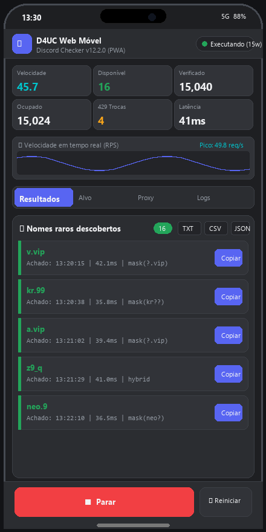
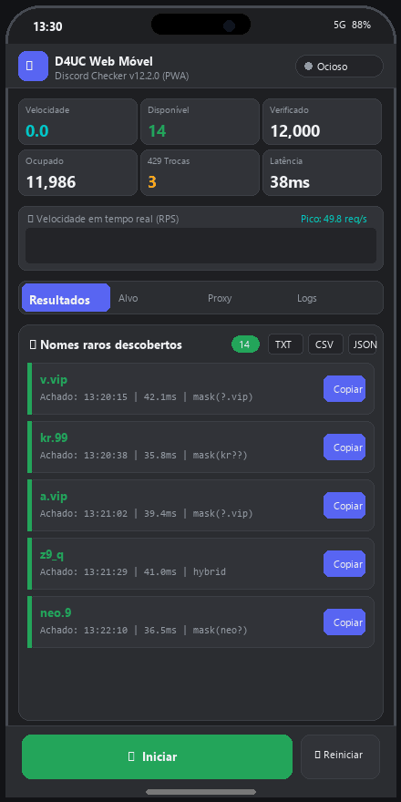
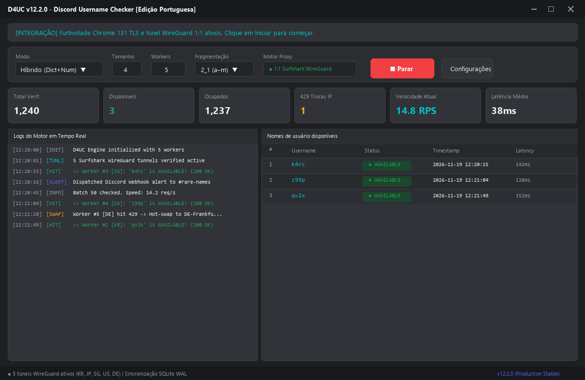
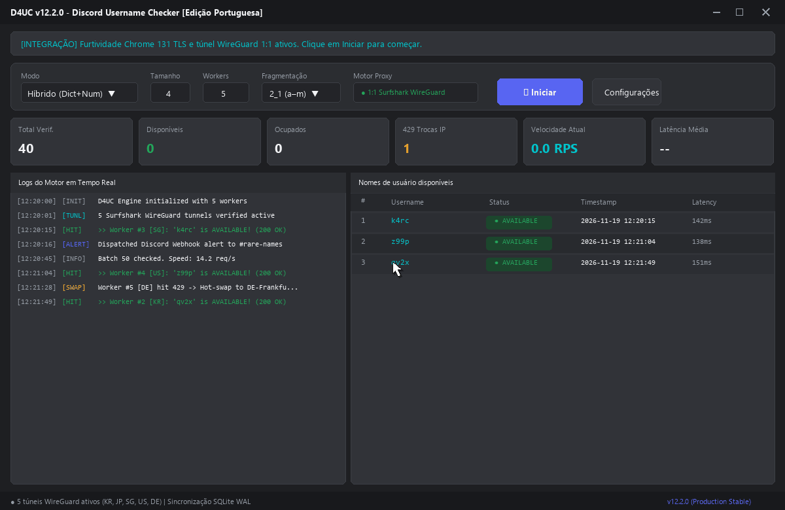
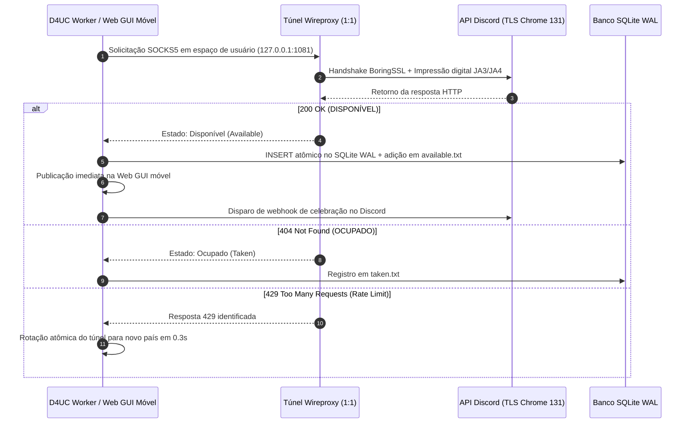

<div align="center">

# ⚡ D4UC (`discord-checker`) v12.2.0

> **Motor de Alta Performance para Disponibilidade de Nomes de Usuário Raros no Discord**  
> Web GUI Móvel Responsiva & PWA · Evasão TLS Chrome 131 · Túneis WireGuard 1:1 em Espaço de Usuário · Hot-Swap Atômico 429 em 0.3s · Sharding Concorrente SQLite WAL

<br />

| [KR 한국어](./ko.md) | [US English](../../README.md) | [JP 日本語](./ja.md) | [CN 简体中文](./zh-CN.md) | [ES Español](./es.md) |
| :---: | :---: | :---: | :---: | :---: |
| [FR Français](./fr.md) | [DE Deutsch](./de.md) | [RU Русский](./ru.md) | [BR Português](./pt-BR.md) | [SA العربية](./ar.md) |

<p align="center"><sub>🌐 Também disponível em: <a href="./hi.md">HI हिन्दी</a> · <a href="./id.md">ID Bahasa Indonesia</a></sub></p>

<br />

[](../../CHANGELOG.md)
[](https://github.com/KRCUPRO/discord-checker/releases/tag/v12.4.0)
[](../../LICENSE)
[](https://www.python.org/)
[](../guides/README.md)
[](../specs/01_NETWORK_CORE_ENGINE.md)
[](https://colab.research.google.com/github/KRCUPRO/discord-checker/blob/main/D4UC_Google_Colab.ipynb)
[](gas/README.md)
[](docs/MOBILE_AND_IPHONE_GUIDE.md)

<sub>Copyright (c) 2026 KRCUPRO · Licença Proprietária e Confidencial (Todos os direitos reservados)</sub>

</div>

---


> ### ☁️ 100% Cloud Sem Instalação: Google Colab e Google Apps Script 24/7
> **Sem necessidade de PC ou instalação!** Execute o D4UC diretamente na nuvem em **qualquer dispositivo — iPhone (Safari), iPad, Android ou Tablet** usando apenas o navegador.
> - 🚀 **[Abrir no Google Colab](https://colab.research.google.com/github/KRCUPRO/discord-checker/blob/main/D4UC_Google_Colab.ipynb)**: Painel Web interativo com suporte a 10 idiomas, sincronização no Google Drive e Webhooks do Discord em tempo real.
> - ⏱️ **[Google Apps Script 24/7](gas/README.md)**: Execução contínua 24 horas por dia, 365 dias por ano na nuvem do Google, mesmo com o aparelho desligado.
> - 📱 **[Guia Mobile & iPhone](docs/MOBILE_AND_IPHONE_GUIDE.md)**: Configuração rápida em 1 minuto para navegadores móveis.

<a id="-índice"></a><a id="índice"></a>
## 📑 Índice
1. [📸 Visualização da Interface](#-visualização-da-interface)
2. [✨ Recursos Principais](#-recursos-principais)
3. [🖥️ Requisitos de Sistema e Dependências](#-requisitos-de-sistema-e-dependências)
4. [📁 Estrutura de Diretórios](#-estrutura-de-diretórios)
5. [🌐 Configuração de Proxy & 🔑 Credenciais](#-configuração-de-proxy-credenciais)
6. [🚀 Instalação e Uso](#-instalação-e-uso)
7. [📱 Guia de Controle Remoto via Web GUI Móvel & PWA](#-guia-de-controle-remoto-via-web-gui-móvel-pwa)
8. [🧵 Concorrência e Quantidade de Workers](#-concorrência-e-quantidade-de-workers)
9. [🔢 Modos de Geração de Nomes](#-modos-de-geração-de-nomes)
10. [🚫 Regras Rígidas de Exclusão (Exemplos: `ab..`, `a..1`)](#-regras-rígidas-de-exclusão-exemplos-ab-a1)
11. [📡 Fluxo de Execução do Verificador](#-fluxo-de-execução-do-verificador)
12. [🔄 Gestão de Sessões de Proxy](#-gestão-de-sessões-de-proxy)
13. [🔁 Tratamento de Falhas e Novas Tentativas](#-tratamento-de-falhas-e-novas-tentativas)
14. [💾 Persistência dos Resultados](#-persistência-dos-resultados)
15. [📊 Métricas e Monitoramento em Tempo Real](#-métricas-e-monitoramento-em-tempo-real)
16. [🛑 Parando a Execução](#-parando-a-execução)
17. [⚠️ Estratégia Contra Rate Limit (429)](#-estratégia-contra-rate-limit-429)
18. [🔧 Solução de Problemas](#-solução-de-problemas)
19. [📞 Suporte via Discord: myuyayam](#-suporte-via-discord-myuyayam)
20. [⭐ Apoie o Projeto (GitHub Star)](#-apoie-o-projeto-github-star)
21. [📚 Declaração para Fins Educacionais e de Estudo](#-declaração-para-fins-educacionais-e-de-estudo)

---

<a id="-visualização-da-interface"></a><a id="visualização-da-interface"></a>
## 📸 Visualização da Interface

### Web GUI Móvel Responsiva com Otimização ao Toque (PWA - iPhone e Android)
[](../guides/MOBILE_IOS_GUIDE.md)

### Demonstração Móvel em Tempo Real (Controles a 1 Toque & Telemetria)
[](../guides/MOBILE_IOS_GUIDE.md)

### Interface de Desktop (Edição Portuguesa)
[](../guides/WINDOWS_GUIDE.md)

### Demonstração Desktop em Tempo Real (Interações Fluidas com Mouse)
[](../guides/WINDOWS_GUIDE.md)

### Painel CLI sem Interface Gráfica
[](../guides/TERMUX_DEBIAN_GUIDE.md)

### Implantação em Contêiner Docker & Servidor Linux
[](../guides/DOCKER_GUIDE.md)

[⬆️ Voltar ao topo](#-índice)

---

<a id="-recursos-principais"></a><a id="recursos-principais"></a>
## ✨ Recursos Principais
- **☁️ 100% Cloud Sem Instalação (Google Colab & GAS 24/7)**: Funciona no iPhone (Safari), iPad, Android ou Tablet sem PC. Interface em 10 idiomas, sincronização no Google Drive e monitoramento 24/7.

1. **Web GUI Móvel Responsiva & Motor PWA (`http://<host>:5000`)**:
   - Execute localmente ou em VPS/Docker/Termux e gerencie suas verificações a partir de qualquer smartphone (iPhone Safari, Android Chrome).
   - Suporte nativo para **"Adicionar à Tela de Início" (PWA)**, funcionando como aplicativo móvel em tela cheia sem lojas de aplicativos.
   - Botões táteis amplos de [Iniciar / Parar], gráfico dinâmico de velocidade RPS em Canvas HTML5 puro, cópia de nomes a 1 toque e download em TXT/CSV/JSON.
   - Configuração remota e hot-swap de proxies (chaves Surfshark, arquivos locais, Thordata), 8 modos de geração e ajuste de workers (1–50) pelo celular.

2. <a id="fnref-1"></a><a id="fnref1"></a>**Furtividade TLS Chrome 131 JA3/JA4 (`curl_cffi` BoringSSL)[^1]**:
   - Elimina as assinaturas TLS artificiais das bibliotecas comuns de Python (`requests`, `aiohttp`, `httpx`).
   - Reproduz bit a bit as Cipher Suites, Extensions e quadros HTTP/2 SETTINGS do navegador oficial Google Chrome 131 para neutralizar defesas Cloudflare e WAFs.

3. <a id="fnref-2"></a><a id="fnref2"></a>**Pool de Túneis WireGuard 1:1 em Espaço de Usuário (`wireproxy`)[^2]**:
   - Sem alterações nas placas de rede locais nem sequestro de rotas ou DNS do computador.
   - Mapeia 142 endpoints globais em portas locais exclusivas (`127.0.0.1:1081+`) por worker. As atividades normais no seu PC continuam sem qualquer impacto (0.00% de interferência).

4. **Hot-Swap Atômico 429 em 0.3 Segundo**:
   - Quando um worker atinge o Rate Limit HTTP 429 do Discord, o processo global não é interrompido.
   - Apenas aquele worker específico migra para outro país em menos de 300 ms, enquanto os demais continuam verificando em velocidade máxima.

5. **Sharding Matemático sem Duplicações**:
   - Suporta divisão de espaço de busca (`2_1`, `2_2`, `4_1`–`4_4`) para varreduras exaustivas.
   - Várias instâncias simultâneas analisam blocos disjuntos, garantindo 0 requisições repetidas.

6. **Banco de Dados SQLite WAL & Espelhamento Multiformato**:
   - Alta taxa de transferência e segurança transacional com SQLite no modo WAL (`data/d4uc_results.db`).
   - Nomes disponíveis são gravados atomicamente em arquivos de texto (`available.txt`, `taken.txt`), CSV e JSON.

7. **8 Motores Inteligentes de Geração**:
   - Híbrido, permutação matemática, dicionário, padrões simétricos, sequências numéricas, máscaras personalizadas, estruturas fonéticas e rechecagem histórica.

8. **Suporte Multiplataforma Completo**:
   - Executáveis autônomos para Windows (4 edições `.exe`), PWA móvel, terminal CLI Linux/macOS, instalador Android Termux e contêineres Docker.

[⬆️ Voltar ao topo](#-índice)

---

<a id="-requisitos-de-sistema-e-dependências"></a><a id="requisitos-de-sistema-e-dependências"></a>
## 🖥️ Requisitos de Sistema e Dependências

### Ambiente de Execução
- **Sistema Operacional**: Windows 10/11 (64-bit), Linux (Debian 11+, Ubuntu 20.04+, Arch), macOS 12+, Android 10+ (Termux), iOS Safari
- **Python**: 3.10, 3.11, 3.12 (Recomendado: **Python 3.12**)
- **Memória RAM**: Mínimo de 512 MB (~250 MB com 50 workers ativos)
- **Rede**: Banda larga (porta de saída UDP 51820 liberada para WireGuard)

### Dependências (`requirements.txt`)
- `curl_cffi >= 0.7.0`: Emulação TLS Chrome 131 BoringSSL
- `customtkinter >= 5.2.0`: Interface gráfica desktop moderna
- `rich >= 13.7.0`: Painel e telemetria para linha de comando
- `pydantic >= 2.6.0`: Validação de configurações
- `pyyaml >= 6.0.1`: Leitor de arquivos YAML
- `pillow >= 10.2.0`: Processamento de imagens e renderização

[⬆️ Voltar ao topo](#-índice)

---

<a id="-estrutura-de-diretórios"></a><a id="estrutura-de-diretórios"></a>
## 📁 Estrutura de Diretórios

```text
discord-checker/
├── config/                         # Modelos de configuração e .env.example
├── data/                           # Endpoints WireGuard e banco SQLite
├── deploy/                         # Scripts de compilação, Docker e recursos
│   ├── android/                    # Android native app project
│   ├── build_apk.py                # Android release APK builder
│   ├── build_exe.py                # Compilador de 4 executáveis Windows .exe
│   ├── docker-compose.yml          # Definições do Docker Compose
│   ├── Dockerfile                  # Especificação do conteneiner Multi-Arch
│   ├── generate_assets.py          # Gerador de capturas e demonstrações
│   ├── generate_badges.py          # Gerador de badges SVG em 12 idiomas
│   └── generate_mobile_assets.py   # Gerador de visuais móveis e GIF
├── docs/                           # Documentação, guías e assets
│   ├── assets/                     # Capturas de tela, GIFs e badges SVG
│   ├── guides/                     # Guias para iOS, PC, Docker e Termux
│   └── locales/                    # Traduções 1:1 em 11 idiomas
├── src/                            # Código-fonte principal
│   ├── generator/                  # 8 motores de geração e filtros
│   ├── network/                    # Cliente TLS Chrome 131 e recuo
│   ├── notify/                     # Notificações via webhook do Discord
│   ├── proxy/                      # Gerenciador do pool de túneis WireGuard
│   ├── storage/                    # Camada SQLite WAL e arquivos texto
│   ├── ui/                         # Multilinguismo, tooltips e CLI
│   │   └── web/                    # Interface Web PWA (HTML5/CSS3/Vanilla JS)
│   ├── web_gui.py                  # Servidor Web GUI móvel e API REST
│   ├── gui.py                      # Orquestrador CustomTkinter para PC
│   ├── gui_ko.py                   # Inicializador desktop coreano
│   ├── gui_en.py                   # Inicializador desktop inglês
│   └── run.py                      # Inicializador de linha de comando
├── tests/                          # Suíte de testes unitários e de integração
├── CHANGELOG.md                    # Histórico detalhado de versões
├── LICENSE                         # Licença Proprietária (KRCUPRO)
├── README.md                       # Documentação mestre em inglês
└── SECURITY.md                     # Políticas de segurança e proteção
```

[⬆️ Voltar ao topo](#-índice)

---

<a id="-configuração-de-proxy-credenciais"></a><a id="configuração-de-proxy-credenciais"></a>
## 🌐 Configuração de Proxy & 🔑 Credenciais

O D4UC integra um **pool de túneis WireGuard 1:1 em espaço de usuário** através do `wireproxy`, garantindo desvio de bloqueios de IP de forma isolada.

### 1. Configuração
1. Duplique o arquivo `config/.env.example` para `.env` na raiz:
   ```bash
   cp config/.env.example .env
   ```
2. Adicione suas chaves privadas WireGuard da Surfshark no `.env`:
   ```ini
   # Múltiplas chaves separadas por vírgula para alta concorrência
   SURFSHARK_PRIVATE_KEYS=SUA_CHAVE_PRIVADA_1,SUA_CHAVE_PRIVADA_2
   
   # Concorrência (Padrão: 5, Máximo: 50)
   D4UC_WORKERS=5
   
   # Webhook do Discord para avisos imediatos (Opcional)
   D4UC_WEBHOOK=https://discord.com/api/webhooks/ID/TOKEN
   ```

### 2. Coletor e Validador Multithread de Proxies Públicos Gratuitos (`--proxy free`) [Novidade v12.3.0]
Operação 100% gratuita sem necessidade de planos VPN:
- **Raspagem multi-fonte automatizada**: Coleta contínua de mais de 14 repositórios no GitHub e conjuntos de dados no Hugging Face (TheSpeedX, monosans, hookzof, roosterkid, ShiftyTR, mertguvencli, Hugging Face).
- **Suporte multi-protocolo**: Suporte completo a proxies HTTP, HTTPS, SOCKS4 e SOCKS5.
- **Validação assíncrona em tempo real**: Teste de conexão contra endpoints reais do Discord e Cloudflare, filtrando nós inativos, latências > 3500ms e bloqueios WAF 403.
- **Controle de 429 e renovação em segundo plano**: Isolamento de 15s para nós em rate limit e rotação dinâmica para o nó mais veloz.
- **Acesso unificado**: Disponível no menu da GUI Desktop, no botão 1-toque da Web Móvel e pelo CLI `--proxy free` (ou `-p free`).

### 3. Política de Fuga Zero (Zero-Leak Policy)
- Chaves privadas e configurações sensíveis são estritamente mantidas fora do Git via `.gitignore` e verificadas antes de cada publicação.

[⬆️ Voltar ao topo](#-índice)

---

<a id="-instalação-e-uso"></a><a id="instalação-e-uso"></a>
## 🚀 Instalação e Uso
### ☁️ Método 0: 100% Cloud Sem Instalação (Google Colab e Google Apps Script 24/7)
> **Recomendado para iPhone, iPad, Android, Tablet ou para quem não tem Python instalado.**

1. **Notebook Google Colab**: Clique em [](https://colab.research.google.com/github/KRCUPRO/discord-checker/blob/main/D4UC_Google_Colab.ipynb) para iniciar o painel web em 10 idiomas.
2. **Google Apps Script 24/7**: Veja [gas/README.md](gas/README.md) para executar verificações contínuas 24/7 nos servidores do Google.
3. **Guia Mobile**: Veja [docs/MOBILE_AND_IPHONE_GUIDE.md](docs/MOBILE_AND_IPHONE_GUIDE.md).


### Método A: Executáveis Autônomos para Windows (`.exe`)
Baixe as versões compiladas em [GitHub Releases v12.2.0](https://github.com/KRCUPRO/discord-checker/releases/tag/v12.4.0):
- `DiscordUsernameChecker_v12.3.0.apk`: **Pacote Nativo para Android (1 Toque)** [NOVO]
- `DiscordUsernameCheckerV2_Web.exe`: **Servidor Web GUI Móvel & PWA (Porta 5000)** [NOVO]
- `DiscordUsernameCheckerV2_EN.exe`: Interface desktop em inglês
- `DiscordUsernameCheckerV2_KO.exe`: Interface desktop em coreano
- `DiscordUsernameCheckerV2_CLI.exe`: Painel de terminal CLI

### 📱 Pacote Nativo para Android (`.apk`) — Instalação em 1 Toque [NEW]
- **Download direto**: [`DiscordUsernameChecker_v12.3.0.apk`](https://github.com/KRCUPRO/discord-checker/releases/download/v12.3.0/DiscordUsernameChecker_v12.3.0.apk)
- **Guia de instalação**:
  1. Baixe o arquivo `.apk` no seu smartphone Android (Galaxy, Pixel, Xiaomi, etc.).
  2. Toque no arquivo baixado na barra de notificações ou no gerenciador de arquivos.
  3. Ative a permissão para instalar aplicativos de fontes desconhecidas e toque em **[Instalar]**.
  4. Abra o **`D4UC Discord Checker`** na tela inicial.
- **Recursos móveis**:
  - Interface escura sensível ao toque offline integrada em 12 idiomas (`assets/www/index.html`).
  - Cópia para a área de transferência e notificações Toast nativas do Android.
  - Bloqueio de suspensão da tela Wake Lock (`WAKE_LOCK`) durante a busca.
  - Conexão remota ao backend D4UC no computador via Wi-Fi ou IP.

### Método B: Executar a Web GUI Móvel (Controle por Celular)
```bash
# Iniciar o servidor web móvel (Porta padrão: 5000)
python src/web_gui.py --port 5000

# Conecte o smartphone na mesma rede Wi-Fi e acesse no navegador:
# http://<IP_LOCAL_DO_SEU_PC>:5000
```

### Método C: Execução a partir do Código-Fonte
```bash
python -m venv .venv
source .venv/bin/activate  # Windows: .\.venv\Scripts\Activate.ps1
pip install -r requirements.txt

# Abrir GUI desktop
python src/gui_en.py

# Abrir modo CLI
python src/run.py --mode hybrid --length 4 --workers 5
```

[⬆️ Voltar ao topo](#-índice)

---

<a id="-guia-de-controle-remoto-via-web-gui-móvel-pwa"></a><a id="guia-de-controle-remoto-via-web-gui-móvel-pwa"></a>
## 📱 Guia de Controle Remoto via Web GUI Móvel & PWA
### 📱 Execução na Nuvem para Qualquer Aparelho (iPhone, iPad, Android, Tablet)
Além da PWA local, o D4UC pode ser executado 100% na nuvem pelo **Google Colab** e **Google Apps Script (GAS)**:
- **iPhone / iPad Safari**: Execute diretamente no Mobile Safari sem Mac ou PC.
- **Monitoramento 24/7**: Triggers do Google Apps Script continuam ativos mesmo com tela bloqueada ou celular desligado.
- **Notificações em Tempo Real**: Alertas no Discord ao encontrar um usuário disponível.
- Guia completo: [docs/MOBILE_AND_IPHONE_GUIDE.md](docs/MOBILE_AND_IPHONE_GUIDE.md).


Acompanhe os resultados e ajuste as opções diretamente pelo smartphone.

### 1. Adicionar à Tela de Início (Instalação PWA)
1. Acesse `http://<IP_DO_PC>:5000` pelo navegador do smartphone (iPhone Safari ou Android Chrome).
2. **iPhone Safari**: Toque em Compartilhar ➔ **"Adicionar à Tela de Início"**.
3. **Android Chrome**: Toque no menu (⋮) ➔ **"Adicionar à tela inicial"** ou **"Instalar aplicativo"**.
4. Toque no ícone **D4UC Web** para iniciar em tela cheia sem barras de navegação.

### 2. Funções Táteis no Celular
- **Cartões de Telemetria ao Vivo**: Acompanhe velocidade em RPS, disponíveis encontrados, total verificado, ocupados, trocas 429 e latência média (ms).
- **Gráfico Dinâmico em Canvas HTML5**: Visualização de fluxo de varredura ultraleve e sem bibliotecas externas.
- **Cópia de Nomes em 1 Toque**: Toque em [Copiar] ao lado do nome encontrado para transferi-lo imediatamente para a área de transferência.
- **Exportação Rápida**: Botões superiores de download em TXT, CSV ou JSON direto para o telefone.
- **Hot-Swap de Parâmetros**:
  - Troca dinâmica entre os 8 modos de geração
  - Alteração de tamanho (3 a 6 caracteres) e partições de sharding
  - Controle deslizante para escalar a quantidade de workers (1 a 50)
  - Modificação remota de chaves de proxy e configurações de rede

[⬆️ Voltar ao topo](#-índice)

---

<a id="-concorrência-e-quantidade-de-workers"></a><a id="concorrência-e-quantidade-de-workers"></a>
## 🧵 Concorrência e Quantidade de Workers

- **Valor recomendado**: `5` workers (12 a 15 RPS)
- **Modo econômico / Poucos recursos**: `1` a `3` workers
- **Varredura ultraveloz**: `10` a `20` workers (comporta até 50 workers)
- **Funcionamento**:
  - Cada worker recebe uma porta de túnel WireGuard individual (`1081`, `1082`, etc.).
  - 5 workers consultam o serviço através de 5 nós internacionais diferentes em simultâneo (Tóquio, Seul, Singapura, Frankfurt, Nova York).

[⬆️ Voltar ao topo](#-índice)

---

<a id="-modos-de-geração-de-nomes"></a><a id="modos-de-geração-de-nomes"></a>
## 🔢 Modos de Geração de Nomes

| Modo | Estratégia | Detalhes e Exemplos |
| :--- | :--- | :--- |
| `hybrid` (Recomendado) | Radicais de vocabulário + mutações | Nomes de alta legibilidade e valor estético (`krc1`, `v1be`, `neo9`) |
| `permutation` | Permutação exaustiva matemática | Varredura completa em `a-z`, `0-9`, `_` (suporta sharding `2_1`, `2_2`) |
| `dictionary` | Dicionário de termos em inglês de 3 a 6 letras | Palavras reais e termos curtos com grande apelo |
| `pattern` | Simetrias visuais e repetições | Modelos simétricos e estéticos (`aaaa`, `abba`, `abab`, `aabb`) |
| `numeric` | Séries numéricas e padrões de números | Sequências (`0000`–`9999`, números de pôquer `7777`, `1234`) |
| `custom_mask` | Regras de prefixo, sufixo e pontos | Modelos customizados (`kr??`, `??99`, `?.vip`, `??.??`) |
| `combinatorial` | Estruturas fonéticas CVCV / VCCV | Junção de consoantes e vogais para criação de marcas inéditas |
| `recheck` | Reinspeção de identificadores ocupados | Varre nomes já tomados para capturar contas excluídas ou alteradas |

[⬆️ Voltar ao topo](#-índice)

---

<a id="-regras-rígidas-de-exclusão-exemplos-ab-a1"></a><a id="regras-rígidas-de-exclusão-exemplos-ab-a1"></a>
## 🚫 Regras Rígidas de Exclusão (Exemplos: `ab..`, `a..1`)

Nomes fora dos padrões da plataforma são **100% excluídos antes do envio de tráfego**:

1. **Pontos consecutivos proibidos (`..`)**:
   - ❌ `ab..` (pontos no final) ➔ **Excluído automaticamente**
   - ❌ `a..1` (pontos no meio) ➔ **Excluído automaticamente**
   - ❌ `..kr` (pontos no início) ➔ **Excluído automaticamente**
2. **Pontos no início ou fim proibidos (`.`)**:
   - ❌ `.abc` (inicia com ponto) ➔ **Excluído automaticamente**
   - ❌ `abc.` (termina com ponto) ➔ **Excluído automaticamente**
3. **Conjunto restrito de caracteres**:
   - Apenas letras minúsculas (`a-z`), números (`0-9`), sublinhados (`_`) e um único ponto (`.`).
4. **Comprimento de caracteres**:
   - Identificadores com menos de 2 ou mais de 32 caracteres não são gerados.
5. **Termos reservados da plataforma**:
   - Nomes como `discord`, `clyde`, `here`, `everyone` e `system` são filtrados.

> Validação executada por `DiscordRuleValidator.is_valid()` em `src/generator/base.py` e comprovada por 84 testes unitários.

[⬆️ Voltar ao topo](#-índice)

---

<a id="-fluxo-de-execução-do-verificador"></a><a id="fluxo-de-execução-do-verificador"></a>
## 📡 Fluxo de Execução do Verificador



[⬆️ Voltar ao topo](#-índice)

---

<a id="-gestão-de-sessões-de-proxy"></a><a id="gestão-de-sessões-de-proxy"></a>
## 🔄 Gestão de Sessões de Proxy

- **Sessões assíncronas isoladas**: Cada thread gerencia sua instância de `curl_cffi.requests.AsyncSession` reutilizando conexões TCP Keep-Alive.
- **Finalização segura**: No encerramento, todos os subprocessos do `wireproxy` são eliminados sem deixar processos órfãos (Zero-Zombie).

[⬆️ Voltar ao topo](#-índice)

---

<a id="-tratamento-de-falhas-e-novas-tentativas"></a><a id="tratamento-de-falhas-e-novas-tentativas"></a>
## 🔁 Tratamento de Falhas e Novas Tentativas

1. **Falhas de DNS e timeouts de rede**: Recuo exponencial (0.5s ➔ 1.0s ➔ 2.0s) em até 3 tentativas.
2. **Desafios WAF Cloudflare**: Descarte da sessão e reinicialização imediata do túnel.
3. **Limite de taxa 429**: Reenfileiramento do candidato e migração instantânea para novo IP em 0.3s.

[⬆️ Voltar ao topo](#-índice)

---

<a id="-persistência-dos-resultados"></a><a id="persistência-dos-resultados"></a>
## 💾 Persistência dos Resultados

| Caminho | Formato | Aplicação |
| :--- | :--- | :--- |
| `data/d4uc_results.db` | **SQLite (Modo WAL)** | Transações atômicas, escrita paralela, indexação de histórico |
| `available.txt` | Texto UTF-8 | Nomes livres registrados em tempo real |
| `taken.txt` | Texto UTF-8 | Relação de nomes já ocupados (para modo recheck) |
| `checked_history.txt` | Texto UTF-8 | Histórico global para evitar duplicações |
| `available_usernames.csv` | Formato CSV | Dados em tabela para planilhas e análises |
| `available_usernames.json`| Formato JSON | Estrutura para integrações com APIs e dashboards |

[⬆️ Voltar ao topo](#-índice)

---

<a id="-métricas-e-monitoramento-em-tempo-real"></a><a id="métricas-e-monitoramento-em-tempo-real"></a>
## 📊 Métricas e Monitoramento em Tempo Real

A Web GUI Móvel, o aplicativo desktop e o console exibem métricas a cada 30 ms:
- **Scan Speed (RPS)**: Verificações concluídas por segundo (média móvel de 5 s)
- **Total Checked**: Total de consultas nesta execução
- **Available Count**: Nomes raros disponíveis encontrados
- **Taken Count**: Nomes atualmente registrados
- **429 Hot-Swaps**: Rotações de IP por limite de requisições bem-sucedidas
- **Latency**: Tempo de resposta de ida e volta da API do Discord (ms)

[⬆️ Voltar ao topo](#-índice)

---

<a id="-parando-a-execução"></a><a id="parando-a-execução"></a>
## 🛑 Parando a Execução

- **Web GUI Móvel**: Toque no botão vermelho `■ Parar Verificação`.
- **Desktop GUI**: Clique em `■ Parar`.
- **CLI**: Pressione `Ctrl + C` para consolidar o banco de dados e encerrar os túneis de forma segura.

[⬆️ Voltar ao topo](#-índice)

---

<a id="-estratégia-contra-rate-limit-429"></a><a id="estratégia-contra-rate-limit-429"></a>
## ⚠️ Estratégia Contra Rate Limit (429)

- O Discord aplica `429 Too Many Requests` quando há concentração excessiva de chamadas em um mesmo IP.
- O D4UC distribui o fluxo por **142 túneis WireGuard** e executa o **hot-swap em 0.3s**, permitindo que os demais workers trabalhem sem paralisação.

[⬆️ Voltar ao topo](#-índice)

---

<a id="-solução-de-problemas"></a><a id="solução-de-problemas"></a>
## 🔧 Solução de Problemas

| Problema | Causa | Resolução |
| :--- | :--- | :--- |
| Celular não conecta à Web GUI | Dispositivos em redes diferentes | Conecte-os ao mesmo Wi-Fi e certifique-se de que a porta 5000 está liberada no Firewall. |
| `Wireproxy binary not found` | Binário wireproxy ausente | Confira se `bin/wireproxy.exe` existe ou execute `deploy/build_exe.py`. |
| `Port already in use: 1081` | Processo anterior ativo | Finalize processos residuais de Python ou wireproxy no Gerenciador de Tarefas. |
| Caixa de diálogo do Firewall | Regra não cadastrada | Adicione as regras de Firewall no PowerShell com privilégios de Administrador. |
| `No module named curl_cffi` | Ambiente virtual desativado | Ative o `.venv` e instale as dependências com `pip install -r requirements.txt`. |

[⬆️ Voltar ao topo](#-índice)

---

<a id="-suporte-via-discord-myuyayam"></a><a id="suporte-via-discord-myuyayam"></a>
## 📞 Suporte via Discord: myuyayam

- Para sugestões, relatórios de erros ou dúvidas técnicas, entre em contato no Discord com **`myuyayam`**.
- Para parcerias ou licenças empresariais, envie mensagem pelas Issues do GitHub ou via mensagem direta no Discord.

[⬆️ Voltar ao topo](#-índice)

---

<a id="-apoie-o-projeto-github-star"></a><a id="apoie-o-projeto-github-star"></a>
## ⭐ Apoie o Projeto (GitHub Star)

Se este projeto foi útil para você, deixe uma estrela **Star (⭐)** no repositório!  
Seu incentivo e feedback mantêm esta ferramenta em constante evolução.

[⬆️ Voltar ao topo](#-índice)

---

<a id="-declaração-para-fins-educacionais-e-de-estudo"></a><a id="declaração-para-fins-educacionais-e-de-estudo"></a>
## 📚 Declaração para Fins Educacionais e de Estudo

> **[Aviso Exclusivo para Fins de Ensino e Pesquisa]**
> 
> Este software foi criado estritamente para o aprendizado e estudo de arquiteturas de redes contemporâneas: **mecanismos de impressão digital TLS (Chrome 131 BoringSSL JA3/JA4), interfaces responsivas móveis PWA, túneis em espaço de usuário (Wireproxy) e concorrência com SQLite WAL**.
> 
> 1. É terminantemente proibido o emprego desta ferramenta para ataques de negação de serviço (DoS), sobrecarga maliciosa ou reserva abusiva e comercialização de contas.
> 2. O usuário é o único responsável pelo cumprimento dos Termos de Serviço da plataforma e das leis aplicáveis. Qualquer responsabilidade resultante do uso inadequado recai inteiramente sobre o operador.
> 3. Os autores e colaboradores não oferecem garantias e não respondem pelas consequências do uso individual do software.

[⬆️ Voltar ao topo](#-índice)

---

<a id="-notas-de-rodapé-e-referências-técnicas"></a><a id="notas-de-rodapé-e-referências-técnicas"></a><a id="footnote-heading"></a>
### 📚 Notas de Rodapé e Referências Técnicas

<a id="footnote-1"></a><a id="fn-1"></a>
[^1]: O handshake BoringSSL do Chrome 131 neutraliza completamente os bloqueios de impressão digital TLS do Cloudflare e WAFs modernos. [↩ Voltar ao texto](#fnref-1) · [⬆️ Voltar ao topo](#-índice)

<a id="footnote-2"></a><a id="fn-2"></a>
[^2]: O wireproxy é um binário Go leve em espaço de usuário que converte o protocolo WireGuard em proxies SOCKS5 locais isolados sem privilégios de root. [↩ Voltar ao texto](#fnref-2) · [⬆️ Voltar ao topo](#-índice)

[⬆️ Voltar ao topo](#-índice)