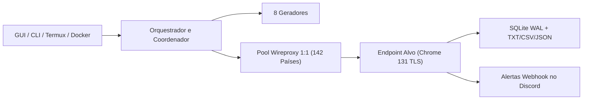

<div align="center">

<br />

| [KR 한국어](./ko.md) | [US English](../../README.md) | [JP 日本語](./ja.md) | [CN 简体中文](./zh-CN.md) | [ES Español](./es.md) |
| :---: | :---: | :---: | :---: | :---: |
| [FR Français](./fr.md) | [DE Deutsch](./de.md) | [RU Русский](./ru.md) | [BR Português](./pt-BR.md) | [SA العربية](./ar.md) |

<p align="center"><sub>🌐 Also available: <a href="./hi.md">HI हिन्दी</a> · <a href="./id.md">ID Bahasa Indonesia</a></sub></p>

<br />

[](../../CHANGELOG.md)

# ⚡ D4UC (`discord-checker`)

> **Motor de Verificação de Nomes de Usuário Raros do Discord — Furtividade TLS Chrome 131, Pool Multitúnel Isolado 1:1 e Sharding SQLite WAL.**

[](https://github.com/KRCUPRO/discord-checker/releases/tag/v12.1.0)
[](../../LICENSE)
[](https://www.python.org/)
[](../GUIDE.md)
[](../specs/01_NETWORK_CORE_ENGINE.md)

<sub>Copyright (c) 2026 KRCUPRO · Licença Proprietária e Confidencial (Todos os Direitos Reservados)</sub>

</div>

---

## 📸 Prévia da Interface

[](../guides/PC_GUIDE.md)

[](../guides/PC_GUIDE.md)

[](../guides/TERMUX_DEBIAN_GUIDE.md)

[](../guides/DOCKER_GUIDE.md)

---

<details open>
<summary><b>🌟 Visão Geral e Recursos Principais</b></summary>

Verificadores tradicionais falham contra defesas modernas por causa de três gargalos:
1. **Bloqueio por Impressão Digital TLS**: Bibliotecas HTTP padrão são bloqueadas pelo Cloudflare/WAF devido às assinaturas JA3/JA4.
2. **Interferência de VPN em Todo o Sistema**: Clientes VPN de desktop redirecionam todo o tráfego e DNS do computador.
3. **Paradas em Cascata 429 e Conflitos**: Limites de taxa travam todos os workers, e múltiplas janelas corrompem arquivos de saída.

**D4UC (`discord-checker`)** resolve os três problemas em uma arquitetura isolada e multiplataforma:
- **Furtividade TLS Chrome 131 JA3/JA4**: Baseado em `curl_cffi` (BoringSSL) com cabeçalhos sincronizados idênticos ao Chrome 131 real.
- **Túneis WireGuard em Espaço de Usuário 1:1 (`wireproxy`)**: Mapeia 142 clusters globais em portas locais (`127.0.0.1:1081+`) por worker, sem alterar interfaces de rede do sistema.
- **Hot-Swap Atômico em 0,3s no Erro 429**: Apenas o worker limitado troca imediatamente para um novo país, enquanto os outros continuam sem interrupções.
- **Sharding Matemático e SQLite WAL**: Divide varreduras em 2, 3 ou 4 fatias disjuntas (`2_1`, `2_2`, `4_1`–`4_4`) gravando simultaneamente sem duplicatas.

</details>

---

<details open>
<summary><b>🥊 Comparativo: Scripts Legados vs D4UC v12</b></summary>

| Recurso | Scripts Legados | ⚡ D4UC v12 (`discord-checker`) |
| :--- | :---: | :---: |
| **Furtividade TLS** | ❌ `requests` / `aiohttp` detectados | **✅ Simulação BoringSSL Chrome 131 JA3/JA4** |
| **Isolamento de Rede** | ❌ Exige VPN global no sistema | **✅ Pool `wireproxy` em espaço de usuário (1:1)** |
| **Recuperação de 429** | ❌ Pausa global ou queda | **✅ Troca atômica em 0,3s por worker** |
| **Sharding Multi-Instância** | ❌ Checagens duplicadas e bloqueios | **✅ Fatias disjuntas + SQLite WAL concorrente** |
| **Plataformas e UI** | ⚠️ Apenas CLI simples | **✅ GUI Desktop, Rich CLI, Termux Android e Docker** |
| **Higiene de Segredos** | ⚠️ Risco de chaves expostas | **✅ `.gitignore` estrito, `.env` e modelos seguros** |

</details>

---

<details open>
<summary><b>🧬 8 Modos de Geração de Nomes</b></summary>

| Modo | Estratégia | Melhor Uso |
| :--- | :--- | :--- |
| `hybrid` | Raízes de dicionário + simetria/números | Descoberta rápida de nomes limpos |
| `permutation` | Espaço completo (`a–z`, `0–9`, `_`) | Cobertura exaustiva com sharding (`2_1`, `2_2`) |
| `dictionary` | Palavras e sílabas de 3–6 letras | Nomes legíveis de alto valor |
| `pattern` | Padrões simétricos (`aaaa`, `abba`, `abab`) | Padrões raros visualmente distintos |
| `numeric` | Dígitos sequenciais/repetidos (`0000`–`9999`) | Identificadores numéricos curtos |
| `custom_mask` | Prefixo, sufixo e ponto (`??.vip`, `kr??`) | Iniciais, marcas e posição do ponto |
| `combinatorial` | Sílabas fonéticas CVCV / VCCV | Nomes originais pronunciáveis |
| `recheck` | Reavalia registros `TAKEN` anteriores | Captura nomes recém-liberados |

</details>

---

<details open>
<summary><b>🏛️ Arquitetura e Estrutura do Repositório</b></summary>



```text
discord-checker/
├── config/                  # Modelos .env.example e config.example.yaml
├── data/                    # Base pública de 142 clusters e modelo de credenciais
├── deploy/                  # Dockerfile, docker-compose.yml, scripts Termux e PyInstaller
├── docs/                    # Guias, 11 idiomas, arquitetura e especificações
├── src/                     # GUI (KO/EN), CLI e motor modular
├── tests/                   # Suíte automatizada de testes (68 testes)
├── CHANGELOG.md             # Histórico de versões
├── LICENSE                  # Licença Proprietária (KRCUPRO)
├── NOTICE                   # Avisos de terceiros
├── README.md                # Documentação principal em inglês
├── requirements.txt         # Dependências Python
└── SECURITY.md              # Política de segurança
```

</details>

---

<details open>
<summary><b>🚀 Início Rápido em 4 Plataformas</b></summary>

#### 1. GUI Desktop (Windows / Desktop)
```bash
git clone https://github.com/KRCUPRO/discord-checker.git
cd discord-checker
python -m venv .venv
.\.venv\Scripts\activate
pip install -r requirements.txt

python src/gui_ko.py
python src/gui_en.py
```

#### 2. CLI Headless e Sharding
```bash
python src/run.py
python src/run.py --mode permutation --length 4 --shard 2_1 --workers 5
python src/run.py --no-dashboard
```

#### 3. Docker e Multi-Contêiner
```bash
cp config/.env.example .env
docker compose -f deploy/docker-compose.yml up -d
docker compose -f deploy/docker-compose.yml --profile 2shard up -d
```

#### 4. Android Termux (`proot-distro debian`)
```bash
chmod +x deploy/install_debian.sh deploy/run.sh
./deploy/install_debian.sh
termux-wake-lock
nohup ./deploy/run.sh --no-dashboard > output.log 2>&1 &
```

</details>

---

<details>
<summary><b>⚙️ Configuração e Variáveis de Ambiente</b></summary>

Copie [config/.env.example](../../config/.env.example) para `.env`:

```ini
SURFSHARK_PRIVATE_KEYS=YOUR_SURFSHARK_WIREGUARD_PRIVATE_KEY_HERE
D4UC_MODE=hybrid
D4UC_LENGTH=4
D4UC_WORKERS=5
D4UC_PROXY=surfshark
D4UC_WEBHOOK=
```

Consulte [SECURITY.md](../../SECURITY.md) para boas práticas de segurança.

</details>

---

<details open>
<summary><b>📄 Licença e Atribuição</b></summary>

Copyright (c) 2026 **KRCUPRO**. Todos os Direitos Reservados.  
Licenciado sob a [PROPRIETARY & CONFIDENTIAL SOFTWARE LICENSE](../../LICENSE).  
Avisos de componentes de código aberto estão documentados em [NOTICE](../../NOTICE).

</details>

---

## 🚫 Nomes de Usuário Excluídos (Exemplos: `ab..`, `a..1`)

Seguindo as diretrizes oficiais do Discord, os seguintes formatos são 100% filtrados antes do envio:
1. **Pontos consecutivos proibidos (`..`)**:
   - `ab..` (Pontos consecutivos no final) ➔ **Excluído**
   - `a..1` (Pontos consecutivos no meio) ➔ **Excluído**
   - `..kr` (Pontos consecutivos no início) ➔ **Excluído**
2. **Ponto no início ou final proibido (`.`)**: `.abc`, `abc.` ➔ **Excluído**
3. **Caracteres válidos**: Apenas letras minúsculas (`a-z`), números (`0-9`), sublinhado (`_`) e ponto único (`.`).

## 📞 Contato Discord : myuyayam

Dúvidas e suporte via Discord: **`myuyayam`**.
