<div align="center">

# 🏛️ Mapeamento de Arquitetura e Diagramas D4UC (ARCHITECTURE_MAP.md)

> **Concorrência Assíncrona Sem Perdas, Persistência Sem Conflitos, Camuflagem TLS e Túneis Isolados 1:1**

<br />

| [KR 한국어](../ko/ARCHITECTURE_MAP.md) | [US English](../en/ARCHITECTURE_MAP.md) | [JP 日本語](../ja/ARCHITECTURE_MAP.md) | [CN 简体中文](../zh-CN/ARCHITECTURE_MAP.md) | [ES Español](../es/ARCHITECTURE_MAP.md) |
| :---: | :---: | :---: | :---: | :---: |
| [FR Français](../fr/ARCHITECTURE_MAP.md) | [DE Deutsch](../de/ARCHITECTURE_MAP.md) | [RU Русский](../ru/ARCHITECTURE_MAP.md) | [BR Português](./ARCHITECTURE_MAP.md) | [SA العربية](../ar/ARCHITECTURE_MAP.md) |

<p align="center"><sub>🌐 Also available: <a href="../hi/ARCHITECTURE_MAP.md">HI हिन्दी</a> • <a href="../id/ARCHITECTURE_MAP.md">ID Bahasa Indonesia</a></sub></p>

<br />

[](./CHANGELOG.md)
[](./ARCHITECTURE_MAP.md)

</div>

---

<a id="-índice"></a>
## 📑 Índice
1. [1. Arquitetura do Sistema em Camadas](#-1-arquitetura-do-sistema-em-camadas)
2. [2. Fluxo de Execução Ponta a Ponta](#-2-fluxo-de-execução-ponta-a-ponta)
3. [3. Alta Concorrência e Prevenção de Deadlocks](#-3-alta-concorrência-e-prevenção-de-deadlocks)
4. [4. Fluxo de Dados e Persistência SQLite WAL](#-4-fluxo-de-dados-e-persistência-sqlite-wal)
5. [5. Segurança e Isolamento de Rede](#-5-segurança-e-isolamento-de-rede)

---

## 💎 Princípios Fundamentais de Projeto
- **Concorrência Assíncrona Sem Perdas**: Até 50 workers paralelos sem bloqueio no loop `asyncio`.
- **Persistência Sem Conflitos**: SQLite WAL com `busy_timeout=5000ms` impede impasses (deadlocks).
- **Camuflagem TLS Chrome 131**: `curl_cffi` reproduz com precisão os apertos de mão JA3/JA4.
- **Túneis Isolados em Espaço de Usuário**: `wireproxy` roteia dados sem alterar as configurações de rede do host.

---

<a id="-1-arquitetura-do-sistema-em-camadas"></a>
## 🏛️ 1. Arquitetura do Sistema em Camadas

```mermaid
graph TD
    subgraph Layer 1: Presentation ["1. Presentation Layer (UI / CLI)"]
        GUI_KO["src/gui_ko.py (Korean GUI)"]
        GUI_EN["src/gui_en.py (English GUI)"]
        GUI_WEB["src/web_gui.py (Mobile Touch Web GUI / PWA)"]
        CLI["src/run.py (Headless CLI + Rich Dashboard)"]
    end

    subgraph Layer 2: Orchestration ["2. Orchestration & Worker Loop"]
        ORCH["Orchestrator / Async Worker Loop"]
        METRICS["DashboardMetrics (RPS, Available, Taken, 429)"]
        SHARD["Sharding Coordinator (2_1, 2_2, 3_1...)"]
    end

    subgraph Layer 3: Network & Stealth ["3. Network & TLS Stealth"]
        CLIENT["DiscordApiClient (curl_cffi AsyncSession)"]
        TLS["Chrome 131 TLS JA3/JA4 Fingerprint"]
        HEADERS["Browser Headers (sec-ch-ua, Referer, Accept)"]
    end

    subgraph Layer 4: Proxy Infrastructure ["4. Proxy Infrastructure & Multi-Tunnel"]
        UPM["UnifiedProxyManager"]
        SURF["SurfsharkProxyProvider (1:1 Multi-Tunnel)"]
        FREE["FreeProxyProvider (18 Open-Source Pools)"]
        WIRE["Wireproxy Process Daemon (User-Space Netstack)"]
        COOLDOWN["429 Cooldown Queue & 0.3s Atomic Hot-Swap Engine"]
    end

    subgraph Layer 5: Candidate Generator ["5. Candidate Username Generator Engine"]
        GEN_FACT["create_generator() Factory"]
        HYBRID["HybridGenerator"]
        PERM["PermutationGenerator (Sharded Math Engine)"]
        DICT["DictionaryGenerator"]
        MASK["CustomMaskGenerator"]
        OTHER_GEN["Pattern / Numeric / Combinatorial / Recheck"]
    end

    subgraph Layer 6: Storage & Notify ["6. Persistent Storage & Notifications"]
        STORAGE["StorageManager (Async Queue Worker)"]
        SQLITE["SQLite WAL (d4uc_results.db, busy_timeout=5s)"]
        MIRROR["Legacy Mirror (available.txt, taken.txt)"]
        WEBHOOK["DiscordWebhookNotifier (0.1s Dispatch)"]
    end

    GUI_KO & GUI_EN & GUI_WEB & CLI --> ORCH
    ORCH --> GEN_FACT
    GEN_FACT --> HYBRID & PERM & DICT & MASK & OTHER_GEN
    ORCH --> CLIENT
    CLIENT --> TLS & HEADERS
    ORCH --> UPM
    UPM --> SURF & FREE & WIRE & COOLDOWN
    ORCH --> STORAGE
    STORAGE --> SQLITE & MIRROR & WEBHOOK
```



### Camada 1: Apresentação
`src/gui_ko.py` (Coreano), `src/gui_en.py` (Inglês), `src/web_gui.py` (Web GUI Móvel / PWA), `src/run.py` (Terminal Rich CLI).

### Camada 2: Orquestração
Loop de workers em segundo plano, telemetria em tempo real (RPS, Disponíveis, 429) e sharding (`2_1`, `2_2`).

### Camada 3: Rede & Furtividade TLS
`DiscordApiClient` (`curl_cffi`), assinaturas TLS Chrome 131 e cabeçalhos emulados.

### Camada 4: Infraestrutura de Proxies
`UnifiedProxyManager`, `SurfsharkProxyProvider` (1:1), `FreeProxyProvider` e hot-swap 429 em 0,3s.

### Camada 5: Motores de Geração
Fábrica `create_generator()`: Permutação, Híbrido, Dicionário, Máscara, Padrão, Numérico, Combinatório, Rechecagem.

### Camada 6: Armazenamento & Notificações
`StorageManager`, SQLite WAL (`d4uc_results.db`), espelhos txt e alertas via Discord Webhook.


[⬆️ Voltar ao Topo do Índice](#-índice)

---

<a id="-2-fluxo-de-execução-ponta-a-ponta"></a>
## 🔄 2. Fluxo de Execução Ponta a Ponta

```text
[Candidate Generator] ──(Next Batch)──> [Orchestrator Worker Pool]
                                                    │
                                            (Lease Isolated SOCKS5)
                                                    ▼
                                        [Unified Proxy Manager]
                                                    │
                                          (Chrome 131 TLS Impersonation)
                                                    ▼
                                        [Discord API Endpoint]
                                                    │
                                         (Response Dispatch)
                        ┌───────────────────────────┴───────────────────────────┐
                        ▼                                                       ▼
               HTTP 200 / Taken                                         HTTP 429 Rate Limit
                        │                                                       │
        ┌───────────────┴───────────────┐                             (0.3s Atomic Hot-Swap)
        ▼                               ▼                                       ▼
 [SQLite WAL Storage]       [Discord Webhook Push]                  [Rotate to Fresh Country]
```

[⬆️ Voltar ao Topo do Índice](#-índice)

---

<a id="-3-alta-concorrência-e-prevenção-de-deadlocks"></a>
## ⚡ 3. Alta Concorrência e Prevenção de Deadlocks

- **Non-blocking Concurrency**: All network I/O operations are scheduled on Python's native `asyncio` event loop.
- **429 Atomic Hot-Swap**: When an isolated worker hits Discord's 429 rate limit, its specific Wireproxy local port is seamlessly reassigned to an available server node in under 0.3s without affecting concurrent workers.
- **Zero Lock Deadlock**: SQLite WAL journal mode coupled with Python-level queueing completely eliminates `database is locked` operational exceptions.

[⬆️ Voltar ao Topo do Índice](#-índice)

---

<a id="-4-fluxo-de-dados-e-persistência-sqlite-wal"></a>
## 💾 4. Fluxo de Dados e Persistência SQLite WAL

- **Primary Database**: `data/d4uc_results.db` configured with `PRAGMA journal_mode = WAL` and `PRAGMA synchronous = NORMAL`.
- **Text File Mirroring**: For maximum legacy compatibility, all newly verified rare handles are concurrently appended to `available.txt` and `checked_history.txt`.

[⬆️ Voltar ao Topo do Índice](#-índice)

---

<a id="-5-segurança-e-isolamento-de-rede"></a>
## 🛡️ 5. Segurança e Isolamento de Rede

- **Zero-Leak Policy**: All local credentials, WireGuard configuration files, and secrets are strictly excluded from version control.
- **User-Space Network Isolation**: All proxy traffic is terminated in user space (`wireproxy`), preventing interference with system-wide DNS or routing tables.

[⬆️ Voltar ao Topo do Índice](#-índice)
