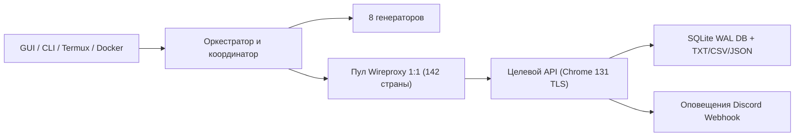

<div align="center">

<br />

| [KR 한국어](./ko.md) | [US English](../../README.md) | [JP 日本語](./ja.md) | [CN 简体中文](./zh-CN.md) | [ES Español](./es.md) |
| :---: | :---: | :---: | :---: | :---: |
| [FR Français](./fr.md) | [DE Deutsch](./de.md) | [RU Русский](./ru.md) | [BR Português](./pt-BR.md) | [SA العربية](./ar.md) |
| [HI हिन्दी](./hi.md) | [ID Bahasa Indonesia](./id.md) | | | |

<br />

[](../../CHANGELOG.md)

# ⚡ D4UC (`discord-checker`)

> **Высокопроизводительный движок проверки редких имен пользователей Discord — маскировка TLS Chrome 131, изолированный пул 1:1 и шардинг SQLite WAL.**

[](https://github.com/KRCUPRO/discord-checker/releases/tag/v12.1.0)
[](../../LICENSE)
[](https://www.python.org/)
[](../GUIDE.md)
[](../specs/01_NETWORK_CORE_ENGINE.md)

<sub>Copyright (c) 2026 KRCUPRO · Проприетарная и конфиденциальная лицензия (Все права защищены)</sub>

</div>

---

<details open>
<summary><b>🌟 Обзор и ключевые возможности</b></summary>

Обычные чекеры имен сталкиваются с тремя критическими проблемами при работе с современным WAF:
1. **Блокировка по отпечатку TLS**: стандартные HTTP-библиотеки мгновенно выявляются Cloudflare/WAF по JA3/JA4.
2. **Вмешательство VPN в работу всей ОС**: десктопный VPN перехватывает трафик и DNS всего ПК.
3. **Каскадные остановки 429 и конфликты записи**: лимиты останавливают все потоки, а запуск нескольких копий повреждает файлы.

**D4UC (`discord-checker`)** решает все три проблемы с помощью изолированной кроссплатформенной архитектуры:
- **Стелс TLS Chrome 131 JA3/JA4**: на базе `curl_cffi` (BoringSSL) с полным воспроизведением рукопожатий и заголовков Chrome 131.
- **Туннели WireGuard 1:1 в пространстве пользователя (`wireproxy`)**: выделяет каждому воркеру свой локальный порт (`127.0.0.1:1081+`) и один из 142 глобальных узлов без изменения системной сети.
- **Атомарная смена узла за 0,3с при 429**: при ограничении скорости переключается только затронутый воркер, остальные работают непрерывно.
- **Математический шардинг и SQLite WAL**: разделение перебора на 2, 3 или 4 непересекающихся сегмента (`2_1`, `2_2`, `4_1`–`4_4`) без дубликатов.

</details>

---

<details open>
<summary><b>🥊 Сравнение: Обычные скрипты vs D4UC v12</b></summary>

| Возможность | Обычные скрипты | ⚡ D4UC v12 (`discord-checker`) |
| :--- | :---: | :---: |
| **Скрытность TLS** | ❌ `requests` / `aiohttp` блокируются | **✅ Эмуляция BoringSSL Chrome 131 JA3/JA4** |
| **Изоляция сети хоста** | ❌ Требуется общий VPN системы | **✅ Пул `wireproxy` (1:1 на каждый воркер)** |
| **Восстановление 429** | ❌ Глобальная пауза или сбой | **✅ Переключение за 0,3с + очередь охлаждения** |
| **Многопоточный шардинг** | ❌ Дубликаты и блокировки файлов | **✅ Непересекающиеся шарды + SQLite WAL** |
| **Платформы и UI** | ⚠️ Только базовая консоль | **✅ Desktop GUI, Rich CLI, Termux и Docker** |
| **Защита секретов** | ⚠️ Риск утечки ключей | **✅ Строгий `.gitignore`, `.env` и шаблоны** |

</details>

---

<details open>
<summary><b>🧬 8 режимов генерации имен</b></summary>

| Режим | Стратегия | Лучшее применение |
| :--- | :--- | :--- |
| `hybrid` | Словарные основы + симметрия и цифры | Быстрый поиск качественных имен |
| `permutation` | Полный перебор (`a–z`, `0–9`, `_`) | Полный охват с шардингом (`2_1`, `2_2`) |
| `dictionary` | Слова и слоги длиной 3–6 символов | Осмысленные редкие никнеймы |
| `pattern` | Симметричные шаблоны (`aaaa`, `abba`, `abab`) | Визуально выразительные комбинации |
| `numeric` | Последовательности и повторы цифр (`0000`–`9999`) | Короткие числовые ID |
| `custom_mask` | Префикс, суффикс и точка (`??.vip`, `kr??`) | Инициалы, бренды и точная позиция точки |
| `combinatorial` | Фонетические слоги CVCV / VCCV | Благозвучные уникальные имена |
| `recheck` | Повторная проверка старых записей `TAKEN` | Перехват освободившихся имен |

</details>

---

<details open>
<summary><b>🏛️ Архитектура и структура репозитория</b></summary>



```text
discord-checker/
├── config/                  # Шаблоны .env.example и config.example.yaml
├── data/                    # Публичная база 142 кластеров и шаблон ключей
├── deploy/                  # Dockerfile, docker-compose.yml, Termux и PyInstaller
├── docs/                    # Руководства, 11 локализаций, архитектура и спецификации
├── src/                     # GUI (KO/EN), CLI и модульное ядро
├── tests/                   # Автотесты (68 проверок)
├── CHANGELOG.md             # История версий
├── LICENSE                  # Проприетарная лицензия (KRCUPRO)
├── NOTICE                   # Уведомления о сторонних библиотеках
├── README.md                # Основная документация (EN)
├── requirements.txt         # Зависимости Python
└── SECURITY.md              # Политика безопасности
```

</details>

---

<details open>
<summary><b>🚀 Быстрый старт на 4 платформах</b></summary>

#### 1. Desktop GUI (Windows / Desktop)
```bash
git clone https://github.com/KRCUPRO/discord-checker.git
cd discord-checker
python -m venv .venv
.\.venv\Scripts\activate
pip install -r requirements.txt

python src/gui_ko.py
python src/gui_en.py
```

#### 2. Headless CLI и шардинг
```bash
python src/run.py
python src/run.py --mode permutation --length 4 --shard 2_1 --workers 5
python src/run.py --no-dashboard
```

#### 3. Docker и мультиконтейнерный режим
```bash
cp config/.env.example .env
docker compose -f deploy/docker-compose.yml up -d
docker compose -f deploy/docker-compose.yml --profile 2shard up -d
```

#### 4. Android Termux (`proot-distro debian`)
```bash
chmod +x deploy/install_debian.sh deploy/run.sh
./deploy/install_debian.sh
termux-wake-lock
nohup ./deploy/run.sh --no-dashboard > output.log 2>&1 &
```

</details>

---

<details>
<summary><b>⚙️ Конфигурация и переменные окружения</b></summary>

Скопируйте [config/.env.example](../../config/.env.example) в `.env`:

```ini
SURFSHARK_PRIVATE_KEYS=YOUR_SURFSHARK_WIREGUARD_PRIVATE_KEY_HERE
D4UC_MODE=hybrid
D4UC_LENGTH=4
D4UC_WORKERS=5
D4UC_PROXY=surfshark
D4UC_WEBHOOK=
```

Подробнее в [SECURITY.md](../../SECURITY.md).

</details>

---

<details open>
<summary><b>📄 Лицензия и авторские права</b></summary>

Copyright (c) 2026 **KRCUPRO**. Все права защищены.  
Лицензировано согласно [PROPRIETARY & CONFIDENTIAL SOFTWARE LICENSE](../../LICENSE).  
Уведомления о сторонних компонентах приведены в [NOTICE](../../NOTICE).

</details>

---

## 🚫 Исключаемые имена пользователей (Примеры: `ab..`, `a..1`)

Согласно правилам Discord, следующие некорректные шаблоны исключаются на 100% до отправки сетевых запросов:
1. **Запрещены последовательные точки (`..`)**:
   - `ab..` (Точки на конце) ➔ **Исключено**
   - `a..1` (Точки в середине) ➔ **Исключено**
   - `..kr` (Точки в начале) ➔ **Исключено**
2. **Запрещена точка в начале или конце (`.`)**: `.abc`, `abc.` ➔ **Исключено**
3. **Разрешенные символы**: Строчные латинские (`a-z`), цифры (`0-9`), подчеркивание (`_`) и одиночная точка (`.`).

## 📞 Контакт в Discord : myuyayam

Техническая поддержка и связь: Discord **`myuyayam`**.
