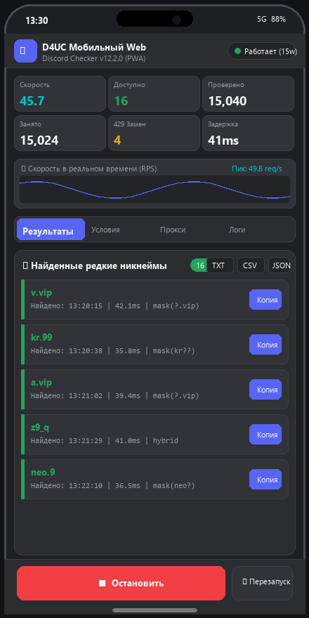
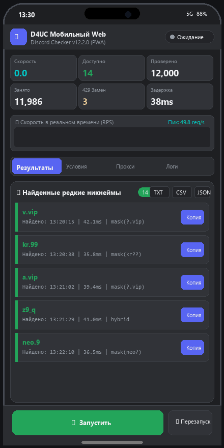
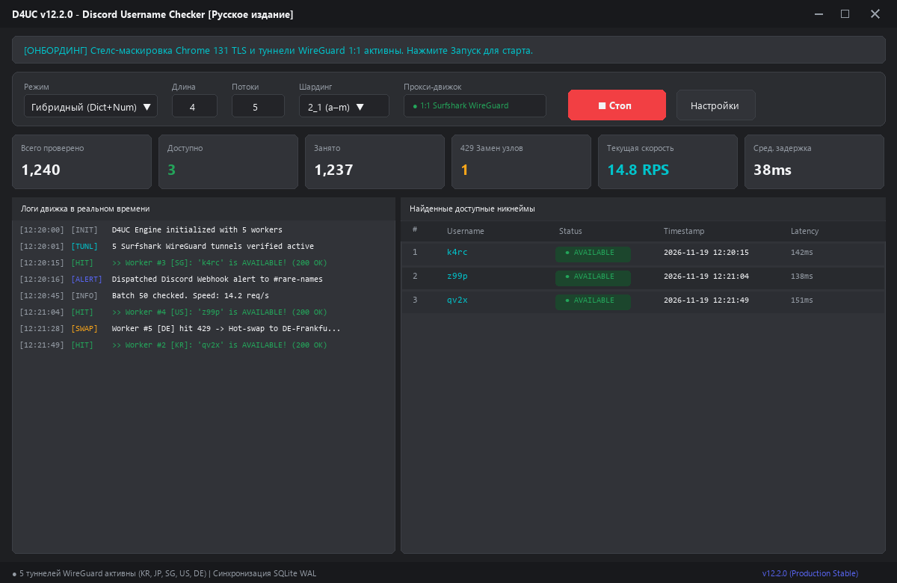
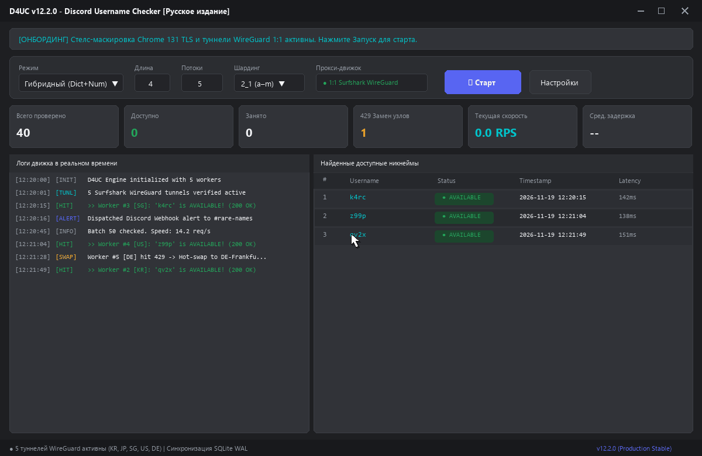
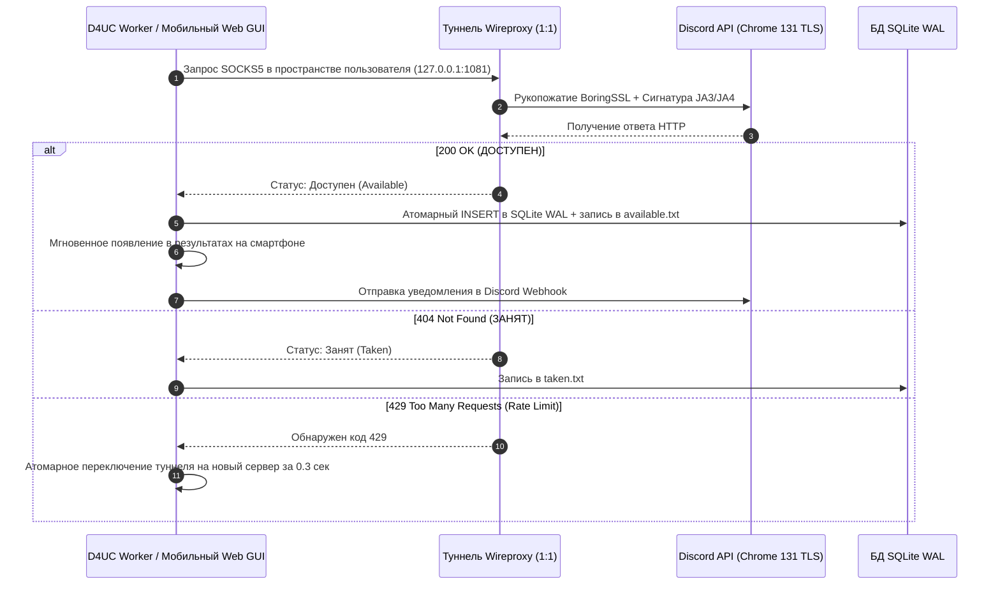

<div align="center">

# ⚡ D4UC (`discord-checker`) v12.2.0

> **Высокопроизводительный движок проверки доступности редких никнеймов Discord**  
> Мобильный адаптивный Web GUI & PWA · Маскировка Chrome 131 TLS · Пул туннелей WireGuard 1:1 в пространстве пользователя · Атомарный 429 Hot-Swap за 0.3 сек · Шардинг SQLite WAL

<br />

| [KR 한국어](./ko.md) | [US English](../../README.md) | [JP 日本語](./ja.md) | [CN 简体中文](./zh-CN.md) | [ES Español](./es.md) |
| :---: | :---: | :---: | :---: | :---: |
| [FR Français](./fr.md) | [DE Deutsch](./de.md) | [RU Русский](./ru.md) | [BR Português](./pt-BR.md) | [SA العربية](./ar.md) |

<p align="center"><sub>🌐 Также доступно на: <a href="./hi.md">HI हिन्दी</a> · <a href="./id.md">ID Bahasa Indonesia</a></sub></p>

<br />

[](../../CHANGELOG.md)
[](https://github.com/KRCUPRO/discord-checker/releases/tag/v12.2.0)
[](../../LICENSE)
[](https://www.python.org/)
[](../GUIDE.md)
[](../specs/01_NETWORK_CORE_ENGINE.md)

<sub>Copyright (c) 2026 KRCUPRO · Проприетарная лицензия (Все права защищены)</sub>

</div>

---

## 📸 Обзор интерфейса

### Адаптивный мобильный Web GUI (PWA - iPhone и Android)
[](../guides/MOBILE_IOS_GUIDE.md)

### Интерактивная демонстрация мобильного Web (Сенсорное управление в 1 касание)
[](../guides/MOBILE_IOS_GUIDE.md)

### Настольный интерфейс Desktop GUI (Русское издание)
[](../guides/PC_GUIDE.md)

### Анимация работы GUI (Плавное управление мышью)
[](../guides/PC_GUIDE.md)

### Консольная панель CLI без графической оболочки
[](../guides/TERMUX_DEBIAN_GUIDE.md)

### Развертывание в контейнерах Docker и на серверах Linux
[](../guides/DOCKER_GUIDE.md)

---

## ✨ Ключевые возможности

1. **Мобильный адаптивный Web GUI & PWA (`http://<host>:5000`)**:
   - Запускайте на ПК, VPS, в Docker или Termux и управляйте процессом проверки с любого смартфона (iPhone Safari, Android Chrome).
   - Поддержка режима **«На экран Домой» (PWA)** превращает веб-интерфейс в полноэкранное мобильное приложение без рамок и без App Store.
   - Крупные сенсорные кнопки [Старт / Стоп], чистый HTML5 Canvas график скорости RPS, копирование никнейма в 1 касание и экспорт в TXT/CSV/JSON.
   - Удаленная настройка и горячая замена прокси (ключи Surfshark, прокси-файлы, Thordata), 8 режимов генерации и ползунок потоков (1–50) со смартфона.

2. **Маскировка TLS Chrome 131 JA3/JA4 (`curl_cffi` BoringSSL)**:
   - Полное исключение подозрительных синтетических сигнатур стандартных библиотек Python (`requests`, `aiohttp`, `httpx`).
   - Побитовое воспроизведение шифров (Cipher Suites), расширений и фреймов HTTP/2 SETTINGS браузера Google Chrome 131 для обхода WAF и Cloudflare.

3. **Пул туннелей WireGuard 1:1 в пространстве пользователя (`wireproxy`)**:
   - Без модификации сетевых адаптеров хоста и без перехвата глобального DNS или маршрутов ПК.
   - Назначает каждому потоку изолированный локальный порт (`127.0.0.1:1081+`), распределяя запросы по 142 серверам по всему миру. Основной трафик ПК не испытывает задержек (0.00% влияния).

4. **Атомарная смена IP при 429 за 0.3 секунды**:
   - При получении HTTP 429 Rate Limit весь процесс сканирования не останавливается.
   - Только заблокированный поток переключается на новый узел за 300 мс, тогда как остальные потоки продолжают непрерывную работу.

5. **Математический шардинг без повторов (Sharding)**:
   - Разделение диапазона поиска (`2_1`, `2_2`, `4_1`–`4_4`) для исчерпывающего сканирования.
   - Несколько параллельных окон или контейнеров проверяют разные сегменты, обеспечивая 0% дублирующих запросов.

6. **SQLite WAL и многоуровневое дублирование**:
   - Высокопроизводительная запись на базе SQLite в режиме WAL (`data/d4uc_results.db`).
   - Доступные имена мгновенно и атомарно дублируются в файлы (`available.txt`, `taken.txt`), CSV и JSON.

7. **8 интеллектуальных алгоритмов генерации**:
   - Гибридный, полная перестановка, словарь, симметричные паттерны, числовые серии, маски, фонетические слоги и перепроверка истории.

8. **Кроссплатформенность**:
   - Автономные исполняемые файлы Windows (4 варианта `.exe`), мобильное PWA, консоль CLI Linux/macOS, скрипт для Android Termux и Docker.

---

## 🖥️ Системные требования и зависимости

### Среда выполнения
- **ОС**: Windows 10/11 (64-бит), Linux (Debian 11+, Ubuntu 20.04+, Arch), macOS 12+, Android 10+ (Termux), iOS Safari
- **Python**: 3.10, 3.11, 3.12 (Рекомендуется: **Python 3.12**)
- **ОЗУ (RAM)**: Минимум 512 МБ (~250 МБ при 50 параллельных потоках)
- **Сеть**: Широкополосный интернет (открытый исходящий порт UDP 51820 для WireGuard)

### Зависимости (`requirements.txt`)
- `curl_cffi >= 0.7.0`: Эмуляция TLS Chrome 131 BoringSSL
- `customtkinter >= 5.2.0`: Графический интерфейс для рабочего стола
- `rich >= 13.7.0`: Консольный дашборд и телеметрия
- `pydantic >= 2.6.0`: Валидация конфигурации
- `pyyaml >= 6.0.1`: Парсер YAML
- `pillow >= 10.2.0`: Обработка изображений и иконок

---

## 📁 Структура репозитория

```text
discord-checker/
├── config/                         # Шаблоны конфигураций и .env.example
├── data/                           # Список узлов WireGuard и база SQLite
├── deploy/                         # Скрипты сборки, Docker и генерации
│   ├── build_exe.py                # Сборщик 4 автономных .exe для Windows
│   ├── docker-compose.yml          # Конфигурация Docker Compose
│   ├── Dockerfile                  # Спецификация Multi-Arch контейнера
│   ├── generate_assets.py          # Генератор скриншотов и анимаций
│   ├── generate_badges.py          # Генератор 12 языковых SVG-бейджей
│   └── generate_mobile_assets.py   # Генератор мобильных скриншотов и GIF
├── docs/                           # Документация, руководства и бейджи
│   ├── assets/                     # Скриншоты, GIF-демонстрации и SVG
│   ├── guides/                     # Инструкции для iOS, PC, Docker и Termux
│   └── locales/                    # Полные переводы 1:1 на 11 языков
├── src/                            # Исходный код ядра
│   ├── generator/                  # 8 алгоритмов генерации и правила исключений
│   ├── network/                    # Сетевой клиент Chrome 131 и экспоненциальный бэкофф
│   ├── notify/                     # Модуль уведомлений в Discord Webhook
│   ├── proxy/                      # Управление пулом туннелей WireGuard
│   ├── storage/                    # Слой хранения SQLite WAL и текстовых файлов
│   ├── ui/                         # Интернационализация, подсказки и CLI
│   │   └── web/                    # Веб-приложение PWA (HTML5/CSS3/Vanilla JS)
│   ├── web_gui.py                  # Сервер мобильного Web GUI и REST API
│   ├── gui.py                      # Оркестратор CustomTkinter
│   ├── gui_ko.py                   # Корейский запуск GUI
│   ├── gui_en.py                   # Английский запуск GUI
│   └── run.py                      # Консольный запуск CLI
├── tests/                          # Набор автоматических тестов
├── CHANGELOG.md                    # История изменений версий
├── LICENSE                         # Проприетарная лицензия (KRCUPRO)
├── README.md                       # Главная англоязычная документация
└── SECURITY.md                     # Политика безопасности
```

---

## 🌐 Настройка прокси и 🔑 Учетные данные

D4UC использует **1:1 пул туннелей WireGuard в пространстве пользователя** через `wireproxy` для предотвращения блокировок IP.

### 1. Настройка
1. Скопируйте `config/.env.example` в файл `.env` в корне репозитория:
   ```bash
   cp config/.env.example .env
   ```
2. Откройте `.env` и укажите приватные ключи Surfshark WireGuard:
   ```ini
   # Несколько ключей через запятую для высокой параллельности
   SURFSHARK_PRIVATE_KEYS=ВАШ_ПРИВАТНЫЙ_КЛЮЧ_1,ВАШ_ПРИВАТНЫЙ_КЛЮЧ_2
   
   # Количество потоков (По умолчанию: 5, Максимум: 50)
   D4UC_WORKERS=5
   
   # Webhook Discord для моментальных оповещений (Опционально)
   D4UC_WEBHOOK=https://discord.com/api/webhooks/ID/TOKEN
   ```

### 2. Сборщик и многопоточный валидатор бесплатных публичных прокси (`--proxy free`) [Новинка v12.3.0]
Полностью бесплатная работа без необходимости платной подписки на VPN:
- **Автоматический сбор из множества источников**: Загрузка регулярно обновляемых списков прокси из 14+ репозиториев GitHub и датасетов Hugging Face (TheSpeedX, monosans, hookzof, roosterkid, ShiftyTR, mertguvencli, Hugging Face).
- **Поддержка всех протоколов**: Поддержка бесплатных прокси HTTP, HTTPS, SOCKS4 и SOCKS5.
- **Асинхронный валидатор в реальном времени**: Проверка связи с реальными эндпоинтами Discord и Cloudflare, фильтрация неработающих узлов, задержки > 3500мс и блокировок 403 WAF.
- **Ротация при 429 и автообновление**: Временная изоляция узлов на 15 секунд при лимитах и мгновенный хот-свап на самый быстрый доступный узел.
- **Интерфейс**: Выбор в десктопном GUI, 1-тап кнопка в мобильном веб-интерфейсе и флаг CLI `--proxy free` (или `-p free`).

### 3. Политика предотвращения утечек (Zero-Leak Policy)
- Файлы конфигураций (`.env`, `config.yaml`) и ключи исключены из Git через `.gitignore` и проверяются перед каждым коммитом.

---

## 🚀 Установка и запуск

### Вариант A: Автономные исполняемые файлы для Windows (`.exe`)
Скачайте готовые сборки со страницы [GitHub Releases v12.2.0](https://github.com/KRCUPRO/discord-checker/releases/tag/v12.2.0):
- `DiscordUsernameCheckerV2_Web.exe`: **Сервер мобильного Web GUI & PWA (Порт 5000)** [НОВОЕ]
- `DiscordUsernameCheckerV2_EN.exe`: Английский настольный GUI
- `DiscordUsernameCheckerV2_KO.exe`: Корейский настольный GUI
- `DiscordUsernameCheckerV2_CLI.exe`: Консольная панель CLI

### Вариант B: Запуск мобильного Web GUI (Управление со смартфона)
```bash
# Запуск веб-сервера (Порт по умолчанию: 5000)
python src/web_gui.py --port 5000

# Откройте браузер на смартфоне, подключенном к тому же Wi-Fi:
# http://<IP_ВАШЕГО_ПК>:5000
```

### Вариант C: Запуск из исходного кода
```bash
python -m venv .venv
source .venv/bin/activate  # Windows: .\.venv\Scripts\Activate.ps1
pip install -r requirements.txt

# Запуск графического интерфейса
python src/gui_en.py

# Запуск консольного режима CLI
python src/run.py --mode hybrid --length 4 --workers 5
```

---

## 📱 Руководство по управлению через мобильный Web GUI & PWA

Следите за поиском редких никнеймов и меняйте параметры прямо со своего смартфона.

### 1. Добавление на экран «Домой» (Установка PWA)
1. Откройте `http://<IP_ПК>:5000` в мобильном браузере (iPhone Safari или Android Chrome).
2. **iPhone Safari**: Нажмите кнопку «Поделиться» ➔ **«На экран "Домой"»**.
3. **Android Chrome**: Нажмите меню (⋮) ➔ **«Добавить на главный экран»** или **«Установить приложение»**.
4. Запустите иконку **D4UC Web** для полноэкранной работы без рамок браузера.

### 2. Возможности сенсорного управления
- **Крупные карточки телеметрии**: Скорость проверки (RPS), найденные ники, общее число, занятые, 429-смены и задержка (мс).
- **Плавный график Canvas HTML5**: Легковесная визуализация колебаний скорости сканирования в реальном времени.
- **Копирование никнейма в 1 касание**: Нажмите [Копировать] рядом с найденным ником для быстрого занесения в буфер обмена.
- **Быстрый экспорт**: Кнопки [TXT], [CSV], [JSON] для моментальной загрузки файлов на смартфон.
- **Горячая смена настроек (Hot-Swap)**:
  - Мгновенное переключение между 8 алгоритмами генерации
  - Смена длины (3–6 символов) и параметров шардинга
  - Ползунок потоков (1–50) для масштабирования нагрузки на лету
  - Обновление ключей Surfshark и конфигурации прокси

---

## 🧵 Настройка количества потоков (Workers)

- **Рекомендуемое значение**: `5` потоков (~12–15 RPS)
- **Экономичный режим**: `1`–`3` потока
- **Высокоскоростное сканирование**: `10`–`20` потоков (поддерживается до 50 потоков)
- **Принцип работы**:
  - D4UC привязывает каждый рабочий поток к персональному порту туннеля WireGuard (`1081`, `1082` и т. д.).
  - 5 потоков обращаются к серверам через 5 независимых стран одновременно (Токио, Сеул, Сингапур, Франкфурт, Нью-Йорк).

---

## 🔢 Режимы генерации никнеймов

| Режим | Стратегия | Описание и примеры |
| :--- | :--- | :--- |
| `hybrid` (Рекомендуется) | Словарные основы + цифры и паттерны | Эстетичные, легко читаемые редкие никнеймы (`krc1`, `v1be`, `neo9`) |
| `permutation` | Математический полный перебор | Сканирование по `a-z`, `0-9`, `_` (с поддержкой шардинга `2_1`, `2_2`) |
| `dictionary` | Словарь английского языка из 3–6 букв | Настоящие слова и ценные 2-3 слоговые термины |
| `pattern` | Симметричные и повторяющиеся шаблоны | Красивые симметричные ники (`aaaa`, `abba`, `abab`, `aabb`) |
| `numeric` | Последовательные и повторяющиеся числа | Числовые комбинации (`0000`–`9999`, покерные комбинации `7777`, `1234`) |
| `custom_mask` | Пользовательские маски с точками | Шаблоны (`kr??`, `??99`, `?.vip`, `??.??`) |
| `combinatorial` | Фонетические структуры CVCV / VCCV | Чередование согласных и гласных для благозвучных названий |
| `recheck` | Повторная проверка занятых имен | Отслеживание никнеймов, которые освободились после смены или удаления |

---

## 🚫 Правила строгого исключения (примеры: `ab..`, `a..1`)

Имена, противоречащие официальным правилам Discord, **исключаются на 100% еще до отправки запросов**:

1. **Запрещены точки подряд (`..`)**:
   - ❌ `ab..` (две точки в конце) ➔ **Исключается автоматически**
   - ❌ `a..1` (две точки в середине) ➔ **Исключается автоматически**
   - ❌ `..kr` (две точки в начале) ➔ **Исключается автоматически**
2. **Запрещены точки в начале или в конце (`.`)**:
   - ❌ `.abc` (начинается с точки) ➔ **Исключается автоматически**
   - ❌ `abc.` (заканчивается точкой) ➔ **Исключается автоматически**
3. **Ограничения на символы**:
   - Разрешены только строчные латинские буквы (`a-z`), цифры (`0-9`), подчеркивания (`_`) и одиночные точки (`.`).
4. **Ограничения длины**:
   - Имена короче 2 или длиннее 32 символов не генерируются.
5. **Зарезервированные слова**:
   - Имена `discord`, `clyde`, `here`, `everyone`, `system` отфильтровываются автоматически.

> Все правила контролируются валидатором `DiscordRuleValidator.is_valid()` в `src/generator/base.py` и подтверждены 84 тестами.

---

## 📡 Схема работы чекера



---

## 🔄 Управление сессиями прокси

- **Выделенные асинхронные сессии**: Каждый поток держит свой экземпляр `curl_cffi.requests.AsyncSession` для эффективного использования соединений Keep-Alive.
- **Чистое завершение работы (Zero-Zombie)**: При закрытии чекера фоновые процессы `wireproxy` безопасно завершаются без зависших задач.

---

## 🔁 Логика повторных попыток

1. **Таймауты сети и сбои DNS**: До 3 автоматических повторов с экспоненциальной задержкой (0.5с ➔ 1.0с ➔ 2.0с).
2. **Проверки Cloudflare WAF**: Сессия немедленно пересоздается, а туннель перезапускается.
3. **Лимит запросов 429**: Имя возвращается в очередь, а поток за 0.3 секунды получает новый IP-адрес.

---

## 💾 Форматы сохранения данных

| Путь | Формат | Назначение |
| :--- | :--- | :--- |
| `data/d4uc_results.db` | **SQLite (Режим WAL)** | ACID-транзакции, параллельная многопоточная запись, полная индексация |
| `available.txt` | Текст UTF-8 | Список свободных никнеймов по строкам в реальном времени |
| `taken.txt` | Текст UTF-8 | Занятые имена (для режима перепроверки) |
| `checked_history.txt` | Текст UTF-8 | Глобальная история для предотвращения повторных проверок |
| `available_usernames.csv` | Формат CSV | Таблица для импорта в Excel и аналитики |
| `available_usernames.json`| Формат JSON | Структурированные данные для веб-панелей и REST API |

---

## 📊 Мониторинг и метрики

Мобильный интерфейс, приложение для ПК и консоль обновляют следующие показатели каждые 30 мс:
- **Scan Speed (RPS)**: Количество проверок в секунду (среднее за 5 секунд)
- **Total Checked**: Всего проверено никнеймов за текущую сессию
- **Available Count**: Найдено свободных редких никнеймов
- **Taken Count**: Занятых имен
- **429 Hot-Swaps**: Успешных смен IP-адресов при ограничении скорости
- **Latency**: Время отклика API Discord (мс)

---

## 🛑 Остановка проверки

- **Мобильный Web GUI**: Нажмите красную кнопку `■ Остановить поиск`.
- **Desktop GUI**: Нажмите `■ Стоп`.
- **CLI**: Нажмите `Ctrl + C` для корректного сохранения базы данных и закрытия всех сетевых портов.

---

## ⚠️ Архитектура обработки Rate Limit (429)

- При частых запросах Discord выдает ошибку `429 Too Many Requests`.
- D4UC распределяет запросы через **142 сервера WireGuard** и применяет **горячую замену узла за 0.3 секунды**, благодаря чему остальные потоки не прерывают работу ни на мгновение.

---

## 🔧 Устранение неполадок

| Проблема | Причина | Решение |
| :--- | :--- | :--- |
| Не открывается Web GUI на смартфоне | Телефон и ПК в разных сетях | Подключитесь к одной сети Wi-Fi и проверьте, открыт ли порт 5000 в брандмауэре Windows. |
| `Wireproxy binary not found` | Отсутствует файл wireproxy | Убедитесь, что `bin/wireproxy.exe` на месте, или запустите `deploy/build_exe.py`. |
| `Port already in use: 1081` | Завис предыдущий процесс | Завершите остаточные процессы Python или wireproxy через Диспетчер задач. |
| Запрос разрешений брандмауэра | Не прописано правило | Запустите команду PowerShell от имени Администратора для добавления правила. |
| `No module named curl_cffi` | Не активировано окружение | Активируйте `.venv` и выполните `pip install -r requirements.txt`. |

---

## 📞 Поддержка в Discord: myuyayam

- По вопросам предложений, ошибок и технической помощи обращайтесь в Discord к **`myuyayam`**.
- По вопросам лицензирования и интеграций используйте GitHub Issues или личные сообщения в Discord.

---

## ⭐ Поддержите проект (GitHub Star)

Если вам полезен данный проект, поставьте ему звезду **Star (⭐)** на GitHub!  
Ваша поддержка и отзывы вдохновляют на дальнейшее развитие движка.

---

## 📚 Уведомление об образовательных и исследовательских целях

> **[Исключительно в образовательных и исследовательских целях]**
> 
> Данное программное обеспечение создано для изучения сетевой безопасности: **механизмов снятия отпечатков TLS (Chrome 131 BoringSSL JA3/JA4), разработки мобильных PWA-приложений, туннелирования в пространстве пользователя (Wireproxy) и параллельной работы с SQLite WAL**.
> 
> 1. Строго запрещено использовать инструмент для DoS-атак, создания искусственной перегрузки сервисов или несанкционированного массового захвата аккаунтов.
> 2. Пользователь обязан соблюдать Условия обслуживания (Terms of Service) целевой платформы и законы своей страны. Ответственность за использование возлагается на оператора программы.
> 3. Разработчики не предоставляют гарантий и не несут ответственности за результаты индивидуального использования ПО.
