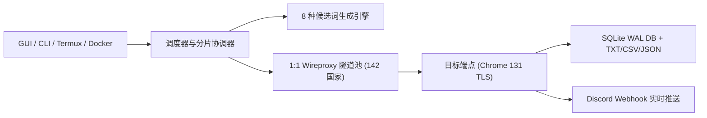

<div align="center">

<p align="center">
  <a href="../../README.md">🇺🇸 English</a> · <a href="./ko.md">🇰🇷 한국어</a> · <a href="./ja.md">🇯🇵 日本語</a> · <strong>🇨🇳 中文</strong> · <a href="./es.md">🇪🇸 Español</a> · <a href="./de.md">🇩🇪 Deutsch</a><br />
  <a href="./fr.md">🇫🇷 Français</a> · <a href="./pt-BR.md">🇧🇷 Português</a> · <a href="./ru.md">🇷🇺 Русский</a> · <a href="./hi.md">🇮🇳 हिन्दी</a> · <a href="./ar.md">🇸🇦 العربية</a> · <a href="./id.md">🇮🇩 Bahasa Indonesia</a>
</p>

# ⚡ D4UC (`discord-checker`)

> **高性能 Discord 稀有用户名检测引擎 — Chrome 131 TLS 指纹伪装、1:1 隔离多隧道池与 SQLite WAL 多分片同步。**

[](https://github.com/KRCUPRO/discord-checker/releases/tag/v12.0.0)
[](../../LICENSE)
[](https://www.python.org/)
[](../GUIDE.md)
[](../specs/01_NETWORK_CORE_ENGINE.md)

<sub>Copyright (c) 2026 KRCUPRO · 专有软件许可 (All Rights Reserved)</sub>

</div>

---

<details open>
<summary><b>🌟 概述与核心特性</b></summary>

传统用户名检测工具在现代 WAF 与边缘防护下面临三大瓶颈：
1. **TLS 指纹拦截**：标准 HTTP 客户端的 JA3/JA4 特征极易被 Cloudflare/WAF 阻断。
2. **全局 VPN 干扰**：开启桌面端 VPN 会劫持整台主机的网络和 DNS 设置。
3. **429 连环卡死与多开冲突**：触发限流会导致全队列停滞，多实例同时写入则会损坏结果文件。

**D4UC (`discord-checker`)** 通过完全隔离的跨平台架构彻底解决了这些问题：
- **Chrome 131 TLS JA3/JA4 伪装**：基于 `curl_cffi` (BoringSSL) 发送与真实 Chrome 131 完全一致的 TLS 握手和请求头。
- **1:1 用户态 WireGuard 隧道池 (`wireproxy`)**：为每个并发工作线程分配独立本地端口 (`127.0.0.1:1081+`) 并映射至 142 个国家节点，零系统网络干扰。
- **0.3 秒原子级 429 热切换**：仅限流的工作线程自动切换至全新国家节点，其余线程全速不中断。
- **数学分片与 SQLite WAL 并发同步**：支持 2/3/4 分片 (`2_1`, `2_2`, `4_1`–`4_4`) 并发写入 `data/d4uc_results.db`，零重复检测。

</details>

---

<details open>
<summary><b>🥊 对比矩阵：传统脚本 vs D4UC v12</b></summary>

| 特性 | 传统检测脚本 | ⚡ D4UC v12 (`discord-checker`) |
| :--- | :---: | :---: |
| **TLS 指纹隐匿** | ❌ `requests` / `aiohttp` 易被识别 | **✅ BoringSSL Chrome 131 JA3/JA4 真实模拟** |
| **主机网络隔离** | ❌ 需接管系统全局 VPN | **✅ 用户态 `wireproxy` 1:1 独立隧道池** |
| **429 限流恢复** | ❌ 全局暂停或崩溃 | **✅ 0.3 秒单线程热切换 + 冷却队列** |
| **多实例分片** | ❌ 重复检测与文件写入冲突 | **✅ 无重叠数学分片 + SQLite WAL 同步** |
| **平台与界面** | ⚠️ 仅限 CLI 命令行 | **✅ 桌面 GUI (中/韩/英), Rich CLI, Termux, Multi-Arch Docker** |
| **密钥与仓库规范** | ⚠️ 硬编码密钥风险 | **✅ 严格 `.gitignore`, `.env` 注入与示例模板** |

</details>

---

<details open>
<summary><b>🧬 8 种用户名生成模式</b></summary>

| 模式键 | 生成策略 | 适用场景 |
| :--- | :--- | :--- |
| `hybrid` | 词库词根 + 对称/数字组合变体 | 快速发掘简洁可用的用户名 |
| `permutation` | 完整排列遍历 (`a–z`, `0–9`, `_`) | 搭配 2/3/4 分片 (`2_1`, `2_2`) 进行全量扫描 |
| `dictionary` | 3–6 位英文单词与可读音节 | 筛选有意义的稀有词汇 |
| `pattern` | 对称与重复结构 (`aaaa`, `abba`, `abab`) | 视觉辨识度高的稀有组合 |
| `numeric` | 连续或重复数字 (`0000`–`9999`) | 短数字编号探索 |
| `custom_mask` | 前缀/后缀/小数点掩码 (`??.vip`, `kr??`) | 品牌缩写、特定前缀及点号定位 |
| `combinatorial` | 音韵结构 CVCV / VCCV 音节 | 易于拼读的原创名称 |
| `recheck` | 重检历史 `TAKEN` 记录 | 捕获刚释放的可用账号名 |

</details>

---

<details open>
<summary><b>🏛️ 系统架构与目录结构</b></summary>



```text
discord-checker/
├── config/                  # .env.example 与 config.example.yaml 模板
├── data/                    # 142 个节点信息与凭据示例模板
├── deploy/                  # Dockerfile, docker-compose.yml, Termux 与打包脚本
├── docs/                    # 指南、11 国语言文档、架构图与规格说明
├── src/                     # 桌面 GUI、CLI 入口与核心模块
├── tests/                   # 自动化回归与并发测试套件 (68 项)
├── CHANGELOG.md             # 版本更新记录
├── LICENSE                  # 专有版权许可 (KRCUPRO)
├── NOTICE                   # 第三方开源组件声明
├── README.md                # 英文主文档
├── requirements.txt         # Python 依赖清单
└── SECURITY.md              # 安全规范说明
```

</details>

---

<details open>
<summary><b>🚀 四大平台快速上手</b></summary>

#### 1. 桌面 GUI (Windows / Desktop)
```bash
git clone https://github.com/KRCUPRO/discord-checker.git
cd discord-checker
python -m venv .venv
.\.venv\Scripts\activate
pip install -r requirements.txt

python src/gui_ko.py
python src/gui_en.py
```

#### 2. 无头 CLI 与分片加速
```bash
python src/run.py
python src/run.py --mode permutation --length 4 --shard 2_1 --workers 5
python src/run.py --no-dashboard
```

#### 3. Docker 与多容器并行分片
```bash
cp config/.env.example .env
docker compose -f deploy/docker-compose.yml up -d
docker compose -f deploy/docker-compose.yml --profile 2shard up -d
```

#### 4. Android Termux (`proot-distro debian`)
```bash
chmod +x deploy/install_debian.sh deploy/run.sh
./deploy/install_debian.sh
termux-wake-lock
nohup ./deploy/run.sh --no-dashboard > output.log 2>&1 &
```

</details>

---

<details>
<summary><b>⚙️ 环境变量配置</b></summary>

复制 [config/.env.example](../../config/.env.example) 为 `.env`:

```ini
SURFSHARK_PRIVATE_KEYS=YOUR_SURFSHARK_WIREGUARD_PRIVATE_KEY_HERE
D4UC_MODE=hybrid
D4UC_LENGTH=4
D4UC_WORKERS=5
D4UC_PROXY=surfshark
D4UC_WEBHOOK=
```

安全细节请参阅 [SECURITY.md](../../SECURITY.md)。

</details>

---

<details open>
<summary><b>📄 许可与版权声明</b></summary>

Copyright (c) 2026 **KRCUPRO**. All Rights Reserved.  
本软件受 [专有与保密软件许可协议 (LICENSE)](../../LICENSE) 保护。  
第三方开源组件版权声明详见 [NOTICE](../../NOTICE)。

</details>
