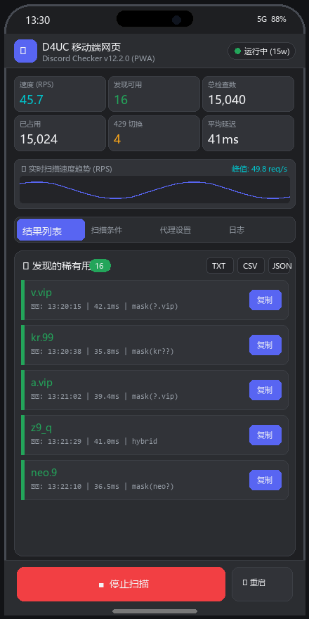
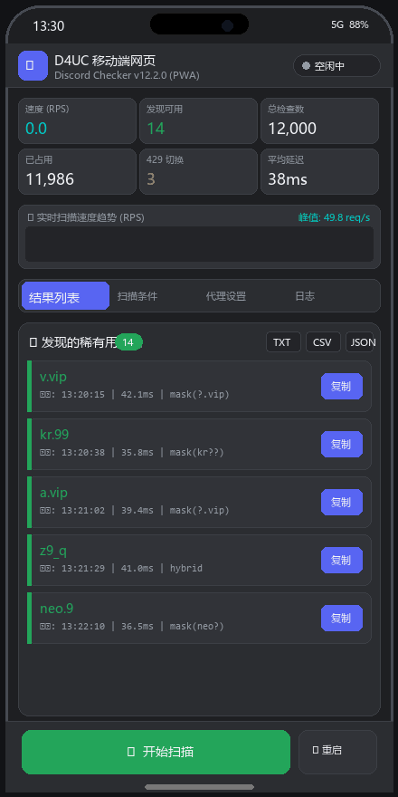
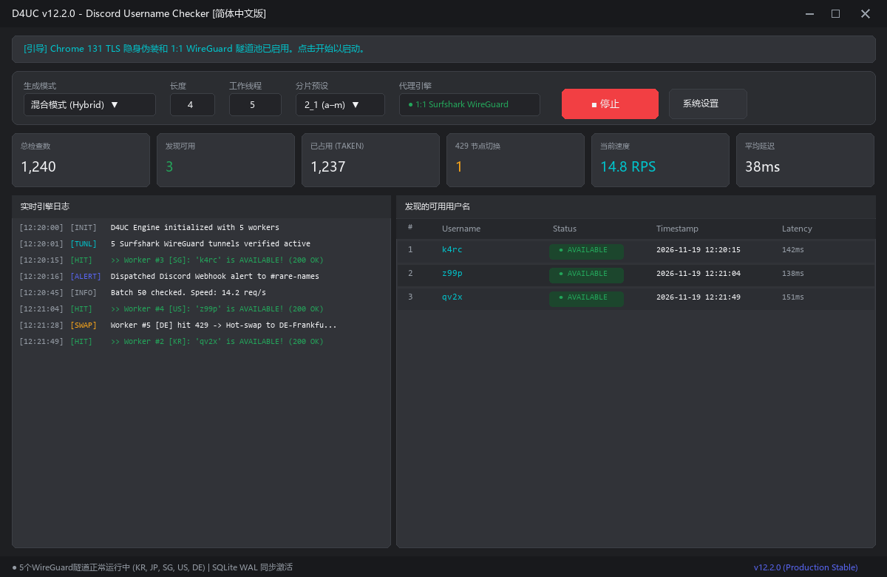
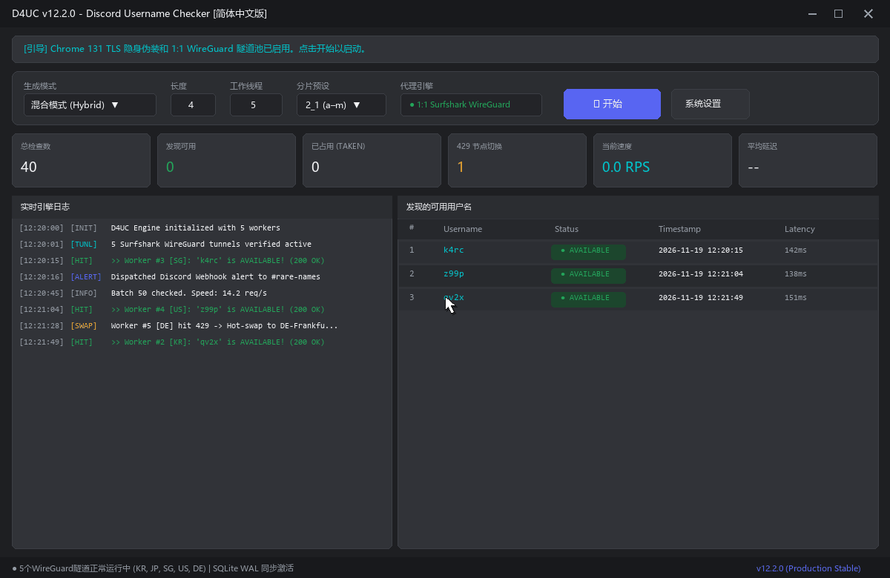
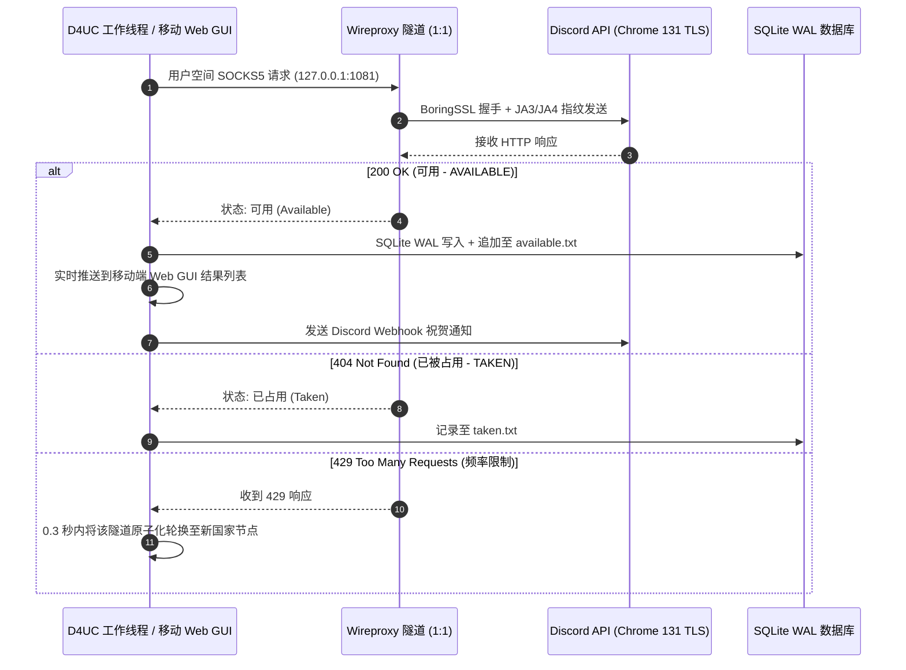

<div align="center">

# ⚡ D4UC (`discord-checker`) v12.2.0

> **高性能 Discord 稀有用户名可用性检测引擎**  
> 移动端响应式 Web GUI & PWA · Chrome 131 TLS 隐形伪装 · 1:1 用户空间 WireGuard 隧道池 · 0.3秒原子级 429 热切换 · SQLite WAL 多分片并发

<br />

| [KR 한국어](./ko.md) | [US English](../../README.md) | [JP 日本語](./ja.md) | [CN 简体中文](./zh-CN.md) | [ES Español](./es.md) |
| :---: | :---: | :---: | :---: | :---: |
| [FR Français](./fr.md) | [DE Deutsch](./de.md) | [RU Русский](./ru.md) | [BR Português](./pt-BR.md) | [SA العربية](./ar.md) |

<p align="center"><sub>🌐 其他语言文档: <a href="./hi.md">HI हिन्दी</a> · <a href="./id.md">ID Bahasa Indonesia</a></sub></p>

<br />

[](../../CHANGELOG.md)
[](https://github.com/KRCUPRO/discord-checker/releases/tag/v12.3.0)
[](../../LICENSE)
[](https://www.python.org/)
[](../GUIDE.md)
[](../specs/01_NETWORK_CORE_ENGINE.md)

<sub>Copyright (c) 2026 KRCUPRO · 专有软件许可证 (All Rights Reserved)</sub>

</div>

---

## 📸 界面预览

### 移动端触控优化响应式 Web GUI (PWA - iPhone & Android)
[](../guides/MOBILE_IOS_GUIDE.md)

### 移动端实时操作演示 (1-Tap 触控操作 & 实时遥测指标)
[](../guides/MOBILE_IOS_GUIDE.md)

### 桌面 GUI 运行界面 (简体中文版)
[](../guides/PC_GUIDE.md)

### 实时 GUI 操作演示 (平滑鼠标交互)
[](../guides/PC_GUIDE.md)

### 无头 CLI 实时终端仪表盘
[](../guides/TERMUX_DEBIAN_GUIDE.md)

### Docker & Linux 服务器部署环境
[](../guides/DOCKER_GUIDE.md)

---

## ✨ 核心特性

1. **移动端响应式 Web GUI & PWA 引擎 (`http://<host>:5000`)**:
   - 无论运行在 PC、VPS、Docker 还是 Termux 上，均可通过手机浏览器（iPhone Safari、Android Chrome）进行远程控制。
   - 原生支持 **“添加至主屏幕” (PWA)**，无需应用商店即可作为全屏无边框原生移动应用直接启动。
   - 针对触屏优化的大尺寸 [开始/停止] 按钮、纯 HTML5 Canvas 实时 RPS 曲线图、1-Tap 一键复制用户名、TXT/CSV/JSON 快速下载。
   - 可在手机上直接远程配置与热切换代理（Surfshark 密钥池、自定义代理文件、Thordata）、8 种生成模式及工作线程滑块（1–50）。

2. **Chrome 131 TLS JA3/JA4 隐形伪装 (`curl_cffi` BoringSSL)**:
   - 彻底摆脱标准 Python 库（`requests`, `aiohttp`, `httpx`）极易被识别的合成 TLS 特征码。
   - 逐位复刻最新 Google Chrome 131 浏览器的加密套件（Cipher Suites）、扩展字段（Extensions）、椭圆曲线（Supported Groups）及 HTTP/2 SETTINGS 帧，有效化解 Cloudflare 与 WAF 挑战。

3. **1:1 用户空间 WireGuard 隧道池 (`wireproxy`)**:
   - 无需修改宿主机网络适配器，不劫持 PC 全局 DNS 或系统路由表。
   - 借助用户空间轻量二进制 `wireproxy` 为每个工作线程分配独立的本地端口（`127.0.0.1:1081+`），与全球 142 个国家端点一一映射。
   - 宿主机正常的日常办公、网页浏览、游戏及即时通讯流量完全不受影响（0.00% 干扰）。

4. **0.3 秒原子级 429 速率限制热恢复**:
   - 当某个线程触发 Discord API 的 429 Rate Limit 时，不会导致整个程序挂起或中断。
   - 仅该受限线程在 0.3 秒内自动轮换至新的国家端点（如 `JP-Tokyo` ➔ `KR-Seoul`），其余兄弟线程全速保持检测。

5. **数学分片无重复扫描 (Mathematical Sharding)**:
   - 支持全排列与大规模扫描的数学偏移分片算法（`2_1`, `2_2`, `4_1`–`4_4`）。
   - 无论同时启动多少个客户端或容器，各个实例检测互不重叠的候选区间，确保 0% 重复请求。

6. **SQLite WAL 并发存储 & 多格式镜像**:
   - 采用开启 `PRAGMA journal_mode = WAL` 的 SQLite（`data/d4uc_results.db`）作为主库，确保事务 ACID 与高并发写入。
   - 发现可用用户名即刻原子化镜像保存至文本（`available.txt`, `taken.txt`）以及 CSV/JSON 文件。

7. **8 种智能用户名生成引擎**:
   - 混合变异、完全顺列、词典词汇、对称模式、纯数字列、自定义掩码、音节组合及历史可用重查。

8. **全平台环境适配**:
   - 包含 Windows 10/11 单独可执行文件（4 种 `.exe`）、移动端 PWA、Linux/macOS 终端 CLI、Android Termux 脚本以及 Multi-Arch Docker 容器。

---

## 🖥️ 运行环境与依赖

### 1. 系统要求
- **操作系统**: Windows 10/11 (64位), Linux (Debian 11+, Ubuntu 20.04+, Arch), macOS 12+, Android 10+ (Termux), iOS Safari
- **Python 版本**: Python 3.10, 3.11, 3.12 (推荐: **Python 3.12**)
- **内存 (RAM)**: 最低 512 MB（50 线程并发约占用 250 MB）
- **网络**: 宽带互联网（允许 Surfshark WireGuard UDP 51820 端口出站）

### 2. 核心依赖项 (`requirements.txt`)
- `curl_cffi >= 0.7.0`: Chrome 131 BoringSSL TLS 指纹伪装
- `customtkinter >= 5.2.0`: 现代暗黑桌面 GUI 框架
- `rich >= 13.7.0`: 终端实时可视化仪表盘
- `pydantic >= 2.6.0`: 环境配置验证
- `pyyaml >= 6.0.1`: YAML 配置文件解析
- `pillow >= 10.2.0`: UI 图像渲染与图标支持

---

## 📁 目录结构

```text
discord-checker/
├── config/                         # 配置模板与环境变量样例
├── data/                           # 142 节点 WireGuard 端点与 SQLite 数据库
├── deploy/                         # 自动化打包、Docker 与资源生成脚本
│   ├── android/                    # Android native app project
│   ├── build_apk.py                # Android release APK builder
│   ├── build_exe.py                # 4 合 1 Windows 单独 .exe 打包脚本
│   ├── docker-compose.yml          # Docker Compose 容器编排
│   ├── Dockerfile                  # 轻量容器镜像构建规范
│   ├── generate_assets.py          # 视觉演示图与 GIF 生成脚本
│   ├── generate_badges.py          # 12 国语言 1:1 SVG 徽章生成器
│   └── generate_mobile_assets.py   # 移动端 PWA 截图与动画生成器
├── docs/                           # 官方文档、多语言翻译及各平台指南
│   ├── assets/                     # 截图、动图与 SVG 徽章目录
│   ├── guides/                     # iOS、PC、Docker、Termux 详细指南
│   └── locales/                    # 11 种语言 1:1 完整本地化文档
├── src/                            # 核心业务源代码
│   ├── generator/                  # 8 大用户名生成算法及排除规则过滤
│   ├── network/                    # Chrome 131 TLS 网络客户端与退避逻辑
│   ├── notify/                     # Discord Webhook 实时通知组件
│   ├── proxy/                      # 1:1 WireGuard 隧道池与代理管理
│   ├── storage/                    # SQLite WAL 与文本双轨存储层
│   ├── ui/                         # 多语言 i18n、提示框与 CLI 仪表盘
│   │   └── web/                    # 移动端 PWA Web 界面 (HTML5/CSS3/Vanilla JS)
│   ├── web_gui.py                  # 移动端响应式 Web GUI 与 REST API 服务端
│   ├── gui.py                      # CustomTkinter GUI 调度编排核心
│   ├── gui_ko.py                   # 韩语桌面 GUI 启动入口
│   ├── gui_en.py                   # 英语桌面 GUI 启动入口
│   └── run.py                      # 无头命令行运行入口
├── tests/                          # 自动化单元测试与集成测试套件
├── CHANGELOG.md                    # 详细版本发布日志
├── LICENSE                         # 专有商业软件许可
├── README.md                       # 英文主文档
└── SECURITY.md                     # 安全准则与机密防泄漏政策
```

---

## 🌐 代理配置与 🔑 凭据管理

D4UC 配备内置的 **Surfshark WireGuard 1:1 用户空间隧道池**，彻底化解 IP 封锁与频率限制。

### 1. 配置流程
1. 复制根目录下的 `config/.env.example` 并重命名为 `.env`：
   ```bash
   cp config/.env.example .env
   ```
2. 编辑 `.env` 文件并填入 Surfshark WireGuard 私钥：
   ```ini
   # 逗号分隔多个私钥，建立多账号高并发代理池
   SURFSHARK_PRIVATE_KEYS=YOUR_WIREGUARD_PRIVATE_KEY_1_HERE,YOUR_WIREGUARD_PRIVATE_KEY_2_HERE
   
   # 工作线程数 (默认: 5, 最大: 50)
   D4UC_WORKERS=5
   
   # Discord Webhook 通知地址 (可选)
   D4UC_WEBHOOK=https://discord.com/api/webhooks/YOUR_WEBHOOK_ID/YOUR_WEBHOOK_TOKEN
   ```

### 2. 免费公开代理自动聚合与实时多线程验证器 (`--proxy free`) [v12.3.0 新增]
支持无需付费购买 VPN 或代理的 100% 零成本开源代理聚合与验证引擎：
- **自动化多源抓取**: 从 GitHub 和 Hugging Face 持续抓取 14+ 个优质开源公开代理源（TheSpeedX, monosans, hookzof, roosterkid, ShiftyTR, mertguvencli, Hugging Face）。
- **多协议全支持**: 完整支持 HTTP、HTTPS、SOCKS4 和 SOCKS5 免费代理。
- **真实 API 异步验证网关**: 高并发向 Discord 用户名 API 及 Cloudflare 节点发起轻量探测，自动剔除失效节点、超 3500ms 高延迟节点与 403 WAF 封锁节点。
- **熔断机制与 429 智能热切**: 遇到 429 频率限制自动冷却隔离 15 秒并瞬时热切换至最低延迟可用节点，后台按设定周期自动刷新代理池。
- **跨平台界面协同**: 桌面端 `🌐 免费代理自动聚合` 模式、移动 Web 端的 1-Tap `🔄 采集并验证免费代理` 按钮与 REST API、以及 CLI 选项 `--proxy free`（或 `-p free`）。

### 3. 零泄露安全政策 (Zero-Leak Policy)
- 密钥、配置文件（`.env`, `config.yaml`）和代理列表已被 `.gitignore` 严格忽略，任何代码提交均经过自动化防泄密审计。

---

## 🚀 安装与使用

### 方案 A: Windows 免安装可执行文件 (`.exe`)
无需配置 Python 即可使用，请从 [GitHub Releases v12.2.0](https://github.com/KRCUPRO/discord-checker/releases/tag/v12.3.0) 下载对应版本：
- `DiscordUsernameChecker_v12.3.0.apk`: **安卓智能手机 1键原生安装包** [NEW]
- `DiscordUsernameCheckerV2_Web.exe`: **移动端 Web GUI & PWA 服务端 (端口 5000)** [NEW]
- `DiscordUsernameCheckerV2_EN.exe`: 英文桌面 GUI
- `DiscordUsernameCheckerV2_KO.exe`: 韩文桌面 GUI
- `DiscordUsernameCheckerV2_CLI.exe`: 无头命令行仪表盘

### 📱 安卓智能手机原生安装包 (`.apk`) — 1键即装即用 [NEW]
- **直接下载**: [`DiscordUsernameChecker_v12.3.0.apk`](https://github.com/KRCUPRO/discord-checker/releases/download/v12.3.0/DiscordUsernameChecker_v12.3.0.apk)
- **安装指南**:
  1. 在安卓手机（三星、小米、Pixel等）上下载 `.apk` 文件。
  2. 点击通知栏或文件管理器中的安装包。
  3. 系统提示时开启“允许安装未知来源应用”，并点击 **[安装]**。
  4. 在主屏幕点击 **`D4UC Discord Checker`** 即可直接运行。
- **移动端专属特性**:
  - 离线内置 12 种语言 Discord 深色触控 Web GUI (`assets/www/index.html`)。
  - 原生剪贴板一键复制与系统 Toast 弹窗反馈。
  - 屏幕常亮 Wake Lock (`WAKE_LOCK`) 防止扫描期间休眠。
  - 支持通过局域网 Wi-Fi 或公网 IP 一键连接 PC/服务器 D4UC 后端。

### 方案 B: 运行移动端 Web GUI (手机远程控制)
```bash
# 启动移动 Web 服务 (默认监听 5000 端口)
python src/web_gui.py --port 5000

# 手机连接同一 Wi-Fi 网络，使用浏览器访问:
# http://<电脑局域网IP>:5000
```

### 方案 C: 从源码启动桌面 GUI 或命令行
```bash
python -m venv .venv
source .venv/bin/activate  # Windows: .\.venv\Scripts\Activate.ps1
pip install -r requirements.txt

# 启动英文桌面 GUI
python src/gui_en.py

# 启动 CLI 命令行
python src/run.py --mode hybrid --length 4 --workers 5
```

---

## 📱 移动端 Web GUI & PWA 远程控制指南

即使躺在床上，也可通过手机随时查看最新发现的稀有用户名并调整检测设置。

### 1. 添加至主屏幕 (PWA 原生移动应用安装)
1. 手机浏览器（iPhone Safari 或 Android Chrome）打开 `http://<电脑IP>:5000`。
2. **iPhone Safari**: 点击底部“分享”按钮（方框+箭头） ➔ 点击 **“添加到主屏幕”**。
3. **Android Chrome**: 点击右上角菜单 (⋮) ➔ 点击 **“添加到主屏幕”** 或 **“安装应用”**。
4. 点击主屏幕上生成的 **D4UC Web** 图标，即可像原生 App 一样全屏无地址栏启动。

### 2. 移动端触控特性
- **大号实时监控卡片**: 实时显示检测速度（RPS）、可用发现数、总扫描数、已占用数、429 热切换数及平均网络延迟。
- **纯 HTML5 Canvas 曲线**: 无需任何第三方图表库，超轻量动态绘制扫描速率波动曲线。
- **1-Tap 一键复制用户名**: 轻触用户名旁的 [复制] 按钮，伴随振动与提示条即刻复制到剪贴板。
- **一键导出功能**: 顶部设有 [TXT], [CSV], [JSON] 快速导出按钮，直连下载到手机。
- **移动端配置热重载**:
  - 自由切换 8 种候选生成模式
  - 动态切换字符长度（3–6位）与分片参数（2_1, 2_2 等）
  - 通过滑块在 1–50 线程间无缝动态伸缩（Hot-Scale）
  - 手机端直接更新 Surfshark 密钥及代理配置

---

## 🧵 线程并发与工作数调节

- **推荐默认值**: `5` 线程 (RPS 约 12–15)
- **低配或稳定模式**: `1`–`3` 线程
- **极速全量穷举模式**: `10`–`20` 线程 (最高支持 50 线程)
- **原理**:
  - D4UC 为每个工作线程分配独立的 WireGuard 端口（如 `1081`, `1082` 等）。
  - 5 个线程意味着分别通过东京、首尔、新加坡、法兰克福、纽约等 5 个不同国家节点并发检测，大幅降低单 IP 的触发封禁几率。

---

## 🔢 用户名生成策略

| 模式标识 | 生成算法 | 行为说明与典型示例 |
| :--- | :--- | :--- |
| `hybrid` (推荐) | 词干字典＋数字/规律变异 | 探索兼具美感与实用性的稀有账号 (`krc1`, `v1be`, `neo9`) |
| `permutation` | 数学完全全排列穷举 | `a-z`, `0-9`, `_` 组合全扫描 (支持 `2_1`, `2_2` 分片) |
| `dictionary` | 3–6 字符真实英文词库 | 有实际意义的单词与高质量 2–3 音节短词 |
| `pattern` | 视觉对称与重复模式 | `aaaa`, `abba`, `abab`, `aabb` 等美学排列 |
| `numeric` | 连续与重复数字组合 | `0000`–`9999` 及炸弹号 (`7777`, `1234`) |
| `custom_mask` | 前缀·后缀·中间点掩码 | `kr??`, `??99`, `?.vip`, `??.??` 自定义模板 |
| `combinatorial` | 语音学 CVCV / VCCV 构词 | 辅音+元音组合，生成易读的品牌原创词汇 |
| `recheck` | 已占用列表二次重查 | 重新检测历史上占用的名字，捕捉刚注销或改名释放的名字 |

---

## 🚫 候选生成排除规则 (示例: `ab..`, `a..1`)

根据 Discord 官方社区用户名规范，以下非法格式在**候选生成阶段将被 100% 提前排除**，绝不浪费网络请求：

1. **禁止连续句点 (`..`)**:
   - ❌ `ab..` (末尾连续句点) ➔ **自动排除**
   - ❌ `a..1` (中间连续句点) ➔ **自动排除**
   - ❌ `..kr` (起始连续句点) ➔ **自动排除**
2. **禁止前导或末尾单个句点 (`.`)**:
   - ❌ `.abc` (点号开头) ➔ **自动排除**
   - ❌ `abc.` (点号结尾) ➔ **自动排除**
3. **字符集限制**:
   - 仅限英文字母小写 (`a-z`)、数字 (`0-9`)、下划线 (`_`)、单句点 (`.`)，其余特殊符号一律排除。
4. **长度限制**:
   - 小于 2 字符或大于 32 字符的用户名不予生成。
5. **系统保留词与敏感词**:
   - `discord`, `clyde`, `here`, `everyone`, `system` 等系统保留词自动过滤。

> 规则均由 `src/generator/base.py` 中的 `DiscordRuleValidator.is_valid()` 进行强制校验，并通过 84 项测试验证。

---

## 📡 检测工作执行流程



---

## 🔄 代理会话管理

- **单一责任异步会话**: 每个线程维持独立的 `curl_cffi.requests.AsyncSession`，最大化利用 TCP Keep-Alive 管道。
- **零进程泄漏 (Zero-Zombie)**: 退出时安全关闭所有网络会话并清理后台 `wireproxy` 守护进程。

---

## 🔁 错误重试机制

1. **临时网络超时与 DNS 波动**: 采用指数退避（0.5s ➔ 1.0s ➔ 2.0s）最多重试 3 次。
2. **Cloudflare WAF 质询**: 立即销毁异常会话并快速重置对应隧道。
3. **429 速率限制**: 将候选名重新入队，对应工作线程仅需 0.3 秒自动轮换 IP 恢复检测。

---

## 💾 数据持久化形式

| 文件路径 | 存储格式 | 用途与特性 |
| :--- | :--- | :--- |
| `data/d4uc_results.db` | **SQLite (WAL 模式)** | 事务 ACID 保证，多进程并发写入，完整带索引历史记录 |
| `available.txt` | UTF-8 文本 | 每行一个可用用户名，实时追加 |
| `taken.txt` | UTF-8 文本 | 已被注册的用户名列表（供重查模式使用） |
| `checked_history.txt` | UTF-8 文本 | 全局扫描历史，防止重复检测 |
| `available_usernames.csv` | CSV 表格 | 便于导入 Excel 或数据分析工具 |
| `available_usernames.json`| JSON 格式 | 结构化数据，用于 REST API 与前端对接 |

---

## 📊 实时数据统计

移动端 Web GUI、桌面 GUI 与命令行控制台均支持以 30ms 精度实时查看以下指标：
- **Scan Speed (RPS)**: 每秒检测完成请求数（5 秒滚动均值）
- **Total Checked**: 当前会话累计检测总量
- **Available Count**: 累计发现的可用稀有用户名
- **Taken Count**: 当前已被占用的用户名数量
- **429 Hot-Swaps**: 自动热切换节点成功次数
- **Latency**: 对应节点的 Discord 往返延迟 (ms)

---

## 🛑 停止检测

- **移动端 Web GUI**: 点击底部的红色 `■ 停止检测` 按钮即可立即挂起。
- **桌面 GUI**: 点击界面上方的 `■ 停止` 按钮即可平滑结束。
- **CLI 命令行**: 按下 `Ctrl + C` 触发优雅终止信号，保存数据库 WAL 检查点并释放代理端口。

---

## ⚠️ 速率限制说明 (Rate Limit)

- Discord API 对短时间内的高频单 IP 访问返回 `429 Too Many Requests`。
- D4UC 通过 142 个国家端点池分摊流量，并具备 **0.3 秒原子热切换** 机制，单节点受限完全不影响其余工作线程，保障检测永续运行。

---

## 🔧 常见故障排查

| 现象 | 可能原因 | 解决方案 |
| :--- | :--- | :--- |
| 手机无法访问 Web GUI | 手机与 PC 不在同一局域网 | 确保连接同一 Wi-Fi，并确认 Windows 防火墙已开放 5000 端口。 |
| `Wireproxy binary not found` | wireproxy 执行文件缺失 | 确认 `bin/wireproxy.exe` 存在，或重新运行 `deploy/build_exe.py`。 |
| `Port already in use: 1081` | 上一次运行的进程残留 | 在任务管理器中结束残留的 Python 或 wireproxy 进程。 |
| 弹出防火墙权限请求窗口 | 防火墙规则未正确注册 | 使用管理员身份运行 PowerShell 注册防火墙放行规则。 |
| `No module named curl_cffi` | 未激活虚拟环境 | 激活 `.venv` 后重新执行 `pip install -r requirements.txt`。 |

---

## 📞 联系作者 Discord : myuyayam

- 功能建议、Bug 反馈及技术咨询，请联系 Discord **`myuyayam`**。
- 商业授权或企业合作事宜，请通过 GitHub Issues 或 Discord 私信沟通。

---

## ⭐ 支持项目 (GitHub Star)

如果您觉得本项目对您有所帮助，请为本项目点亮一颗 **Star (⭐)**！  
您的支持是我们持续优化与维护的最大动力。

---

## 📚 学习与技术研究声明

> **[学习与技术研究免责声明 — Educational & Research Purpose Only]**
> 
> 本软件仅用于关于**现代网络 TLS 指纹防御机制（Chrome 131 BoringSSL JA3/JA4）、移动端 PWA 响应式架构、用户空间隧道技术（Wireproxy）以及 SQLite WAL 并发分片控制**的计算机网络与软件工程研究。
> 
> 1. 严禁利用本工具对任何目标服务发动拒绝服务攻击（DoS）、产生恶意拥塞流量或实施抢注囤积等违规行为。
> 2. 使用者应当严格遵守目标平台的服务条款（Terms of Service）与所在国家法律法规。任何违规滥用所产生的法律责任由使用者自行承担。
> 3. 开发者及代码贡献者对使用者的个人运行结果不承担任何明示或暗示的担保及连带责任。