<div align="center">

# 🏛️ D4UC 架构映射与系统结构图 (ARCHITECTURE_MAP.md)

> **无损异步高并发、0% 冲突持久化同步、TLS 隐形伪装与 1:1 用户空间网络隧道隔离**

<br />

| [KR 한국어](../ko/ARCHITECTURE_MAP.md) | [US English](../en/ARCHITECTURE_MAP.md) | [JP 日本語](../ja/ARCHITECTURE_MAP.md) | [CN 简体中文](./ARCHITECTURE_MAP.md) | [ES Español](../es/ARCHITECTURE_MAP.md) |
| :---: | :---: | :---: | :---: | :---: |
| [FR Français](../fr/ARCHITECTURE_MAP.md) | [DE Deutsch](../de/ARCHITECTURE_MAP.md) | [RU Русский](../ru/ARCHITECTURE_MAP.md) | [BR Português](../pt-BR/ARCHITECTURE_MAP.md) | [SA العربية](../ar/ARCHITECTURE_MAP.md) |

<p align="center"><sub>🌐 Also available: <a href="../hi/ARCHITECTURE_MAP.md">HI हिन्दी</a> • <a href="../id/ARCHITECTURE_MAP.md">ID Bahasa Indonesia</a></sub></p>

<br />

[](./CHANGELOG.md)
[](./ARCHITECTURE_MAP.md)

</div>

---

<a id="目录"></a>
## 📑 目录
1. [1. 系统分层架构 (Layered Architecture)](#-1-系统分层架构-layered-architecture)
2. [2. 端到端执行流程 (End-to-End Execution Flow)](#-2-端到端执行流程-end-to-end-execution-flow)
3. [3. 高吞吐并发与防死锁设计](#-3-高吞吐并发与防死锁设计)
4. [4. 数据持久化与多进程同步 (SQLite WAL)](#-4-数据持久化与多进程同步-sqlite-wal)
5. [5. 安全防护与网络隔离机制](#-5-安全防护与网络隔离机制)

---

## 💎 核心设计原则
- **无损异步高并发**: 基于 `asyncio` 事件循环调度，支持高达 50 个工作线程进行无阻塞并行检测。
- **0% 冲突持久化同步**: 采用 SQLite WAL 模式与 `busy_timeout=5000ms` 彻底消除多进程读写锁竞争。
- **TLS 隐形指纹伪装**: 借助 `curl_cffi` 完整还原 Chrome 131 JA3/JA4 握手特征，绕过各类 WAF 识别。
- **1:1 用户空间隧道隔离**: 通过 `wireproxy` 在用户态实现独立的本地代理网关，完全不干扰宿主机的网络环境。

---

<a id="-1-系统分层架构-layered-architecture"></a>
## 🏛️ 1. 系统分层架构 (Layered Architecture)

```mermaid
graph TD
    subgraph Layer 1: Presentation ["1. Presentation Layer (UI / CLI)"]
        GUI_KO["src/gui_ko.py (Korean GUI)"]
        GUI_EN["src/gui_en.py (English GUI)"]
        GUI_WEB["src/web_gui.py (Mobile Touch Web GUI / PWA)"]
        CLI["src/run.py (Headless CLI + Rich Dashboard)"]
    end

    subgraph Layer 2: Orchestration ["2. Orchestration & Worker Loop"]
        ORCH["Orchestrator / Async Worker Loop"]
        METRICS["DashboardMetrics (RPS, Available, Taken, 429)"]
        SHARD["Sharding Coordinator (2_1, 2_2, 3_1...)"]
    end

    subgraph Layer 3: Network & Stealth ["3. Network & TLS Stealth"]
        CLIENT["DiscordApiClient (curl_cffi AsyncSession)"]
        TLS["Chrome 131 TLS JA3/JA4 Fingerprint"]
        HEADERS["Browser Headers (sec-ch-ua, Referer, Accept)"]
    end

    subgraph Layer 4: Proxy Infrastructure ["4. Proxy Infrastructure & Multi-Tunnel"]
        UPM["UnifiedProxyManager"]
        SURF["SurfsharkProxyProvider (1:1 Multi-Tunnel)"]
        FREE["FreeProxyProvider (18 Open-Source Pools)"]
        WIRE["Wireproxy Process Daemon (User-Space Netstack)"]
        COOLDOWN["429 Cooldown Queue & 0.3s Atomic Hot-Swap Engine"]
    end

    subgraph Layer 5: Candidate Generator ["5. Candidate Username Generator Engine"]
        GEN_FACT["create_generator() Factory"]
        HYBRID["HybridGenerator"]
        PERM["PermutationGenerator (Sharded Math Engine)"]
        DICT["DictionaryGenerator"]
        MASK["CustomMaskGenerator"]
        OTHER_GEN["Pattern / Numeric / Combinatorial / Recheck"]
    end

    subgraph Layer 6: Storage & Notify ["6. Persistent Storage & Notifications"]
        STORAGE["StorageManager (Async Queue Worker)"]
        SQLITE["SQLite WAL (d4uc_results.db, busy_timeout=5s)"]
        MIRROR["Legacy Mirror (available.txt, taken.txt)"]
        WEBHOOK["DiscordWebhookNotifier (0.1s Dispatch)"]
    end

    GUI_KO & GUI_EN & GUI_WEB & CLI --> ORCH
    ORCH --> GEN_FACT
    GEN_FACT --> HYBRID & PERM & DICT & MASK & OTHER_GEN
    ORCH --> CLIENT
    CLIENT --> TLS & HEADERS
    ORCH --> UPM
    UPM --> SURF & FREE & WIRE & COOLDOWN
    ORCH --> STORAGE
    STORAGE --> SQLITE & MIRROR & WEBHOOK
```



### Layer 1: 表现层 (Presentation Layer)
`src/gui_ko.py` (韩文界面), `src/gui_en.py` (英文界面), `src/web_gui.py` (移动端 Web GUI / PWA), `src/run.py` (无头 Rich CLI)。

### Layer 2: 编排调度层 (Orchestration Layer)
后台工作线程池循环、实时指标遥测系统（RPS、可用、已占用、429）与数学分片协调器（`2_1`, `2_2`）。

### Layer 3: 网络通信与 TLS 隐形层 (Network & Stealth)
`DiscordApiClient` (`curl_cffi` AsyncSession)，Chrome 131 TLS 指纹仿真与浏览器标头伪装。

### Layer 4: 代理基础设施与多隧道池 (Proxy Infrastructure)
`UnifiedProxyManager`，`SurfsharkProxyProvider` (1:1 多隧道)，`FreeProxyProvider` (公开池)，0.3 秒原子热切换。

### Layer 5: 候选用户名生成引擎 (Candidate Generator)
`create_generator()` 工厂：排列、混合、字典、自定义掩码、模式、纯数字、组合式与复检引擎。

### Layer 6: 存储持久化与通知层 (Storage & Notify)
`StorageManager`，SQLite WAL (`d4uc_results.db`)，文本文件实时镜像与 Discord Webhook 推送。


[⬆️ 返回目录顶部](#目录)

---

<a id="-2-端到端执行流程-end-to-end-execution-flow"></a>
## 🔄 2. 端到端执行流程 (End-to-End Execution Flow)

```text
[Candidate Generator] ──(Next Batch)──> [Orchestrator Worker Pool]
                                                    │
                                            (Lease Isolated SOCKS5)
                                                    ▼
                                        [Unified Proxy Manager]
                                                    │
                                          (Chrome 131 TLS Impersonation)
                                                    ▼
                                        [Discord API Endpoint]
                                                    │
                                         (Response Dispatch)
                        ┌───────────────────────────┴───────────────────────────┐
                        ▼                                                       ▼
               HTTP 200 / Taken                                         HTTP 429 Rate Limit
                        │                                                       │
        ┌───────────────┴───────────────┐                             (0.3s Atomic Hot-Swap)
        ▼                               ▼                                       ▼
 [SQLite WAL Storage]       [Discord Webhook Push]                  [Rotate to Fresh Country]
```

[⬆️ 返回目录顶部](#目录)

---

<a id="-3-高吞吐并发与防死锁设计"></a>
## ⚡ 3. 高吞吐并发与防死锁设计

- **Non-blocking Concurrency**: All network I/O operations are scheduled on Python's native `asyncio` event loop.
- **429 Atomic Hot-Swap**: When an isolated worker hits Discord's 429 rate limit, its specific Wireproxy local port is seamlessly reassigned to an available server node in under 0.3s without affecting concurrent workers.
- **Zero Lock Deadlock**: SQLite WAL journal mode coupled with Python-level queueing completely eliminates `database is locked` operational exceptions.

[⬆️ 返回目录顶部](#目录)

---

<a id="-4-数据持久化与多进程同步-sqlite-wal"></a>
## 💾 4. 数据持久化与多进程同步 (SQLite WAL)

- **Primary Database**: `data/d4uc_results.db` configured with `PRAGMA journal_mode = WAL` and `PRAGMA synchronous = NORMAL`.
- **Text File Mirroring**: For maximum legacy compatibility, all newly verified rare handles are concurrently appended to `available.txt` and `checked_history.txt`.

[⬆️ 返回目录顶部](#目录)

---

<a id="-5-安全防护与网络隔离机制"></a>
## 🛡️ 5. 安全防护与网络隔离机制

- **Zero-Leak Policy**: All local credentials, WireGuard configuration files, and secrets are strictly excluded from version control.
- **User-Space Network Isolation**: All proxy traffic is terminated in user space (`wireproxy`), preventing interference with system-wide DNS or routing tables.

[⬆️ 返回目录顶部](#目录)
